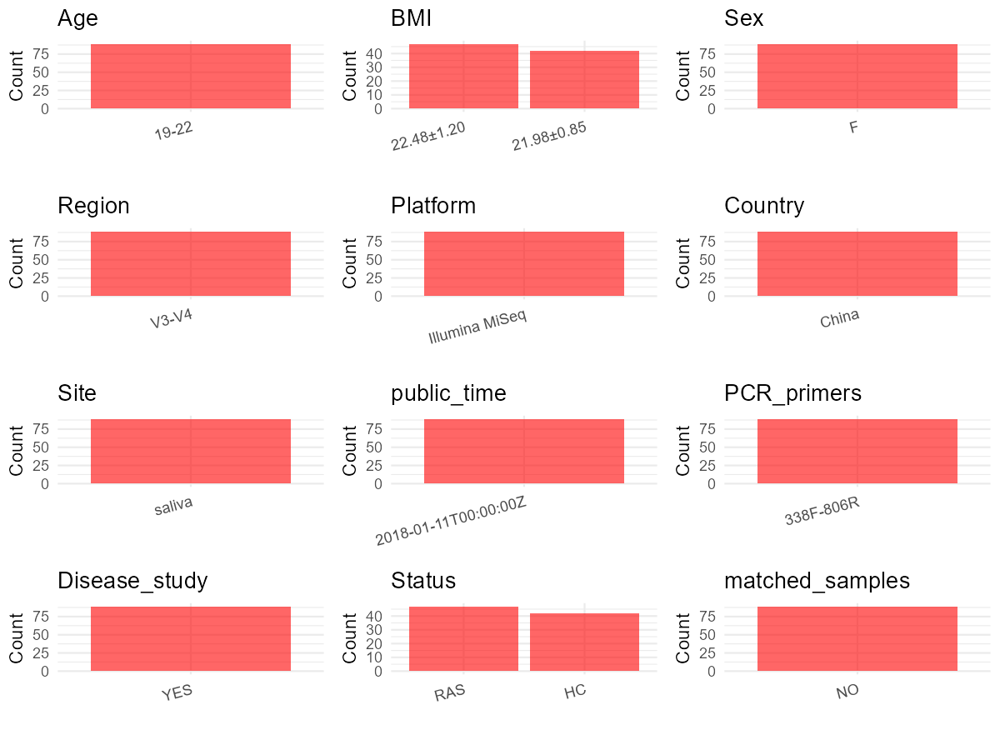

R Notebook: Metadata Processing Workflow
================

# Step 1: Obtain Initial Metadata from Each Project

To obtain the initial metadata: 1. Search for the BioProject ID (e.g.,
“PRJEBXXXX”) on the [NCBI SRA
website](https://www.ncbi.nlm.nih.gov/Traces/study/). 2. In the “Select”
table, click on “Metadata” and download the file. 3. The downloaded file
is typically named “SraRunTable.csv” and contains metadata for the
project.

``` r
# Load necessary libraries
library(dplyr)
library(ggplot2)
library(cowplot)

# Set working directory (update this path to your local directory)
setwd("D:/oral_project/PRJNA413647")

# Read the initial metadata files
initial_meta<-read.csv("SraRunTable.csv",header = T)

# Combine the two metadata files
#meta <- rbind(initial_meta, initial_meta1)

#Remove entries non-oral samples
#initial_meta <- subset(initial_meta,isolate %in% c("saliva","tongue coat"))

# Check the number of samples containing "HT" in Sample.Name (e.g., healthy controls)
#nrow(subset(meta, grepl("HT", Sample.Name)))

# Display the first few rows of the metadata
head(initial_meta)
```

    ##          Run Assay.Type AvgSpotLen   Bases  BioProject    BioSample
    ## 1 SRR6148380   AMPLICON        494 7271855 PRJNA413647 SAMN07759816
    ## 2 SRR6148381   AMPLICON        494 7410668 PRJNA413647 SAMN07759815
    ## 3 SRR6148382   AMPLICON        495    3465 PRJNA413647 SAMN07759818
    ## 4 SRR6148383   AMPLICON        494   11373 PRJNA413647 SAMN07759817
    ## 5 SRR6148384   AMPLICON        494 6408746 PRJNA413647 SAMN07759820
    ## 6 SRR6148385   AMPLICON        494 6120524 PRJNA413647 SAMN07759819
    ##                BioSampleModel   Bytes                         Center.Name
    ## 1 Metagenome or environmental 3321550 ZHEJIANG CHINESE MEDICAL UNIVERSITY
    ## 2 Metagenome or environmental 3341498 ZHEJIANG CHINESE MEDICAL UNIVERSITY
    ## 3 Metagenome or environmental   81284 ZHEJIANG CHINESE MEDICAL UNIVERSITY
    ## 4 Metagenome or environmental   85256 ZHEJIANG CHINESE MEDICAL UNIVERSITY
    ## 5 Metagenome or environmental 2855893 ZHEJIANG CHINESE MEDICAL UNIVERSITY
    ## 6 Metagenome or environmental 2718925 ZHEJIANG CHINESE MEDICAL UNIVERSITY
    ##   Collection_Date Consent DATASTORE.filetype DATASTORE.provider
    ## 1      2016-04-21  public   fastq,run.zq,sra         gs,ncbi,s3
    ## 2      2016-04-21  public   fastq,run.zq,sra         gs,ncbi,s3
    ## 3      2016-04-21  public   fastq,run.zq,sra         gs,ncbi,s3
    ## 4      2016-04-21  public   fastq,run.zq,sra         gs,ncbi,s3
    ## 5      2016-04-21  public   fastq,run.zq,sra         gs,ncbi,s3
    ## 6      2016-04-21  public   fastq,run.zq,sra         gs,ncbi,s3
    ##                       DATASTORE.region Experiment geo_loc_name_country
    ## 1 gs.us-east1,ncbi.public,s3.us-east-1 SRX3260488                China
    ## 2 gs.us-east1,ncbi.public,s3.us-east-1 SRX3260487                China
    ## 3 gs.us-east1,ncbi.public,s3.us-east-1 SRX3260486                China
    ## 4 gs.us-east1,ncbi.public,s3.us-east-1 SRX3260485                China
    ## 5 gs.us-east1,ncbi.public,s3.us-east-1 SRX3260484                China
    ## 6 gs.us-east1,ncbi.public,s3.us-east-1 SRX3260483                China
    ##   geo_loc_name_country_continent   geo_loc_name     Instrument
    ## 1                           Asia China:Zhejiang Illumina MiSeq
    ## 2                           Asia China:Zhejiang Illumina MiSeq
    ## 3                           Asia China:Zhejiang Illumina MiSeq
    ## 4                           Asia China:Zhejiang Illumina MiSeq
    ## 5                           Asia China:Zhejiang Illumina MiSeq
    ## 6                           Asia China:Zhejiang Illumina MiSeq
    ##       isolation_source          lat_lon Library.Name LibraryLayout
    ## 1 Human 22 oral saliva 30.14 N 120.10 E          T22        PAIRED
    ## 2 Human 21 oral saliva 30.14 N 120.10 E          T21        PAIRED
    ## 3 Human 24 oral saliva 30.14 N 120.10 E          T24        PAIRED
    ## 4 Human 23 oral saliva 30.14 N 120.10 E          T23        PAIRED
    ## 5 Human 26 oral saliva 30.14 N 120.10 E          T26        PAIRED
    ## 6 Human 25 oral saliva 30.14 N 120.10 E          T25        PAIRED
    ##   LibrarySelection LibrarySource              Organism Platform
    ## 1              PCR   METAGENOMIC human oral metagenome ILLUMINA
    ## 2              PCR   METAGENOMIC human oral metagenome ILLUMINA
    ## 3              PCR   METAGENOMIC human oral metagenome ILLUMINA
    ## 4              PCR   METAGENOMIC human oral metagenome ILLUMINA
    ## 5              PCR   METAGENOMIC human oral metagenome ILLUMINA
    ## 6              PCR   METAGENOMIC human oral metagenome ILLUMINA
    ##            ReleaseDate          create_date version Sample.Name SRA.Study
    ## 1 2018-01-11T00:00:00Z 2017-10-09T04:29:00Z       1         T22 SRP119591
    ## 2 2018-01-11T00:00:00Z 2017-10-09T04:29:00Z       1         T21 SRP119591
    ## 3 2018-01-11T00:00:00Z 2017-10-09T04:29:00Z       1         T24 SRP119591
    ## 4 2018-01-11T00:00:00Z 2017-10-09T04:29:00Z       1         T23 SRP119591
    ## 5 2018-01-11T00:00:00Z 2017-10-09T04:29:00Z       1         T26 SRP119591
    ## 6 2018-01-11T00:00:00Z 2017-10-09T04:29:00Z       1         T25 SRP119591

# Step 2: Create a Uniform Metadata Template

The uniform metadata should include the following columns:

1.  **BioProject**: Project ID (e.g., “PRJNA339212”)
2.  **Run**: Sample ID (e.g., “ERRXXXXXX” or “SRRXXXXXX”)
3.  **sample_name**: Original sample name submitted by the authors (not
    the database-assigned ID)
4.  **Age**: Age of the subject (if available)
5.  **BMI**: Body Mass Index (if available)
6.  **Sex**: Sex of the subject (“F” or “M”)
7.  **Region**: Targeted 16S rRNA region (e.g., “V3-V4”)
8.  **Platform**: Sequencing platform (e.g., “Illumina MiSeq”)
9.  **Country**: Country of sample origin (e.g., “China”)
10. **Site**: Sample site (e.g., “saliva”, “dental plaque”)
11. **public_time**: Data release date (format: “YYYY-MM-DD”)
12. **PCR_primers**: PCR primers used (e.g., “515F-806R”)
13. **title**: Title of the associated publication
14. **Disease_study**: Whether the study involves a disease (“YES” or
    “NO”)
15. **Status**: Disease status (e.g., “T2DM”, “HC”). Note: If the study
    includes both disease and healthy samples, this must be specified
    per sample.
16. **matched_samples**: matched samples (“YES” or “NO”)

``` r
# Create a uniform metadata dataframe
metadata <- data.frame(
  BioProject = initial_meta$BioProject,
  Run = initial_meta$Run,
  sample_name = initial_meta$Sample.Name,
  Age = "19-22",
  #BMI = NA,
  Sex = "F",
  Region = "V3-V4",
  Platform = initial_meta$Instrument,
  Country = initial_meta$geo_loc_name_country,
  Site = replace(initial_meta$Organism, initial_meta$Organism == "human oral metagenome", "saliva"),
  public_time = initial_meta$ReleaseDate,
  stringsAsFactors = FALSE
)
```

# Step 3: Manually Add Information from the Publication

Some information (e.g. PCR primers, study title, disease status) must be
manually extracted from the publication and added to the metadata.

``` r
# Add information obtained from the publication
metadata$PCR_primers <- "338F-806R"
metadata$title <- "Altered oral microbiota composition associated with recurrent aphthous stomatitis in young females"
metadata$Disease_study <- "YES"
# Assign disease status based on sample_name patterns
metadata <- metadata %>%
  mutate(Status = case_when(
    grepl("NO", sample_name) ~ "HC",
    grepl("T", sample_name) ~ "RAS"
  ))
metadata <- metadata %>%
  mutate(BMI = case_when(
    grepl("NO", sample_name) ~ "21.98±0.85",
    grepl("T", sample_name) ~ "22.48±1.20"
  ))
#get subjects id according to sample id
metadata$sample_name<-gsub("T|NO","",metadata$sample_name)
#get subjects id with Saliva available
keep_subjects<-subset(metadata,Site %in% "saliva")
#remove subjects without Saliva samples
metadata<-subset(metadata,sample_name %in% keep_subjects$sample_name)
#get subjects sampling counts
sample_counts <- table(metadata$sample_name)
# Create matched_samples column, any subjects have >=2 samples will be label "YES", otherwise "NO"
metadata <- metadata %>%
  group_by(sample_name) %>%
  mutate(
    sample_count = n(),
    unique_sites = n_distinct(Site),
    matched_samples = ifelse(sample_count >= 2 & unique_sites >= 2, "YES", "NO")
  ) 
```

# Step 4: Summarize and Validate the Metadata

``` r
# Check the number of unique runs and sample names
print(paste("Number of unique runs:", length(unique(metadata$Run))))
```

    ## [1] "Number of unique runs: 89"

``` r
print(paste("Number of unique sample names:", length(unique(metadata$sample_name))))
```

    ## [1] "Number of unique sample names: 47"

# Step 5: Visualize the Metadata

``` r

```


# Step 6: Finalize and Export the Metadata

``` r
# Reorder columns to match the desired format
metadata <- metadata[, c(
  "BioProject", "Run", "sample_name", "Age", "BMI", "Sex", 
  "Region", "Platform", "Country", "Site", "public_time", 
  "PCR_primers", "title", "Disease_study", "Status","matched_samples"
)]

# Export the uniform metadata to a CSV file
write.csv(metadata, file = "metadata.csv", quote = TRUE)
head(metadata)
```

    ## # A tibble: 6 × 16
    ## # Groups:   sample_name [6]
    ##   BioProject  Run    sample_name Age   BMI   Sex   Region Platform Country Site 
    ##   <chr>       <chr>  <chr>       <chr> <chr> <chr> <chr>  <chr>    <chr>   <chr>
    ## 1 PRJNA413647 SRR61… 22          19-22 22.4… F     V3-V4  Illumin… China   sali…
    ## 2 PRJNA413647 SRR61… 21          19-22 22.4… F     V3-V4  Illumin… China   sali…
    ## 3 PRJNA413647 SRR61… 24          19-22 22.4… F     V3-V4  Illumin… China   sali…
    ## 4 PRJNA413647 SRR61… 23          19-22 22.4… F     V3-V4  Illumin… China   sali…
    ## 5 PRJNA413647 SRR61… 26          19-22 22.4… F     V3-V4  Illumin… China   sali…
    ## 6 PRJNA413647 SRR61… 25          19-22 22.4… F     V3-V4  Illumin… China   sali…
    ## # ℹ 6 more variables: public_time <chr>, PCR_primers <chr>, title <chr>,
    ## #   Disease_study <chr>, Status <chr>, matched_samples <chr>

## Notes for Students:

1.  **Metadata Accuracy**: Always cross-check the metadata with the
    original publication to ensure accuracy.
2.  **Manual Entries**: Columns like `PCR_primers`, and `Status` often
    require manual entry based on the publication.
3.  **Disease Status**: Be careful when assigning `Status`—some studies
    include both disease and healthy samples.
4.  **Visualization**: The plots help quickly identify the distribution
    of values in each column, which is useful for quality control.
5.  **Reproducibility**: Update the working directory and file paths to
    match your local environment.
