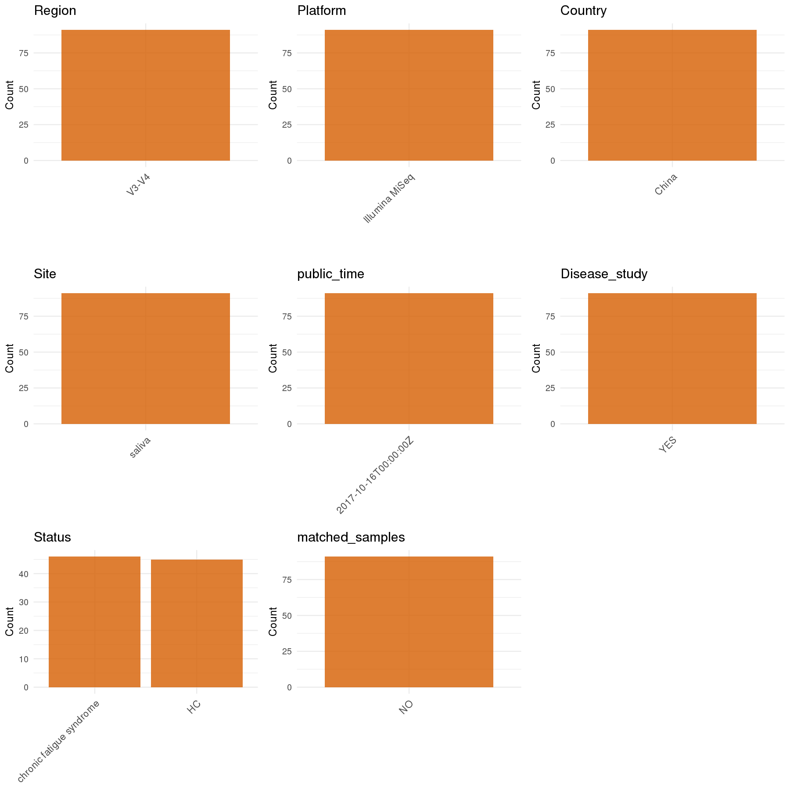

# Step 1: Obtain Initial Metadata from Each Project

To obtain the initial metadata: 1. Search for the BioProject ID (e.g., "PRJEBXXXX") on the [NCBI SRA website](https://www.ncbi.nlm.nih.gov/Traces/study/). 2. In the "Select" table, click on "Metadata" and download the file. 3. The downloaded file is typically named "SraRunTable.csv" and contains metadata for the project.

```{r message=FALSE, warning=FALSE}
# Load necessary libraries
library(dplyr)
library(ggplot2)
library(cowplot)
library(readxl)

# Set working directory (update this path to your local directory)
setwd("/home/cjj/projects/collect_oral_data/global-oral-microbiome/data/tmp/PRJNA414355")

# table1 <- read_excel("CRA006039.xlsx")
# write.csv(table1, "CRA006039.csv", row.names = FALSE)

initial_meta<-read.csv("SraRunTable.csv",header = T)
colnames(initial_meta)
# 
# # initial_meta <- initial_meta[grepl("16s", initial_meta$sample_name, ignore.case = TRUE), ]
# initial_meta$BioProject = initial_meta$Project.accession
# initial_meta$Run = initial_meta$Accession
head(initial_meta , n=8)


# table1 <- read_excel("Table 1.XLSX",)
# table2 <- read_excel("Table 1.XLSX",)
# head(table1 , n=3)
# head(table2 , n=3)
# ESM <- ESM[,c(1,3,4)]
# colnames(ESM) <- c("subject_id","Age","Sex")
# initial_meta_cbind <- left_join(initial_meta,ESM,by="subject_id")
# table(initial_meta_cbind$Age,initial_meta_cbind$Sex)
# Display the first few rows of the metadata
# head(initial_meta_cbind)
```

```{r}
# Create a uniform metadata dataframe
metadata <- data.frame(
  BioProject = initial_meta$BioProject,
  Run = initial_meta$Run,
  stringsAsFactors = FALSE
)
```

# Step 2: Create a Uniform Metadata Template

The uniform metadata should include the following columns:

1.  **BioProject**: Project ID (e.g., "PRJNA339212")
2.  **Run**: Sample ID (e.g., "ERRXXXXXX" or "SRRXXXXXX")
3.  **sample_name**: Original sample name submitted by the authors (not the database-assigned ID)
4.  **Age**: Age of the subject (if available)
5.  **BMI**: Body Mass Index (if available)
6.  **Sex**: Sex of the subject ("F" or "M")
7.  **Region**: Targeted 16S rRNA region (e.g., "V3-V4")
8.  **Platform**: Sequencing platform (e.g., "Illumina MiSeq")
9.  **Country**: Country of sample origin (e.g., "China")
10. **Site**: Sample site (e.g., "saliva", "dental plaque")
11. **public_time**: Data release date (format: "YYYY-MM-DD")
12. **PCR_primers**: PCR primers used (e.g., "515F-806R")
13. **title**: Title of the associated publication
14. **Disease_study**: Whether the study involves a disease ("YES" or "NO")
15. **Status**: Disease status (e.g., "T2DM", "HC"). Note: If the study includes both disease and healthy samples, this must be specified per sample.

```{r}
# Create a uniform metadata dataframe
metadata <- data.frame(
  BioProject = initial_meta$BioProject,
  Run = initial_meta$Run,
  sample_name = initial_meta$sample_name,
  Age = NA_character_,
  BMI = NA_character_,
  Sex= NA_character_,
  Region = "V3-V4",
  Platform = initial_meta$Instrument,
  Country = initial_meta$geo_loc_name_country,
  Site = initial_meta$sample_name,
  public_time = initial_meta$ReleaseDate,
  Disease_study = 'NO',
  Status = 'HC',
  stringsAsFactors = FALSE
)
```

# concat ohter info

```{r}
library(dplyr)
library(stringr)
library(readxl)
pattern <- "^16S_(\\d+)([A-Za-z]{1,2})(\\d{1,2})$"
extracted_parts <- str_match(metadata$sample_name, pattern)

#>      [,1]          [,2] [,3] [,4]
#> [1,] "16S_6O1"     "6"  "O"  "1" 
#> [2,] "16S_6O2"     "6"  "O"  "2" 
#> [3,] "16S_6O3"     "6"  "O"  "3" 
#> 
metadata <- metadata %>%
  mutate(
    sample_name = paste0(extracted_parts[, 2],'-', extracted_parts[, 4]), # 第2列是第一个捕获组
    Site = extracted_parts[, 3],                 # 第3列是第二个捕获组
  )
head(metadata , n=8)

info_path <- "/home/cjj/projects/collect_oral_data/global-oral-microbiome/data/tmp/PRJEB25916/msphere.00558-19-sd001.xlsx"
info_data <- read_excel(info_path)
colnames(info_data)
pattern_info <- "^[A-Za-z]_(\\d+)[A-Za-z](\\d+)$"
extracted_info <- str_match(info_data$Subject_ID, pattern_info)
head(extracted_info)

info_data <- info_data %>%
  # 创建新的 sample_name 列，格式为 "数字-数字"
  mutate(
    sample_name = paste(extracted_info[, 2], extracted_info[, 3], sep = "-")
  ) %>%
  # 选择并重命名我们需要的列
  select(
    sample_name, # 这是我们用来连接的 "钥匙"
    Age,
    Sex = Gender,
    BMI = BMIc
  )
head(info_data)

matching_logic <- metadata$sample_name %in% info_data$sample_name
number_of_matches <- sum(matching_logic)
print(number_of_matches)

conflicting_cols <- setdiff(colnames(info_data), "sample_name")

metadata <- metadata %>%
  # 步骤1: 从 metadata 中移除所有可能与 info_data_processed 冲突的列
  select(-any_of(conflicting_cols)) %>%
  
  # 步骤2: 现在执行 left_join，就不会有命名冲突了
  left_join(info_data, by = "sample_name")

head(metadata , n=8)

```

# 3: Manually Add Information from the Publication

Some information (e.g. PCR primers, study title, disease status) must be manually extracted from the publication and added to the metadata.

```{r}
# Add information obtained from the publication
metadata_clean <- metadata
metadata_clean$PCR_primers <- "5′-ACTCCTACGGGAGGCAGCAG-3′-5′-GGACTACHVGGGTWTCTAAT-3′"
metadata_clean$title <- "Age-Related Variation of Bacterial and Fungal Communities in Different Body Habitats across the Young, Elderly, and Centenarians in Sardinia"

metadata_clean$sample_name <- metadata$sample_name

# metadata_clean$Status <-  metadata$Status
metadata_clean$Status <- metadata$Status

metadata_clean$matched_samples <- "YES"
# metadata_clean$Sex <- ifelse(metadata_clean$Sex == "female", "F",
#                       ifelse(metadata_clean$Sex == "male", "M",metadata_clean$Sex))


# metadata_clean$Site <- ifelse(grepl("sal", metadata$Status), "saliva", "mucosa")

metadata_clean[which(metadata$Site=="L"),]$Site <- "left palm"
metadata_clean[which(metadata$Site=="R"),]$Site <- "right palm"
metadata_clean[which(metadata$Site=="F"),]$Site <- "forehead"
metadata_clean[which(metadata$Site=="U"),]$Site <- "umbilicus"
metadata_clean[which(metadata$Site=="O"),]$Site <- "oral cavity"
metadata_clean[which(metadata$Site=="OW"),]$Site <- "oral cavity"
metadata_clean[which(metadata$Site=="G"),]$Site <- "gut"


# Use cleaned dataset for subsequent analysis
metadata <- metadata_clean
```

# Step 4: Summarize and Validate the Metadata

```{r}
# Check the number of unique runs and sample names
print(paste("Number of unique runs:", length(unique(metadata$Run))))
print(paste("Number of unique sample names:", length(unique(metadata$sample_name))))
```

# Step 5: Visualize the Metadata

```{r, fig.width=8, fig.height=16, fig.align='center', include=FALSE}
# 加载必要的包
library(dplyr)
library(ggplot2)
library(cowplot)

# 1. 准备数据
plot_data <- metadata %>%
  select(
    -any_of(c("BioProject", "Run", "sample_name", "title","PCR_primers"))
  ) %>%
  select(where(~!all(is.na(.))))

# 2. 循环绘图
plots <- list()
for (col_name in names(plot_data)) {
  if (is.numeric(plot_data[[col_name]])) {
    p <- ggplot(plot_data, aes(x = .data[[col_name]])) +
      geom_histogram(bins = 20, fill = "#0072B2", alpha = 0.7, na.rm = TRUE) +
      labs(title = col_name, x = NULL) +
      theme_minimal(base_size = 16)
  } else {
    p <- plot_data %>%
      count(.data[[col_name]], sort = TRUE, name = "Count") %>%
      ggplot(aes(x = reorder(.data[[col_name]], -Count), y = Count)) +
      geom_col(fill = "#D55E00", alpha = 0.8) +
      labs(title = col_name, x = NULL, y = "Count") +
      theme_minimal(base_size = 12) +
      theme(axis.text.x = element_text(angle = 45, hjust = 1, size = 11))
  }
  plots[[col_name]] <- p
}

# 3. 【已修复】自动组合并动态调整尺寸后保存
if (length(plots) > 0) {
  
  # --- 这是你需要添加的关键部分 ---
  n_plots <- length(plots)
  n_cols <- 3 
  n_rows <- ceiling(n_plots / n_cols) 
  # 根据行数动态设置输出图片的高度 (例如，每行给4英寸)
  dynamic_height <- n_rows * 4 
  
  p_final <- plot_grid(plotlist = plots, ncol = n_cols, align = "hv")
  
  # 使用动态计算出的高度来保存图像
  ggsave("Metadata_Summary.png", plot = p_final, width = 12, height = dynamic_height, dpi = 150, bg = "white")
  
  print(paste("图像已生成, 动态高度为:", dynamic_height))
  
} else {
  print("没有可以绘制的列。")
}
```

```{r}

```

# Step 6: Finalize and Export the Metadata

```{r}
# Reorder columns to match the desired format
metadata <- metadata[, c(
  "BioProject", "Run", "sample_name", "Age", "BMI", "Sex", 
  "Region", "Platform", "Country", "Site", "public_time", 
  "PCR_primers", "title", "Disease_study", "Status","matched_samples"
)]

# Export the uniform metadata to a CSV file
write.csv(metadata, file = "metadata.csv", quote = TRUE)
head(metadata)
```

```{r}
# Reorder columns to match the desired format
metadata <- metadata[, c(
  "BioProject", "Run"
)]

# Export the uniform metadata to a CSV file
write.csv(metadata, file = "metadata.csv", quote = TRUE)
head(metadata)
```

## Notes for Students:

1.  **Metadata Accuracy**: Always cross-check the metadata with the original publication to ensure accuracy.
2.  **Manual Entries**: Columns like `PCR_primers`, and `Status` often require manual entry based on the publication.
3.  **Disease Status**: Be careful when assigning `Status`—some studies include both disease and healthy samples.
4.  **Visualization**: The plots help quickly identify the distribution of values in each column, which is useful for quality control.
5.  **Reproducibility**: Update the working directory and file paths to match your local environment.
