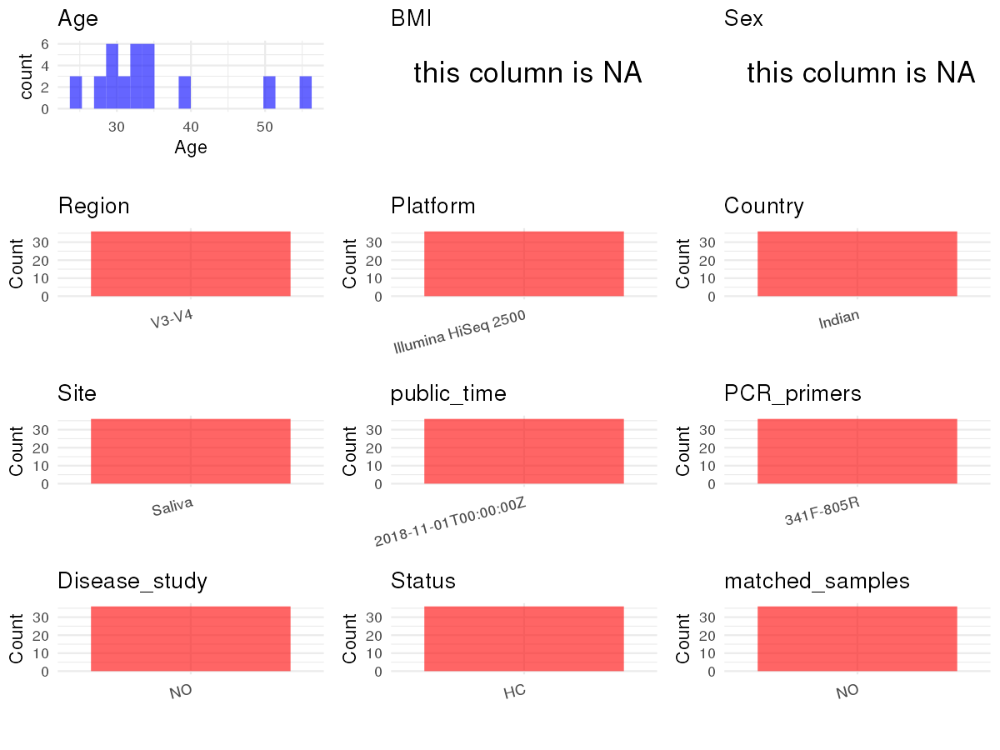

R Notebook: Metadata Processing Workflow
================

# Step 1: Obtain Initial Metadata from Each Project

To obtain the initial metadata: 1. Search for the BioProject ID (e.g.,
“PRJEBXXXX”) on the [NCBI SRA
website](https://www.ncbi.nlm.nih.gov/Traces/study/). 2. In the “Select”
table, click on “Metadata” and download the file. 3. The downloaded file
is typically named “SraRunTable.csv” and contains metadata for the
project.

``` r
# Load necessary libraries
library(dplyr)
library(ggplot2)
library(cowplot)
library(readxl)

# Set working directory (update this path to your local directory)
setwd("/home/dongbiao/word_embedding_microbiome/all_data/oral/global-oral-microbiome/data/projects/PRJNA419274")

# Read the initial metadata files
initial_meta<-read.csv("SraRunTable.csv")

head(initial_meta)
```

    ##          Run age                            aliquot Assay.Type AvgSpotLen
    ## 1 SRR6311992  29  Biological replicate 2 of sample4      OTHER        507
    ## 2 SRR6311993  24  Biological replicate 2 of sample3      OTHER        508
    ## 3 SRR6311994  28  Biological replicate 2 of sample6      OTHER        518
    ## 4 SRR6311995  51  Biological replicate 2 of sample5      OTHER        512
    ## 5 SRR6311996  31 Biological replicate 1 of sample12      OTHER        494
    ## 6 SRR6311997  34 Biological replicate 1 of sample11      OTHER        494
    ##      Bases
    ## 1 64730476
    ## 2 62130140
    ## 3 48885216
    ## 4 55495950
    ## 5 66357202
    ## 6 62085692
    ##                                                                                                    BIOMATERIAL_PROVIDER
    ## 1 Immunomodulation division\\, Defence Institute of Physiology and Allied Sciences\\, Lucknow road Timarpur\\, delhi-54
    ## 2 Immunomodulation division\\, Defence Institute of Physiology and Allied Sciences\\, Lucknow road Timarpur\\, delhi-54
    ## 3 Immunomodulation division\\, Defence Institute of Physiology and Allied Sciences\\, Lucknow road Timarpur\\, delhi-54
    ## 4 Immunomodulation division\\, Defence Institute of Physiology and Allied Sciences\\, Lucknow road Timarpur\\, delhi-54
    ## 5 Immunomodulation division\\, Defence Institute of Physiology and Allied Sciences\\, Lucknow road Timarpur\\, delhi-54
    ## 6 Immunomodulation division\\, Defence Institute of Physiology and Allied Sciences\\, Lucknow road Timarpur\\, delhi-54
    ##    BioProject    BioSample BioSampleModel    Bytes Center.Name Consent
    ## 1 PRJNA419274 SAMN08048843          Human 36241016       DIPAS  public
    ## 2 PRJNA419274 SAMN08048842          Human 34871372       DIPAS  public
    ## 3 PRJNA419274 SAMN08048845          Human 27415778       DIPAS  public
    ## 4 PRJNA419274 SAMN08048844          Human 31076260       DIPAS  public
    ## 5 PRJNA419274 SAMN08048839          Human 34631167       DIPAS  public
    ## 6 PRJNA419274 SAMN08048838          Human 32956605       DIPAS  public
    ##   DATASTORE.filetype DATASTORE.provider                     DATASTORE.region
    ## 1   fastq,run.zq,sra         gs,ncbi,s3 gs.us-east1,ncbi.public,s3.us-east-1
    ## 2   fastq,run.zq,sra         gs,ncbi,s3 gs.us-east1,ncbi.public,s3.us-east-1
    ## 3   fastq,run.zq,sra         gs,ncbi,s3 gs.us-east1,ncbi.public,s3.us-east-1
    ## 4   fastq,run.zq,sra         gs,ncbi,s3 gs.us-east1,ncbi.public,s3.us-east-1
    ## 5   fastq,run.zq,sra         gs,ncbi,s3 gs.us-east1,ncbi.public,s3.us-east-1
    ## 6   fastq,run.zq,sra         gs,ncbi,s3 gs.us-east1,ncbi.public,s3.us-east-1
    ##   Experiment          Instrument                        isolate Library.Name
    ## 1 SRX3412289 Illumina HiSeq 2500 34th (ISEA) Expedition members           B4
    ## 2 SRX3412288 Illumina HiSeq 2500 34th (ISEA) Expedition members           B3
    ## 3 SRX3412287 Illumina HiSeq 2500 34th (ISEA) Expedition members           B6
    ## 4 SRX3412286 Illumina HiSeq 2500 34th (ISEA) Expedition members           B5
    ## 5 SRX3412285 Illumina HiSeq 2500 34th (ISEA) Expedition members          A12
    ## 6 SRX3412284 Illumina HiSeq 2500 34th (ISEA) Expedition members          A11
    ##   LibraryLayout   LibrarySelection LibrarySource     Organism Platform
    ## 1        PAIRED size fractionation   METAGENOMIC Homo sapiens ILLUMINA
    ## 2        PAIRED size fractionation   METAGENOMIC Homo sapiens ILLUMINA
    ## 3        PAIRED size fractionation   METAGENOMIC Homo sapiens ILLUMINA
    ## 4        PAIRED size fractionation   METAGENOMIC Homo sapiens ILLUMINA
    ## 5        PAIRED size fractionation   METAGENOMIC Homo sapiens ILLUMINA
    ## 6        PAIRED size fractionation   METAGENOMIC Homo sapiens ILLUMINA
    ##            ReleaseDate          create_date version Sample.Name  sex SRA.Study
    ## 1 2018-11-01T00:00:00Z 2017-11-27T11:34:00Z       1          B4 male SRP125370
    ## 2 2018-11-01T00:00:00Z 2017-11-27T11:34:00Z       1          B3 male SRP125370
    ## 3 2018-11-01T00:00:00Z 2017-11-27T11:33:00Z       1          B6 male SRP125370
    ## 4 2018-11-01T00:00:00Z 2017-11-27T11:34:00Z       1          B5 male SRP125370
    ## 5 2018-11-01T00:00:00Z 2017-11-21T15:30:00Z       1         A12 male SRP125370
    ## 6 2018-11-01T00:00:00Z 2017-11-21T15:30:00Z       1         A11 male SRP125370
    ##   tissue
    ## 1 Saliva
    ## 2 Saliva
    ## 3 Saliva
    ## 4 Saliva
    ## 5 Saliva
    ## 6 Saliva

# Step 2: Create a Uniform Metadata Template

The uniform metadata should include the following columns:

1.  **BioProject**: Project ID (e.g., “PRJNA339212”)
2.  **Run**: Sample ID (e.g., “ERRXXXXXX” or “SRRXXXXXX”)
3.  **sample_name**: Original sample name submitted by the authors (not
    the database-assigned ID)
4.  **Age**: Age of the subject (if available)
5.  **BMI**: Body Mass Index (if available)
6.  **Sex**: Sex of the subject (“F” or “M”)
7.  **Region**: Targeted 16S rRNA region (e.g., “V3-V4”)
8.  **Platform**: Sequencing platform (e.g., “Illumina MiSeq”)
9.  **Country**: Country of sample origin (e.g., “China”)
10. **Site**: Sample site (e.g., “saliva”, “dental plaque”)
11. **public_time**: Data release date (format: “YYYY-MM-DD”)
12. **PCR_primers**: PCR primers used (e.g., “515F-806R”)
13. **title**: Title of the associated publication
14. **Disease_study**: Whether the study involves a disease (“YES” or
    “NO”)
15. **Status**: Disease status (e.g., “T2DM”, “HC”). Note: If the study
    includes both disease and healthy samples, this must be specified
    per sample.

``` r
# Create a uniform metadata dataframe
metadata <- data.frame(
  BioProject = initial_meta$BioProject,
  Run = initial_meta$Run,
  sample_name = initial_meta$Sample.Name,
  Age = initial_meta$age,
  BMI = NA,
  Sex=NA,
  Region = "V3-V4",
  Platform = initial_meta$Instrument,
  Country = "Indian",
  Site = "Saliva",
  public_time = initial_meta$ReleaseDate,
  stringsAsFactors = FALSE
)
metadata<-unique(metadata)
```

# Step 3: Manually Add Information from the Publication

Some information (e.g. PCR primers, study title, disease status) must be
manually extracted from the publication and added to the metadata.

``` r
# Add information obtained from the publication
metadata$PCR_primers <- "341F-805R"
metadata$title <- "Diversity and functional analysis of salivary microflora of Indian Antarctic expeditionaries"
metadata$Disease_study <- "NO"

# Assign disease status based on sample_name patterns
metadata$Status <- "HC"
metadata$matched_samples <- "NO"
```

# Step 4: Summarize and Validate the Metadata

``` r
# Check the number of unique runs and sample names
print(paste("Number of unique runs:", length(unique(metadata$Run))))
```

    ## [1] "Number of unique runs: 36"

``` r
print(paste("Number of unique sample names:", length(unique(metadata$sample_name))))
```

    ## [1] "Number of unique sample names: 36"

# Step 5: Visualize the Metadata

``` r

```


# Step 6: Finalize and Export the Metadata

``` r
# Reorder columns to match the desired format
metadata <- metadata[, c(
  "BioProject", "Run", "sample_name", "Age", "BMI", "Sex", 
  "Region", "Platform", "Country", "Site", "public_time", 
  "PCR_primers", "title", "Disease_study", "Status","matched_samples"
)]

# Export the uniform metadata to a CSV file
metadata<-unique(metadata)
write.csv(metadata, file = "metadata.csv", quote = FALSE)
head(metadata)
```

    ##    BioProject        Run sample_name Age BMI Sex Region            Platform
    ## 1 PRJNA419274 SRR6311992          B4  29  NA  NA  V3-V4 Illumina HiSeq 2500
    ## 2 PRJNA419274 SRR6311993          B3  24  NA  NA  V3-V4 Illumina HiSeq 2500
    ## 3 PRJNA419274 SRR6311994          B6  28  NA  NA  V3-V4 Illumina HiSeq 2500
    ## 4 PRJNA419274 SRR6311995          B5  51  NA  NA  V3-V4 Illumina HiSeq 2500
    ## 5 PRJNA419274 SRR6311996         A12  31  NA  NA  V3-V4 Illumina HiSeq 2500
    ## 6 PRJNA419274 SRR6311997         A11  34  NA  NA  V3-V4 Illumina HiSeq 2500
    ##   Country   Site          public_time PCR_primers
    ## 1  Indian Saliva 2018-11-01T00:00:00Z   341F-805R
    ## 2  Indian Saliva 2018-11-01T00:00:00Z   341F-805R
    ## 3  Indian Saliva 2018-11-01T00:00:00Z   341F-805R
    ## 4  Indian Saliva 2018-11-01T00:00:00Z   341F-805R
    ## 5  Indian Saliva 2018-11-01T00:00:00Z   341F-805R
    ## 6  Indian Saliva 2018-11-01T00:00:00Z   341F-805R
    ##                                                                                          title
    ## 1 Diversity and functional analysis of salivary microflora of Indian Antarctic expeditionaries
    ## 2 Diversity and functional analysis of salivary microflora of Indian Antarctic expeditionaries
    ## 3 Diversity and functional analysis of salivary microflora of Indian Antarctic expeditionaries
    ## 4 Diversity and functional analysis of salivary microflora of Indian Antarctic expeditionaries
    ## 5 Diversity and functional analysis of salivary microflora of Indian Antarctic expeditionaries
    ## 6 Diversity and functional analysis of salivary microflora of Indian Antarctic expeditionaries
    ##   Disease_study Status matched_samples
    ## 1            NO     HC              NO
    ## 2            NO     HC              NO
    ## 3            NO     HC              NO
    ## 4            NO     HC              NO
    ## 5            NO     HC              NO
    ## 6            NO     HC              NO

## Notes for Students:

1.  **Metadata Accuracy**: Always cross-check the metadata with the
    original publication to ensure accuracy.
2.  **Manual Entries**: Columns like `PCR_primers`, and `Status` often
    require manual entry based on the publication.
3.  **Disease Status**: Be careful when assigning `Status`—some studies
    include both disease and healthy samples.
4.  **Visualization**: The plots help quickly identify the distribution
    of values in each column, which is useful for quality control.
5.  **Reproducibility**: Update the working directory and file paths to
    match your local environment.
