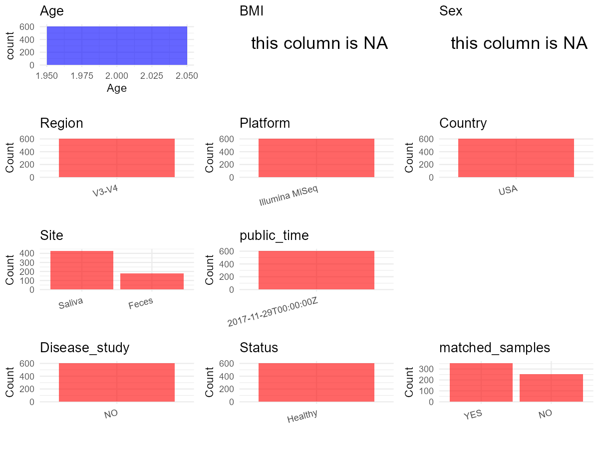

R Notebook: Metadata Processing Workflow
================

# Step 1: Obtain Initial Metadata from Each Project

To obtain the initial metadata: 1. Search for the BioProject ID (e.g.,
“PRJEBXXXX”) on the [NCBI SRA
website](https://www.ncbi.nlm.nih.gov/Traces/study/). 2. In the “Select”
table, click on “Metadata” and download the file. 3. The downloaded file
is typically named “SraRunTable.csv” and contains metadata for the
project.

``` r
# Load necessary libraries
library(dplyr)
library(ggplot2)
library(cowplot)

# Set working directory (update this path to your local directory)
setwd("D:/oral_project/PRJNA420339")

# Read the initial metadata files
initial_meta<-read.csv("SraRunTable.csv",header = T)

# Combine the two metadata files
#meta <- rbind(initial_meta, initial_meta1)

#Remove entries where Organism is "gut metagenome" (non-oral samples)
#initial_meta <- subset(initial_meta,isolation_source!= "feces")

# Check the number of samples containing "HT" in Sample.Name (e.g., healthy controls)
#nrow(subset(meta, grepl("HT", Sample.Name)))

# Display the first few rows of the metadata
head(initial_meta)
```

    ##          Run Assay.Type AvgSpotLen     Bases  BioProject    BioSample
    ## 1 SRR6330872   AMPLICON        602 139641124 PRJNA420339 SAMN08108998
    ## 2 SRR6330873   AMPLICON        600  64841114 PRJNA420339 SAMN08109137
    ## 3 SRR6330874   AMPLICON        600 145788738 PRJNA420339 SAMN08108917
    ## 4 SRR6330875   AMPLICON        600 201176444 PRJNA420339 SAMN08108975
    ## 5 SRR6330876   AMPLICON        601 123869104 PRJNA420339 SAMN08109446
    ## 6 SRR6330877   AMPLICON        600 137930315 PRJNA420339 SAMN08109206
    ##                                      BioSampleModel     Bytes
    ## 1 MIMARKS.survey,MIGS/MIMS/MIMARKS.human-associated  90441844
    ## 2 MIMARKS.survey,MIGS/MIMS/MIMARKS.human-associated  43354575
    ## 3 MIMARKS.survey,MIGS/MIMS/MIMARKS.human-associated  98188433
    ## 4 MIMARKS.survey,MIGS/MIMS/MIMARKS.human-associated 129519074
    ## 5 MIMARKS.survey,MIGS/MIMS/MIMARKS.human-associated  74202484
    ## 6 MIMARKS.survey,MIGS/MIMS/MIMARKS.human-associated  96501594
    ##             Center.Name Collection_Date Consent DATASTORE.filetype
    ## 1 PENN STATE UNIVERISTY  not applicable  public   fastq,run.zq,sra
    ## 2 PENN STATE UNIVERISTY  not applicable  public   fastq,run.zq,sra
    ## 3 PENN STATE UNIVERISTY  not applicable  public   fastq,run.zq,sra
    ## 4 PENN STATE UNIVERISTY  not applicable  public   fastq,run.zq,sra
    ## 5 PENN STATE UNIVERISTY  not applicable  public   fastq,run.zq,sra
    ## 6 PENN STATE UNIVERISTY  not applicable  public   fastq,run.zq,sra
    ##   DATASTORE.provider                     DATASTORE.region      env_biome
    ## 1         gs,ncbi,s3 gs.us-east1,ncbi.public,s3.us-east-1 not applicable
    ## 2         gs,ncbi,s3 gs.us-east1,ncbi.public,s3.us-east-1 not applicable
    ## 3         gs,ncbi,s3 gs.us-east1,ncbi.public,s3.us-east-1 not applicable
    ## 4         gs,ncbi,s3 gs.us-east1,ncbi.public,s3.us-east-1 not applicable
    ## 5         gs,ncbi,s3 gs.us-east1,ncbi.public,s3.us-east-1 not applicable
    ## 6         gs,ncbi,s3 gs.us-east1,ncbi.public,s3.us-east-1 not applicable
    ##   env_feature env_material Experiment geo_loc_name_country
    ## 1        Oral  Buccal Swab SRX3430623         uncalculated
    ## 2        Oral  Buccal Swab SRX3430622         uncalculated
    ## 3         Gut        Stool SRX3430621         uncalculated
    ## 4         Gut        Stool SRX3430620         uncalculated
    ## 5        Oral  Buccal Swab SRX3430619         uncalculated
    ## 6        Oral  Buccal Swab SRX3430618         uncalculated
    ##   geo_loc_name_country_continent   geo_loc_name           host_age
    ## 1                   uncalculated not applicable child 2-year visit
    ## 2                   uncalculated not applicable child 2-year visit
    ## 3                   uncalculated not applicable child 2-year visit
    ## 4                   uncalculated not applicable child 2-year visit
    ## 5                   uncalculated not applicable child 2-year visit
    ## 6                   uncalculated not applicable child 2-year visit
    ##   host_family_relationship         HOST host_subject_id     Instrument
    ## 1             child (self) Homo sapiens            873C Illumina MiSeq
    ## 2             child (self) Homo sapiens            154C Illumina MiSeq
    ## 3             child (self) Homo sapiens            154C Illumina MiSeq
    ## 4             child (self) Homo sapiens            379C Illumina MiSeq
    ## 5                   mother Homo sapiens            379M Illumina MiSeq
    ## 6             child (self) Homo sapiens            280C Illumina MiSeq
    ##   Library.Name LibraryLayout LibrarySelection LibrarySource
    ## 1    873C_oral        PAIRED              PCR   METAGENOMIC
    ## 2    154C_oral        PAIRED              PCR   METAGENOMIC
    ## 3     154C_gut        PAIRED              PCR   METAGENOMIC
    ## 4     379C_gut        PAIRED              PCR   METAGENOMIC
    ## 5    379M_oral        PAIRED              PCR   METAGENOMIC
    ## 6    280C_oral        PAIRED              PCR   METAGENOMIC
    ##                Organism Platform          ReleaseDate Sample.Name SRA.Study
    ## 1 human oral metagenome ILLUMINA 2017-11-29T00:00:00Z        S233 SRP125841
    ## 2 human oral metagenome ILLUMINA 2017-11-29T00:00:00Z        S367 SRP125841
    ## 3  human gut metagenome ILLUMINA 2017-11-29T00:00:00Z        S141 SRP125841
    ## 4  human gut metagenome ILLUMINA 2017-11-29T00:00:00Z        S209 SRP125841
    ## 5 human oral metagenome ILLUMINA 2017-11-29T00:00:00Z        S661 SRP125841
    ## 6 human oral metagenome ILLUMINA 2017-11-29T00:00:00Z        S433 SRP125841
    ##            create_date version
    ## 1 2017-11-29T18:35:00Z       1
    ## 2 2017-11-29T18:35:00Z       1
    ## 3 2017-11-29T18:35:00Z       1
    ## 4 2017-11-29T18:36:00Z       1
    ## 5 2017-11-29T18:35:00Z       1
    ## 6 2017-11-29T18:36:00Z       1

# Step 2: Create a Uniform Metadata Template

The uniform metadata should include the following columns:

1.  **BioProject**: Project ID (e.g., “PRJNA339212”)
2.  **Run**: Sample ID (e.g., “ERRXXXXXX” or “SRRXXXXXX”)
3.  **sample_name**: Original sample name submitted by the authors (not
    the database-assigned ID)
4.  **Age**: Age of the subject (if available)
5.  **BMI**: Body Mass Index (if available)
6.  **Sex**: Sex of the subject (“F” or “M”)
7.  **Region**: Targeted 16S rRNA region (e.g., “V3-V4”)
8.  **Platform**: Sequencing platform (e.g., “Illumina MiSeq”)
9.  **Country**: Country of sample origin (e.g., “China”)
10. **Site**: Sample site (e.g., “saliva”, “dental plaque”)
11. **public_time**: Data release date (format: “YYYY-MM-DD”)
12. **PCR_primers**: PCR primers used (e.g., “515F-806R”)
13. **title**: Title of the associated publication
14. **Disease_study**: Whether the study involves a disease (“YES” or
    “NO”)
15. **Status**: Disease status (e.g., “T2DM”, “HC”). Note: If the study
    includes both disease and healthy samples, this must be specified
    per sample.

``` r
# Create a uniform metadata dataframe
metadata <- data.frame(
  BioProject = initial_meta$BioProject,
  Run = initial_meta$Run,
  sample_name = initial_meta$host_subject_id,
  Age = initial_meta$host_age,
  BMI = NA,
  Sex=NA,
  Region = "V3-V4",
  Platform = initial_meta$Instrument,
  Country = "USA",
  Site = initial_meta$env_material,
  public_time = initial_meta$ReleaseDate,
  stringsAsFactors = FALSE
)
```

# Step 3: Manually Add Information from the Publication

Some information (e.g. PCR primers, study title, disease status) must be
manually extracted from the publication and added to the metadata.

``` r
# Add information obtained from the publication
metadata$PCR_primers <- "F:TCGTCGGCAGCGTCAGATGTGTATAAGAGA
CAGCCTACGGGNGGCWGCAG R:GTCTCGTGGGCTCGGAGATGTGTATAAGAGACAGGACTACHVGGGTATCTAATCC"
metadata$title <- "Child Weight Gain Trajectories Linked To Oral Microbiota Composition"
#metadata<-subset(uniform_meta,Site!="feces")
metadata$Disease_study <- "NO"
# Assign disease status based on sample_name patterns
metadata$Status <- "Healthy"

metadata <- metadata %>%
  mutate(Site = case_when(
    Site == "Buccal Swab" ~ "Saliva",
    Site == "Stool" ~ "Feces",
    TRUE ~ Site  # 保持其他值不变
  ))
#extract subject id by remove prefix of sample_name
keep_subjects<-subset(metadata,Site=="Saliva")
#metadata$sample_name <- gsub("[FSP].*", "", metadata$sample_name)
#get subjects id with Saliva available

#remove subjects without Saliva samples
metadata<-subset(metadata,sample_name %in% keep_subjects$sample_name)
#get subjects sampling counts
sample_counts <- table(metadata$sample_name)
# Create matched_samples column, any subjects have >=2 samples will be label "YES", otherwise "NO"
metadata$matched_samples <- ifelse(metadata$sample_name %in% names(sample_counts[sample_counts >= 2]), "YES", "NO")
metadata$Age<-2
```

# Step 4: Summarize and Validate the Metadata

``` r
# Check the number of unique runs and sample names
print(paste("Number of unique runs:", length(unique(metadata$Run))))
```

    ## [1] "Number of unique runs: 606"

``` r
print(paste("Number of unique sample names:", length(unique(metadata$sample_name))))
```

    ## [1] "Number of unique sample names: 428"

# Step 5: Visualize the Metadata

``` r

```


# Step 6: Finalize and Export the Metadata

``` r
# Reorder columns to match the desired format
metadata <- metadata[, c(
  "BioProject", "Run", "sample_name", "Age", "BMI", "Sex", 
  "Region", "Platform", "Country", "Site", "public_time", 
  "PCR_primers", "title", "Disease_study", "Status","matched_samples"
)]

# Export the uniform metadata to a CSV file
write.csv(metadata, file = "metadata.csv", quote = FALSE)
head(metadata)
```

    ##    BioProject        Run sample_name Age BMI Sex Region       Platform Country
    ## 1 PRJNA420339 SRR6330872        873C   2  NA  NA  V3-V4 Illumina MiSeq     USA
    ## 2 PRJNA420339 SRR6330873        154C   2  NA  NA  V3-V4 Illumina MiSeq     USA
    ## 3 PRJNA420339 SRR6330874        154C   2  NA  NA  V3-V4 Illumina MiSeq     USA
    ## 4 PRJNA420339 SRR6330875        379C   2  NA  NA  V3-V4 Illumina MiSeq     USA
    ## 5 PRJNA420339 SRR6330876        379M   2  NA  NA  V3-V4 Illumina MiSeq     USA
    ## 6 PRJNA420339 SRR6330877        280C   2  NA  NA  V3-V4 Illumina MiSeq     USA
    ##     Site          public_time
    ## 1 Saliva 2017-11-29T00:00:00Z
    ## 2 Saliva 2017-11-29T00:00:00Z
    ## 3  Feces 2017-11-29T00:00:00Z
    ## 4  Feces 2017-11-29T00:00:00Z
    ## 5 Saliva 2017-11-29T00:00:00Z
    ## 6 Saliva 2017-11-29T00:00:00Z
    ##                                                                                                        PCR_primers
    ## 1 F:TCGTCGGCAGCGTCAGATGTGTATAAGAGA\nCAGCCTACGGGNGGCWGCAG R:GTCTCGTGGGCTCGGAGATGTGTATAAGAGACAGGACTACHVGGGTATCTAATCC
    ## 2 F:TCGTCGGCAGCGTCAGATGTGTATAAGAGA\nCAGCCTACGGGNGGCWGCAG R:GTCTCGTGGGCTCGGAGATGTGTATAAGAGACAGGACTACHVGGGTATCTAATCC
    ## 3 F:TCGTCGGCAGCGTCAGATGTGTATAAGAGA\nCAGCCTACGGGNGGCWGCAG R:GTCTCGTGGGCTCGGAGATGTGTATAAGAGACAGGACTACHVGGGTATCTAATCC
    ## 4 F:TCGTCGGCAGCGTCAGATGTGTATAAGAGA\nCAGCCTACGGGNGGCWGCAG R:GTCTCGTGGGCTCGGAGATGTGTATAAGAGACAGGACTACHVGGGTATCTAATCC
    ## 5 F:TCGTCGGCAGCGTCAGATGTGTATAAGAGA\nCAGCCTACGGGNGGCWGCAG R:GTCTCGTGGGCTCGGAGATGTGTATAAGAGACAGGACTACHVGGGTATCTAATCC
    ## 6 F:TCGTCGGCAGCGTCAGATGTGTATAAGAGA\nCAGCCTACGGGNGGCWGCAG R:GTCTCGTGGGCTCGGAGATGTGTATAAGAGACAGGACTACHVGGGTATCTAATCC
    ##                                                                  title
    ## 1 Child Weight Gain Trajectories Linked To Oral Microbiota Composition
    ## 2 Child Weight Gain Trajectories Linked To Oral Microbiota Composition
    ## 3 Child Weight Gain Trajectories Linked To Oral Microbiota Composition
    ## 4 Child Weight Gain Trajectories Linked To Oral Microbiota Composition
    ## 5 Child Weight Gain Trajectories Linked To Oral Microbiota Composition
    ## 6 Child Weight Gain Trajectories Linked To Oral Microbiota Composition
    ##   Disease_study  Status matched_samples
    ## 1            NO Healthy             YES
    ## 2            NO Healthy             YES
    ## 3            NO Healthy             YES
    ## 4            NO Healthy             YES
    ## 5            NO Healthy              NO
    ## 6            NO Healthy             YES

## Notes for Students:

1.  **Metadata Accuracy**: Always cross-check the metadata with the
    original publication to ensure accuracy.
2.  **Manual Entries**: Columns like `PCR_primers`, and `Status` often
    require manual entry based on the publication.
3.  **Disease Status**: Be careful when assigning `Status`—some studies
    include both disease and healthy samples.
4.  **Visualization**: The plots help quickly identify the distribution
    of values in each column, which is useful for quality control.
5.  **Reproducibility**: Update the working directory and file paths to
    match your local environment.
