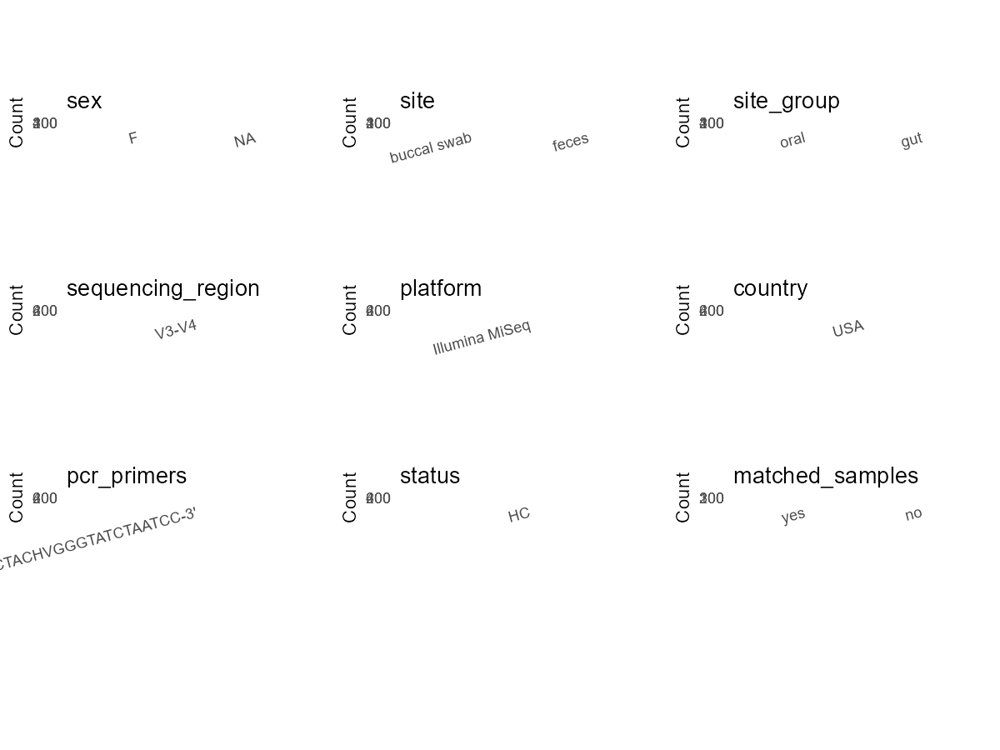

R Notebook: Metadata Processing Workflow
================

# Step 1: Obtain Initial Metadata from Each Project

This step sets the project directory, loads the raw SRA metadata, and
optionally merges supplement tables.

``` r
# Load libraries
library(dplyr)
library(ggplot2)
library(cowplot)

# (1) Setting working directory
# EDIT HERE: change project_id for each study
project_id <- "PRJNA420339" 

base_dir <- "E:/oral/26/metadata-2604/Oral-Metadata-YL-02"
setwd(file.path(base_dir, project_id))

# (2) Loading raw SRA metadata file
sra_file <- "SraRunTable.csv"
initial_meta <- read.csv(sra_file, header = TRUE)

# (3) OPTIONAL: If extra metadata (e.g., Table.x or supplemental materials) are available from the article, you may need to merge the file with initial_meta manually. Below is example code for merging. Depending on the specific case of each study, you can customize the code as needed.
#supp_table <- read.csv("supplemental_table_v2.csv", header = TRUE)
#initial_meta <- left_join(initial_meta, supp_table, by = "Sample.Name")
```

# Step 2: Data Overview

First, you need to get an overview of the data, which includes two
steps: reading the article and reading the initial metadata. This step
is very IMPORTANT!

``` r
# (1) Read the article in the following order: abstract, the beginning of the results section, and the methods. Understand the sample size, experimental design, and disease group overview. Clarify the sampling sites; for oral and gut samples, specify the exact sites like supragingival plaque, tongue, etc.

# (2) IMPORTANT: MUST go through each column of initial_meta
head(initial_meta, 10)
```

    ##           Run Assay.Type AvgSpotLen     Bases  BioProject    BioSample
    ## 1  SRR6330872   AMPLICON        602 139641124 PRJNA420339 SAMN08108998
    ## 2  SRR6330873   AMPLICON        600  64841114 PRJNA420339 SAMN08109137
    ## 3  SRR6330874   AMPLICON        600 145788738 PRJNA420339 SAMN08108917
    ## 4  SRR6330875   AMPLICON        600 201176444 PRJNA420339 SAMN08108975
    ## 5  SRR6330876   AMPLICON        601 123869104 PRJNA420339 SAMN08109446
    ## 6  SRR6330877   AMPLICON        600 137930315 PRJNA420339 SAMN08109206
    ## 7  SRR6330878   AMPLICON        600  65391108 PRJNA420339 SAMN08108974
    ## 8  SRR6330879   AMPLICON        600 232755382 PRJNA420339 SAMN08108973
    ## 9  SRR6330880   AMPLICON        599 150707178 PRJNA420339 SAMN08109442
    ## 10 SRR6330881   AMPLICON        599 150628337 PRJNA420339 SAMN08109445
    ##                                       BioSampleModel     Bytes
    ## 1  MIMARKS.survey,MIGS/MIMS/MIMARKS.human-associated  90441844
    ## 2  MIMARKS.survey,MIGS/MIMS/MIMARKS.human-associated  43354575
    ## 3  MIMARKS.survey,MIGS/MIMS/MIMARKS.human-associated  98188433
    ## 4  MIMARKS.survey,MIGS/MIMS/MIMARKS.human-associated 129519074
    ## 5  MIMARKS.survey,MIGS/MIMS/MIMARKS.human-associated  74202484
    ## 6  MIMARKS.survey,MIGS/MIMS/MIMARKS.human-associated  96501594
    ## 7  MIMARKS.survey,MIGS/MIMS/MIMARKS.human-associated  40931624
    ## 8  MIMARKS.survey,MIGS/MIMS/MIMARKS.human-associated 149781778
    ## 9  MIMARKS.survey,MIGS/MIMS/MIMARKS.human-associated 104609260
    ## 10 MIMARKS.survey,MIGS/MIMS/MIMARKS.human-associated 105292690
    ##              Center.Name Collection_Date Consent DATASTORE.filetype
    ## 1  PENN STATE UNIVERISTY  not applicable  public   fastq,run.zq,sra
    ## 2  PENN STATE UNIVERISTY  not applicable  public   fastq,run.zq,sra
    ## 3  PENN STATE UNIVERISTY  not applicable  public   fastq,run.zq,sra
    ## 4  PENN STATE UNIVERISTY  not applicable  public   fastq,run.zq,sra
    ## 5  PENN STATE UNIVERISTY  not applicable  public   fastq,run.zq,sra
    ## 6  PENN STATE UNIVERISTY  not applicable  public   fastq,run.zq,sra
    ## 7  PENN STATE UNIVERISTY  not applicable  public   fastq,run.zq,sra
    ## 8  PENN STATE UNIVERISTY  not applicable  public   fastq,run.zq,sra
    ## 9  PENN STATE UNIVERISTY  not applicable  public   fastq,run.zq,sra
    ## 10 PENN STATE UNIVERISTY  not applicable  public   fastq,run.zq,sra
    ##    DATASTORE.provider                     DATASTORE.region      env_biome
    ## 1          gs,ncbi,s3 gs.us-east1,ncbi.public,s3.us-east-1 not applicable
    ## 2          gs,ncbi,s3 gs.us-east1,ncbi.public,s3.us-east-1 not applicable
    ## 3          gs,ncbi,s3 gs.us-east1,ncbi.public,s3.us-east-1 not applicable
    ## 4          gs,ncbi,s3 gs.us-east1,ncbi.public,s3.us-east-1 not applicable
    ## 5          gs,ncbi,s3 gs.us-east1,ncbi.public,s3.us-east-1 not applicable
    ## 6          gs,ncbi,s3 gs.us-east1,ncbi.public,s3.us-east-1 not applicable
    ## 7          gs,ncbi,s3 gs.us-east1,ncbi.public,s3.us-east-1 not applicable
    ## 8          gs,ncbi,s3 gs.us-east1,ncbi.public,s3.us-east-1 not applicable
    ## 9          gs,ncbi,s3 gs.us-east1,ncbi.public,s3.us-east-1 not applicable
    ## 10         gs,ncbi,s3 gs.us-east1,ncbi.public,s3.us-east-1 not applicable
    ##    env_feature env_material Experiment geo_loc_name_country
    ## 1         Oral  Buccal Swab SRX3430623         uncalculated
    ## 2         Oral  Buccal Swab SRX3430622         uncalculated
    ## 3          Gut        Stool SRX3430621         uncalculated
    ## 4          Gut        Stool SRX3430620         uncalculated
    ## 5         Oral  Buccal Swab SRX3430619         uncalculated
    ## 6         Oral  Buccal Swab SRX3430618         uncalculated
    ## 7          Gut        Stool SRX3430617         uncalculated
    ## 8          Gut        Stool SRX3430616         uncalculated
    ## 9         Oral  Buccal Swab SRX3430615         uncalculated
    ## 10        Oral  Buccal Swab SRX3430614         uncalculated
    ##    geo_loc_name_country_continent   geo_loc_name           host_age
    ## 1                    uncalculated not applicable child 2-year visit
    ## 2                    uncalculated not applicable child 2-year visit
    ## 3                    uncalculated not applicable child 2-year visit
    ## 4                    uncalculated not applicable child 2-year visit
    ## 5                    uncalculated not applicable child 2-year visit
    ## 6                    uncalculated not applicable child 2-year visit
    ## 7                    uncalculated not applicable child 2-year visit
    ## 8                    uncalculated not applicable child 2-year visit
    ## 9                    uncalculated not applicable child 2-year visit
    ## 10                   uncalculated not applicable child 2-year visit
    ##    host_family_relationship         HOST host_subject_id     Instrument
    ## 1              child (self) Homo sapiens            873C Illumina MiSeq
    ## 2              child (self) Homo sapiens            154C Illumina MiSeq
    ## 3              child (self) Homo sapiens            154C Illumina MiSeq
    ## 4              child (self) Homo sapiens            379C Illumina MiSeq
    ## 5                    mother Homo sapiens            379M Illumina MiSeq
    ## 6              child (self) Homo sapiens            280C Illumina MiSeq
    ## 7              child (self) Homo sapiens            280C Illumina MiSeq
    ## 8              child (self) Homo sapiens            877C Illumina MiSeq
    ## 9                    mother Homo sapiens            877M Illumina MiSeq
    ## 10                   mother Homo sapiens            297M Illumina MiSeq
    ##    Library.Name LibraryLayout LibrarySelection LibrarySource
    ## 1     873C_oral        PAIRED              PCR   METAGENOMIC
    ## 2     154C_oral        PAIRED              PCR   METAGENOMIC
    ## 3      154C_gut        PAIRED              PCR   METAGENOMIC
    ## 4      379C_gut        PAIRED              PCR   METAGENOMIC
    ## 5     379M_oral        PAIRED              PCR   METAGENOMIC
    ## 6     280C_oral        PAIRED              PCR   METAGENOMIC
    ## 7      280C_gut        PAIRED              PCR   METAGENOMIC
    ## 8      877C_gut        PAIRED              PCR   METAGENOMIC
    ## 9     877M_oral        PAIRED              PCR   METAGENOMIC
    ## 10    297M_oral        PAIRED              PCR   METAGENOMIC
    ##                 Organism Platform          ReleaseDate Sample.Name SRA.Study
    ## 1  human oral metagenome ILLUMINA 2017-11-29T00:00:00Z        S233 SRP125841
    ## 2  human oral metagenome ILLUMINA 2017-11-29T00:00:00Z        S367 SRP125841
    ## 3   human gut metagenome ILLUMINA 2017-11-29T00:00:00Z        S141 SRP125841
    ## 4   human gut metagenome ILLUMINA 2017-11-29T00:00:00Z        S209 SRP125841
    ## 5  human oral metagenome ILLUMINA 2017-11-29T00:00:00Z        S661 SRP125841
    ## 6  human oral metagenome ILLUMINA 2017-11-29T00:00:00Z        S433 SRP125841
    ## 7   human gut metagenome ILLUMINA 2017-11-29T00:00:00Z        S207 SRP125841
    ## 8   human gut metagenome ILLUMINA 2017-11-29T00:00:00Z        S206 SRP125841
    ## 9  human oral metagenome ILLUMINA 2017-11-29T00:00:00Z        S658 SRP125841
    ## 10 human oral metagenome ILLUMINA 2017-11-29T00:00:00Z        S660 SRP125841
    ##             create_date version
    ## 1  2017-11-29T18:35:00Z       1
    ## 2  2017-11-29T18:35:00Z       1
    ## 3  2017-11-29T18:35:00Z       1
    ## 4  2017-11-29T18:36:00Z       1
    ## 5  2017-11-29T18:35:00Z       1
    ## 6  2017-11-29T18:36:00Z       1
    ## 7  2017-11-29T18:35:00Z       1
    ## 8  2017-11-29T18:36:00Z       1
    ## 9  2017-11-29T18:36:00Z       1
    ## 10 2017-11-29T18:36:00Z       1

``` r
# IMPORTANT: Check the unique values in the column of interest or query column.
lapply(initial_meta[c('env_material')], table) # site
```

    ## $env_material
    ## 
    ## Buccal Swab       Stool 
    ##         429         189

``` r
lapply(initial_meta[c('env_feature', 'Organism')], table) # organism
```

    ## $env_feature
    ## 
    ##  Gut Oral 
    ##  189  429 
    ## 
    ## $Organism
    ## 
    ##  human gut metagenome human oral metagenome 
    ##                   189                   429

``` r
table(initial_meta$host_subject_id) # subject id
```

    ## 
    ## 102C 102M 105C 105M  10C  10M 111C 111M 112C 112M 116C 116M 117C 117M 118C 118M 
    ##    2    1    1    1    2    1    1    1    2    1    1    1    2    1    2    1 
    ## 119C 119M 120C 120M 123C 123M 130C 130M 135C 135M 136C 136M 141C 141M 149C 149M 
    ##    2    1    2    1    2    1    2    1    2    1    2    1    2    1    2    1 
    ## 152C 152M 154C 154M 156C 156M 159C 159M 160C 160M 171C 171M 178C 178M 184C 184M 
    ##    2    1    2    1    2    1    2    1    2    1    2    1    1    1    2    1 
    ## 198C 198M 201C 201M 204C 204M 207C 207M 210C 210M 211C 211M 215C 215M 219C 219M 
    ##    1    1    2    1    2    1    1    1    2    1    1    1    2    1    2    1 
    ## 225C 225M 227C 227M 237C 237M  23C  23M 252C 252M 256C 256M 257C 257M 259C 259M 
    ##    2    1    2    1    2    1    2    1    2    1    2    1    1    1    2    1 
    ## 269C 269M 271C 271M 273C 273M 280C 280M 281C 281M 293C 296C 296M 297C 297M  29C 
    ##    1    1    2    1    2    1    2    1    2    1    2    2    1    1    1    1 
    ##  29M 305C 305M 312C 312M 313C 313M 315C 315M 321C 321M 329C 329M 333C 333M 335C 
    ##    1    2    1    2    1    2    1    2    1    1    1    2    1    1    1    2 
    ## 335M 338C 338M 342C 342M 353C 353M 359C 359M 360C 360M 364C 364M 365C 365M 370C 
    ##    1    1    1    1    1    2    1    2    1    2    1    1    1    2    1    1 
    ## 370M 371C 371M 373C 373M 379C 379M 386C 386M 387C 387M 388C 389C 389M 395C 395M 
    ##    1    2    1    1    1    2    1    2    1    2    1    1    2    1    1    1 
    ## 397C 397M 399C 399M   3C   3M 406C 406M 412C 412M 413C 413M 416C 416M 420C 420M 
    ##    2    1    2    1    2    1    1    1    2    1    2    1    2    1    1    1 
    ## 427C 427M 434C 434M 439C 439M 444C 444M 451C 451M 452C 452M 453C 453M 455C 455M 
    ##    2    1    1    1    1    1    1    1    2    1    2    1    2    1    2    1 
    ## 457C 457M 459C 459M 465C 465M 467C 467M 469C 469M  46C  46M 470C 470M 471C 471M 
    ##    2    1    2    1    1    1    2    1    1    1    2    1    1    1    2    1 
    ## 473C 473M 474C 474M 478C 478M 481C 481M 485C 485M  49C  49M 506C 506M 515C 515M 
    ##    2    1    2    1    2    1    1    1    2    1    2    1    2    1    1    1 
    ## 516C 516M 521C 521M 525C 525M 534C 534M 535C 535M 536C 536M 544C 544M 546C 546M 
    ##    2    1    2    1    2    1    2    1    2    1    2    1    2    1    1    1 
    ## 547C 547M 554C 554M  56C  56M 572C 572M 576C 576M 579C 579M  57C  57M 580C 580M 
    ##    2    1    2    1    2    1    1    1    2    1    2    1    2    1    2    1 
    ## 588C 588M 591C 591M  593 596C 596M 598C 598M   5C   5M 602C 602M 606C 616C 616M 
    ##    2    1    2    1    3    2    1    1    1    2    1    2    1    1    2    1 
    ## 622C 622M 629C 629M 635C 635M 644C 644M 647C 647M 650C 650M 653C 653M 655C 655M 
    ##    2    1    2    1    1    1    2    1    2    1    2    1    2    1    2    1 
    ## 656C 656M 659C 659M  65C  65M 663C 663M 674C 674M 676C 676M 678C 678M 679C 679M 
    ##    2    1    2    1    2    1    2    1    2    1    2    1    2    1    2    1 
    ## 690C 690M 694C 694M   6C 704C 704M 705C 706C  70C  70M 716C 716M 720C 720M 739C 
    ##    2    1    2    1    1    2    1    2    2    2    1    1    1    2    1    2 
    ## 739M 741C 741M 745C 751C 751M 752C 752M 756C 756M 757C 757M 758C 758M 767C 767M 
    ##    1    2    1    2    2    1    2    1    2    1    2    1    2    1    2    1 
    ## 770C 770M 775C 775M  77C 781C 781M 785C 785M 789C 789M 795C 795M 796C 796M 797C 
    ##    2    1    1    1    2    1    1    2    1    2    1    2    1    2    1    2 
    ## 797M 800C 800M 804C 804M  80C  80M 812C 814C 814M 815C 815M  81C  81M 821C 821M 
    ##    1    2    1    2    1    2    1    2    2    1    2    1    1    1    2    1 
    ## 825C 825M 826C 826M 827C 827M 828C 828M 832C 832M 833C 833M 835C 835M 842C 842M 
    ##    2    1    2    1    2    1    2    1    2    1    2    1    1    1    2    1 
    ##  84C  84M 852C 852M 858C 858M 860C 860M 864C 873C 873M 874C 874M 875C 875M 877C 
    ##    2    1    2    1    2    1    2    1    2    2    1    1    1    2    1    2 
    ## 877M  87C  87M 881C 881M 885C 885M 889C 889M 890C 890M 891C 891M 895C 895M   8C 
    ##    1    2    1    2    1    1    1    2    1    1    1    2    1    2    1    2 
    ##   8M 906C 906M 907C 907M 908C 908M 914C 914M  91C  91M 922C 922M 926C 926M 940C 
    ##    1    2    1    1    1    2    1    2    1    2    1    2    1    1    1    2 
    ## 944C 944M 961C 961M 964C 964M 968C 968M 970C 970M 971C 971M 979C 979M 985C 985M 
    ##    2    1    1    1    2    1    2    1    2    1    1    1    2    1    1    1 
    ## 988C 988M 990C 990M 996C 996M  99C  99M 
    ##    2    1    2    1    2    1    2    1

``` r
#table(initial_meta$sequencing_meth..exp.) # output is Sequencing by synthesis
table(initial_meta$Platform) # output is Illumina. according to the methods, Illumina is correct.
```

    ## 
    ## ILLUMINA 
    ##      618

``` r
#table(initial_meta$target_subfragment..exp.)
```

# Step 3: Removing Control and Non-human Samples

First, we need to remove control samples(including both negative
controls and positive controls) and non-human samples.

``` r
# (1) EDIT HERE: Parameter setup
control_column <- "" # column name in initial_meta
# unique(initial_meta[[control_column]])
control_keywords <- c() # Enter exact keywords

species_column <- "" # column name in initial_meta
unique(initial_meta[[species_column]])
```

    ## NULL

``` r
non_human_keywords <- c() # Enter exact keywords

# (2) Remove controls and non-human samples. DO NOT need to modify code in this part, just run it.
n_samples <- nrow(initial_meta)
# Control evaluation
if (length(control_keywords) > 0) {
  if (is.null(control_column) || control_column == "") {
    stop("Error: control_keywords provided but control_column is missing.")
  }
  
  if (!(control_column %in% colnames(initial_meta))) {
    stop(sprintf("Error: Column '%s' not found in initial_meta.", control_column))
  }
  
  control_pattern <- paste(control_keywords, collapse = "|")
  control_text <- initial_meta[[control_column]]
  is_control <- grepl(control_pattern, control_text)
  
} else {
  is_control <- rep(FALSE, n_samples)
}

# Non-human evaluation
if (length(non_human_keywords) > 0) {
  if (is.null(species_column) || species_column == "") {
    stop("Error: non_human_keywords provided but species_column is missing.")
  }
  
  if (!(species_column %in% colnames(initial_meta))) {
    stop(sprintf("Error: Column '%s' not found in initial_meta.", species_column))
  }
  
  non_human_pattern <- paste(non_human_keywords, collapse = "|")
  species_text <- initial_meta[[species_column]]
  is_non_human <- grepl(non_human_pattern, species_text)
} else {
  is_non_human <- rep(FALSE, n_samples)
}

# Execute removal
samples_to_remove <- is_control | is_non_human
initial_meta <- initial_meta[!samples_to_remove, ]

cat("Initial samples counts:",n_samples,"\n")
```

    ## Initial samples counts: 618

``` r
cat("Removed control samples:", sum(is_control), "\n")
```

    ## Removed control samples: 0

``` r
cat("Removed non-human samples:", sum(is_non_human), "\n")
```

    ## Removed non-human samples: 0

``` r
cat("Total samples removed ", sum(samples_to_remove), "\n")
```

    ## Total samples removed  0

``` r
cat("Remaining samples after Step 2:", nrow(initial_meta), "\n")
```

    ## Remaining samples after Step 2: 618

# Step 4: Creating a Uniform Metadata Template

This step converts the raw SRA table into the standard metadata format
used in our meta-analysis. The uniform metadata should include the
following columns: 1. **bioproject**: Project ID from SRA or other
database e.g. `PRJNA1234`, `CNP1234`, ‘OEP1234’, ‘qiita_1234’ 2.
**sample_id**: SRA sample/run ID. Unique id for each sample!
e.g. `DRR1234567`, `ERR1234567` and `SRR1234567`. If no such column
exists, can use column like sample_name. 3. **subject_id**: subject id
for each person if available. e.g. `patient_01`, `Host_03_before`,
`subject12` 4. **age**: Age of the subject if available. e.g. `35`, `42`
\| not `adult`, `chilren` 5. **age_info**: If the age is not explicitly
stated but approximate age range information is available, mark it in
this column. e.g., `18-55`, `children`, `infant`, `elder` 6. **bmi**:
Body Mass Index if available. e.g. `22.5`, `18.9` \| not `normal`,
`overweight` 7. **sex**: Sex of the subject. Mandatory to write as M/F
\| not `female`, `woman` 8. **sequencing_region**: Targeted 16S rRNA
region. e.g. `V3-V4`, `V4` 9. **platform**: Sequencing platform.
e.g. `Illumina MiSeq`, `454 GS FLX Titanium`, `Ion Torrent` 10.
**country**: Country of sample origin. e.g. `China`, `Japan` \| not city
name like `Beijing` 11. **site**: Sampling site. For oral and gut sites,
specify the exact sites as detailed as possible. For example, if it is
known to be supragingival plaque, do not record it as ‘dental plaque’,
unless the original text provides only a vague description.
e.g. `saliva`, `tongue coating` \| not broad term like `oral` 12.
**site_group**: only accepts one of following three values: ‘oral’,
‘gut’, or ‘other’. 13. **public_time**: Data release date.
e.g. `2021-06-22` \| not `June 2021` 14. **pcr_primers**: PCR primers
used. e.g. `515F-806R`, `27F-338R` \| not primer sequences 15.
**title**: Title of the associated publication. 16. **disease_study**:
Whether the study involves disease samples. If it’s not clear, can
record as NA. Only three values accepted: ‘yes’, ‘no’ or NA 17.
**status**: Disease status for each sample if available, else record as
NA. Only accept following abbreviations, Write full names for all other
diseases. HC: healthy control CD: Crohn’s disease CRC: colorectal cancer
COPD: chronic obstructive pulmonary disease HIV: human immunodeficiency
virus ICU: intensive care unit OSCC: oral squamous cell carcinoma RA:
rheumatoid arthritis UC: ulcerative colitis 18. **matched_samples**:
Whether the subject has matched samples. Only accept ‘yes’ or ‘no’. 19.
**is_time_series**: Whether the study is a time series study. Only
accept ‘yes’ or ‘no’.

``` r
# Extract columns from initial_meta as follows: (1) No modification needed → extract directly. (2) Modification needed → create a new column with the prefix raw_ and mark the original column as “pending”. (3) Need to find or determine based on the article.
metadata <- data.frame(
  bioproject = initial_meta$BioProject,
  sample_id = initial_meta$Run,
  subject_id = initial_meta$host_subject_id,
  age = NA,
  raw_age_info = initial_meta$host_family_relationship,
  age_info = "pending", # modify later
  bmi = NA,
  raw_sex = initial_meta$host_family_relationship,
  sex = "pending", # modify later
  sequencing_region = "V3-V4", # extract from methods section
  platform = "Illumina MiSeq", # extract from methods section, NOT initial_meta
  country = "USA",
  raw_site = initial_meta$env_material,
  site = "pending", # modify later
  site_group = "pending", # modify later
  public_time = initial_meta$ReleaseDate,
  pcr_primers = "F:5'-TCGTCGGCAGCGTCAGATGTGTATAAGAGA CAGCCTACGGGNGGCWGCAG-3';R:5'-GTCTCGTGGGCTCGGAGATGTGTAT AAGAGACAGGACTACHVGGGTATCTAATCC-3'", # Format: xxF-xxR
  title = "Child weight gain trajectories linked to oral microbiota composition", # extract from article
  disease_study = "no", # determine according to the article
  status = "HC", 
  matched_samples = "pending", # modify later
  is_time_series = "no", 
  stringsAsFactors = FALSE
)
metadata$public_time <- as.Date(metadata$public_time)
```

# Step 5: Manually solving pending issues

This step involves two parts: (1) handle the columns with the `raw_`
prefix, and next (2) handle the `site_group` and `matched_samples`
columns.

``` r
# (1) Handle the columns with the `raw_` prefix.
# In this part, you need to customize the code based on the situation of the raw_ columns to obtain the content of the target columns. IMPORTANT: Add comments if the modification is not straightforward!!
metadata <- metadata %>%
  mutate(age_info = case_when(
    grepl("child", raw_age_info) ~ "child (2-year-olds)",
    grepl("mother", raw_age_info) ~ "adult",
    TRUE ~ NA_character_
  )) # according to the 'host_family_relationship' column of initial_meta

metadata <- metadata %>%
  mutate(sex = case_when(
    grepl("mother", raw_sex) ~ "F",
    TRUE ~ NA_character_
  )) # according to the 'host_family_relationship' column of initial_meta

metadata <- metadata %>%
  mutate(site = case_when(
    grepl("Buccal Swab", raw_site) ~ "buccal swab",
    grepl("Stool", raw_site) ~ "feces",
    TRUE ~ NA_character_
  )) # according to the 'env_material' column of initial_meta
```

``` r
# (2) Filling the 'site_group' and 'matched_samples' columns
# editing site_group
unique(metadata$site)
```

    ## [1] "buccal swab" "feces"

``` r
# EDIT HERE: add oral sites
Oral_site = c("buccal swab")
# EDIT HERE: add gut sites
Gut_site = c("feces")
# just run
metadata <- metadata %>%
  mutate(site_group = case_when(
    site %in% Oral_site ~ "oral",
    site %in% Gut_site ~ "gut",
    TRUE ~ "other" 
  ))

# editing matched_samples, just run.
metadata$matched_samples <- ifelse(
  ave(metadata$subject_id, metadata$subject_id, FUN = length) > 1, 
  "yes", 
  "no"
)
```

``` r
# (3) check if there is pending value in metadata. If there is pending value, go on modify the metadata.
# Function to check if a column contains "pending"
has_pending <- function(col) {
  if (is.character(col) || is.factor(col)) {
    any(col == "pending", na.rm = TRUE)
  } else {
    FALSE
  }
}

# Check for any pending value
any_pending_value <- any(sapply(metadata, has_pending))

if (!any_pending_value) {
  message("Good! No cell contains the value 'pending'.")
} else {
  pending_cols <- names(metadata)[sapply(metadata, has_pending)]
  message("Columns containing 'pending': ", paste(pending_cols, collapse = ", "))
  message("Please continue to resolve these pending columns!")
}
```

    ## Good! No cell contains the value 'pending'.

# Step 6: Visualize the Metadata

This step makes a quick set of plots for checking the distribution of
key metadata fields.

``` r
# Select columns for visualization, just run
plot_data <- metadata %>%
  select(-bioproject, -sample_id, -subject_id, -title)

create_simple_plots <- function(data) {
  plots <- list()
  continuous_vars <- c("age", "bmi")

  for (col in colnames(data)) {
    if (all(is.na(data[[col]]))) {
      p <- ggplot() +
        annotate("text", x = 0.5, y = 0.5, label = "this column is NA", size = 6) +
        labs(title = col) +
        theme_void()
    } else if (col %in% continuous_vars && is.numeric(data[[col]])) {
      p <- ggplot(data, aes(x = .data[[col]])) +
        geom_histogram(fill = "blue", alpha = 0.6, bins = 20, na.rm = TRUE) +
        labs(title = col, x = col, y = "Count") +
        theme_minimal()
    } else {
      count_data <- as.data.frame(table(data[[col]], useNA = "ifany"))
      p <- ggplot(count_data, aes(x = reorder(Var1, -Freq), y = Freq)) +
        geom_col(fill = "red", alpha = 0.6) +
        labs(title = col, x = NULL, y = "Count") +
        theme_minimal() +
        theme(axis.text.x = element_text(angle = 15, hjust = 1))
    }
    plots[[col]] <- p
  }

  return(plots)
}

# Generate and arrange plots
plots <- create_simple_plots(plot_data)
p <- plot_grid(plots$age,
               plots$age_info,
               plots$bmi,
               plots$sex,
               plots$site,
               plots$site_group,
               plots$sequencing_region,
               plots$platform,
               plots$country,
               plots$pcr_primers,
               plots$status,
               plots$matched_samples,
               ncol = 3, align = "hv", axis = "lb")
ggsave("Metadata_Summary_v2.png", plot = p, width = 8, height = 6, dpi = 150)
```

``` r
# Insert Metadata_Summary.png into the current Rmd output

```


# Step 7: Sort and export the metadata

This step saves the cleaned metadata table as the final `metadata.csv`
file.

``` r
# Reorder the data frame
fixed_cols <- c("bioproject", "sample_id", "subject_id", "age", "age_info",
                "bmi", "sex", "platform", "sequencing_region", "pcr_primers", 
                "country", "site", "site_group", "disease_study", "status", 
                "title", "public_time", "matched_samples", "is_time_series")  
metadata <- metadata %>%
  select(all_of(fixed_cols), everything())

# save metadata 
# head(metadata)
write.csv(metadata, file = "metadata_v2.csv", quote = TRUE)
```
