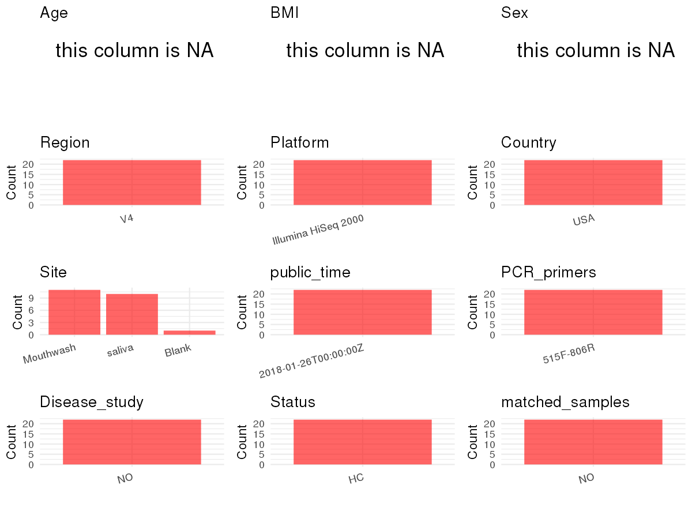

R Notebook: Metadata Processing Workflow
================

# Step 1: Obtain Initial Metadata from Each Project

To obtain the initial metadata: 1. Search for the BioProject ID (e.g.,
“PRJEBXXXX”) on the [NCBI SRA
website](https://www.ncbi.nlm.nih.gov/Traces/study/). 2. In the “Select”
table, click on “Metadata” and download the file. 3. The downloaded file
is typically named “SraRunTable.csv” and contains metadata for the
project.

``` r
# Load necessary libraries
library(dplyr)
library(ggplot2)
library(cowplot)
library(readxl)

# Set working directory (update this path to your local directory)
setwd("/home/dongbiao/word_embedding_microbiome/all_data/oral/global-oral-microbiome/data/projects/PRJNA431300")

# Read the initial metadata files
initial_meta<-read.csv("SraRunTable.csv")

head(initial_meta)
```

    ##          Run Assay.Type AvgSpotLen    Bases  BioProject    BioSample
    ## 1 SRR6503955   AMPLICON        302 18713732 PRJNA431300 SAMN08386867
    ## 2 SRR6503956   AMPLICON        302 36010782 PRJNA431300 SAMN08386866
    ## 3 SRR6503957   AMPLICON        302 33129400 PRJNA431300 SAMN08386848
    ## 4 SRR6503958   AMPLICON        302 44716234 PRJNA431300 SAMN08386849
    ## 5 SRR6503959   AMPLICON        302 36610554 PRJNA431300 SAMN08386846
    ## 6 SRR6503960   AMPLICON        302 44334506 PRJNA431300 SAMN08386847
    ##                BioSampleModel    Bytes                            Center.Name
    ## 1 Metagenome or environmental 11853873 NEW YORK UNIVERSITY SCHOOL OF MEDICINE
    ## 2 Metagenome or environmental 21074330 NEW YORK UNIVERSITY SCHOOL OF MEDICINE
    ## 3 Metagenome or environmental 19693300 NEW YORK UNIVERSITY SCHOOL OF MEDICINE
    ## 4 Metagenome or environmental 26124458 NEW YORK UNIVERSITY SCHOOL OF MEDICINE
    ## 5 Metagenome or environmental 21632732 NEW YORK UNIVERSITY SCHOOL OF MEDICINE
    ## 6 Metagenome or environmental 26036663 NEW YORK UNIVERSITY SCHOOL OF MEDICINE
    ##   Collection_Date Consent DATASTORE.filetype DATASTORE.provider
    ## 1         2017-06  public   fastq,run.zq,sra         gs,ncbi,s3
    ## 2         2017-06  public   fastq,run.zq,sra         gs,ncbi,s3
    ## 3         2017-06  public   fastq,run.zq,sra         gs,ncbi,s3
    ## 4         2017-06  public   fastq,run.zq,sra         gs,ncbi,s3
    ## 5         2017-06  public   fastq,run.zq,sra         gs,ncbi,s3
    ## 6         2017-06  public   fastq,run.zq,sra         gs,ncbi,s3
    ##                       DATASTORE.region Experiment geo_loc_name_country
    ## 1 gs.us-east1,ncbi.public,s3.us-east-1 SRX3592603         uncalculated
    ## 2 gs.us-east1,ncbi.public,s3.us-east-1 SRX3592602         uncalculated
    ## 3 gs.us-east1,ncbi.public,s3.us-east-1 SRX3592601         uncalculated
    ## 4 gs.us-east1,ncbi.public,s3.us-east-1 SRX3592600         uncalculated
    ## 5 gs.us-east1,ncbi.public,s3.us-east-1 SRX3592599         uncalculated
    ## 6 gs.us-east1,ncbi.public,s3.us-east-1 SRX3592598         uncalculated
    ##   geo_loc_name_country_continent   geo_loc_name           HOST
    ## 1                   uncalculated not applicable not applicable
    ## 2                   uncalculated not applicable   Homo sapiens
    ## 3                   uncalculated not applicable   Homo sapiens
    ## 4                   uncalculated not applicable   Homo sapiens
    ## 5                   uncalculated not applicable   Homo sapiens
    ## 6                   uncalculated not applicable   Homo sapiens
    ##            Instrument        isolate isolation_source lat_lon Library.Name
    ## 1 Illumina HiSeq 2000 not applicable        Mouthwash missing           22
    ## 2 Illumina HiSeq 2000 not applicable           saliva missing           21
    ## 3 Illumina HiSeq 2000 not applicable        Mouthwash missing            3
    ## 4 Illumina HiSeq 2000 not applicable           saliva missing            4
    ## 5 Illumina HiSeq 2000 not applicable        Mouthwash missing            1
    ## 6 Illumina HiSeq 2000 not applicable           saliva missing            2
    ##   LibraryLayout LibrarySelection LibrarySource              Organism Platform
    ## 1        PAIRED              PCR       GENOMIC human oral metagenome ILLUMINA
    ## 2        PAIRED              PCR       GENOMIC human oral metagenome ILLUMINA
    ## 3        PAIRED              PCR       GENOMIC human oral metagenome ILLUMINA
    ## 4        PAIRED              PCR       GENOMIC human oral metagenome ILLUMINA
    ## 5        PAIRED              PCR       GENOMIC human oral metagenome ILLUMINA
    ## 6        PAIRED              PCR       GENOMIC human oral metagenome ILLUMINA
    ##            ReleaseDate  replicate          create_date version
    ## 1 2018-01-26T00:00:00Z       <NA> 2018-01-23T22:06:00Z       1
    ## 2 2018-01-26T00:00:00Z Subject 10 2018-01-23T22:07:00Z       1
    ## 3 2018-01-26T00:00:00Z  Subject 2 2018-01-23T22:07:00Z       1
    ## 4 2018-01-26T00:00:00Z  Subject 2 2018-01-23T22:07:00Z       1
    ## 5 2018-01-26T00:00:00Z  Subject 1 2018-01-23T22:07:00Z       1
    ## 6 2018-01-26T00:00:00Z  Subject 1 2018-01-23T22:07:00Z       1
    ##                  Sample.Name sample_type SRA.Study         strain
    ## 1       Scoop blank sample 2   Mouthwash SRP131156 not applicable
    ## 2   Subject 10 Saliva sample      Saliva SRP131156 not applicable
    ## 3 Subject 2 Mouthwash sample   Mouthwash SRP131156 not applicable
    ## 4    Subject 2 Saliva sample      Saliva SRP131156 not applicable
    ## 5 Subject 1 Mouthwash sample   Mouthwash SRP131156 not applicable
    ## 6    Subject 1 Saliva sample      Saliva SRP131156 not applicable

# Step 2: Create a Uniform Metadata Template

The uniform metadata should include the following columns:

1.  **BioProject**: Project ID (e.g., “PRJNA339212”)
2.  **Run**: Sample ID (e.g., “ERRXXXXXX” or “SRRXXXXXX”)
3.  **sample_name**: Original sample name submitted by the authors (not
    the database-assigned ID)
4.  **Age**: Age of the subject (if available)
5.  **BMI**: Body Mass Index (if available)
6.  **Sex**: Sex of the subject (“F” or “M”)
7.  **Region**: Targeted 16S rRNA region (e.g., “V3-V4”)
8.  **Platform**: Sequencing platform (e.g., “Illumina MiSeq”)
9.  **Country**: Country of sample origin (e.g., “China”)
10. **Site**: Sample site (e.g., “saliva”, “dental plaque”)
11. **public_time**: Data release date (format: “YYYY-MM-DD”)
12. **PCR_primers**: PCR primers used (e.g., “515F-806R”)
13. **title**: Title of the associated publication
14. **Disease_study**: Whether the study involves a disease (“YES” or
    “NO”)
15. **Status**: Disease status (e.g., “T2DM”, “HC”). Note: If the study
    includes both disease and healthy samples, this must be specified
    per sample.

``` r
# Create a uniform metadata dataframe
metadata <- data.frame(
  BioProject = initial_meta$BioProject,
  Run = initial_meta$Run,
  sample_name = initial_meta$`Sample.Name`,
  Age = NA,
  BMI = NA,
  Sex=NA,
  Region = "V4",
  Platform = initial_meta$Instrument,
  Country = "USA",
  Site = initial_meta$isolation_source,
  public_time = initial_meta$ReleaseDate,
  stringsAsFactors = FALSE
)
metadata<-unique(metadata)
```

# Step 3: Manually Add Information from the Publication

Some information (e.g. PCR primers, study title, disease status) must be
manually extracted from the publication and added to the metadata.

``` r
# Add information obtained from the publication
metadata$PCR_primers <- "515F-806R"
metadata$title <- "Comparison of the oral microbiome in mouthwash and whole saliva samplese"
metadata$Disease_study <- "NO"

# Assign disease status based on sample_name patterns
metadata$Status <- "HC"
metadata$matched_samples <- "NO"
```

# Step 4: Summarize and Validate the Metadata

``` r
# Check the number of unique runs and sample names
print(paste("Number of unique runs:", length(unique(metadata$Run))))
```

    ## [1] "Number of unique runs: 22"

``` r
print(paste("Number of unique sample names:", length(unique(metadata$sample_name))))
```

    ## [1] "Number of unique sample names: 22"

# Step 5: Visualize the Metadata

``` r

```


# Step 6: Finalize and Export the Metadata

``` r
# Reorder columns to match the desired format
metadata <- metadata[, c(
  "BioProject", "Run", "sample_name", "Age", "BMI", "Sex", 
  "Region", "Platform", "Country", "Site", "public_time", 
  "PCR_primers", "title", "Disease_study", "Status","matched_samples"
)]

# Export the uniform metadata to a CSV file
metadata<-unique(metadata)
write.csv(metadata, file = "metadata.csv", quote = FALSE)
head(metadata)
```

    ##    BioProject        Run                sample_name Age BMI Sex Region
    ## 1 PRJNA431300 SRR6503955       Scoop blank sample 2  NA  NA  NA     V4
    ## 2 PRJNA431300 SRR6503956   Subject 10 Saliva sample  NA  NA  NA     V4
    ## 3 PRJNA431300 SRR6503957 Subject 2 Mouthwash sample  NA  NA  NA     V4
    ## 4 PRJNA431300 SRR6503958    Subject 2 Saliva sample  NA  NA  NA     V4
    ## 5 PRJNA431300 SRR6503959 Subject 1 Mouthwash sample  NA  NA  NA     V4
    ## 6 PRJNA431300 SRR6503960    Subject 1 Saliva sample  NA  NA  NA     V4
    ##              Platform Country      Site          public_time PCR_primers
    ## 1 Illumina HiSeq 2000     USA Mouthwash 2018-01-26T00:00:00Z   515F-806R
    ## 2 Illumina HiSeq 2000     USA    saliva 2018-01-26T00:00:00Z   515F-806R
    ## 3 Illumina HiSeq 2000     USA Mouthwash 2018-01-26T00:00:00Z   515F-806R
    ## 4 Illumina HiSeq 2000     USA    saliva 2018-01-26T00:00:00Z   515F-806R
    ## 5 Illumina HiSeq 2000     USA Mouthwash 2018-01-26T00:00:00Z   515F-806R
    ## 6 Illumina HiSeq 2000     USA    saliva 2018-01-26T00:00:00Z   515F-806R
    ##                                                                      title
    ## 1 Comparison of the oral microbiome in mouthwash and whole saliva samplese
    ## 2 Comparison of the oral microbiome in mouthwash and whole saliva samplese
    ## 3 Comparison of the oral microbiome in mouthwash and whole saliva samplese
    ## 4 Comparison of the oral microbiome in mouthwash and whole saliva samplese
    ## 5 Comparison of the oral microbiome in mouthwash and whole saliva samplese
    ## 6 Comparison of the oral microbiome in mouthwash and whole saliva samplese
    ##   Disease_study Status matched_samples
    ## 1            NO     HC              NO
    ## 2            NO     HC              NO
    ## 3            NO     HC              NO
    ## 4            NO     HC              NO
    ## 5            NO     HC              NO
    ## 6            NO     HC              NO

## Notes for Students:

1.  **Metadata Accuracy**: Always cross-check the metadata with the
    original publication to ensure accuracy.
2.  **Manual Entries**: Columns like `PCR_primers`, and `Status` often
    require manual entry based on the publication.
3.  **Disease Status**: Be careful when assigning `Status`—some studies
    include both disease and healthy samples.
4.  **Visualization**: The plots help quickly identify the distribution
    of values in each column, which is useful for quality control.
5.  **Reproducibility**: Update the working directory and file paths to
    match your local environment.
