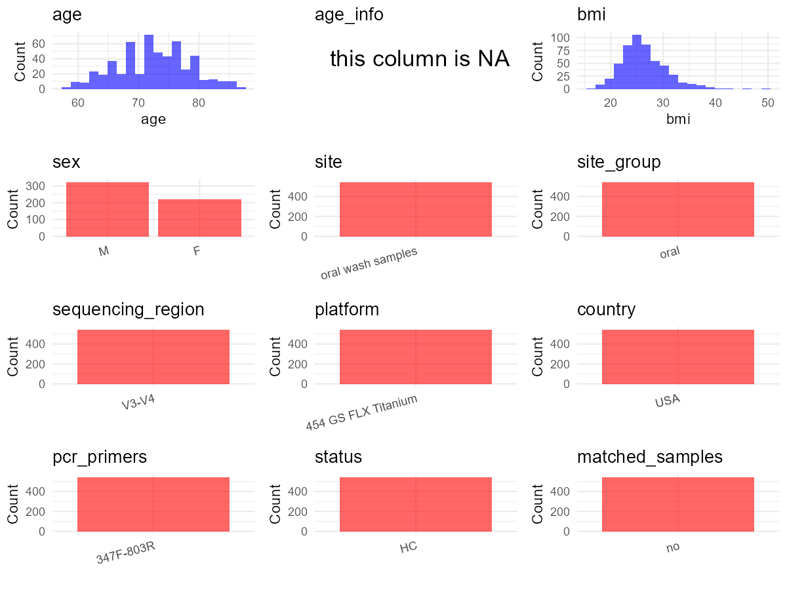

R Notebook: Metadata Processing Workflow
================

# Step 1: Obtain Initial Metadata from Each Project

This step sets the project directory, loads the raw SRA metadata, and
optionally merges supplement tables.

``` r
# Load libraries
library(dplyr)
library(ggplot2)
library(cowplot)

# (1) Setting working directory
# EDIT HERE: change project_id for each study
project_id <- "PRJNA434300" 

base_dir <- "E:/oral/26/metadata-2604/Oral-Metadata-YL-02"
setwd(file.path(base_dir, project_id))

# (2) Loading raw SRA metadata file
sra_file <- "SraRunTable.csv"
initial_meta <- read.csv(sra_file, header = TRUE)

# (3) OPTIONAL: If extra metadata (e.g., Table.x or supplemental materials) are available from the article, you may need to merge the file with initial_meta manually. Below is example code for merging. Depending on the specific case of each study, you can customize the code as needed.
#supp_table <- read.csv("supplemental_table_v2.csv", header = TRUE)
#initial_meta <- left_join(initial_meta, supp_table, by = "Sample.Name")
```

# Step 2: Data Overview

First, you need to get an overview of the data, which includes two
steps: reading the article and reading the initial metadata. This step
is very IMPORTANT!

``` r
# (1) Read the article in the following order: abstract, the beginning of the results section, and the methods. Understand the sample size, experimental design, and disease group overview. Clarify the sampling sites; for oral and gut samples, specify the exact sites like supragingival plaque, tongue, etc.

# (2) IMPORTANT: MUST go through each column of initial_meta
head(initial_meta, 10)
```

    ##           Run Assay.Type AvgSpotLen    Bases  BioProject    BioSample
    ## 1  SRR6751132   AMPLICON        384 12777550 PRJNA434300 SAMN08552086
    ## 2  SRR6751133   AMPLICON        377 10357769 PRJNA434300 SAMN08552085
    ## 3  SRR6751134   AMPLICON        392  6509545 PRJNA434300 SAMN08552350
    ## 4  SRR6751135   AMPLICON        399  5349647 PRJNA434300 SAMN08552082
    ## 5  SRR6751136   AMPLICON        396  5575230 PRJNA434300 SAMN08552081
    ## 6  SRR6751137   AMPLICON        372  8798481 PRJNA434300 SAMN08552084
    ## 7  SRR6751138   AMPLICON        406  4192148 PRJNA434300 SAMN08552083
    ## 8  SRR6751139   AMPLICON        380  4946265 PRJNA434300 SAMN08552078
    ## 9  SRR6751140   AMPLICON        396  5455567 PRJNA434300 SAMN08552077
    ## 10 SRR6751141   AMPLICON        400  5594359 PRJNA434300 SAMN08552080
    ##                 BioSampleModel   Bytes                            Center.Name
    ## 1  Metagenome or environmental 7763243 NEW YORK UNIVERSITY SCHOOL OF MEDICINE
    ## 2  Metagenome or environmental 6162147 NEW YORK UNIVERSITY SCHOOL OF MEDICINE
    ## 3  Metagenome or environmental 3748969 NEW YORK UNIVERSITY SCHOOL OF MEDICINE
    ## 4  Metagenome or environmental 2956824 NEW YORK UNIVERSITY SCHOOL OF MEDICINE
    ## 5  Metagenome or environmental 3010481 NEW YORK UNIVERSITY SCHOOL OF MEDICINE
    ## 6  Metagenome or environmental 5340517 NEW YORK UNIVERSITY SCHOOL OF MEDICINE
    ## 7  Metagenome or environmental 2376239 NEW YORK UNIVERSITY SCHOOL OF MEDICINE
    ## 8  Metagenome or environmental 2766066 NEW YORK UNIVERSITY SCHOOL OF MEDICINE
    ## 9  Metagenome or environmental 3027667 NEW YORK UNIVERSITY SCHOOL OF MEDICINE
    ## 10 Metagenome or environmental 3126239 NEW YORK UNIVERSITY SCHOOL OF MEDICINE
    ##    Collection_Date Consent DATASTORE.filetype DATASTORE.provider
    ## 1   not applicable  public     bam,run.zq,sra         gs,ncbi,s3
    ## 2   not applicable  public     bam,run.zq,sra         gs,ncbi,s3
    ## 3   not applicable  public     bam,run.zq,sra         gs,ncbi,s3
    ## 4   not applicable  public     bam,run.zq,sra         gs,ncbi,s3
    ## 5   not applicable  public     bam,run.zq,sra         gs,ncbi,s3
    ## 6   not applicable  public     bam,run.zq,sra         gs,ncbi,s3
    ## 7   not applicable  public     bam,run.zq,sra         gs,ncbi,s3
    ## 8   not applicable  public     bam,run.zq,sra         gs,ncbi,s3
    ## 9   not applicable  public     bam,run.zq,sra         gs,ncbi,s3
    ## 10  not applicable  public     bam,run.zq,sra         gs,ncbi,s3
    ##                        DATASTORE.region disease_status Experiment
    ## 1  gs.us-east1,ncbi.public,s3.us-east-1           Case SRX3724150
    ## 2  gs.us-east1,ncbi.public,s3.us-east-1        Control SRX3724149
    ## 3  gs.us-east1,ncbi.public,s3.us-east-1           Case SRX3724148
    ## 4  gs.us-east1,ncbi.public,s3.us-east-1           Case SRX3724147
    ## 5  gs.us-east1,ncbi.public,s3.us-east-1        Control SRX3724146
    ## 6  gs.us-east1,ncbi.public,s3.us-east-1        Control SRX3724145
    ## 7  gs.us-east1,ncbi.public,s3.us-east-1        Control SRX3724144
    ## 8  gs.us-east1,ncbi.public,s3.us-east-1        Control SRX3724143
    ## 9  gs.us-east1,ncbi.public,s3.us-east-1           Case SRX3724142
    ## 10 gs.us-east1,ncbi.public,s3.us-east-1        Control SRX3724141
    ##    geo_loc_name_country geo_loc_name_country_continent   geo_loc_name Host_Age
    ## 1          uncalculated                   uncalculated not applicable       66
    ## 2          uncalculated                   uncalculated not applicable       65
    ## 3          uncalculated                   uncalculated not applicable       74
    ## 4          uncalculated                   uncalculated not applicable       75
    ## 5          uncalculated                   uncalculated not applicable       78
    ## 6          uncalculated                   uncalculated not applicable       75
    ## 7          uncalculated                   uncalculated not applicable       75
    ## 8          uncalculated                   uncalculated not applicable       81
    ## 9          uncalculated                   uncalculated not applicable       80
    ## 10         uncalculated                   uncalculated not applicable       79
    ##    host_BMI host_ETHA_GRAMS_PER_DAY host_race         HOST host_smoke
    ## 1     23.24                    1.20     White Homo sapiens     Former
    ## 2     23.63                   10.25     White Homo sapiens    Current
    ## 3     33.90                    2.24     White Homo sapiens      Never
    ## 4     24.41                   17.14     White Homo sapiens     Former
    ## 5     21.97                      NA     White Homo sapiens      Never
    ## 6     23.06                    0.00     White Homo sapiens      Never
    ## 7     28.41                      NA     White Homo sapiens     Former
    ## 8        NA                    0.44     White Homo sapiens     Former
    ## 9     20.36                   11.25     White Homo sapiens     Former
    ## 10    23.63                    1.76     White Homo sapiens     Former
    ##    host_type_beer host_type_liquor host_type_wine hostgender
    ## 1               2                2              2       male
    ## 2               1                2              2       male
    ## 3               2                2              2     female
    ## 4               2                2              2       male
    ## 5              NA               NA             NA       male
    ## 6               0                0              0       male
    ## 7              NA               NA             NA       male
    ## 8               2                2              1       male
    ## 9               2                2              2       male
    ## 10              2                2              1       male
    ##             Instrument        isolate isolation_source lat_lon Library.Name
    ## 1  454 GS FLX Titanium not applicable   not applicable missing          100
    ## 2  454 GS FLX Titanium not applicable   not applicable missing           99
    ## 3  454 GS FLX Titanium not applicable   not applicable missing          364
    ## 4  454 GS FLX Titanium not applicable   not applicable missing           96
    ## 5  454 GS FLX Titanium not applicable   not applicable missing           95
    ## 6  454 GS FLX Titanium not applicable   not applicable missing           98
    ## 7  454 GS FLX Titanium not applicable   not applicable missing           97
    ## 8  454 GS FLX Titanium not applicable   not applicable missing           92
    ## 9  454 GS FLX Titanium not applicable   not applicable missing           91
    ## 10 454 GS FLX Titanium not applicable   not applicable missing           94
    ##    LibraryLayout LibrarySelection LibrarySource              Organism Platform
    ## 1         SINGLE              PCR       GENOMIC human oral metagenome    LS454
    ## 2         SINGLE              PCR       GENOMIC human oral metagenome    LS454
    ## 3         SINGLE              PCR       GENOMIC human oral metagenome    LS454
    ## 4         SINGLE              PCR       GENOMIC human oral metagenome    LS454
    ## 5         SINGLE              PCR       GENOMIC human oral metagenome    LS454
    ## 6         SINGLE              PCR       GENOMIC human oral metagenome    LS454
    ## 7         SINGLE              PCR       GENOMIC human oral metagenome    LS454
    ## 8         SINGLE              PCR       GENOMIC human oral metagenome    LS454
    ## 9         SINGLE              PCR       GENOMIC human oral metagenome    LS454
    ## 10        SINGLE              PCR       GENOMIC human oral metagenome    LS454
    ##             ReleaseDate          create_date version Sample.Name sample_type
    ## 1  2018-02-21T00:00:00Z 2018-05-10T10:01:00Z       2     ACS_100   Mouthwash
    ## 2  2018-02-21T00:00:00Z 2018-05-10T10:01:00Z       2     ACS_099   Mouthwash
    ## 3  2018-02-21T00:00:00Z 2018-05-10T10:01:00Z       2     ACS_364   Mouthwash
    ## 4  2018-02-21T00:00:00Z 2018-05-10T10:01:00Z       2     ACS_096   Mouthwash
    ## 5  2018-02-21T00:00:00Z 2018-05-10T10:01:00Z       2     ACS_095   Mouthwash
    ## 6  2018-02-21T00:00:00Z 2018-05-10T10:01:00Z       2     ACS_098   Mouthwash
    ## 7  2018-02-21T00:00:00Z 2018-05-10T10:01:00Z       2     ACS_097   Mouthwash
    ## 8  2018-02-21T00:00:00Z 2018-05-10T10:01:00Z       2     ACS_092   Mouthwash
    ## 9  2018-02-21T00:00:00Z 2018-05-10T10:01:00Z       2     ACS_091   Mouthwash
    ## 10 2018-02-21T00:00:00Z 2018-05-10T10:01:00Z       2     ACS_094   Mouthwash
    ##    SRA.Study         strain study type
    ## 1  SRP133146 not applicable   ACS  HNC
    ## 2  SRP133146 not applicable   ACS  HNC
    ## 3  SRP133146 not applicable   ACS   PC
    ## 4  SRP133146 not applicable   ACS  HNC
    ## 5  SRP133146 not applicable   ACS  HNC
    ## 6  SRP133146 not applicable   ACS  HNC
    ## 7  SRP133146 not applicable   ACS  HNC
    ## 8  SRP133146 not applicable   ACS  HNC
    ## 9  SRP133146 not applicable   ACS  HNC
    ## 10 SRP133146 not applicable   ACS  HNC

``` r
# IMPORTANT: Check the unique values in the column of interest or query column.
lapply(initial_meta[c('sample_type')], table) # site
```

    ## $sample_type
    ## 
    ## Mouthwash 
    ##       543

``` r
lapply(initial_meta[c('HOST', 'Organism')], table) # organism
```

    ## $HOST
    ## 
    ## Homo sapiens 
    ##          543 
    ## 
    ## $Organism
    ## 
    ## human oral metagenome 
    ##                   543

``` r
table(initial_meta$Library.Name) # subject id
```

    ## 
    ##   1   2   3   4   5   6   7   8   9  10  11  12  13  14  15  16  17  18  19  20 
    ##   1   1   1   1   1   1   1   1   1   1   1   1   1   1   1   1   1   1   1   1 
    ##  21  22  23  24  25  26  27  28  29  30  31  32  33  34  35  36  37  38  39  40 
    ##   1   1   1   1   1   1   1   1   1   1   1   1   1   1   1   1   1   1   1   1 
    ##  41  42  43  44  45  46  47  48  49  50  51  52  53  54  55  56  57  58  59  60 
    ##   1   1   1   1   1   1   1   1   1   1   1   1   1   1   1   1   1   1   1   1 
    ##  61  62  63  64  65  66  67  68  69  70  71  72  73  74  75  76  77  78  79  80 
    ##   1   1   1   1   1   1   1   1   1   1   1   1   1   1   1   1   1   1   1   1 
    ##  81  82  83  84  85  86  87  88  89  90  91  92  93  94  95  96  97  98  99 100 
    ##   1   1   1   1   1   1   1   1   1   1   1   1   1   1   1   1   1   1   1   1 
    ## 101 102 103 104 105 106 107 108 109 110 111 112 113 114 115 116 117 118 119 120 
    ##   1   1   1   1   1   1   1   1   1   1   1   1   1   1   1   1   1   1   1   1 
    ## 121 122 123 124 125 126 127 128 129 130 131 132 133 134 135 136 137 138 139 140 
    ##   1   1   1   1   1   1   1   1   1   1   1   1   1   1   1   1   1   1   1   1 
    ## 141 142 143 144 145 146 147 148 149 150 151 152 153 154 155 156 157 158 159 160 
    ##   1   1   1   1   1   1   1   1   1   1   1   1   1   1   1   1   1   1   1   1 
    ## 161 162 163 164 165 166 167 168 169 170 171 172 173 174 175 176 177 178 179 180 
    ##   1   1   1   1   1   1   1   1   1   1   1   1   1   1   1   1   1   1   1   1 
    ## 181 182 183 184 185 186 187 188 189 190 191 192 193 194 195 196 197 198 199 200 
    ##   1   1   1   1   1   1   1   1   1   1   1   1   1   1   1   1   1   1   1   1 
    ## 201 202 203 204 205 206 207 208 209 210 211 212 213 214 215 216 217 218 219 220 
    ##   1   1   1   1   1   1   1   1   1   1   1   1   1   1   1   1   1   1   1   1 
    ## 221 222 223 224 225 226 227 228 229 230 231 232 233 234 235 236 237 238 239 240 
    ##   1   1   1   1   1   1   1   1   1   1   1   1   1   1   1   1   1   1   1   1 
    ## 241 242 243 244 245 246 247 248 249 250 251 252 253 254 255 256 257 258 259 260 
    ##   1   1   1   1   1   1   1   1   1   1   1   1   1   1   1   1   1   1   1   1 
    ## 261 262 263 264 265 266 267 268 269 270 271 272 273 274 275 276 277 278 279 280 
    ##   1   1   1   1   1   1   1   1   1   1   1   1   1   1   1   1   1   1   1   1 
    ## 281 282 283 284 285 286 287 288 289 290 291 292 293 294 295 296 297 298 299 300 
    ##   1   1   1   1   1   1   1   1   1   1   1   1   1   1   1   1   1   1   1   1 
    ## 301 302 303 304 305 306 307 308 309 310 311 312 313 314 315 316 317 318 319 320 
    ##   1   1   1   1   1   1   1   1   1   1   1   1   1   1   1   1   1   1   1   1 
    ## 321 322 323 324 325 326 327 328 329 330 331 332 333 334 335 336 337 338 339 340 
    ##   1   1   1   1   1   1   1   1   1   1   1   1   1   1   1   1   1   1   1   1 
    ## 341 342 343 344 345 346 347 348 349 350 351 352 353 354 355 356 357 358 359 360 
    ##   1   1   1   1   1   1   1   1   1   1   1   1   1   1   1   1   1   1   1   1 
    ## 361 362 363 364 365 366 367 368 369 370 371 372 373 374 375 376 377 378 379 380 
    ##   1   1   1   1   1   1   1   1   1   1   1   1   1   1   1   1   1   1   1   1 
    ## 381 382 383 384 385 386 387 388 389 390 391 392 393 394 395 396 397 398 399 400 
    ##   1   1   1   1   1   1   1   1   1   1   1   1   1   1   1   1   1   1   1   1 
    ## 401 402 403 404 405 406 407 408 409 410 411 412 413 414 415 416 417 418 419 420 
    ##   1   1   1   1   1   1   1   1   1   1   1   1   1   1   1   1   1   1   1   1 
    ## 421 422 423 424 425 426 427 428 429 430 431 432 433 434 435 436 437 438 439 440 
    ##   1   1   1   1   1   1   1   1   1   1   1   1   1   1   1   1   1   1   1   1 
    ## 441 442 443 444 445 446 447 448 449 450 451 452 453 454 455 456 457 458 459 460 
    ##   1   1   1   1   1   1   1   1   1   1   1   1   1   1   1   1   1   1   1   1 
    ## 461 462 463 464 465 466 467 468 469 470 471 472 473 474 475 476 477 478 479 480 
    ##   1   1   1   1   1   1   1   1   1   1   1   1   1   1   1   1   1   1   1   1 
    ## 481 482 483 484 485 486 487 488 489 490 491 492 493 494 495 496 497 498 499 500 
    ##   1   1   1   1   1   1   1   1   1   1   1   1   1   1   1   1   1   1   1   1 
    ## 501 502 503 504 505 506 507 508 509 510 511 512 513 514 515 516 517 518 519 520 
    ##   1   1   1   1   1   1   1   1   1   1   1   1   1   1   1   1   1   1   1   1 
    ## 521 522 523 524 525 526 527 528 529 530 531 532 533 534 535 536 537 538 539 540 
    ##   1   1   1   1   1   1   1   1   1   1   1   1   1   1   1   1   1   1   1   1 
    ## 541 542 543 
    ##   1   1   1

``` r
#table(initial_meta$sequencing_meth..exp.) # output is Sequencing by synthesis
table(initial_meta$Platform) # output is LS454. according to the methods, LS454 is correct.
```

    ## 
    ## LS454 
    ##   543

``` r
#table(initial_meta$target_subfragment..exp.)
```

# Step 3: Removing Control and Non-human Samples

First, we need to remove control samples(including both negative
controls and positive controls) and non-human samples.

``` r
# (1) EDIT HERE: Parameter setup
control_column <- "" # column name in initial_meta
# unique(initial_meta[[control_column]])
control_keywords <- c() # Enter exact keywords

species_column <- "" # column name in initial_meta
unique(initial_meta[[species_column]])
```

    ## NULL

``` r
non_human_keywords <- c() # Enter exact keywords

# (2) Remove controls and non-human samples. DO NOT need to modify code in this part, just run it.
n_samples <- nrow(initial_meta)
# Control evaluation
if (length(control_keywords) > 0) {
  if (is.null(control_column) || control_column == "") {
    stop("Error: control_keywords provided but control_column is missing.")
  }
  
  if (!(control_column %in% colnames(initial_meta))) {
    stop(sprintf("Error: Column '%s' not found in initial_meta.", control_column))
  }
  
  control_pattern <- paste(control_keywords, collapse = "|")
  control_text <- initial_meta[[control_column]]
  is_control <- grepl(control_pattern, control_text)
  
} else {
  is_control <- rep(FALSE, n_samples)
}

# Non-human evaluation
if (length(non_human_keywords) > 0) {
  if (is.null(species_column) || species_column == "") {
    stop("Error: non_human_keywords provided but species_column is missing.")
  }
  
  if (!(species_column %in% colnames(initial_meta))) {
    stop(sprintf("Error: Column '%s' not found in initial_meta.", species_column))
  }
  
  non_human_pattern <- paste(non_human_keywords, collapse = "|")
  species_text <- initial_meta[[species_column]]
  is_non_human <- grepl(non_human_pattern, species_text)
} else {
  is_non_human <- rep(FALSE, n_samples)
}

# Execute removal
samples_to_remove <- is_control | is_non_human
initial_meta <- initial_meta[!samples_to_remove, ]

cat("Initial samples counts:",n_samples,"\n")
```

    ## Initial samples counts: 543

``` r
cat("Removed control samples:", sum(is_control), "\n")
```

    ## Removed control samples: 0

``` r
cat("Removed non-human samples:", sum(is_non_human), "\n")
```

    ## Removed non-human samples: 0

``` r
cat("Total samples removed ", sum(samples_to_remove), "\n")
```

    ## Total samples removed  0

``` r
cat("Remaining samples after Step 2:", nrow(initial_meta), "\n")
```

    ## Remaining samples after Step 2: 543

# Step 4: Creating a Uniform Metadata Template

This step converts the raw SRA table into the standard metadata format
used in our meta-analysis. The uniform metadata should include the
following columns: 1. **bioproject**: Project ID from SRA or other
database e.g. `PRJNA1234`, `CNP1234`, ‘OEP1234’, ‘qiita_1234’ 2.
**sample_id**: SRA sample/run ID. Unique id for each sample!
e.g. `DRR1234567`, `ERR1234567` and `SRR1234567`. If no such column
exists, can use column like sample_name. 3. **subject_id**: subject id
for each person if available. e.g. `patient_01`, `Host_03_before`,
`subject12` 4. **age**: Age of the subject if available. e.g. `35`, `42`
\| not `adult`, `chilren` 5. **age_info**: If the age is not explicitly
stated but approximate age range information is available, mark it in
this column. e.g., `18-55`, `children`, `infant`, `elder` 6. **bmi**:
Body Mass Index if available. e.g. `22.5`, `18.9` \| not `normal`,
`overweight` 7. **sex**: Sex of the subject. Mandatory to write as M/F
\| not `female`, `woman` 8. **sequencing_region**: Targeted 16S rRNA
region. e.g. `V3-V4`, `V4` 9. **platform**: Sequencing platform.
e.g. `Illumina MiSeq`, `454 GS FLX Titanium`, `Ion Torrent` 10.
**country**: Country of sample origin. e.g. `China`, `Japan` \| not city
name like `Beijing` 11. **site**: Sampling site. For oral and gut sites,
specify the exact sites as detailed as possible. For example, if it is
known to be supragingival plaque, do not record it as ‘dental plaque’,
unless the original text provides only a vague description.
e.g. `saliva`, `tongue coating` \| not broad term like `oral` 12.
**site_group**: only accepts one of following three values: ‘oral’,
‘gut’, or ‘other’. 13. **public_time**: Data release date.
e.g. `2021-06-22` \| not `June 2021` 14. **pcr_primers**: PCR primers
used. e.g. `515F-806R`, `27F-338R` \| not primer sequences 15.
**title**: Title of the associated publication. 16. **disease_study**:
Whether the study involves disease samples. If it’s not clear, can
record as NA. Only three values accepted: ‘yes’, ‘no’ or NA 17.
**status**: Disease status for each sample if available, else record as
NA. Only accept following abbreviations, Write full names for all other
diseases. HC: healthy control CD: Crohn’s disease CRC: colorectal cancer
COPD: chronic obstructive pulmonary disease HIV: human immunodeficiency
virus ICU: intensive care unit OSCC: oral squamous cell carcinoma RA:
rheumatoid arthritis UC: ulcerative colitis 18. **matched_samples**:
Whether the subject has matched samples. Only accept ‘yes’ or ‘no’. 19.
**is_time_series**: Whether the study is a time series study. Only
accept ‘yes’ or ‘no’.

``` r
# Extract columns from initial_meta as follows: (1) No modification needed → extract directly. (2) Modification needed → create a new column with the prefix raw_ and mark the original column as “pending”. (3) Need to find or determine based on the article.
metadata <- data.frame(
  bioproject = initial_meta$BioProject,
  sample_id = initial_meta$Run,
  subject_id = initial_meta$Library.Name,
  age = initial_meta$Host_Age,
  age_info = NA, 
  bmi = initial_meta$host_BMI,
  raw_sex = initial_meta$hostgender,
  sex = "pending", # modify later
  sequencing_region = "V3-V4", # extract from methods section
  platform = "454 GS FLX Titanium", # extract from methods section, NOT initial_meta
  country = "USA",
  raw_site = initial_meta$sample_type,
  site = "pending", # modify later
  site_group = "pending", # modify later
  public_time = initial_meta$ReleaseDate,
  pcr_primers = "347F-803R", # Format: xxF-xxR
  title = "Elevated Dietary Carbohydrate and Glycemic Intake Associate with an Altered Oral Microbial Ecosystem in Two Large U.S. Cohorts", # extract from article
  disease_study = "yes", # determine according to the article
  raw_status_01 = initial_meta$type,
  raw_status_02 = initial_meta$disease_status, 
  status = "pending", # modify later
  matched_samples = "pending", # modify later
  is_time_series = "no", 
  stringsAsFactors = FALSE
)
metadata$public_time <- as.Date(metadata$public_time)
```

# Step 5: Manually solving pending issues

This step involves two parts: (1) handle the columns with the `raw_`
prefix, and next (2) handle the `site_group` and `matched_samples`
columns.

``` r
# (1) Handle the columns with the `raw_` prefix.
# In this part, you need to customize the code based on the situation of the raw_ columns to obtain the content of the target columns. IMPORTANT: Add comments if the modification is not straightforward!!
metadata <- metadata %>%
  mutate(sex = case_when(
    raw_sex == "male" ~ "M",
    raw_sex == "female" ~ "F",
    TRUE ~ NA_character_
  )) # according to the 'hostgender' column of initial_meta

metadata <- metadata %>%
  mutate(site = case_when(
    grepl("Mouthwash", raw_site) ~ "oral wash samples",
    TRUE ~ NA_character_
  )) # according to the 'sample_type' column of initial_meta

metadata <- metadata %>%
  mutate(status = case_when(
    raw_status_02 == "Case" & raw_status_01 == "HNC" ~ "head and neck cancer",
    raw_status_02 == "Case" & raw_status_01 == "PC" ~ "pancreatic cancer",
    raw_status_02 == "Control" & raw_status_01 %in% c("PC", "HNC") ~ "HC",
    TRUE ~ NA_character_
  )) # according to the 'disease_status' column and 'type' column of initial_meta
```

``` r
# (2) Filling the 'site_group' and 'matched_samples' columns
# editing site_group
unique(metadata$site)
```

    ## [1] "oral wash samples"

``` r
# EDIT HERE: add oral sites
Oral_site = unique(metadata$site)
# EDIT HERE: add gut sites
Gut_site = c()
# just run
metadata <- metadata %>%
  mutate(site_group = case_when(
    site %in% Oral_site ~ "oral",
    site %in% Gut_site ~ "gut",
    TRUE ~ "other" 
  ))

# editing matched_samples, just run.
metadata$matched_samples <- ifelse(
  ave(metadata$subject_id, metadata$subject_id, FUN = length) > 1, 
  "yes", 
  "no"
)
```

``` r
# (3) check if there is pending value in metadata. If there is pending value, go on modify the metadata.
# Function to check if a column contains "pending"
has_pending <- function(col) {
  if (is.character(col) || is.factor(col)) {
    any(col == "pending", na.rm = TRUE)
  } else {
    FALSE
  }
}

# Check for any pending value
any_pending_value <- any(sapply(metadata, has_pending))

if (!any_pending_value) {
  message("Good! No cell contains the value 'pending'.")
} else {
  pending_cols <- names(metadata)[sapply(metadata, has_pending)]
  message("Columns containing 'pending': ", paste(pending_cols, collapse = ", "))
  message("Please continue to resolve these pending columns!")
}
```

    ## Good! No cell contains the value 'pending'.

# Step 6: Visualize the Metadata

This step makes a quick set of plots for checking the distribution of
key metadata fields.

``` r
# Select columns for visualization, just run
plot_data <- metadata %>%
  select(-bioproject, -sample_id, -subject_id, -title)

create_simple_plots <- function(data) {
  plots <- list()
  continuous_vars <- c("age", "bmi")

  for (col in colnames(data)) {
    if (all(is.na(data[[col]]))) {
      p <- ggplot() +
        annotate("text", x = 0.5, y = 0.5, label = "this column is NA", size = 6) +
        labs(title = col) +
        theme_void()
    } else if (col %in% continuous_vars && is.numeric(data[[col]])) {
      p <- ggplot(data, aes(x = .data[[col]])) +
        geom_histogram(fill = "blue", alpha = 0.6, bins = 20, na.rm = TRUE) +
        labs(title = col, x = col, y = "Count") +
        theme_minimal()
    } else {
      count_data <- as.data.frame(table(data[[col]], useNA = "ifany"))
      p <- ggplot(count_data, aes(x = reorder(Var1, -Freq), y = Freq)) +
        geom_col(fill = "red", alpha = 0.6) +
        labs(title = col, x = NULL, y = "Count") +
        theme_minimal() +
        theme(axis.text.x = element_text(angle = 15, hjust = 1))
    }
    plots[[col]] <- p
  }

  return(plots)
}

# Generate and arrange plots
plots <- create_simple_plots(plot_data)
p <- plot_grid(plots$age,
               plots$age_info,
               plots$bmi,
               plots$sex,
               plots$site,
               plots$site_group,
               plots$sequencing_region,
               plots$platform,
               plots$country,
               plots$pcr_primers,
               plots$status,
               plots$matched_samples,
               ncol = 3, align = "hv", axis = "lb")
ggsave("Metadata_Summary_v2.png", plot = p, width = 8, height = 6, dpi = 150)
```

``` r
# Insert Metadata_Summary.png into the current Rmd output

```


# Step 7: Sort and export the metadata

This step saves the cleaned metadata table as the final `metadata.csv`
file.

``` r
# Reorder the data frame
fixed_cols <- c("bioproject", "sample_id", "subject_id", "age", "age_info",
                "bmi", "sex", "platform", "sequencing_region", "pcr_primers", 
                "country", "site", "site_group", "disease_study", "status", 
                "title", "public_time", "matched_samples", "is_time_series")  
metadata <- metadata %>%
  select(all_of(fixed_cols), everything())

# save metadata 
# head(metadata)
write.csv(metadata, file = "metadata_v2.csv", quote = TRUE)
```
