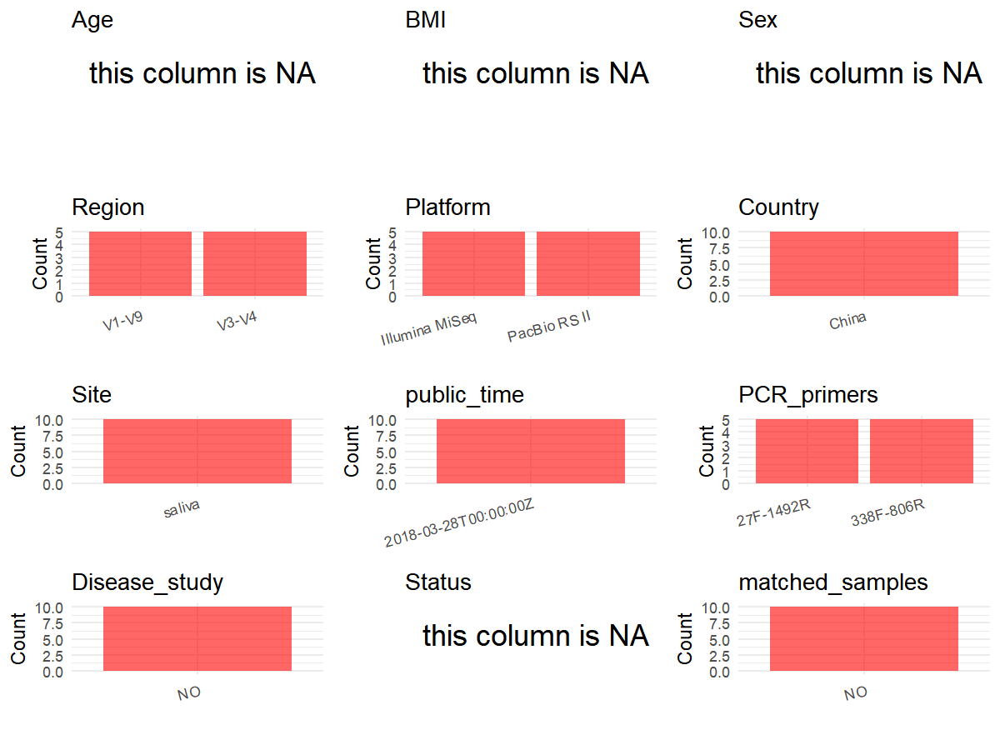

R Notebook: Metadata Processing Workflow
================

# Step 1: Obtain Initial Metadata from Each Project

To obtain the initial metadata: 1. Search for the BioProject ID (e.g.,
“PRJEBXXXX”) on the [NCBI SRA
website](https://www.ncbi.nlm.nih.gov/Traces/study/). 2. In the “Select”
table, click on “Metadata” and download the file. 3. The downloaded file
is typically named “SraRunTable.csv” and contains metadata for the
project.

``` r
# Load necessary libraries
library(dplyr)
library(ggplot2)
library(cowplot)

# Set working directory (update this path to your local directory)
setwd("D:/metadata/3/PRJNA445629")

# Read the initial metadata files
initial_meta<-read.csv("SraRunTable.csv",header = T)

# Combine the two metadata files
#meta <- rbind(initial_meta, initial_meta1)

#Remove entries non-oral samples
#initial_meta <- subset(initial_meta,BioSampleModel != "Metagenome or environmental")

# Check the number of samples containing "HT" in Sample.Name (e.g., healthy controls)
#nrow(subset(meta, grepl("HT", Sample.Name)))

# Display the first few rows of the metadata
head(initial_meta)
```

    ##          Run Assay.Type AvgSpotLen    Bases  BioProject    BioSample
    ## 1 SRR6906012   AMPLICON        602 43677508 PRJNA445629 SAMN08794404
    ## 2 SRR6906013   AMPLICON        602 39105318 PRJNA445629 SAMN08794405
    ## 3 SRR6906014   AMPLICON       1478 49260212 PRJNA445629 SAMN08794402
    ## 4 SRR6906015   AMPLICON        602 33128060 PRJNA445629 SAMN08794403
    ## 5 SRR6906016   AMPLICON       1477 31096186 PRJNA445629 SAMN08794400
    ## 6 SRR6906017   AMPLICON       1466 22794132 PRJNA445629 SAMN08794401
    ##                         BioSampleModel    Bytes
    ## 1 MIMS.me,MIGS/MIMS/MIMARKS.human-oral 21067010
    ## 2 MIMS.me,MIGS/MIMS/MIMARKS.human-oral 18576590
    ## 3 MIMS.me,MIGS/MIMS/MIMARKS.human-oral 23604798
    ## 4 MIMS.me,MIGS/MIMS/MIMARKS.human-oral 15864583
    ## 5 MIMS.me,MIGS/MIMS/MIMARKS.human-oral 15014797
    ## 6 MIMS.me,MIGS/MIMS/MIMARKS.human-oral 12373095
    ##                                                                    Center.Name
    ## 1 AFFILIATED HOSPITAL OF STOMATOLOGY, COLLEGE OF MEDICINE, ZHEJIANG UNIVERSITY
    ## 2 AFFILIATED HOSPITAL OF STOMATOLOGY, COLLEGE OF MEDICINE, ZHEJIANG UNIVERSITY
    ## 3 AFFILIATED HOSPITAL OF STOMATOLOGY, COLLEGE OF MEDICINE, ZHEJIANG UNIVERSITY
    ## 4 AFFILIATED HOSPITAL OF STOMATOLOGY, COLLEGE OF MEDICINE, ZHEJIANG UNIVERSITY
    ## 5 AFFILIATED HOSPITAL OF STOMATOLOGY, COLLEGE OF MEDICINE, ZHEJIANG UNIVERSITY
    ## 6 AFFILIATED HOSPITAL OF STOMATOLOGY, COLLEGE OF MEDICINE, ZHEJIANG UNIVERSITY
    ##   Collection_Date Consent DATASTORE.filetype DATASTORE.provider
    ## 1      2014-11-26  public   fastq,run.zq,sra         gs,ncbi,s3
    ## 2      2014-11-26  public         run.zq,sra         gs,ncbi,s3
    ## 3      2014-11-26  public         run.zq,sra         gs,ncbi,s3
    ## 4      2014-11-26  public   fastq,run.zq,sra         gs,ncbi,s3
    ## 5      2014-11-26  public         run.zq,sra         gs,ncbi,s3
    ## 6      2014-11-26  public         run.zq,sra         gs,ncbi,s3
    ##                       DATASTORE.region      env_biome    env_feature
    ## 1 gs.us-east1,ncbi.public,s3.us-east-1 not applicable not applicable
    ## 2 gs.us-east1,ncbi.public,s3.us-east-1 not applicable not applicable
    ## 3 gs.us-east1,ncbi.public,s3.us-east-1 not applicable not applicable
    ## 4 gs.us-east1,ncbi.public,s3.us-east-1 not applicable not applicable
    ## 5 gs.us-east1,ncbi.public,s3.us-east-1 not applicable not applicable
    ## 6 gs.us-east1,ncbi.public,s3.us-east-1 not applicable not applicable
    ##     env_material Experiment geo_loc_name_country geo_loc_name_country_continent
    ## 1 not applicable SRX3854629                China                           Asia
    ## 2 not applicable SRX3854628                China                           Asia
    ## 3 not applicable SRX3854627                China                           Asia
    ## 4 not applicable SRX3854626                China                           Asia
    ## 5 not applicable SRX3854625                China                           Asia
    ## 6 not applicable SRX3854624                China                           Asia
    ##      geo_loc_name         HOST     Instrument          lat_lon Library.Name
    ## 1 China: Zhejiang Homo sapiens Illumina MiSeq 30.23 N 119.72 E      Miseq-2
    ## 2 China: Zhejiang Homo sapiens Illumina MiSeq 30.23 N 119.72 E      Miseq-3
    ## 3 China: Zhejiang Homo sapiens   PacBio RS II 30.23 N 119.72 E     Pacbio-5
    ## 4 China: Zhejiang Homo sapiens Illumina MiSeq 30.23 N 119.72 E      Miseq-1
    ## 5 China: Zhejiang Homo sapiens   PacBio RS II 30.23 N 119.72 E     Pacbio-3
    ## 6 China: Zhejiang Homo sapiens   PacBio RS II 30.23 N 119.72 E     Pacbio-4
    ##   LibraryLayout LibrarySelection LibrarySource              Organism
    ## 1        PAIRED              PCR       GENOMIC human oral metagenome
    ## 2        PAIRED              PCR       GENOMIC human oral metagenome
    ## 3        SINGLE              PCR       GENOMIC human oral metagenome
    ## 4        PAIRED              PCR       GENOMIC human oral metagenome
    ## 5        SINGLE              PCR       GENOMIC human oral metagenome
    ## 6        SINGLE              PCR       GENOMIC human oral metagenome
    ##      Platform          ReleaseDate          create_date version
    ## 1    ILLUMINA 2018-03-28T00:00:00Z 2018-03-28T00:32:00Z       1
    ## 2    ILLUMINA 2018-03-28T00:00:00Z 2018-03-28T00:35:00Z       1
    ## 3 PACBIO_SMRT 2018-03-28T00:00:00Z 2018-03-28T00:39:00Z       1
    ## 4    ILLUMINA 2018-03-28T00:00:00Z 2018-03-28T00:32:00Z       1
    ## 5 PACBIO_SMRT 2018-03-28T00:00:00Z 2018-03-28T00:41:00Z       1
    ## 6 PACBIO_SMRT 2018-03-28T00:00:00Z 2018-03-28T00:38:00Z       1
    ##          sample_id Sample.Name SRA.Study
    ## 1 Miseq-children-2     Miseq-2 SRP136578
    ## 2 Miseq-children-3     Miseq-3 SRP136578
    ## 3 Pacbio-chidren-5    Pacbio-5 SRP136578
    ## 4 Miseq-children-1     Miseq-1 SRP136578
    ## 5 Pacbio-chidren-3    Pacbio-3 SRP136578
    ## 6 Pacbio-chidren-4    Pacbio-4 SRP136578

# Step 2: Create a Uniform Metadata Template

The uniform metadata should include the following columns:

1.  **BioProject**: Project ID (e.g., “PRJNA339212”)
2.  **Run**: Sample ID (e.g., “ERRXXXXXX” or “SRRXXXXXX”)
3.  **sample_name**: Original sample name submitted by the authors (not
    the database-assigned ID)
4.  **Age**: Age of the subject (if available)
5.  **BMI**: Body Mass Index (if available)
6.  **Sex**: Sex of the subject (“F” or “M”)
7.  **Region**: Targeted 16S rRNA region (e.g., “V3-V4”)
8.  **Platform**: Sequencing platform (e.g., “Illumina MiSeq”)
9.  **Country**: Country of sample origin (e.g., “China”)
10. **Site**: Sample site (e.g., “saliva”, “dental plaque”)
11. **public_time**: Data release date (format: “YYYY-MM-DD”)
12. **PCR_primers**: PCR primers used (e.g., “515F-806R”)
13. **title**: Title of the associated publication
14. **Disease_study**: Whether the study involves a disease (“YES” or
    “NO”)
15. **Status**: Disease status (e.g., “T2DM”, “HC”). Note: If the study
    includes both disease and healthy samples, this must be specified
    per sample.
16. **matched_samples**: matched samples (“YES” or “NO”)

``` r
# Create a uniform metadata dataframe
metadata <- data.frame(
  BioProject = initial_meta$BioProject,
  Run = initial_meta$Run,
  sample_name = initial_meta$Sample.Name,
  Age = NA,
  BMI = NA,
  Sex=NA,
  #Region = "V4",
  Platform = initial_meta$Instrument,
  Country = initial_meta$geo_loc_name_country,
  Site = "saliva",
  public_time = initial_meta$ReleaseDate,
  Status = NA,
  stringsAsFactors = FALSE
)
```

# Step 3: Manually Add Information from the Publication

Some information (e.g. PCR primers, study title, disease status) must be
manually extracted from the publication and added to the metadata.

``` r
# Add information obtained from the publication
#metadata$PCR_primers <- "515F-806R"
metadata$title <- "Improved High-Throughput Sequencing of the Human Oral Microbiome: From Illumina to PacBio"
metadata$Disease_study <- "NO"
# Assign disease status based on sample_name patterns
metadata <- metadata %>%
  mutate(Region = case_when(
    initial_meta$Instrument == "Illumina MiSeq" ~ "V3-V4",
    initial_meta$Instrument == "PacBio RS II" ~ "V1-V9"
  ))
metadata <- metadata %>%
  mutate(PCR_primers = case_when(
    initial_meta$Instrument == "Illumina MiSeq" ~ "338F-806R",
    initial_meta$Instrument == "PacBio RS II" ~ "27F-1492R"
  ))

metadata$matched_samples <- "NO"
```

# Step 4: Summarize and Validate the Metadata

``` r
# Check the number of unique runs and sample names
print(paste("Number of unique runs:", length(unique(metadata$Run))))
```

    ## [1] "Number of unique runs: 10"

``` r
print(paste("Number of unique sample names:", length(unique(metadata$sample_name))))
```

    ## [1] "Number of unique sample names: 10"

# Step 5: Visualize the Metadata

``` r

```

<!-- -->

# Step 6: Finalize and Export the Metadata

``` r
# Reorder columns to match the desired format
metadata <- metadata[, c(
  "BioProject", "Run", "sample_name", "Age", "BMI", "Sex", 
  "Region", "Platform", "Country", "Site", "public_time", 
  "PCR_primers", "title", "Disease_study", "Status","matched_samples"
)]

# Export the uniform metadata to a CSV file
write.csv(metadata, file = "metadata.csv", quote = TRUE)
head(metadata)
```

    ##    BioProject        Run sample_name Age BMI Sex Region       Platform Country
    ## 1 PRJNA445629 SRR6906012     Miseq-2  NA  NA  NA  V3-V4 Illumina MiSeq   China
    ## 2 PRJNA445629 SRR6906013     Miseq-3  NA  NA  NA  V3-V4 Illumina MiSeq   China
    ## 3 PRJNA445629 SRR6906014    Pacbio-5  NA  NA  NA  V1-V9   PacBio RS II   China
    ## 4 PRJNA445629 SRR6906015     Miseq-1  NA  NA  NA  V3-V4 Illumina MiSeq   China
    ## 5 PRJNA445629 SRR6906016    Pacbio-3  NA  NA  NA  V1-V9   PacBio RS II   China
    ## 6 PRJNA445629 SRR6906017    Pacbio-4  NA  NA  NA  V1-V9   PacBio RS II   China
    ##     Site          public_time PCR_primers
    ## 1 saliva 2018-03-28T00:00:00Z   338F-806R
    ## 2 saliva 2018-03-28T00:00:00Z   338F-806R
    ## 3 saliva 2018-03-28T00:00:00Z   27F-1492R
    ## 4 saliva 2018-03-28T00:00:00Z   338F-806R
    ## 5 saliva 2018-03-28T00:00:00Z   27F-1492R
    ## 6 saliva 2018-03-28T00:00:00Z   27F-1492R
    ##                                                                                       title
    ## 1 Improved High-Throughput Sequencing of the Human Oral Microbiome: From Illumina to PacBio
    ## 2 Improved High-Throughput Sequencing of the Human Oral Microbiome: From Illumina to PacBio
    ## 3 Improved High-Throughput Sequencing of the Human Oral Microbiome: From Illumina to PacBio
    ## 4 Improved High-Throughput Sequencing of the Human Oral Microbiome: From Illumina to PacBio
    ## 5 Improved High-Throughput Sequencing of the Human Oral Microbiome: From Illumina to PacBio
    ## 6 Improved High-Throughput Sequencing of the Human Oral Microbiome: From Illumina to PacBio
    ##   Disease_study Status matched_samples
    ## 1            NO     NA              NO
    ## 2            NO     NA              NO
    ## 3            NO     NA              NO
    ## 4            NO     NA              NO
    ## 5            NO     NA              NO
    ## 6            NO     NA              NO

## Notes for Students:

1.  **Metadata Accuracy**: Always cross-check the metadata with the
    original publication to ensure accuracy.
2.  **Manual Entries**: Columns like `PCR_primers`, and `Status` often
    require manual entry based on the publication.
3.  **Disease Status**: Be careful when assigning `Status`—some studies
    include both disease and healthy samples.
4.  **Visualization**: The plots help quickly identify the distribution
    of values in each column, which is useful for quality control.
5.  **Reproducibility**: Update the working directory and file paths to
    match your local environment.
