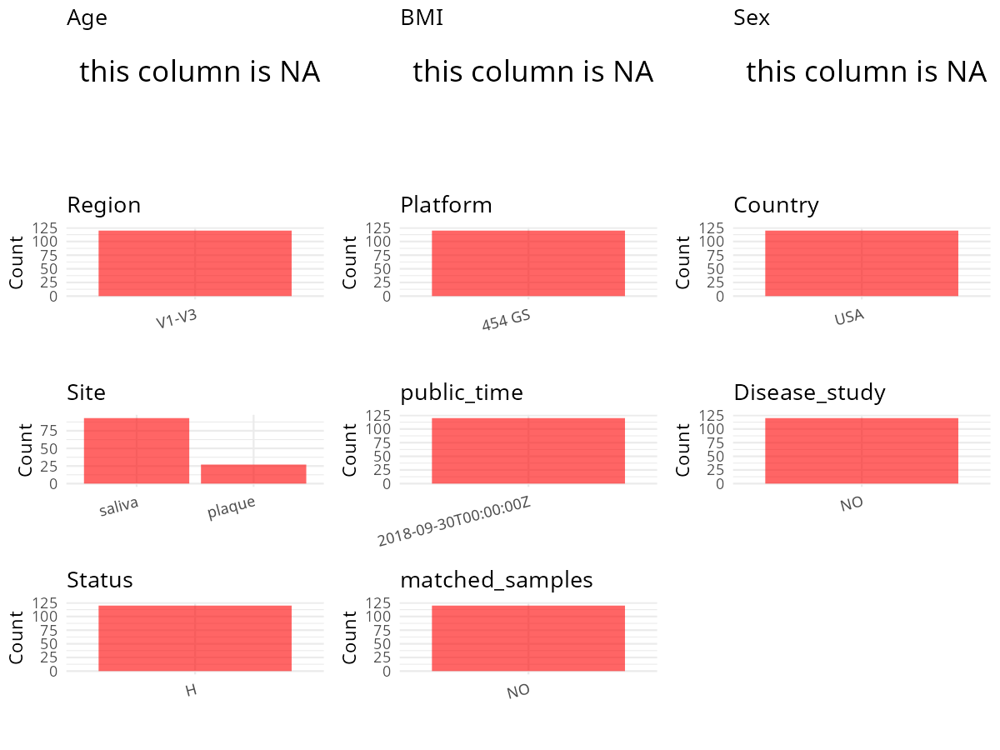

R Notebook: Metadata Processing Workflow
================

# Step 1: Obtain Initial Metadata from Each Project

To obtain the initial metadata: 1. Search for the BioProject ID (e.g.,
“PRJEBXXXX”) on the [NCBI SRA
website](https://www.ncbi.nlm.nih.gov/Traces/study/). 2. In the “Select”
table, click on “Metadata” and download the file. 3. The downloaded file
is typically named “SraRunTable.csv” and contains metadata for the
project.

``` r
# Load necessary libraries
library(dplyr)
library(ggplot2)
library(cowplot)
library(stringr)

# Set working directory (update this path to your local directory)
setwd("/home/hby/oral_project/PRJNA448135")

# Read the initial metadata files
initial_meta <- read.csv("SraRunTable.csv", header = T)

# Combine the two metadata files
# meta <- rbind(initial_meta, initial_meta1)

# Remove entries non-oral samples
# initial_meta <- subset(initial_meta,isolate %in% c("saliva","tongue coat"))

# Check the number of samples containing "HT" in Sample.Name (e.g., healthy controls)
# nrow(subset(meta, grepl("HT", Sample.Name)))

# Display the first few rows of the metadata
head(initial_meta)
```

    ##          Run Assay.Type AvgSpotLen   Bases  BioProject    BioSample                                BioSampleModel   Bytes Center.Name Collection_Date Consent DATASTORE.filetype
    ## 1 SRR6918902   AMPLICON        470    4233 PRJNA448135 SAMN08824480 MIMARKS.specimen,MIGS/MIMS/MIMARKS.human-oral   81864      MOTHUR      2011/12/20  public         run.zq,sra
    ## 2 SRR6918903   AMPLICON        453  430611 PRJNA448135 SAMN08824464 MIMARKS.specimen,MIGS/MIMS/MIMARKS.human-oral  295933      MOTHUR       2012/9/18  public         run.zq,sra
    ## 3 SRR6918904   AMPLICON        371    1113 PRJNA448135 SAMN08824550 MIMARKS.specimen,MIGS/MIMS/MIMARKS.human-oral   81446      MOTHUR       2012/7/10  public         run.zq,sra
    ## 4 SRR6918905   AMPLICON        502   18597 PRJNA448135 SAMN08824509 MIMARKS.specimen,MIGS/MIMS/MIMARKS.human-oral   90440      MOTHUR      2012/10/30  public         run.zq,sra
    ## 5 SRR6918906   AMPLICON        424 8755696 PRJNA448135 SAMN08824543 MIMARKS.specimen,MIGS/MIMS/MIMARKS.human-oral 4381513      MOTHUR       2012/1/13  public         run.zq,sra
    ## 6 SRR6918907   AMPLICON        454 4621626 PRJNA448135 SAMN08824535 MIMARKS.specimen,MIGS/MIMS/MIMARKS.human-oral 2355895      MOTHUR      2012/11/16  public         run.zq,sra
    ##   DATASTORE.provider                     DATASTORE.region                     env_biome env_feature env_material Experiment geo_loc_name_country geo_loc_name_country_continent
    ## 1         gs,ncbi,s3 gs.us-east1,ncbi.public,s3.us-east-1 animal-associated environment       mouth       saliva SRX3866448         uncalculated                   uncalculated
    ## 2         gs,ncbi,s3 gs.us-east1,ncbi.public,s3.us-east-1 animal-associated environment       mouth       saliva SRX3866447         uncalculated                   uncalculated
    ## 3         gs,ncbi,s3 gs.us-east1,ncbi.public,s3.us-east-1 animal-associated environment       mouth       saliva SRX3866446         uncalculated                   uncalculated
    ## 4         gs,ncbi,s3 gs.us-east1,ncbi.public,s3.us-east-1 animal-associated environment       mouth       saliva SRX3866445         uncalculated                   uncalculated
    ## 5         gs,ncbi,s3 gs.us-east1,ncbi.public,s3.us-east-1 animal-associated environment       mouth       saliva SRX3866444         uncalculated                   uncalculated
    ## 6         gs,ncbi,s3 gs.us-east1,ncbi.public,s3.us-east-1 animal-associated environment       mouth       plaque SRX3866443         uncalculated                   uncalculated
    ##    geo_loc_name host_family_relationship         HOST host_tissue_sampled Instrument         lat_lon
    ## 1 not collected       Baby from family 7 Homo sapiens              saliva     454 GS 39.95 N 82.99 W
    ## 2 not collected       Baby from family 8 Homo sapiens              saliva     454 GS 39.95 N 82.99 W
    ## 3 not collected        Mom from family 1 Homo sapiens              saliva     454 GS 39.95 N 82.99 W
    ## 4 not collected        Mom from family 4 Homo sapiens              saliva     454 GS 39.95 N 82.99 W
    ## 5 not collected       Baby from family 2 Homo sapiens              saliva     454 GS 39.95 N 82.99 W
    ## 6 not collected       Baby from family 2 Homo sapiens              plaque     454 GS 39.95 N 82.99 W
    ##                                                                                                                            Library_Name LibraryLayout LibrarySelection LibrarySource
    ## 1     454_rs_ab_070113_1472_pool_3__3.TCA.454Reads_Shotgun.v1v3.7.BS.2_AGTTGGC.ATTACCGCGGCTGCTGG.fastq.7.BS.2_AGTTGGC.ATTACCGCGGCTGCTGG        SINGLE              PCR   METAGENOMIC
    ## 2   454_rs_ab_070113_1472_pool_4__4.TCA.454Reads_Shotgun.v1v3.8.BS.8_CTTCCTTC.ATTACCGCGGCTGCTGG.fastq.8.BS.8_CTTCCTTC.ATTACCGCGGCTGCTGG        SINGLE              PCR   METAGENOMIC
    ## 3   454_rs_ab_070113_1472_pool_3__3.TCA.454Reads_Shotgun.v1v3.1.MS.9_CCGTTCAC.ATTACCGCGGCTGCTGG.fastq.1.MS.9_CCGTTCAC.ATTACCGCGGCTGCTGG        SINGLE              PCR   METAGENOMIC
    ## 4 454_rs_ab_070113_1472_pool_3__3.TCA.454Reads_Shotgun.v1v3.4.MS.11_TCCAGAAC.ATTACCGCGGCTGCTGG.fastq.4.MS.11_TCCAGAAC.ATTACCGCGGCTGCTGG        SINGLE              PCR   METAGENOMIC
    ## 5   454_rs_ab_070113_1472_pool_4__4.TCA.454Reads_Shotgun.v1v3.2.BS.2_TCGTTGTC.ATTACCGCGGCTGCTGG.fastq.2.BS.2_TCGTTGTC.ATTACCGCGGCTGCTGG        SINGLE              PCR   METAGENOMIC
    ## 6 454_rs_ab_070113_1472_pool_4__4.TCA.454Reads_Shotgun.v1v3.2.TS.12_AACGAGGC.ATTACCGCGGCTGCTGG.fastq.2.TS.12_AACGAGGC.ATTACCGCGGCTGCTGG        SINGLE              PCR   METAGENOMIC
    ##     Organism Platform          ReleaseDate          create_date version                        Sample_Name SRA.Study Cultivar                                      Description
    ## 1 metagenome    LS454 2018-09-30T00:00:00Z 2018-03-30T10:48:00Z       1   7.BS.2_AGTTGGC.ATTACCGCGGCTGCTGG SRP136797       NA Amplicon metagenomic sample of human oral saliva
    ## 2 metagenome    LS454 2018-09-30T00:00:00Z 2018-03-30T10:48:00Z       1  8.BS.8_CTTCCTTC.ATTACCGCGGCTGCTGG SRP136797       NA Amplicon metagenomic sample of human oral saliva
    ## 3 metagenome    LS454 2018-09-30T00:00:00Z 2018-03-30T10:48:00Z       1  1.MS.9_CCGTTCAC.ATTACCGCGGCTGCTGG SRP136797       NA Amplicon metagenomic sample of human oral saliva
    ## 4 metagenome    LS454 2018-09-30T00:00:00Z 2018-03-30T10:48:00Z       1 4.MS.11_TCCAGAAC.ATTACCGCGGCTGCTGG SRP136797       NA Amplicon metagenomic sample of human oral saliva
    ## 5 metagenome    LS454 2018-09-30T00:00:00Z 2018-03-30T10:48:00Z       1  2.BS.2_TCGTTGTC.ATTACCGCGGCTGCTGG SRP136797       NA Amplicon metagenomic sample of human oral saliva
    ## 6 metagenome    LS454 2018-09-30T00:00:00Z 2018-03-30T23:53:00Z       2 2.TS.12_AACGAGGC.ATTACCGCGGCTGCTGG SRP136797       NA Amplicon metagenomic sample of human oral plaque
    ##   isol_growth_condt   organism                                     sample_title seq_methods BarCode_max_mismatch..run. barcode..run. Primer_max_mismatch..run.            primer
    ## 1     not collected metagenome Amplicon metagenomic sample of human oral saliva         454                          1       AGTTGGC                         2 ATTACCGCGGCTGCTGG
    ## 2     not collected metagenome Amplicon metagenomic sample of human oral saliva         454                          1      CTTCCTTC                         2 ATTACCGCGGCTGCTGG
    ## 3     not collected metagenome Amplicon metagenomic sample of human oral saliva         454                          1      CCGTTCAC                         2 ATTACCGCGGCTGCTGG
    ## 4     not collected metagenome Amplicon metagenomic sample of human oral saliva         454                          1      TCCAGAAC                         2 ATTACCGCGGCTGCTGG
    ## 5     not collected metagenome Amplicon metagenomic sample of human oral saliva         454                          1      TCGTTGTC                         2 ATTACCGCGGCTGCTGG
    ## 6     not collected metagenome Amplicon metagenomic sample of human oral plaque         454                          1      AACGAGGC                         2 ATTACCGCGGCTGCTGG

# Step 2: Create a Uniform Metadata Template

The uniform metadata should include the following columns:

1.  **BioProject**: Project ID (e.g., “PRJNA339212”)
2.  **Run**: Sample ID (e.g., “ERRXXXXXX” or “SRRXXXXXX”)
3.  **sample_name**: Original sample name submitted by the authors (not
    the database-assigned ID)
4.  **Age**: Age of the subject (if available)
5.  **BMI**: Body Mass Index (if available)
6.  **Sex**: Sex of the subject (“F” or “M”)
7.  **Region**: Targeted 16S rRNA region (e.g., “V3-V4”)
8.  **Platform**: Sequencing platform (e.g., “Illumina MiSeq”)
9.  **Country**: Country of sample origin (e.g., “China”)
10. **Site**: Sample site (e.g., “saliva”, “dental plaque”)
11. **public_time**: Data release date (format: “YYYY-MM-DD”)
12. **PCR_primers**: PCR primers used (e.g., “515F-806R”)
13. **title**: Title of the associated publication
14. **Disease_study**: Whether the study involves a disease (“YES” or
    “NO”)
15. **Status**: Disease status (e.g., “T2DM”, “HC”). Note: If the study
    includes both disease and healthy samples, this must be specified
    per sample.
16. **matched_samples**: matched samples (“YES” or “NO”)

``` r
# Create a uniform metadata dataframe
metadata <- data.frame(
  BioProject = initial_meta$BioProject,
  Run = initial_meta$Run,
  sample_name = initial_meta$Sample_Name,
  Platform = initial_meta$Instrument,
  Site = initial_meta$host_tissue_sampled,
  public_time = initial_meta$ReleaseDate,
  PCR_primers = initial_meta$primer, # Placeholder, to be updated manually
  BMI = NA,
  Age = NA,
  Sex = NA,
  stringsAsFactors = FALSE
)
```

# Step 3: Manually Add Information from the Publication

Some information (e.g. PCR primers, study title, disease status) must be
manually extracted from the publication and added to the metadata.

``` r
# Add information obtained from the publication
metadata$Status <- "H"
metadata$Country <- "USA"
metadata$Region <- "V1-V3"
metadata$title <- "The Predominant Oral Microbiota Is Acquired Early in an Organized Pattern"
metadata$Disease_study <- "NO"
metadata$matched_samples <- "NO"
```

# Step 4: Summarize and Validate the Metadata

``` r
# Check the number of unique runs and sample names
print(paste("Number of unique runs:", length(unique(metadata$Run))))
```

    ## [1] "Number of unique runs: 120"

``` r
print(paste("Number of unique sample names:", length(unique(metadata$sample_name))))
```

    ## [1] "Number of unique sample names: 120"

# Step 5: Visualize the Metadata

``` r

```


# Step 6: Finalize and Export the Metadata

``` r
# Reorder columns to match the desired format
metadata <- metadata[, c(
  "BioProject", "Run", "sample_name", "Age", "BMI", "Sex",
  "Region", "Platform", "Country", "Site", "public_time",
  "PCR_primers", "title", "Disease_study", "Status", "matched_samples"
)]

# Export the uniform metadata to a CSV file
write.csv(metadata, file = "metadata.csv", quote = FALSE)
head(metadata)
```

    ##    BioProject        Run                        sample_name Age BMI Sex Region Platform Country   Site          public_time       PCR_primers
    ## 1 PRJNA448135 SRR6918902   7.BS.2_AGTTGGC.ATTACCGCGGCTGCTGG  NA  NA  NA  V1-V3   454 GS     USA saliva 2018-09-30T00:00:00Z ATTACCGCGGCTGCTGG
    ## 2 PRJNA448135 SRR6918903  8.BS.8_CTTCCTTC.ATTACCGCGGCTGCTGG  NA  NA  NA  V1-V3   454 GS     USA saliva 2018-09-30T00:00:00Z ATTACCGCGGCTGCTGG
    ## 3 PRJNA448135 SRR6918904  1.MS.9_CCGTTCAC.ATTACCGCGGCTGCTGG  NA  NA  NA  V1-V3   454 GS     USA saliva 2018-09-30T00:00:00Z ATTACCGCGGCTGCTGG
    ## 4 PRJNA448135 SRR6918905 4.MS.11_TCCAGAAC.ATTACCGCGGCTGCTGG  NA  NA  NA  V1-V3   454 GS     USA saliva 2018-09-30T00:00:00Z ATTACCGCGGCTGCTGG
    ## 5 PRJNA448135 SRR6918906  2.BS.2_TCGTTGTC.ATTACCGCGGCTGCTGG  NA  NA  NA  V1-V3   454 GS     USA saliva 2018-09-30T00:00:00Z ATTACCGCGGCTGCTGG
    ## 6 PRJNA448135 SRR6918907 2.TS.12_AACGAGGC.ATTACCGCGGCTGCTGG  NA  NA  NA  V1-V3   454 GS     USA plaque 2018-09-30T00:00:00Z ATTACCGCGGCTGCTGG
    ##                                                                       title Disease_study Status matched_samples
    ## 1 The Predominant Oral Microbiota Is Acquired Early in an Organized Pattern            NO      H              NO
    ## 2 The Predominant Oral Microbiota Is Acquired Early in an Organized Pattern            NO      H              NO
    ## 3 The Predominant Oral Microbiota Is Acquired Early in an Organized Pattern            NO      H              NO
    ## 4 The Predominant Oral Microbiota Is Acquired Early in an Organized Pattern            NO      H              NO
    ## 5 The Predominant Oral Microbiota Is Acquired Early in an Organized Pattern            NO      H              NO
    ## 6 The Predominant Oral Microbiota Is Acquired Early in an Organized Pattern            NO      H              NO

## Notes for Students:

1.  **Metadata Accuracy**: Always cross-check the metadata with the
    original publication to ensure accuracy.
2.  **Manual Entries**: Columns like `PCR_primers`, and `Status` often
    require manual entry based on the publication.
3.  **Disease Status**: Be careful when assigning `Status`—some studies
    include both disease and healthy samples.
4.  **Visualization**: The plots help quickly identify the distribution
    of values in each column, which is useful for quality control.
5.  **Reproducibility**: Update the working directory and file paths to
    match your local environment.
