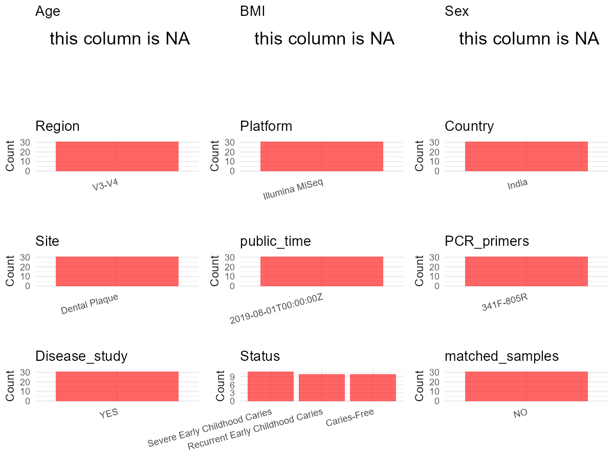

# Step 1: Obtain Initial Metadata from Each Project

To obtain the initial metadata: 1. Search for the BioProject ID (e.g.,
“PRJEBXXXX”) on the [NCBI SRA
website](https://www.ncbi.nlm.nih.gov/Traces/study/). 2. In the “Select”
table, click on “Metadata” and download the file. 3. The downloaded file
is typically named “SraRunTable.csv” and contains metadata for the
project.

    library(tidyverse)
    library(ggplot2)
    library(cowplot)

    setwd("C:/Users/zyc/Desktop/oral_project/PRJNA454811")
    initial_meta <- read.csv("SraRunTable.csv", header = TRUE) 
    head(initial_meta)

    ##          Run Assay.Type AvgSpotLen     Bases  BioProject    BioSample                       BioSampleModel     Bytes
    ## 1 SRR7647537   AMPLICON        500 289163500 PRJNA454811 SAMN09708708 MIMS.me,MIGS/MIMS/MIMARKS.human-oral 130574838
    ## 2 SRR7647538   AMPLICON        500 250065500 PRJNA454811 SAMN09708708 MIMS.me,MIGS/MIMS/MIMARKS.human-oral 117172582
    ## 3 SRR7647539   AMPLICON        500 270997500 PRJNA454811 SAMN09708708 MIMS.me,MIGS/MIMS/MIMARKS.human-oral 125369742
    ## 4 SRR7647540   AMPLICON        500 290694000 PRJNA454811 SAMN09708708 MIMS.me,MIGS/MIMS/MIMARKS.human-oral 134577411
    ## 5 SRR7647541   AMPLICON        500 330119000 PRJNA454811 SAMN09708708 MIMS.me,MIGS/MIMS/MIMARKS.human-oral 150855247
    ## 6 SRR7647542   AMPLICON        500 381763000 PRJNA454811 SAMN09708708 MIMS.me,MIGS/MIMS/MIMARKS.human-oral 179278545
    ##                           Center.Name Collection_Date Consent DATASTORE.filetype DATASTORE.provider
    ## 1 K.S.RANGASAMY COLLEGE OF TECHNOLOGY      2017-11-17  public         run.zq,sra         gs,ncbi,s3
    ## 2 K.S.RANGASAMY COLLEGE OF TECHNOLOGY      2017-11-17  public         run.zq,sra         gs,ncbi,s3
    ## 3 K.S.RANGASAMY COLLEGE OF TECHNOLOGY      2017-11-17  public         run.zq,sra         gs,ncbi,s3
    ## 4 K.S.RANGASAMY COLLEGE OF TECHNOLOGY      2017-11-17  public         run.zq,sra         gs,ncbi,s3
    ## 5 K.S.RANGASAMY COLLEGE OF TECHNOLOGY      2017-11-17  public         run.zq,sra         gs,ncbi,s3
    ## 6 K.S.RANGASAMY COLLEGE OF TECHNOLOGY      2017-11-17  public         run.zq,sra         gs,ncbi,s3
    ##                       DATASTORE.region   env_biome   env_feature  env_material Experiment geo_loc_name_country
    ## 1 gs.us-east1,ncbi.public,s3.us-east-1 Oral cavity Teeth surface Dental Plaque SRX4510507                India
    ## 2 gs.us-east1,ncbi.public,s3.us-east-1 Oral cavity Teeth surface Dental Plaque SRX4510506                India
    ## 3 gs.us-east1,ncbi.public,s3.us-east-1 Oral cavity Teeth surface Dental Plaque SRX4510505                India
    ## 4 gs.us-east1,ncbi.public,s3.us-east-1 Oral cavity Teeth surface Dental Plaque SRX4510504                India
    ## 5 gs.us-east1,ncbi.public,s3.us-east-1 Oral cavity Teeth surface Dental Plaque SRX4510503                India
    ## 6 gs.us-east1,ncbi.public,s3.us-east-1 Oral cavity Teeth surface Dental Plaque SRX4510502                India
    ##   geo_loc_name_country_continent                   geo_loc_name         HOST     Instrument       lat_lon Library.Name
    ## 1                           Asia India:Tiruchengode\\,TamilNadu Homo sapiens Illumina MiSeq 11.2 N 77.1 E          SC5
    ## 2                           Asia India:Tiruchengode\\,TamilNadu Homo sapiens Illumina MiSeq 11.2 N 77.1 E          CF7
    ## 3                           Asia India:Tiruchengode\\,TamilNadu Homo sapiens Illumina MiSeq 11.2 N 77.1 E          SC7
    ## 4                           Asia India:Tiruchengode\\,TamilNadu Homo sapiens Illumina MiSeq 11.2 N 77.1 E          SC6
    ## 5                           Asia India:Tiruchengode\\,TamilNadu Homo sapiens Illumina MiSeq 11.2 N 77.1 E          CF9
    ## 6                           Asia India:Tiruchengode\\,TamilNadu Homo sapiens Illumina MiSeq 11.2 N 77.1 E          CF8
    ##   LibraryLayout LibrarySelection LibrarySource              Organism Platform          ReleaseDate          create_date version
    ## 1        PAIRED              PCR   METAGENOMIC human oral metagenome ILLUMINA 2019-08-01T00:00:00Z 2018-08-06T09:48:00Z       1
    ## 2        PAIRED              PCR   METAGENOMIC human oral metagenome ILLUMINA 2019-08-01T00:00:00Z 2018-08-06T09:48:00Z       1
    ## 3        PAIRED              PCR   METAGENOMIC human oral metagenome ILLUMINA 2019-08-01T00:00:00Z 2018-08-06T09:48:00Z       1
    ## 4        PAIRED              PCR   METAGENOMIC human oral metagenome ILLUMINA 2019-08-01T00:00:00Z 2018-08-06T09:48:00Z       1
    ## 5        PAIRED              PCR   METAGENOMIC human oral metagenome ILLUMINA 2019-08-01T00:00:00Z 2018-08-06T09:48:00Z       1
    ## 6        PAIRED              PCR   METAGENOMIC human oral metagenome ILLUMINA 2019-08-01T00:00:00Z 2018-08-06T09:48:00Z       1
    ##          Sample.Name SRA.Study
    ## 1 16s V3-V4 amplicon SRP156445
    ## 2 16s V3-V4 amplicon SRP156445
    ## 3 16s V3-V4 amplicon SRP156445
    ## 4 16s V3-V4 amplicon SRP156445
    ## 5 16s V3-V4 amplicon SRP156445
    ## 6 16s V3-V4 amplicon SRP156445

# Step 2: Create a Uniform Metadata Template

The uniform metadata should include the following columns:

1.  **BioProject**: Project ID (e.g., “PRJNA339212”)
2.  **Run**: Sample ID (e.g., “ERRXXXXXX” or “SRRXXXXXX”)
3.  **sample\_name**: Original sample name submitted by the authors (not
    the database-assigned ID)
4.  **Age**: Age of the subject (if available)
5.  **BMI**: Body Mass Index (if available)
6.  **Sex**: Sex of the subject (“F” or “M”)
7.  **Region**: Targeted 16S rRNA region (e.g., “V3-V4”)
8.  **Platform**: Sequencing platform (e.g., “Illumina MiSeq”)
9.  **Country**: Country of sample origin (e.g., “China”)
10. **Site**: Sample site (e.g., “saliva”, “dental plaque”)
11. **public\_time**: Data release date (format: “YYYY-MM-DD”)
12. **PCR\_primers**: PCR primers used (e.g., “515F-806R”)
13. **title**: Title of the associated publication
14. **Disease\_study**: Whether the study involves a disease (“YES” or
    “NO”)
15. **Status**: Disease status (e.g., “T2DM”, “HC”). Note: If the study
    includes both disease and healthy samples, this must be specified
    per sample.
16. **matched\_samples**: matched samples (“YES” or “NO”)

<!-- -->

    metadata <- data.frame(
      BioProject = initial_meta$BioProject,
      Run = initial_meta$Run,
      sample_name = initial_meta$Library.Name,
      Age = NA, 
      BMI = NA,  
      Sex = NA,
      Platform = initial_meta$Instrument,
      Country = initial_meta$geo_loc_name_country,
      Site = initial_meta$env_material,
      public_time = initial_meta$ReleaseDate,
      stringsAsFactors = FALSE
    )

# Step 3: Manually Add Information from the Publication

Some information (e.g. PCR primers, study title, disease status) must be
manually extracted from the publication and added to the metadata.

     # metadata <- metadata %>%
     #  mutate(Sex = recode(Sex, "female" = "F", "male" = "M"))
    metadata <-metadata%>%
      mutate(Status = str_remove_all(sample_name,"[^A-Za-z]"))%>%
      mutate(Status = case_when(
        Status == "CF" ~ "Caries-Free",
        Status == "SC" ~ "Severe Early Childhood Caries",
        TRUE ~ " Recurrent Early Childhood Caries"
      ))

    metadata$matched_samples = "NO"
    metadata$Region = "V3-V4"
    metadata$title <- "Bacterial diversity and functional analysis of severe early childhood caries and recurrence in India"
    metadata$Disease_study <- "YES"
    metadata$PCR_primers <- "341F-805R"
    head(metadata)

    ##    BioProject        Run sample_name Age BMI Sex       Platform Country          Site          public_time
    ## 1 PRJNA454811 SRR7647537         SC5  NA  NA  NA Illumina MiSeq   India Dental Plaque 2019-08-01T00:00:00Z
    ## 2 PRJNA454811 SRR7647538         CF7  NA  NA  NA Illumina MiSeq   India Dental Plaque 2019-08-01T00:00:00Z
    ## 3 PRJNA454811 SRR7647539         SC7  NA  NA  NA Illumina MiSeq   India Dental Plaque 2019-08-01T00:00:00Z
    ## 4 PRJNA454811 SRR7647540         SC6  NA  NA  NA Illumina MiSeq   India Dental Plaque 2019-08-01T00:00:00Z
    ## 5 PRJNA454811 SRR7647541         CF9  NA  NA  NA Illumina MiSeq   India Dental Plaque 2019-08-01T00:00:00Z
    ## 6 PRJNA454811 SRR7647542         CF8  NA  NA  NA Illumina MiSeq   India Dental Plaque 2019-08-01T00:00:00Z
    ##                          Status matched_samples Region
    ## 1 Severe Early Childhood Caries              NO  V3-V4
    ## 2                   Caries-Free              NO  V3-V4
    ## 3 Severe Early Childhood Caries              NO  V3-V4
    ## 4 Severe Early Childhood Caries              NO  V3-V4
    ## 5                   Caries-Free              NO  V3-V4
    ## 6                   Caries-Free              NO  V3-V4
    ##                                                                                                  title Disease_study PCR_primers
    ## 1 Bacterial diversity and functional analysis of severe early childhood caries and recurrence in India           YES   341F-805R
    ## 2 Bacterial diversity and functional analysis of severe early childhood caries and recurrence in India           YES   341F-805R
    ## 3 Bacterial diversity and functional analysis of severe early childhood caries and recurrence in India           YES   341F-805R
    ## 4 Bacterial diversity and functional analysis of severe early childhood caries and recurrence in India           YES   341F-805R
    ## 5 Bacterial diversity and functional analysis of severe early childhood caries and recurrence in India           YES   341F-805R
    ## 6 Bacterial diversity and functional analysis of severe early childhood caries and recurrence in India           YES   341F-805R

# Step 4: Summarize and Validate the Metadata

    print(paste("Number of unique runs:", length(unique(metadata$Run))))

    ## [1] "Number of unique runs: 31"

    print(paste("Number of unique sample names:", length(unique(metadata$sample_name))))

    ## [1] "Number of unique sample names: 31"

# Step 5: Visualize the Metadata

    plot_data <- metadata %>%
      select(-BioProject, -Run, -sample_name, -title)

    # Function to create simple plots for each column
    create_simple_plots <- function(data) {
      plots <- list()
      
      for (col in colnames(data)) {
        # Check if the column is all NA
        if (all(is.na(data[[col]]))) {
          # Create an empty plot with text indicating all NA
          p <- ggplot() +
            annotate("text", x = 0.5, y = 0.5, label = "this column is NA", size = 6) +
            labs(title = col) +
            theme_void()
        } else if (is.numeric(data[[col]])) {
          # Numeric variable: histogram
          p <- ggplot(data, aes(x = .data[[col]])) +
            geom_histogram(fill = "blue", alpha = 0.6, bins = 20, na.rm = T) +
            labs(title = col) +
            theme_minimal()
        } else {
          # Categorical variable: bar plot (remove NA values)
          count_data <- as.data.frame(table(data[[col]], useNA = "ifany"))
          p <- ggplot(count_data, aes(x = reorder(Var1, -Freq), y = Freq)) +
            geom_col(fill = "red", alpha = 0.6) +
            labs(title = col, x = NULL, y = "Count") +
            theme_minimal() +
            theme(axis.text.x = element_text(angle = 15, hjust = 1))
        }
        plots[[col]] <- p
      }
      
      return(plots)
    }

    plots <- create_simple_plots(plot_data)
    p<-plot_grid(plots$Age, 
              plots$BMI, 
              plots$Sex, 
              plots$Region, 
              plots$Platform, 
              plots$Country, 
              plots$Site,
              plots$public_time, 
              plots$PCR_primers,
              plots$Disease_study,
              plots$Status,
              plots$matched_samples,# add 
              ncol = 3, align = "hv", axis = "lb")
    ggsave("Metadata_Summary.png", plot = p, width = 8, height = 6, dpi = 150)

    

 \# Step 6: Finalize and Export the Metadata

    metadata <- metadata[, c(
      "BioProject", "Run", "sample_name", "Age", "BMI", "Sex", 
      "Region", "Platform", "Country", "Site", "public_time", 
      "PCR_primers", "title", "Disease_study", "Status","matched_samples"
    )]

    write.csv(metadata, file = "metadata.csv", quote = FALSE)
