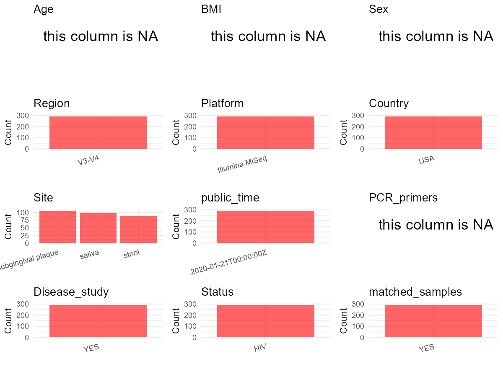

# Step 1: Obtain Initial Metadata from Each Project

To obtain the initial metadata: 1. Search for the BioProject ID (e.g.,
“PRJEBXXXX”) on the [NCBI SRA
website](https://www.ncbi.nlm.nih.gov/Traces/study/). 2. In the “Select”
table, click on “Metadata” and download the file. 3. The downloaded file
is typically named “SraRunTable.csv” and contains metadata for the
project.

    library(tidyverse)
    library(ggplot2)
    library(cowplot)

    setwd("C:/Users/zyc/Desktop/oral_project/data/projects/PRJNA471556")
    initial_meta <- read.csv("SraRunTable.csv", header = TRUE) 
    head(initial_meta)

    ##           Run Assay.Type AvgSpotLen    Bases  BioProject    BioSample                             BioSampleModel    Bytes         Center.Name
    ## 1 SRR12994814   AMPLICON        600 19931818 PRJNA471556 SAMN16678011 MIMS.me,MIGS/MIMS/MIMARKS.human-associated 11433943 COLUMBIA UNIVERSITY
    ## 2 SRR12994815   AMPLICON        600 24138979 PRJNA471556 SAMN16678010 MIMS.me,MIGS/MIMS/MIMARKS.human-associated 13395739 COLUMBIA UNIVERSITY
    ## 3 SRR12994816   AMPLICON        600 20388101 PRJNA471556 SAMN16678009 MIMS.me,MIGS/MIMS/MIMARKS.human-associated 11554627 COLUMBIA UNIVERSITY
    ## 4 SRR12994817   AMPLICON        600 16010397 PRJNA471556 SAMN16678008 MIMS.me,MIGS/MIMS/MIMARKS.human-associated  9416954 COLUMBIA UNIVERSITY
    ## 5 SRR12994818   AMPLICON        601  8551718 PRJNA471556 SAMN16678007 MIMS.me,MIGS/MIMS/MIMARKS.human-associated  4657785 COLUMBIA UNIVERSITY
    ## 6 SRR12994819   AMPLICON        600 21601912 PRJNA471556 SAMN16678006 MIMS.me,MIGS/MIMS/MIMARKS.human-associated 11356520 COLUMBIA UNIVERSITY
    ##   clinic_visit Collection_Date Consent DATASTORE.filetype DATASTORE.provider                     DATASTORE.region Experiment
    ## 1           V1  not applicable  public         run.zq,sra         gs,ncbi,s3 gs.us-east1,ncbi.public,s3.us-east-1 SRX9446283
    ## 2           V1  not applicable  public         run.zq,sra         gs,ncbi,s3 gs.us-east1,ncbi.public,s3.us-east-1 SRX9446282
    ## 3           V1  not applicable  public         run.zq,sra         gs,ncbi,s3 gs.us-east1,ncbi.public,s3.us-east-1 SRX9446281
    ## 4           V1  not applicable  public         run.zq,sra         gs,ncbi,s3 gs.us-east1,ncbi.public,s3.us-east-1 SRX9446280
    ## 5           V1  not applicable  public         run.zq,sra         gs,ncbi,s3 gs.us-east1,ncbi.public,s3.us-east-1 SRX9446279
    ## 6           V1  not applicable  public         run.zq,sra         gs,ncbi,s3 gs.us-east1,ncbi.public,s3.us-east-1 SRX9446278
    ##   geo_loc_name_country geo_loc_name_country_continent       geo_loc_name         HOST host_subject_id     Instrument isolation_source
    ## 1                  USA                  North America USA: New York City Homo sapiens              98 Illumina MiSeq           saliva
    ## 2                  USA                  North America USA: New York City Homo sapiens              97 Illumina MiSeq            stool
    ## 3                  USA                  North America USA: New York City Homo sapiens              97 Illumina MiSeq           saliva
    ## 4                  USA                  North America USA: New York City Homo sapiens              74 Illumina MiSeq           saliva
    ## 5                  USA                  North America USA: New York City Homo sapiens              61 Illumina MiSeq            stool
    ## 6                  USA                  North America USA: New York City Homo sapiens              61 Illumina MiSeq           saliva
    ##          lat_lon  Library.Name LibraryLayout LibrarySelection LibrarySource         Organism Platform          ReleaseDate
    ## 1 not applicable  0098.V1.SALB        PAIRED              PCR   METAGENOMIC human metagenome ILLUMINA 2020-11-05T00:00:00Z
    ## 2 not applicable 0097.V1.STOOL        PAIRED              PCR   METAGENOMIC human metagenome ILLUMINA 2020-11-05T00:00:00Z
    ## 3 not applicable  0097.V1.SALB        PAIRED              PCR   METAGENOMIC human metagenome ILLUMINA 2020-11-05T00:00:00Z
    ## 4 not applicable  0074.V1.SALB        PAIRED              PCR   METAGENOMIC human metagenome ILLUMINA 2020-11-05T00:00:00Z
    ## 5 not applicable 0061.V1.STOOL        PAIRED              PCR   METAGENOMIC human metagenome ILLUMINA 2020-11-05T00:00:00Z
    ## 6 not applicable  0061.V1.SALW        PAIRED              PCR   METAGENOMIC human metagenome ILLUMINA 2020-11-05T00:00:00Z
    ##            create_date version   Sample.Name SRA.Study plaque_type env_biome env_feature env_material isol_growth_condt strain
    ## 1 2020-11-05T16:06:00Z       1  0098.V1.SALB SRP146270                                                                        
    ## 2 2020-11-05T16:07:00Z       1 0097.V1.STOOL SRP146270                                                                        
    ## 3 2020-11-05T16:06:00Z       1  0097.V1.SALB SRP146270                                                                        
    ## 4 2020-11-05T21:55:00Z       2  0074.V1.SALB SRP146270                                                                        
    ## 5 2020-11-05T16:06:00Z       1 0061.V1.STOOL SRP146270                                                                        
    ## 6 2020-11-05T21:55:00Z       2  0061.V1.SALW SRP146270                                                                        
    ##   env_broad_scale env_local_scale     env_medium
    ## 1  not applicable  not applicable not applicable
    ## 2  not applicable  not applicable not applicable
    ## 3  not applicable  not applicable not applicable
    ## 4  not applicable  not applicable not applicable
    ## 5  not applicable  not applicable not applicable
    ## 6  not applicable  not applicable not applicable

# Step 2: Create a Uniform Metadata Template

The uniform metadata should include the following columns:

1.  **BioProject**: Project ID (e.g., “PRJNA339212”)
2.  **Run**: Sample ID (e.g., “ERRXXXXXX” or “SRRXXXXXX”)
3.  **sample\_name**: Original sample name submitted by the authors (not
    the database-assigned ID)
4.  **Age**: Age of the subject (if available)
5.  **BMI**: Body Mass Index (if available)
6.  **Sex**: Sex of the subject (“F” or “M”)
7.  **Region**: Targeted 16S rRNA region (e.g., “V3-V4”)
8.  **Platform**: Sequencing platform (e.g., “Illumina MiSeq”)
9.  **Country**: Country of sample origin (e.g., “China”)
10. **Site**: Sample site (e.g., “saliva”, “dental plaque”)
11. **public\_time**: Data release date (format: “YYYY-MM-DD”)
12. **PCR\_primers**: PCR primers used (e.g., “515F-806R”)
13. **title**: Title of the associated publication
14. **Disease\_study**: Whether the study involves a disease (“YES” or
    “NO”)
15. **Status**: Disease status (e.g., “T2DM”, “HC”). Note: If the study
    includes both disease and healthy samples, this must be specified
    per sample.
16. **matched\_samples**: matched samples (“YES” or “NO”)

<!-- -->

    metadata <- data.frame(
      BioProject = initial_meta$BioProject,
      Run = initial_meta$Run,
      sample_name = initial_meta$Library.Name,
      Age = NA,
      BMI = NA,
      Sex = NA,
      Platform = initial_meta$Instrument,
      Country = initial_meta$geo_loc_name_country,
      Site = initial_meta$isolation_source,
      public_time = initial_meta$ReleaseDate,
      # Status = initial_meta$Sample.Name,
      stringsAsFactors = FALSE
    )

# Step 3: Manually Add Information from the Publication

Some information (e.g. PCR primers, study title, disease status) must be
manually extracted from the publication and added to the metadata.

    metadata <- metadata %>% mutate(Site = case_when(
      grepl("SUBGINGIVAL PLAQUE",Site) ~ "subgingival plaque",
      TRUE ~ Site
    )) 

    metadata <- metadata %>%filter(grepl("16S",sample_name))

     # metadata <- metadata %>%
     #  mutate(Sex = recode(Sex, "female" = "F", "male" = "M"))
    # metadata <-metadata%>%
    #   mutate(Status = case_when(Site == "mucous" ~ "OSCC",
    #                             Site == "dental plaque" ~ "OSCC",
    #                             Site == "tumor" ~ "OSCC",
    #                             TRUE ~ NA))

    metadata$Status <- "HIV"
    metadata$matched_samples <- "YES"
    metadata$Region <- "V3-V4"
    metadata$title <- "Oral and Gut Microbial Diversity and Immune Regulation in Patients with HIV on Antiretroviral Therapy"
    metadata$Disease_study <- "YES"
    metadata$PCR_primers <- NA
    head(metadata)

    ##    BioProject        Run      sample_name Age BMI Sex       Platform Country               Site          public_time Status matched_samples
    ## 1 PRJNA471556 SRR7168117 2005.V1.SUBF.16S  NA  NA  NA Illumina MiSeq     USA subgingival plaque 2020-01-21T00:00:00Z    HIV             YES
    ## 2 PRJNA471556 SRR7168118 0038.V2.SALB.16S  NA  NA  NA Illumina MiSeq     USA             saliva 2020-01-21T00:00:00Z    HIV             YES
    ## 3 PRJNA471556 SRR7168119 0023.V1.SUBF.16S  NA  NA  NA Illumina MiSeq     USA subgingival plaque 2020-01-21T00:00:00Z    HIV             YES
    ## 4 PRJNA471556 SRR7168120 0005.V2.SALB.16S  NA  NA  NA Illumina MiSeq     USA             saliva 2020-01-21T00:00:00Z    HIV             YES
    ## 5 PRJNA471556 SRR7168121 0026.V1.SALB.16S  NA  NA  NA Illumina MiSeq     USA             saliva 2020-01-21T00:00:00Z    HIV             YES
    ## 6 PRJNA471556 SRR7168122 2057.V1.SALB.16S  NA  NA  NA Illumina MiSeq     USA             saliva 2020-01-21T00:00:00Z    HIV             YES
    ##   Region                                                                                                 title Disease_study PCR_primers
    ## 1  V3-V4 Oral and Gut Microbial Diversity and Immune Regulation in Patients with HIV on Antiretroviral Therapy           YES          NA
    ## 2  V3-V4 Oral and Gut Microbial Diversity and Immune Regulation in Patients with HIV on Antiretroviral Therapy           YES          NA
    ## 3  V3-V4 Oral and Gut Microbial Diversity and Immune Regulation in Patients with HIV on Antiretroviral Therapy           YES          NA
    ## 4  V3-V4 Oral and Gut Microbial Diversity and Immune Regulation in Patients with HIV on Antiretroviral Therapy           YES          NA
    ## 5  V3-V4 Oral and Gut Microbial Diversity and Immune Regulation in Patients with HIV on Antiretroviral Therapy           YES          NA
    ## 6  V3-V4 Oral and Gut Microbial Diversity and Immune Regulation in Patients with HIV on Antiretroviral Therapy           YES          NA

# Step 4: Summarize and Validate the Metadata

    print(paste("Number of unique runs:", length(unique(metadata$Run))))

    ## [1] "Number of unique runs: 293"

    print(paste("Number of unique sample names:", length(unique(metadata$sample_name))))

    ## [1] "Number of unique sample names: 264"

# Step 5: Visualize the Metadata

    plot_data <- metadata %>%
      select(-BioProject, -Run, -sample_name, -title)

    # Function to create simple plots for each column
    create_simple_plots <- function(data) {
      plots <- list()

      for (col in colnames(data)) {
        # Check if the column is all NA
        if (all(is.na(data[[col]]))) {
          # Create an empty plot with text indicating all NA
          p <- ggplot() +
            annotate("text", x = 0.5, y = 0.5, label = "this column is NA", size = 6) +
            labs(title = col) +
            theme_void()
        } else if (is.numeric(data[[col]])) {
          # Numeric variable: histogram
          p <- ggplot(data, aes(x = .data[[col]])) +
            geom_histogram(fill = "blue", alpha = 0.6, bins = 20, na.rm = T) +
            labs(title = col) +
            theme_minimal()
        } else {
          # Categorical variable: bar plot (remove NA values)
          count_data <- as.data.frame(table(data[[col]], useNA = "ifany"))
          p <- ggplot(count_data, aes(x = reorder(Var1, -Freq), y = Freq)) +
            geom_col(fill = "red", alpha = 0.6) +
            labs(title = col, x = NULL, y = "Count") +
            theme_minimal() +
            theme(axis.text.x = element_text(angle = 15, hjust = 1))
        }
        plots[[col]] <- p
      }

      return(plots)
    }

    plots <- create_simple_plots(plot_data)
    p<-plot_grid(plots$Age,
              plots$BMI,
              plots$Sex,
              plots$Region,
              plots$Platform,
              plots$Country,
              plots$Site,
              plots$public_time,
              plots$PCR_primers,
              plots$Disease_study,
              plots$Status,
              plots$matched_samples,# add
              ncol = 3, align = "hv", axis = "lb")
    ggsave("Metadata_Summary.png", plot = p, width = 8, height = 6, dpi = 150)

    

 \# Step 6: Finalize and Export the Metadata

    metadata <- metadata[, c(
      "BioProject", "Run", "sample_name", "Age", "BMI", "Sex",
      "Region", "Platform", "Country", "Site", "public_time",
      "PCR_primers", "title", "Disease_study", "Status","matched_samples"
    )]

    write.csv(metadata, file = "metadata.csv", quote = FALSE)
