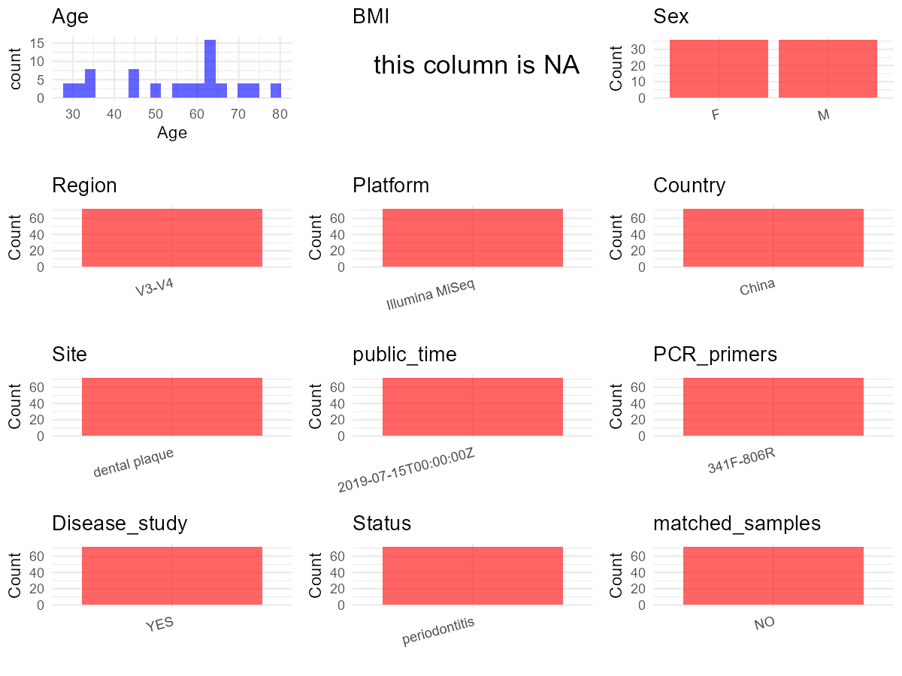

# Step 1: Obtain Initial Metadata from Each Project

To obtain the initial metadata: 1. Search for the BioProject ID (e.g.,
“PRJEBXXXX”) on the [NCBI SRA
website](https://www.ncbi.nlm.nih.gov/Traces/study/). 2. In the “Select”
table, click on “Metadata” and download the file. 3. The downloaded file
is typically named “SraRunTable.csv” and contains metadata for the
project.

    library(tidyverse)
    library(ggplot2)
    library(cowplot)

    setwd("C:/Users/zyc/Desktop/oral_project/data/projects/PRJNA477241")
    initial_meta <- read.csv("SraRunTable.csv", header = TRUE) 
    head(initial_meta)

    ##          Run Assay.Type AvgSpotLen    Bases  BioProject    BioSample                              BioSampleModel    Bytes
    ## 1 SRR7403272   AMPLICON        595 36707930 PRJNA477241 SAMN09464073 MIMARKS.survey,MIGS/MIMS/MIMARKS.human-oral 20902149
    ## 2 SRR7403273   AMPLICON        594 53014500 PRJNA477241 SAMN09464074 MIMARKS.survey,MIGS/MIMS/MIMARKS.human-oral 29805055
    ## 3 SRR7403274   AMPLICON        591 72005076 PRJNA477241 SAMN09464067 MIMARKS.survey,MIGS/MIMS/MIMARKS.human-oral 40024251
    ## 4 SRR7403279   AMPLICON        597 69677661 PRJNA477241 SAMN09464058 MIMARKS.survey,MIGS/MIMS/MIMARKS.human-oral 38449706
    ## 5 SRR7403294   AMPLICON        592 28731536 PRJNA477241 SAMN09464077 MIMARKS.survey,MIGS/MIMS/MIMARKS.human-oral 16228258
    ## 6 SRR7403295   AMPLICON        591 51522198 PRJNA477241 SAMN09464061 MIMARKS.survey,MIGS/MIMS/MIMARKS.human-oral 28602931
    ##                   Center.Name Collection_Date Consent DATASTORE.filetype DATASTORE.provider                     DATASTORE.region
    ## 1 THE UNIVERSITY OF HONG KONG            2013  public   fastq,run.zq,sra         gs,ncbi,s3 gs.us-east1,ncbi.public,s3.us-east-1
    ## 2 THE UNIVERSITY OF HONG KONG            2013  public   fastq,run.zq,sra         gs,ncbi,s3 gs.us-east1,ncbi.public,s3.us-east-1
    ## 3 THE UNIVERSITY OF HONG KONG            2013  public   fastq,run.zq,sra         gs,ncbi,s3 gs.us-east1,ncbi.public,s3.us-east-1
    ## 4 THE UNIVERSITY OF HONG KONG            2012  public   fastq,run.zq,sra         gs,ncbi,s3 gs.us-east1,ncbi.public,s3.us-east-1
    ## 5 THE UNIVERSITY OF HONG KONG            2013  public   fastq,run.zq,sra         gs,ncbi,s3 gs.us-east1,ncbi.public,s3.us-east-1
    ## 6 THE UNIVERSITY OF HONG KONG            2012  public   fastq,run.zq,sra         gs,ncbi,s3 gs.us-east1,ncbi.public,s3.us-east-1
    ##                  env_biome env_feature  env_material Experiment geo_loc_name_country geo_loc_name_country_continent    geo_loc_name Host_Age
    ## 1 microbiome in human oral oral cavity dental plaque SRX4275440                China                           Asia China: Shanghai       32
    ## 2 microbiome in human oral oral cavity dental plaque SRX4275439                China                           Asia China: Shanghai       32
    ## 3 microbiome in human oral oral cavity dental plaque SRX4275438                China                           Asia China: Shanghai       66
    ## 4 microbiome in human oral oral cavity dental plaque SRX4275433                China                           Asia China: Shanghai       80
    ## 5 microbiome in human oral oral cavity dental plaque SRX4275418                China                           Asia China: Shanghai       60
    ## 6 microbiome in human oral oral cavity dental plaque SRX4275417                China                           Asia China: Shanghai       62
    ##                        Host_disease         HOST host_sex host_subject_id host_tissue_sampled     Instrument isolation_source
    ## 1 peri-implantitis\\, periodontitis Homo sapiens     male             P13  subgingival plaque Illumina MiSeq           FDI 27
    ## 2 peri-implantitis\\, periodontitis Homo sapiens     male             P13  subgingival plaque Illumina MiSeq           FDI 35
    ## 3 peri-implantitis\\, periodontitis Homo sapiens   female             P12   submucosal plaque Illumina MiSeq           FDI 17
    ## 4 peri-implantitis\\, periodontitis Homo sapiens     male              P9  subgingival plaque Illumina MiSeq           FDI 15
    ## 5 peri-implantitis\\, periodontitis Homo sapiens     male             P14  subgingival plaque Illumina MiSeq           FDI 42
    ## 6 peri-implantitis\\, periodontitis Homo sapiens   female             P10  subgingival plaque Illumina MiSeq           FDI 12
    ##            lat_lon  Library.Name LibraryLayout LibrarySelection LibrarySource              Organism Platform          ReleaseDate
    ## 1 31.23 N 121.48 E FCAJJ90_L1_51        PAIRED              PCR       GENOMIC human oral metagenome ILLUMINA 2019-07-15T00:00:00Z
    ## 2 31.23 N 121.48 E FCAJJ90_L1_52        PAIRED              PCR       GENOMIC human oral metagenome ILLUMINA 2019-07-15T00:00:00Z
    ## 3 31.23 N 121.48 E FCAJJ90_L1_45        PAIRED              PCR       GENOMIC human oral metagenome ILLUMINA 2019-07-15T00:00:00Z
    ## 4 31.23 N 121.48 E FCAJJ90_L1_36        PAIRED              PCR       GENOMIC human oral metagenome ILLUMINA 2019-07-15T00:00:00Z
    ## 5 31.23 N 121.48 E FCAJJ90_L1_55        PAIRED              PCR       GENOMIC human oral metagenome ILLUMINA 2019-07-15T00:00:00Z
    ## 6 31.23 N 121.48 E FCAJJ90_L1_39        PAIRED              PCR       GENOMIC human oral metagenome ILLUMINA 2019-07-15T00:00:00Z
    ##            create_date version Sample.Name SRA.Study
    ## 1 2018-06-21T00:50:00Z       1       P13G3 SRP150966
    ## 2 2018-06-21T00:49:00Z       1       P13G4 SRP150966
    ## 3 2018-06-21T00:50:00Z       1       P12G1 SRP150966
    ## 4 2018-06-21T00:50:00Z       1        P9G4 SRP150966
    ## 5 2018-06-21T00:50:00Z       1       P14G3 SRP150966
    ## 6 2018-06-21T00:50:00Z       1       P10G3 SRP150966

# Step 2: Create a Uniform Metadata Template

The uniform metadata should include the following columns:

1.  **BioProject**: Project ID (e.g., “PRJNA339212”)
2.  **Run**: Sample ID (e.g., “ERRXXXXXX” or “SRRXXXXXX”)
3.  **sample\_name**: Original sample name submitted by the authors (not
    the database-assigned ID)
4.  **Age**: Age of the subject (if available)
5.  **BMI**: Body Mass Index (if available)
6.  **Sex**: Sex of the subject (“F” or “M”)
7.  **Region**: Targeted 16S rRNA region (e.g., “V3-V4”)
8.  **Platform**: Sequencing platform (e.g., “Illumina MiSeq”)
9.  **Country**: Country of sample origin (e.g., “China”)
10. **Site**: Sample site (e.g., “saliva”, “dental plaque”)
11. **public\_time**: Data release date (format: “YYYY-MM-DD”)
12. **PCR\_primers**: PCR primers used (e.g., “515F-806R”)
13. **title**: Title of the associated publication
14. **Disease\_study**: Whether the study involves a disease (“YES” or
    “NO”)
15. **Status**: Disease status (e.g., “T2DM”, “HC”). Note: If the study
    includes both disease and healthy samples, this must be specified
    per sample.
16. **matched\_samples**: matched samples (“YES” or “NO”)

<!-- -->

    metadata <- data.frame(
      BioProject = initial_meta$BioProject,
      Run = initial_meta$Run,
      sample_name = initial_meta$Sample.Name,
      Age = initial_meta$Host_Age, 
      BMI = NA,  
      Sex = initial_meta$host_sex,
      Platform = initial_meta$Instrument,
      Country = initial_meta$geo_loc_name_country,
      Site = initial_meta$env_material,
      public_time = initial_meta$ReleaseDate,
      Status = initial_meta$Host_disease,
      stringsAsFactors = FALSE
    )

# Step 3: Manually Add Information from the Publication

Some information (e.g. PCR primers, study title, disease status) must be
manually extracted from the publication and added to the metadata.

    # metadata <- metadata %>% mutate(Site = case_when(
    #   grepl("Supragingival dental plaque",Site) ~ "Supragingival dental plaque",
    #   TRUE ~ Site
    # ))
    metadata <- metadata %>% mutate(Status = case_when(
      grepl("periodontitis",Status) ~ "periodontitis",
      TRUE ~ Status
    ))
    # metadata <- metadata %>%mutate(Status = case_when(
    #   Status == "Oral Neoplasm (Healthy Control)" ~ "HC",
    #   Status == "Oral Neoplasm (OSCC)" ~ "OSCC",
    #   TRUE ~ "Precancer"
    # ))
    metadata <- metadata %>%
      mutate(Sex = recode(Sex, "female" = "F", "male" = "M"))
    # metadata <-metadata%>%
    #   mutate(Country = case_when(Country == "Taiwan" ~ "China"))

    metadata$matched_samples <- "NO"
    metadata$Region <- "V3-V4"
    metadata$title <- "Intra-oral single-site comparisons of periodontal and peri-implant microbiota in health and disease"
    metadata$Disease_study <- "YES"
    metadata$PCR_primers <- "341F-806R"

    head(metadata)

    ##    BioProject        Run sample_name Age BMI Sex       Platform Country          Site          public_time        Status matched_samples
    ## 1 PRJNA477241 SRR7403272       P13G3  32  NA   M Illumina MiSeq   China dental plaque 2019-07-15T00:00:00Z periodontitis              NO
    ## 2 PRJNA477241 SRR7403273       P13G4  32  NA   M Illumina MiSeq   China dental plaque 2019-07-15T00:00:00Z periodontitis              NO
    ## 3 PRJNA477241 SRR7403274       P12G1  66  NA   F Illumina MiSeq   China dental plaque 2019-07-15T00:00:00Z periodontitis              NO
    ## 4 PRJNA477241 SRR7403279        P9G4  80  NA   M Illumina MiSeq   China dental plaque 2019-07-15T00:00:00Z periodontitis              NO
    ## 5 PRJNA477241 SRR7403294       P14G3  60  NA   M Illumina MiSeq   China dental plaque 2019-07-15T00:00:00Z periodontitis              NO
    ## 6 PRJNA477241 SRR7403295       P10G3  62  NA   F Illumina MiSeq   China dental plaque 2019-07-15T00:00:00Z periodontitis              NO
    ##   Region                                                                                               title Disease_study PCR_primers
    ## 1  V3-V4 Intra-oral single-site comparisons of periodontal and peri-implant microbiota in health and disease           YES   341F-806R
    ## 2  V3-V4 Intra-oral single-site comparisons of periodontal and peri-implant microbiota in health and disease           YES   341F-806R
    ## 3  V3-V4 Intra-oral single-site comparisons of periodontal and peri-implant microbiota in health and disease           YES   341F-806R
    ## 4  V3-V4 Intra-oral single-site comparisons of periodontal and peri-implant microbiota in health and disease           YES   341F-806R
    ## 5  V3-V4 Intra-oral single-site comparisons of periodontal and peri-implant microbiota in health and disease           YES   341F-806R
    ## 6  V3-V4 Intra-oral single-site comparisons of periodontal and peri-implant microbiota in health and disease           YES   341F-806R

# Step 4: Summarize and Validate the Metadata

    print(paste("Number of unique runs:", length(unique(metadata$Run))))

    ## [1] "Number of unique runs: 72"

    print(paste("Number of unique sample names:", length(unique(metadata$sample_name))))

    ## [1] "Number of unique sample names: 72"

# Step 5: Visualize the Metadata

    plot_data <- metadata %>%
      select(-BioProject, -Run, -sample_name, -title)

    # Function to create simple plots for each column
    create_simple_plots <- function(data) {
      plots <- list()
      
      for (col in colnames(data)) {
        # Check if the column is all NA
        if (all(is.na(data[[col]]))) {
          # Create an empty plot with text indicating all NA
          p <- ggplot() +
            annotate("text", x = 0.5, y = 0.5, label = "this column is NA", size = 6) +
            labs(title = col) +
            theme_void()
        } else if (is.numeric(data[[col]])) {
          # Numeric variable: histogram
          p <- ggplot(data, aes(x = .data[[col]])) +
            geom_histogram(fill = "blue", alpha = 0.6, bins = 20, na.rm = TRUE) +
            labs(title = col) +
            theme_minimal()
        } else {
          # Categorical variable: bar plot (remove NA values)
          count_data <- as.data.frame(table(data[[col]], useNA = "ifany"))
          p <- ggplot(count_data, aes(x = reorder(Var1, -Freq), y = Freq)) +
            geom_col(fill = "red", alpha = 0.6) +
            labs(title = col, x = NULL, y = "Count") +
            theme_minimal() +
            theme(axis.text.x = element_text(angle = 15, hjust = 1))
        }
        plots[[col]] <- p
      }
      
      return(plots)
    }

    plots <- create_simple_plots(plot_data)
    p<-plot_grid(plots$Age, 
              plots$BMI, 
              plots$Sex, 
              plots$Region, 
              plots$Platform, 
              plots$Country, 
              plots$Site,
              plots$public_time, 
              plots$PCR_primers,
              plots$Disease_study,
              plots$Status,
              plots$matched_samples,# add 
              ncol = 3, align = "hv", axis = "lb")
    ggsave("Metadata_Summary.png", plot = p, width = 8, height = 6, dpi = 150)

    

 \# Step 6: Finalize and Export the Metadata

    metadata <- metadata[, c(
      "BioProject", "Run", "sample_name", "Age", "BMI", "Sex", 
      "Region", "Platform", "Country", "Site", "public_time", 
      "PCR_primers", "title", "Disease_study", "Status","matched_samples"
    )]

    write.csv(metadata, file = "metadata.csv", quote = TRUE)
