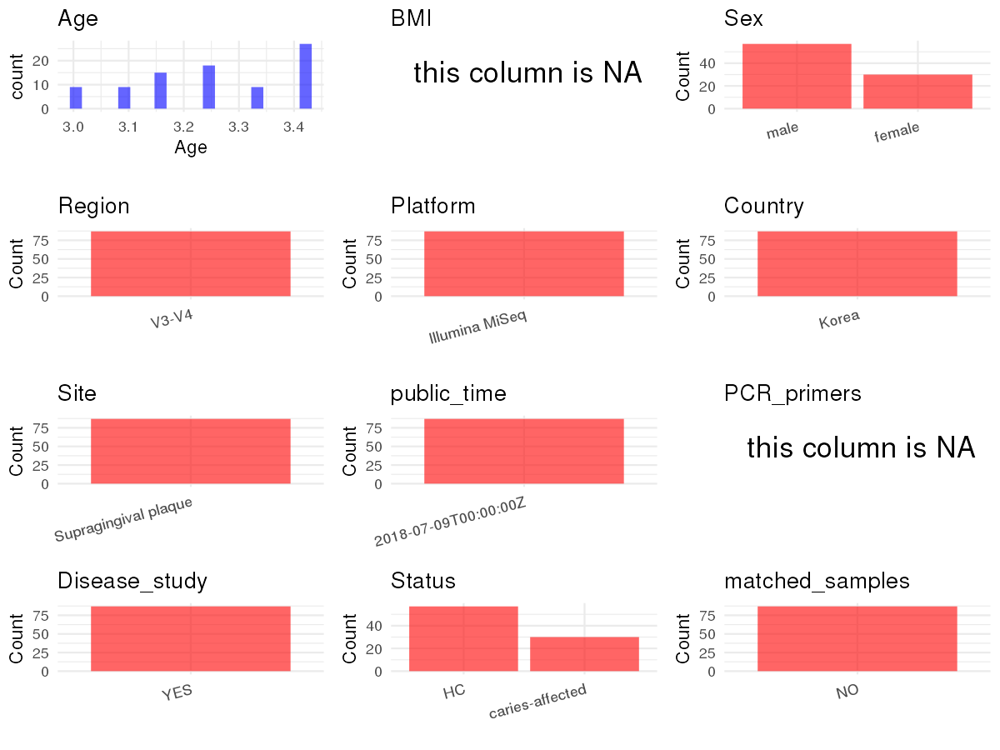

R Notebook: Metadata Processing Workflow
================

# Step 1: Obtain Initial Metadata from Each Project

To obtain the initial metadata: 1. Search for the BioProject ID (e.g.,
“PRJEBXXXX”) on the [NCBI SRA
website](https://www.ncbi.nlm.nih.gov/Traces/study/). 2. In the “Select”
table, click on “Metadata” and download the file. 3. The downloaded file
is typically named “SraRunTable.csv” and contains metadata for the
project.

``` r
# Load necessary libraries
library(dplyr)
library(stringr)
library(ggplot2)
library(cowplot)

# Set working directory (update this path to your local directory)
setwd("/home/dongbiao/word_embedding_microbiome/all_data/oral/global-oral-microbiome/data/projects/PRJNA480252")

# Read the initial metadata files
initial_meta <- read.csv("SraRunTable.csv", header = T)

# Display the first few rows of the metadata
head(initial_meta)
```

    ##          Run     AGE Assay.Type AvgSpotLen   Bases
    ## 1 SRR7500378 41month   AMPLICON        424 4503040
    ## 2 SRR7500379 41month   AMPLICON        426 5061087
    ## 3 SRR7500380 39month   AMPLICON        420 4903690
    ## 4 SRR7500381 41month   AMPLICON        420 4486216
    ## 5 SRR7500382 38month   AMPLICON        423 5860010
    ## 6 SRR7500383 38month   AMPLICON        423 5302200
    ##                                                                                                      BIOMATERIAL_PROVIDER
    ## 1 Beijing Key Laboratory of Digital Stomatology\\,41 Zhongguancun Avenue South\\, Haidian District\\, Beijing\\, PR China
    ## 2 Beijing Key Laboratory of Digital Stomatology\\,40 Zhongguancun Avenue South\\, Haidian District\\, Beijing\\, PR China
    ## 3 Beijing Key Laboratory of Digital Stomatology\\,35 Zhongguancun Avenue South\\, Haidian District\\, Beijing\\, PR China
    ## 4 Beijing Key Laboratory of Digital Stomatology\\,34 Zhongguancun Avenue South\\, Haidian District\\, Beijing\\, PR China
    ## 5 Beijing Key Laboratory of Digital Stomatology\\,33 Zhongguancun Avenue South\\, Haidian District\\, Beijing\\, PR China
    ## 6 Beijing Key Laboratory of Digital Stomatology\\,32 Zhongguancun Avenue South\\, Haidian District\\, Beijing\\, PR China
    ##    BioProject    BioSample BioSampleModel   Bytes
    ## 1 PRJNA480252 SAMN09631478          Human 1218261
    ## 2 PRJNA480252 SAMN09631477          Human 1360834
    ## 3 PRJNA480252 SAMN09631472          Human 1327919
    ## 4 PRJNA480252 SAMN09631471          Human 1225439
    ## 5 PRJNA480252 SAMN09631470          Human 1584087
    ## 6 PRJNA480252 SAMN09631469          Human 1419532
    ##                                            Center.Name Consent
    ## 1 PEKING UNIVERSITY SCHOOL AND HOSPITAL OF STOMATOLOGY  public
    ## 2 PEKING UNIVERSITY SCHOOL AND HOSPITAL OF STOMATOLOGY  public
    ## 3 PEKING UNIVERSITY SCHOOL AND HOSPITAL OF STOMATOLOGY  public
    ## 4 PEKING UNIVERSITY SCHOOL AND HOSPITAL OF STOMATOLOGY  public
    ## 5 PEKING UNIVERSITY SCHOOL AND HOSPITAL OF STOMATOLOGY  public
    ## 6 PEKING UNIVERSITY SCHOOL AND HOSPITAL OF STOMATOLOGY  public
    ##   DATASTORE.filetype DATASTORE.provider                     DATASTORE.region
    ## 1   fastq,run.zq,sra         gs,ncbi,s3 gs.us-east1,ncbi.public,s3.us-east-1
    ## 2   fastq,run.zq,sra         gs,ncbi,s3 gs.us-east1,ncbi.public,s3.us-east-1
    ## 3   fastq,run.zq,sra         gs,ncbi,s3 gs.us-east1,ncbi.public,s3.us-east-1
    ## 4   fastq,run.zq,sra         gs,ncbi,s3 gs.us-east1,ncbi.public,s3.us-east-1
    ## 5   fastq,run.zq,sra         gs,ncbi,s3 gs.us-east1,ncbi.public,s3.us-east-1
    ## 6   fastq,run.zq,sra         gs,ncbi,s3 gs.us-east1,ncbi.public,s3.us-east-1
    ##   Experiment     Instrument           isolate Library.Name LibraryLayout
    ## 1 SRX4369887 Illumina MiSeq caries-free child      CF10_0m        SINGLE
    ## 2 SRX4369886 Illumina MiSeq caries-free child      CF09_0m        SINGLE
    ## 3 SRX4369885 Illumina MiSeq caries-free child      CF04_0m        SINGLE
    ## 4 SRX4369884 Illumina MiSeq caries-free child      CF03_0m        SINGLE
    ## 5 SRX4369883 Illumina MiSeq caries-free child      CF02_0m        SINGLE
    ## 6 SRX4369882 Illumina MiSeq caries-free child      CF01_0m        SINGLE
    ##   LibrarySelection LibrarySource     Organism Platform          ReleaseDate
    ## 1              PCR       GENOMIC Homo sapiens ILLUMINA 2018-07-09T00:00:00Z
    ## 2              PCR       GENOMIC Homo sapiens ILLUMINA 2018-07-09T00:00:00Z
    ## 3              PCR       GENOMIC Homo sapiens ILLUMINA 2018-07-09T00:00:00Z
    ## 4              PCR       GENOMIC Homo sapiens ILLUMINA 2018-07-09T00:00:00Z
    ## 5              PCR       GENOMIC Homo sapiens ILLUMINA 2018-07-09T00:00:00Z
    ## 6              PCR       GENOMIC Homo sapiens ILLUMINA 2018-07-09T00:00:00Z
    ##            create_date version Sample.Name    sex SRA.Study
    ## 1 2018-07-09T12:52:00Z       1  CF10_0m.fa   male SRP152841
    ## 2 2018-07-09T12:52:00Z       1  CF09_0m.fa   male SRP152841
    ## 3 2018-07-09T12:52:00Z       1  CF04_0m.fa   male SRP152841
    ## 4 2018-07-09T12:52:00Z       1  CF03_0m.fa female SRP152841
    ## 5 2018-07-09T12:52:00Z       1  CF02_0m.fa   male SRP152841
    ## 6 2018-07-09T12:52:00Z       1  CF01_0m.fa   male SRP152841
    ##                 tissue
    ## 1 Supragingival plaque
    ## 2 Supragingival plaque
    ## 3 Supragingival plaque
    ## 4 Supragingival plaque
    ## 5 Supragingival plaque
    ## 6 Supragingival plaque

# Step 2: Create a Uniform Metadata Template

The uniform metadata should include the following columns:

1.  **BioProject**: Project ID (e.g., “PRJNA339212”)
2.  **Run**: Sample ID (e.g., “ERRXXXXXX” or “SRRXXXXXX”)
3.  **sample_name**: Original sample name submitted by the authors (not
    the database-assigned ID)
4.  **Age**: Age of the subject (if available)
5.  **BMI**: Body Mass Index (if available)
6.  **Sex**: Sex of the subject (“F” or “M”)
7.  **Region**: Targeted 16S rRNA region (e.g., “V3-V4”)
8.  **Platform**: Sequencing platform (e.g., “Illumina MiSeq”)
9.  **Country**: Country of sample origin (e.g., “China”)
10. **Site**: Sample site (e.g., “saliva”, “dental plaque”)
11. **public_time**: Data release date (format: “YYYY-MM-DD”)
12. **PCR_primers**: PCR primers used (e.g., “515F-806R”)
13. **title**: Title of the associated publication
14. **Disease_study**: Whether the study involves a disease (“YES” or
    “NO”)
15. **Status**: Disease status (e.g., “T2DM”, “HC”). Note: If the study
    includes both disease and healthy samples, this must be specified
    per sample.
16. **matched_samples**: matched samples (“YES” or “NO”)

``` r
# Create a uniform metadata dataframe
metadata <- data.frame(
  BioProject = initial_meta$BioProject,
  Run = initial_meta$Run,
  sample_name = initial_meta$Sample.Name,
  Age = as.numeric(gsub("month", "", initial_meta$AGE)) / 12,
  Sex = initial_meta$sex,
  BMI = NA,  
  Region = "V3-V4",
  Platform = initial_meta$Instrument,
  Country = "Korea",
  Site = initial_meta$tissue,
  public_time = initial_meta$ReleaseDate,
  stringsAsFactors = FALSE
)

metadata$Age[metadata$Age > 110] <- NA
metadata$BMI[metadata$BMI > 50] <- NA
```

# Step 3: Manually Add Information from the Publication

Some information (e.g. PCR primers, study title, disease status) must be
manually extracted from the publication and added to the metadata.

``` r
# Add information obtained from the publication
metadata$PCR_primers <- NA
metadata$title <- "Association between the microbiomes of tonsil and saliva samples isolated from pediatric patients subjected to tonsillectomy for the treatment of tonsillar hyperplasia"
metadata$Disease_study <- "YES"

metadata$Status <- sapply(str_split(initial_meta$isolate, " ", n = 2), function(x) x[1])
metadata$Status[metadata$Status == "caries-free"] <- "HC"

# Check initial data distribution
cat("Initial sample distribution:\n")
```

    ## Initial sample distribution:

``` r
table(metadata$sample_name)
```

    ## 
    ##   C01_0m.fa  C01_12m.fa   C01_6m.fa   C02_0m.fa  C02_12m.fa   C02_6m.fa 
    ##           1           1           1           1           1           1 
    ##   C03_0m.fa  C03_12m.fa   C03_6m.fa   C05_0m.fa  C05_12m.fa   C05_6m.fa 
    ##           1           1           1           1           1           1 
    ##   C06_0m.fa  C06_12m.fa   C06_6m.fa   C08_0m.fa  C08_12m.fa   C08_6m.fa 
    ##           1           1           1           1           1           1 
    ##   C09_0m.fa  C09_12m.fa   C09_6m.fa   C10_0m.fa  C10_12m.fa   C10_6m.fa 
    ##           1           1           1           1           1           1 
    ##   C11_0m.fa  C11_12m.fa   C11_6m.fa   C14_0m.fa  C14_12m.fa   C14_6m.fa 
    ##           1           1           1           1           1           1 
    ##  CF01_0m.fa CF01_12m.fa  CF01_6m.fa  CF02_0m.fa CF02_12m.fa  CF02_6m.fa 
    ##           1           1           1           1           1           1 
    ##  CF03_0m.fa CF03_12m.fa  CF03_6m.fa  CF04_0m.fa CF04_12m.fa  CF04_6m.fa 
    ##           1           1           1           1           1           1 
    ##  CF05_0m.fa CF05_12m.fa  CF05_6m.fa  CF06_0m.fa CF06_12m.fa  CF06_6m.fa 
    ##           1           1           1           1           1           1 
    ##  CF07_0m.fa CF07_12m.fa  CF07_6m.fa  CF08_0m.fa CF08_12m.fa  CF08_6m.fa 
    ##           1           1           1           1           1           1 
    ##  CF09_0m.fa CF09_12m.fa  CF09_6m.fa  CF10_0m.fa CF10_12m.fa  CF10_6m.fa 
    ##           1           1           1           1           1           1 
    ##  CF11_0m.fa CF11_12m.fa  CF11_6m.fa  CF12_0m.fa CF12_12m.fa  CF12_6m.fa 
    ##           1           1           1           1           1           1 
    ##  CF13_0m.fa CF13_12m.fa  CF13_6m.fa  CF14_0m.fa CF14_12m.fa  CF14_6m.fa 
    ##           1           1           1           1           1           1 
    ##  CF15_0m.fa CF15_12m.fa  CF15_6m.fa  CF17_0m.fa CF17_12m.fa  CF17_6m.fa 
    ##           1           1           1           1           1           1 
    ##  CF18_0m.fa CF18_12m.fa  CF18_6m.fa  CF19_0m.fa CF19_12m.fa  CF19_6m.fa 
    ##           1           1           1           1           1           1 
    ##  CF20_0m.fa CF20_12m.fa  CF20_6m.fa 
    ##           1           1           1

``` r
table(metadata$Site)
```

    ## 
    ## Supragingival plaque 
    ##                   87

``` r
# Calculate sampling frequency per subject
sample_counts <- table(metadata$sample_name)
cat("\nNumber of samples per subject:\n")
```

    ## 
    ## Number of samples per subject:

``` r
print(sample_counts)
```

    ## 
    ##   C01_0m.fa  C01_12m.fa   C01_6m.fa   C02_0m.fa  C02_12m.fa   C02_6m.fa 
    ##           1           1           1           1           1           1 
    ##   C03_0m.fa  C03_12m.fa   C03_6m.fa   C05_0m.fa  C05_12m.fa   C05_6m.fa 
    ##           1           1           1           1           1           1 
    ##   C06_0m.fa  C06_12m.fa   C06_6m.fa   C08_0m.fa  C08_12m.fa   C08_6m.fa 
    ##           1           1           1           1           1           1 
    ##   C09_0m.fa  C09_12m.fa   C09_6m.fa   C10_0m.fa  C10_12m.fa   C10_6m.fa 
    ##           1           1           1           1           1           1 
    ##   C11_0m.fa  C11_12m.fa   C11_6m.fa   C14_0m.fa  C14_12m.fa   C14_6m.fa 
    ##           1           1           1           1           1           1 
    ##  CF01_0m.fa CF01_12m.fa  CF01_6m.fa  CF02_0m.fa CF02_12m.fa  CF02_6m.fa 
    ##           1           1           1           1           1           1 
    ##  CF03_0m.fa CF03_12m.fa  CF03_6m.fa  CF04_0m.fa CF04_12m.fa  CF04_6m.fa 
    ##           1           1           1           1           1           1 
    ##  CF05_0m.fa CF05_12m.fa  CF05_6m.fa  CF06_0m.fa CF06_12m.fa  CF06_6m.fa 
    ##           1           1           1           1           1           1 
    ##  CF07_0m.fa CF07_12m.fa  CF07_6m.fa  CF08_0m.fa CF08_12m.fa  CF08_6m.fa 
    ##           1           1           1           1           1           1 
    ##  CF09_0m.fa CF09_12m.fa  CF09_6m.fa  CF10_0m.fa CF10_12m.fa  CF10_6m.fa 
    ##           1           1           1           1           1           1 
    ##  CF11_0m.fa CF11_12m.fa  CF11_6m.fa  CF12_0m.fa CF12_12m.fa  CF12_6m.fa 
    ##           1           1           1           1           1           1 
    ##  CF13_0m.fa CF13_12m.fa  CF13_6m.fa  CF14_0m.fa CF14_12m.fa  CF14_6m.fa 
    ##           1           1           1           1           1           1 
    ##  CF15_0m.fa CF15_12m.fa  CF15_6m.fa  CF17_0m.fa CF17_12m.fa  CF17_6m.fa 
    ##           1           1           1           1           1           1 
    ##  CF18_0m.fa CF18_12m.fa  CF18_6m.fa  CF19_0m.fa CF19_12m.fa  CF19_6m.fa 
    ##           1           1           1           1           1           1 
    ##  CF20_0m.fa CF20_12m.fa  CF20_6m.fa 
    ##           1           1           1

``` r
# Create matched_samples column
metadata$matched_samples <- "NO"
```

# Step 4: Summarize and Validate the Metadata

``` r
# Check the number of unique runs and sample names
print(paste("Number of unique runs:", length(unique(metadata$Run))))
```

    ## [1] "Number of unique runs: 87"

``` r
print(paste("Number of unique sample names:", length(unique(metadata$sample_name))))
```

    ## [1] "Number of unique sample names: 87"

# Step 5: Visualize the Metadata

``` r

```


# Step 6: Finalize and Export the Metadata

``` r
# Reorder columns to match the desired format
metadata <- metadata[, c(
  "BioProject", "Run", "sample_name", "Age", "BMI", "Sex", 
  "Region", "Platform", "Country", "Site", "public_time", 
  "PCR_primers", "title", "Disease_study", "Status", "matched_samples"
)]

# Export the uniform metadata to a CSV file
write.csv(metadata, file = "metadata.csv", quote = TRUE)
head(metadata)
```

    ##    BioProject        Run sample_name      Age BMI    Sex Region       Platform
    ## 1 PRJNA480252 SRR7500378  CF10_0m.fa 3.416667  NA   male  V3-V4 Illumina MiSeq
    ## 2 PRJNA480252 SRR7500379  CF09_0m.fa 3.416667  NA   male  V3-V4 Illumina MiSeq
    ## 3 PRJNA480252 SRR7500380  CF04_0m.fa 3.250000  NA   male  V3-V4 Illumina MiSeq
    ## 4 PRJNA480252 SRR7500381  CF03_0m.fa 3.416667  NA female  V3-V4 Illumina MiSeq
    ## 5 PRJNA480252 SRR7500382  CF02_0m.fa 3.166667  NA   male  V3-V4 Illumina MiSeq
    ## 6 PRJNA480252 SRR7500383  CF01_0m.fa 3.166667  NA   male  V3-V4 Illumina MiSeq
    ##   Country                 Site          public_time PCR_primers
    ## 1   Korea Supragingival plaque 2018-07-09T00:00:00Z          NA
    ## 2   Korea Supragingival plaque 2018-07-09T00:00:00Z          NA
    ## 3   Korea Supragingival plaque 2018-07-09T00:00:00Z          NA
    ## 4   Korea Supragingival plaque 2018-07-09T00:00:00Z          NA
    ## 5   Korea Supragingival plaque 2018-07-09T00:00:00Z          NA
    ## 6   Korea Supragingival plaque 2018-07-09T00:00:00Z          NA
    ##                                                                                                                                                                     title
    ## 1 Association between the microbiomes of tonsil and saliva samples isolated from pediatric patients subjected to tonsillectomy for the treatment of tonsillar hyperplasia
    ## 2 Association between the microbiomes of tonsil and saliva samples isolated from pediatric patients subjected to tonsillectomy for the treatment of tonsillar hyperplasia
    ## 3 Association between the microbiomes of tonsil and saliva samples isolated from pediatric patients subjected to tonsillectomy for the treatment of tonsillar hyperplasia
    ## 4 Association between the microbiomes of tonsil and saliva samples isolated from pediatric patients subjected to tonsillectomy for the treatment of tonsillar hyperplasia
    ## 5 Association between the microbiomes of tonsil and saliva samples isolated from pediatric patients subjected to tonsillectomy for the treatment of tonsillar hyperplasia
    ## 6 Association between the microbiomes of tonsil and saliva samples isolated from pediatric patients subjected to tonsillectomy for the treatment of tonsillar hyperplasia
    ##   Disease_study Status matched_samples
    ## 1           YES     HC              NO
    ## 2           YES     HC              NO
    ## 3           YES     HC              NO
    ## 4           YES     HC              NO
    ## 5           YES     HC              NO
    ## 6           YES     HC              NO

## Notes for Students:

1.  **Metadata Accuracy**: Always cross-check the metadata with the
    original publication to ensure accuracy.
2.  **Manual Entries**: Columns like `PCR_primers`, and `Status` often
    require manual entry based on the publication.
3.  **Disease Status**: Be careful when assigning `Status`—some studies
    include both disease and healthy samples.
4.  **Visualization**: The plots help quickly identify the distribution
    of values in each column, which is useful for quality control.
5.  **Reproducibility**: Update the working directory and file paths to
    match your local environment.
