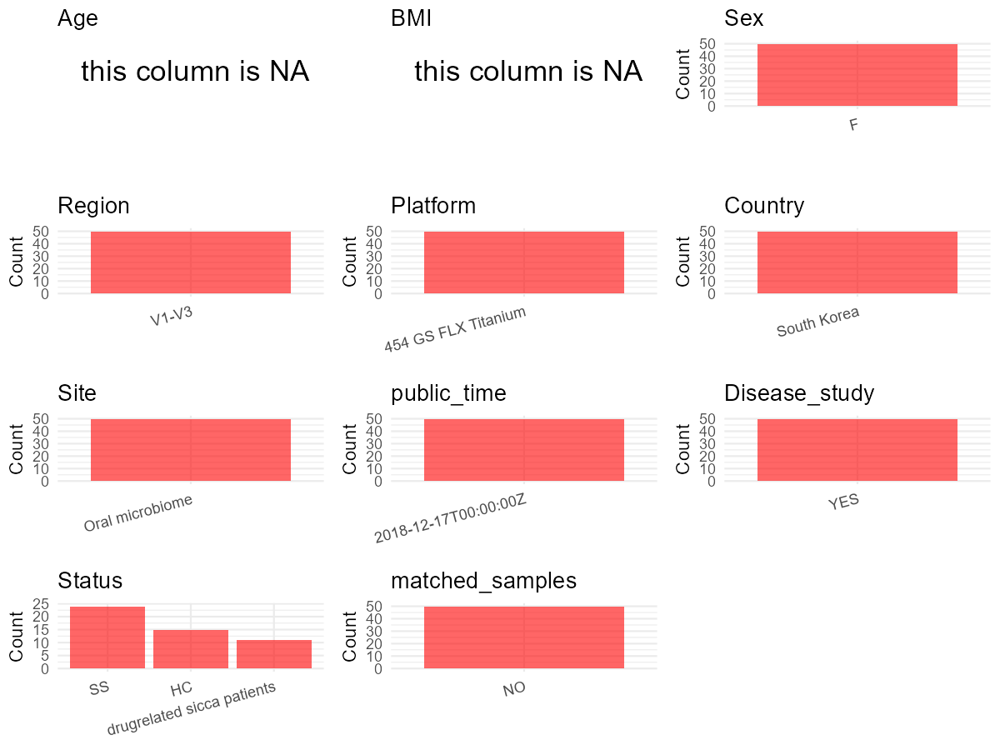

R Notebook: Metadata Processing Workflow
================

# Step 1: Obtain Initial Metadata from Each Project

To obtain the initial metadata: 1. Search for the BioProject ID (e.g.,
“PRJEBXXXX”) on the [NCBI SRA
website](https://www.ncbi.nlm.nih.gov/Traces/study/). 2. In the “Select”
table, click on “Metadata” and download the file. 3. The downloaded file
is typically named “SraRunTable.csv” and contains metadata for the
project.

``` r
# Load necessary libraries
library(dplyr)
library(ggplot2)
library(cowplot)

# Set working directory (update this path to your local directory)
setwd("D:/oral_project/PRJNA488230")

# Read the initial metadata files
initial_meta<-read.csv("SraRunTable.csv",header = T)

# Combine the two metadata files
#meta <- rbind(initial_meta, initial_meta1)

#Remove entries non-oral samples
#initial_meta <- subset(initial_meta,isolate %in% c("saliva","tongue coat"))

# Check the number of samples containing "HT" in Sample.Name (e.g., healthy controls)
#nrow(subset(meta, grepl("HT", Sample.Name)))

# Display the first few rows of the metadata
head(initial_meta)
```

    ##          Run Assay.Type AvgSpotLen   Bases  BioProject    BioSample
    ## 1 SRR7760871   AMPLICON        436 7083477 PRJNA488230 SAMN09927814
    ## 2 SRR7760872   AMPLICON        448 5019920 PRJNA488230 SAMN09927813
    ## 3 SRR7760873   AMPLICON        446 3621467 PRJNA488230 SAMN09927819
    ## 4 SRR7760874   AMPLICON        442 4142760 PRJNA488230 SAMN09927815
    ## 5 SRR7760875   AMPLICON        443 3231445 PRJNA488230 SAMN09927810
    ## 6 SRR7760876   AMPLICON        443 3750855 PRJNA488230 SAMN09927811
    ##                BioSampleModel   Bytes
    ## 1 Metagenome or environmental 1947589
    ## 2 Metagenome or environmental 1396334
    ## 3 Metagenome or environmental 1027788
    ## 4 Metagenome or environmental 1168042
    ## 5 Metagenome or environmental  929968
    ## 6 Metagenome or environmental 1063929
    ##                                     Center.Name Collection_Date Consent
    ## 1 SEOUL NATIONAL UNIVERSITY SCHOOL OF DENTISTRY      2014-03-05  public
    ## 2 SEOUL NATIONAL UNIVERSITY SCHOOL OF DENTISTRY      2014-05-08  public
    ## 3 SEOUL NATIONAL UNIVERSITY SCHOOL OF DENTISTRY      2014-03-19  public
    ## 4 SEOUL NATIONAL UNIVERSITY SCHOOL OF DENTISTRY      2014-01-05  public
    ## 5 SEOUL NATIONAL UNIVERSITY SCHOOL OF DENTISTRY      2013-12-28  public
    ## 6 SEOUL NATIONAL UNIVERSITY SCHOOL OF DENTISTRY      2013-12-30  public
    ##   DATASTORE.filetype DATASTORE.provider                     DATASTORE.region
    ## 1   fastq,run.zq,sra         gs,ncbi,s3 gs.us-east1,ncbi.public,s3.us-east-1
    ## 2   fastq,run.zq,sra         gs,ncbi,s3 gs.us-east1,ncbi.public,s3.us-east-1
    ## 3   fastq,run.zq,sra         gs,ncbi,s3 gs.us-east1,ncbi.public,s3.us-east-1
    ## 4   fastq,run.zq,sra         gs,ncbi,s3 gs.us-east1,ncbi.public,s3.us-east-1
    ## 5   fastq,run.zq,sra         gs,ncbi,s3 gs.us-east1,ncbi.public,s3.us-east-1
    ## 6   fastq,run.zq,sra         gs,ncbi,s3 gs.us-east1,ncbi.public,s3.us-east-1
    ##   Experiment geo_loc_name_country geo_loc_name_country_continent geo_loc_name
    ## 1 SRX4616579          South Korea                           Asia  South Korea
    ## 2 SRX4616578          South Korea                           Asia  South Korea
    ## 3 SRX4616577          South Korea                           Asia  South Korea
    ## 4 SRX4616576          South Korea                           Asia  South Korea
    ## 5 SRX4616575          South Korea                           Asia  South Korea
    ## 6 SRX4616574          South Korea                           Asia  South Korea
    ##           HOST          Instrument isolation_source              lat_lon
    ## 1 Homo sapiens 454 GS FLX Titanium  Oral microbiome 37.5665 N 126.9780 E
    ## 2 Homo sapiens 454 GS FLX Titanium  Oral microbiome 37.5665 N 126.9780 E
    ## 3 Homo sapiens 454 GS FLX Titanium  Oral microbiome 37.5665 N 126.9780 E
    ## 4 Homo sapiens 454 GS FLX Titanium  Oral microbiome 37.5665 N 126.9780 E
    ## 5 Homo sapiens 454 GS FLX Titanium  Oral microbiome 37.5665 N 126.9780 E
    ## 6 Homo sapiens 454 GS FLX Titanium  Oral microbiome 37.5665 N 126.9780 E
    ##   Library.Name LibraryLayout LibrarySelection LibrarySource
    ## 1 20180822SS16        SINGLE              PCR   METAGENOMIC
    ## 2 20180822SS15        SINGLE              PCR   METAGENOMIC
    ## 3 20180822SS21        SINGLE              PCR   METAGENOMIC
    ## 4 20180822SS17        SINGLE              PCR   METAGENOMIC
    ## 5 20180822SS12        SINGLE              PCR   METAGENOMIC
    ## 6 20180822SS13        SINGLE              PCR   METAGENOMIC
    ##                Organism Platform          ReleaseDate          create_date
    ## 1 human oral metagenome    LS454 2018-12-17T00:00:00Z 2018-08-28T11:21:00Z
    ## 2 human oral metagenome    LS454 2018-12-17T00:00:00Z 2018-08-28T11:21:00Z
    ## 3 human oral metagenome    LS454 2018-12-17T00:00:00Z 2018-08-28T11:21:00Z
    ## 4 human oral metagenome    LS454 2018-12-17T00:00:00Z 2018-08-28T11:21:00Z
    ## 5 human oral metagenome    LS454 2018-12-17T00:00:00Z 2018-08-28T11:21:00Z
    ## 6 human oral metagenome    LS454 2018-12-17T00:00:00Z 2018-08-28T11:21:00Z
    ##   version Sample.Name SRA.Study
    ## 1       1       SS-16 SRP158992
    ## 2       1       SS-15 SRP158992
    ## 3       1       SS-21 SRP158992
    ## 4       1       SS-17 SRP158992
    ## 5       1       SS-12 SRP158992
    ## 6       1       SS-13 SRP158992

# Step 2: Create a Uniform Metadata Template

The uniform metadata should include the following columns:

1.  **BioProject**: Project ID (e.g., “PRJNA339212”)
2.  **Run**: Sample ID (e.g., “ERRXXXXXX” or “SRRXXXXXX”)
3.  **sample_name**: Original sample name submitted by the authors (not
    the database-assigned ID)
4.  **Age**: Age of the subject (if available)
5.  **BMI**: Body Mass Index (if available)
6.  **Sex**: Sex of the subject (“F” or “M”)
7.  **Region**: Targeted 16S rRNA region (e.g., “V3-V4”)
8.  **Platform**: Sequencing platform (e.g., “Illumina MiSeq”)
9.  **Country**: Country of sample origin (e.g., “China”)
10. **Site**: Sample site (e.g., “saliva”, “dental plaque”)
11. **public_time**: Data release date (format: “YYYY-MM-DD”)
12. **PCR_primers**: PCR primers used (e.g., “515F-806R”)
13. **title**: Title of the associated publication
14. **Disease_study**: Whether the study involves a disease (“YES” or
    “NO”)
15. **Status**: Disease status (e.g., “T2DM”, “HC”). Note: If the study
    includes both disease and healthy samples, this must be specified
    per sample.
16. **matched_samples**: matched samples (“YES” or “NO”)

``` r
# Create a uniform metadata dataframe
metadata <- data.frame(
  BioProject = initial_meta$BioProject,
  Run = initial_meta$Run,
  sample_name = initial_meta$Sample.Name,
  Age = NA,
  BMI = NA,
  Sex = "F",
  Region = "V1-V3",
  Platform = initial_meta$Instrument,
  Country = initial_meta$geo_loc_name_country,
  Site = initial_meta$isolation_source,
  public_time = initial_meta$ReleaseDate,
  stringsAsFactors = FALSE
)
```

# Step 3: Manually Add Information from the Publication

Some information (e.g. PCR primers, study title, disease status) must be
manually extracted from the publication and added to the metadata.

``` r
# Add information obtained from the publication
metadata$PCR_primers <- "AGTCACTGACGAGTTTGATCMTGGCTCAG-CAGTGACTACWTTACCGCGGCTGCTGG"
metadata$title <- "Dysbiotic oral microbiota and infected salivary glands in Sj?gren's syndrome"
metadata$Disease_study <- "YES"
# Assign disease status based on sample_name patterns
metadata <- metadata %>%
  mutate(Status = case_when(
    grepl("HC", sample_name) ~ "HC",
    grepl("SS", sample_name) ~ "SS",
    grepl("SC", sample_name) ~ "drugrelated sicca patients"
  ))

#get subjects id according to sample id
metadata$sample_name<-gsub("","",metadata$sample_name)
#get subjects id with Saliva available
keep_subjects<-subset(metadata,Site %in% "Oral microbiome")
#remove subjects without Saliva samples
metadata<-subset(metadata,sample_name %in% keep_subjects$sample_name)
#get subjects sampling counts
sample_counts <- table(metadata$sample_name)
# Create matched_samples column, any subjects have >=2 samples will be label "YES", otherwise "NO"
metadata <- metadata %>%
  group_by(sample_name) %>%
  mutate(
    sample_count = n(),
    unique_sites = n_distinct(Site),
    matched_samples = ifelse(sample_count >= 2 & unique_sites >= 2, "YES", "NO")
  ) %>%
  select(-sample_count, -unique_sites)  # 移除临时列
```

# Step 4: Summarize and Validate the Metadata

``` r
# Check the number of unique runs and sample names
print(paste("Number of unique runs:", length(unique(metadata$Run))))
```

    ## [1] "Number of unique runs: 50"

``` r
print(paste("Number of unique sample names:", length(unique(metadata$sample_name))))
```

    ## [1] "Number of unique sample names: 49"

# Step 5: Visualize the Metadata

``` r

```


# Step 6: Finalize and Export the Metadata

``` r
# Reorder columns to match the desired format
metadata <- metadata[, c(
  "BioProject", "Run", "sample_name", "Age", "BMI", "Sex", 
  "Region", "Platform", "Country", "Site", "public_time", 
  "PCR_primers", "title", "Disease_study", "Status","matched_samples"
)]

# Export the uniform metadata to a CSV file
write.csv(metadata, file = "metadata.csv", quote = TRUE)
head(metadata)
```

    ## # A tibble: 6 × 16
    ## # Groups:   sample_name [6]
    ##   BioProject  Run    sample_name Age   BMI   Sex   Region Platform Country Site 
    ##   <chr>       <chr>  <chr>       <lgl> <lgl> <chr> <chr>  <chr>    <chr>   <chr>
    ## 1 PRJNA488230 SRR77… SS-16       NA    NA    F     V1-V3  454 GS … South … Oral…
    ## 2 PRJNA488230 SRR77… SS-15       NA    NA    F     V1-V3  454 GS … South … Oral…
    ## 3 PRJNA488230 SRR77… SS-21       NA    NA    F     V1-V3  454 GS … South … Oral…
    ## 4 PRJNA488230 SRR77… SS-17       NA    NA    F     V1-V3  454 GS … South … Oral…
    ## 5 PRJNA488230 SRR77… SS-12       NA    NA    F     V1-V3  454 GS … South … Oral…
    ## 6 PRJNA488230 SRR77… SS-13       NA    NA    F     V1-V3  454 GS … South … Oral…
    ## # ℹ 6 more variables: public_time <chr>, PCR_primers <chr>, title <chr>,
    ## #   Disease_study <chr>, Status <chr>, matched_samples <chr>

## Notes for Students:

1.  **Metadata Accuracy**: Always cross-check the metadata with the
    original publication to ensure accuracy.
2.  **Manual Entries**: Columns like `PCR_primers`, and `Status` often
    require manual entry based on the publication.
3.  **Disease Status**: Be careful when assigning `Status`—some studies
    include both disease and healthy samples.
4.  **Visualization**: The plots help quickly identify the distribution
    of values in each column, which is useful for quality control.
5.  **Reproducibility**: Update the working directory and file paths to
    match your local environment.
