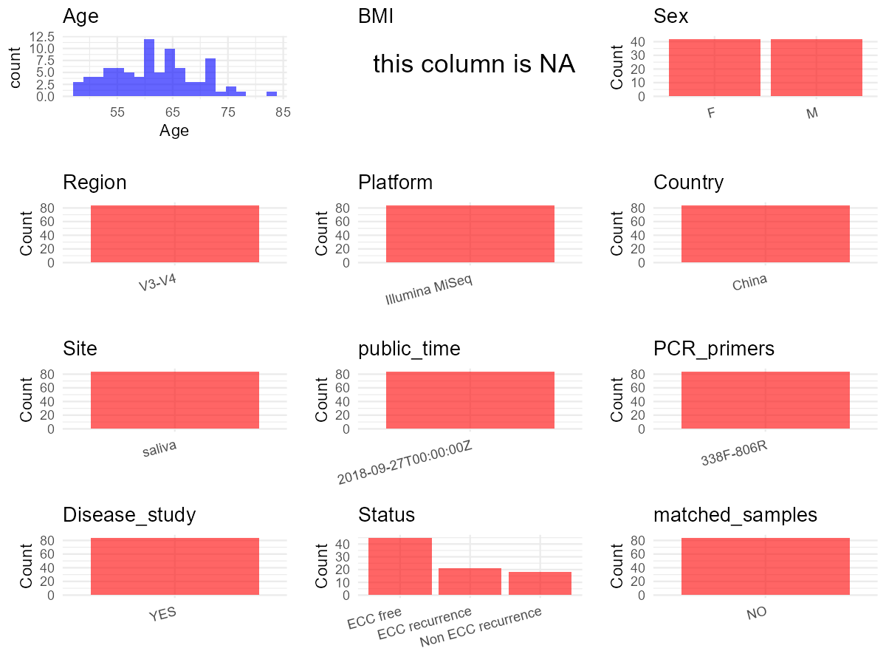

# Step 1: Obtain Initial Metadata from Each Project

To obtain the initial metadata: 1. Search for the BioProject ID (e.g.,
“PRJEBXXXX”) on the [NCBI SRA
website](https://www.ncbi.nlm.nih.gov/Traces/study/). 2. In the “Select”
table, click on “Metadata” and download the file. 3. The downloaded file
is typically named “SraRunTable.csv” and contains metadata for the
project.

    library(tidyverse)
    library(ggplot2)
    library(cowplot)

    setwd("C:/Users/zyc/Desktop/oral_project/data/projects/PRJNA493618")
    initial_meta <- read.csv("SraRunTable.csv", header = TRUE) 
    head(initial_meta)

    ##          Run AGE Assay.Type AvgSpotLen    Bases BIOMATERIAL_PROVIDER  BioProject    BioSample BioSampleModel    Bytes
    ## 1 SRR7908909  65   AMPLICON        602 32604922       not applicable PRJNA493618 SAMN10138328          Human 22273973
    ## 2 SRR7908910  57   AMPLICON        602 28153734       not applicable PRJNA493618 SAMN10138329          Human 18480279
    ## 3 SRR7908911  61   AMPLICON        602 68271616       not applicable PRJNA493618 SAMN10138344          Human 44064224
    ## 4 SRR7908912  64   AMPLICON        602 41397734       not applicable PRJNA493618 SAMN10138345          Human 27004247
    ## 5 SRR7908913  63   AMPLICON        602 42242942       not applicable PRJNA493618 SAMN10138342          Human 27555846
    ## 6 SRR7908914  68   AMPLICON        602 43717240       not applicable PRJNA493618 SAMN10138343          Human 29248087
    ##                                            Center.Name Consent DATASTORE.filetype DATASTORE.provider                     DATASTORE.region
    ## 1 PEKING UNIVERSITY SCHOOL AND HOSPITAL OF STOMATOLOGY  public   fastq,run.zq,sra         gs,ncbi,s3 gs.us-east1,ncbi.public,s3.us-east-1
    ## 2 PEKING UNIVERSITY SCHOOL AND HOSPITAL OF STOMATOLOGY  public   fastq,run.zq,sra         gs,ncbi,s3 gs.us-east1,ncbi.public,s3.us-east-1
    ## 3 PEKING UNIVERSITY SCHOOL AND HOSPITAL OF STOMATOLOGY  public   fastq,run.zq,sra         gs,ncbi,s3 gs.us-east1,ncbi.public,s3.us-east-1
    ## 4 PEKING UNIVERSITY SCHOOL AND HOSPITAL OF STOMATOLOGY  public   fastq,run.zq,sra         gs,ncbi,s3 gs.us-east1,ncbi.public,s3.us-east-1
    ## 5 PEKING UNIVERSITY SCHOOL AND HOSPITAL OF STOMATOLOGY  public   fastq,run.zq,sra         gs,ncbi,s3 gs.us-east1,ncbi.public,s3.us-east-1
    ## 6 PEKING UNIVERSITY SCHOOL AND HOSPITAL OF STOMATOLOGY  public   fastq,run.zq,sra         gs,ncbi,s3 gs.us-east1,ncbi.public,s3.us-east-1
    ##   Experiment     Instrument               isolate Library.Name LibraryLayout LibrarySelection LibrarySource     Organism Platform
    ## 1 SRX4745116 Illumina MiSeq Non ECC recurrence T2         2-28        PAIRED              PCR       GENOMIC Homo sapiens ILLUMINA
    ## 2 SRX4745115 Illumina MiSeq Non ECC recurrence T2         2-77        PAIRED              PCR       GENOMIC Homo sapiens ILLUMINA
    ## 3 SRX4745114 Illumina MiSeq     ECC recurrence T3         3-88        PAIRED              PCR       GENOMIC Homo sapiens ILLUMINA
    ## 4 SRX4745113 Illumina MiSeq     ECC recurrence T3        3-109        PAIRED              PCR       GENOMIC Homo sapiens ILLUMINA
    ## 5 SRX4745112 Illumina MiSeq  Non ECC recurrenceT3         3-77        PAIRED              PCR       GENOMIC Homo sapiens ILLUMINA
    ## 6 SRX4745111 Illumina MiSeq     ECC recurrence T3         3-79        PAIRED              PCR       GENOMIC Homo sapiens ILLUMINA
    ##            ReleaseDate          create_date version Sample.Name    sex SRA.Study tissue
    ## 1 2018-09-27T00:00:00Z 2018-09-27T12:36:00Z       1       C28M2 female SRP162752 saliva
    ## 2 2018-09-27T00:00:00Z 2018-09-27T12:36:00Z       1       C77M2 female SRP162752 saliva
    ## 3 2018-09-27T00:00:00Z 2018-09-27T12:37:00Z       1       C88M3 female SRP162752 saliva
    ## 4 2018-09-27T00:00:00Z 2018-09-27T12:37:00Z       1      C109M3   male SRP162752 saliva
    ## 5 2018-09-27T00:00:00Z 2018-09-27T12:36:00Z       1       C77M3 female SRP162752 saliva
    ## 6 2018-09-27T00:00:00Z 2018-09-27T12:37:00Z       1       C79M3   male SRP162752 saliva

# Step 2: Create a Uniform Metadata Template

The uniform metadata should include the following columns:

1.  **BioProject**: Project ID (e.g., “PRJNA339212”)
2.  **Run**: Sample ID (e.g., “ERRXXXXXX” or “SRRXXXXXX”)
3.  **sample\_name**: Original sample name submitted by the authors (not
    the database-assigned ID)
4.  **Age**: Age of the subject (if available)
5.  **BMI**: Body Mass Index (if available)
6.  **Sex**: Sex of the subject (“F” or “M”)
7.  **Region**: Targeted 16S rRNA region (e.g., “V3-V4”)
8.  **Platform**: Sequencing platform (e.g., “Illumina MiSeq”)
9.  **Country**: Country of sample origin (e.g., “China”)
10. **Site**: Sample site (e.g., “saliva”, “dental plaque”)
11. **public\_time**: Data release date (format: “YYYY-MM-DD”)
12. **PCR\_primers**: PCR primers used (e.g., “515F-806R”)
13. **title**: Title of the associated publication
14. **Disease\_study**: Whether the study involves a disease (“YES” or
    “NO”)
15. **Status**: Disease status (e.g., “T2DM”, “HC”). Note: If the study
    includes both disease and healthy samples, this must be specified
    per sample.
16. **matched\_samples**: matched samples (“YES” or “NO”)

<!-- -->

    metadata <- data.frame(
      BioProject = initial_meta$BioProject,
      Run = initial_meta$Run,
      sample_name = initial_meta$Sample.Name,
      Age = initial_meta$AGE, 
      BMI = NA,  
      Sex = initial_meta$sex,
      Platform = initial_meta$Instrument,
      # Country = initial_meta$geo_loc_name,
      Status = initial_meta$isolate,
      Site = initial_meta$tissue,
      public_time = initial_meta$ReleaseDate,
      stringsAsFactors = FALSE
    )

# Step 3: Manually Add Information from the Publication

Some information (e.g. PCR primers, study title, disease status) must be
manually extracted from the publication and added to the metadata.

     metadata <- metadata %>%
      mutate(Sex = recode(Sex, "female" = "F", "male" = "M"))
    metadata <- metadata %>% mutate(Status = case_when(
      grepl("Non ECC recurrence",Status) ~ "Non ECC recurrence",
      grepl("ECC recurrence",Status) ~ "ECC recurrence",
      TRUE ~ "ECC free"
    ))

    metadata$Country <- "China"
    metadata$matched_samples = "NO"
    metadata$Region = "V3-V4"

    metadata$title <- "The Predictive Potentiality of Salivary Microbiome for the Recurrence of Early Childhood Caries"
    metadata$Disease_study <- "YES"
    metadata$PCR_primers <- "338F-806R"
    head(metadata)

    ##    BioProject        Run sample_name Age BMI Sex       Platform             Status   Site          public_time Country matched_samples
    ## 1 PRJNA493618 SRR7908909       C28M2  65  NA   F Illumina MiSeq Non ECC recurrence saliva 2018-09-27T00:00:00Z   China              NO
    ## 2 PRJNA493618 SRR7908910       C77M2  57  NA   F Illumina MiSeq Non ECC recurrence saliva 2018-09-27T00:00:00Z   China              NO
    ## 3 PRJNA493618 SRR7908911       C88M3  61  NA   F Illumina MiSeq     ECC recurrence saliva 2018-09-27T00:00:00Z   China              NO
    ## 4 PRJNA493618 SRR7908912      C109M3  64  NA   M Illumina MiSeq     ECC recurrence saliva 2018-09-27T00:00:00Z   China              NO
    ## 5 PRJNA493618 SRR7908913       C77M3  63  NA   F Illumina MiSeq Non ECC recurrence saliva 2018-09-27T00:00:00Z   China              NO
    ## 6 PRJNA493618 SRR7908914       C79M3  68  NA   M Illumina MiSeq     ECC recurrence saliva 2018-09-27T00:00:00Z   China              NO
    ##   Region                                                                                           title Disease_study PCR_primers
    ## 1  V3-V4 The Predictive Potentiality of Salivary Microbiome for the Recurrence of Early Childhood Caries           YES   338F-806R
    ## 2  V3-V4 The Predictive Potentiality of Salivary Microbiome for the Recurrence of Early Childhood Caries           YES   338F-806R
    ## 3  V3-V4 The Predictive Potentiality of Salivary Microbiome for the Recurrence of Early Childhood Caries           YES   338F-806R
    ## 4  V3-V4 The Predictive Potentiality of Salivary Microbiome for the Recurrence of Early Childhood Caries           YES   338F-806R
    ## 5  V3-V4 The Predictive Potentiality of Salivary Microbiome for the Recurrence of Early Childhood Caries           YES   338F-806R
    ## 6  V3-V4 The Predictive Potentiality of Salivary Microbiome for the Recurrence of Early Childhood Caries           YES   338F-806R

# Step 4: Summarize and Validate the Metadata

    print(paste("Number of unique runs:", length(unique(metadata$Run))))

    ## [1] "Number of unique runs: 84"

    print(paste("Number of unique sample names:", length(unique(metadata$sample_name))))

    ## [1] "Number of unique sample names: 84"

# Step 5: Visualize the Metadata

    plot_data <- metadata %>%
      select(-BioProject, -Run, -sample_name, -title)

    # Function to create simple plots for each column
    create_simple_plots <- function(data) {
      plots <- list()
      
      for (col in colnames(data)) {
        # Check if the column is all NA
        if (all(is.na(data[[col]]))) {
          # Create an empty plot with text indicating all NA
          p <- ggplot() +
            annotate("text", x = 0.5, y = 0.5, label = "this column is NA", size = 6) +
            labs(title = col) +
            theme_void()
        } else if (is.numeric(data[[col]])) {
          # Numeric variable: histogram
          p <- ggplot(data, aes(x = .data[[col]])) +
            geom_histogram(fill = "blue", alpha = 0.6, bins = 20, na.rm = T) +
            labs(title = col) +
            theme_minimal()
        } else {
          # Categorical variable: bar plot (remove NA values)
          count_data <- as.data.frame(table(data[[col]], useNA = "ifany"))
          p <- ggplot(count_data, aes(x = reorder(Var1, -Freq), y = Freq)) +
            geom_col(fill = "red", alpha = 0.6) +
            labs(title = col, x = NULL, y = "Count") +
            theme_minimal() +
            theme(axis.text.x = element_text(angle = 15, hjust = 1))
        }
        plots[[col]] <- p
      }
      
      return(plots)
    }

    plots <- create_simple_plots(plot_data)
    p<-plot_grid(plots$Age, 
              plots$BMI, 
              plots$Sex, 
              plots$Region, 
              plots$Platform, 
              plots$Country, 
              plots$Site,
              plots$public_time, 
              plots$PCR_primers,
              plots$Disease_study,
              plots$Status,
              plots$matched_samples,# add 
              ncol = 3, align = "hv", axis = "lb")
    ggsave("metadata_summary.png", plot = p, width = 8, height = 6, dpi = 150)

    

 \# Step 6: Finalize and Export the Metadata

    metadata <- metadata[, c(
      "BioProject", "Run", "sample_name", "Age", "BMI", "Sex", 
      "Region", "Platform", "Country", "Site", "public_time", 
      "PCR_primers", "title", "Disease_study", "Status","matched_samples"
    )]

    write.csv(metadata, file = "metadata.csv", quote = FALSE)
