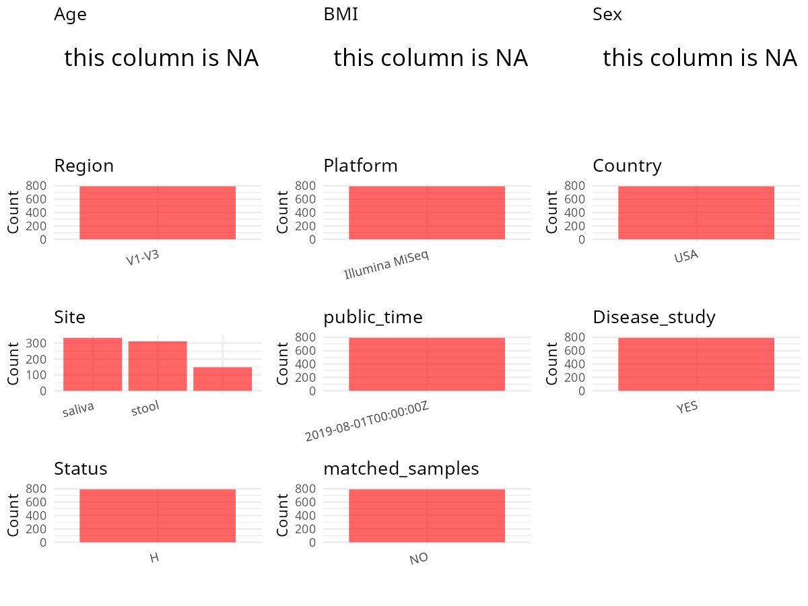

R Notebook: Metadata Processing Workflow
================

# Step 1: Obtain Initial Metadata from Each Project

To obtain the initial metadata: 1. Search for the BioProject ID (e.g.,
“PRJEBXXXX”) on the [NCBI SRA
website](https://www.ncbi.nlm.nih.gov/Traces/study/). 2. In the “Select”
table, click on “Metadata” and download the file. 3. The downloaded file
is typically named “SraRunTable.csv” and contains metadata for the
project.

``` r
# Load necessary libraries
library(dplyr)
library(ggplot2)
library(cowplot)
library(stringr)

# Set working directory (update this path to your local directory)
setwd("/home/hby/oral_project/PRJNA503194")

# Read the initial metadata files
initial_meta <- read.csv("SraRunTable.csv", header = T)

# Combine the two metadata files
# meta <- rbind(initial_meta, initial_meta1)

# Remove entries non-oral samples
# initial_meta <- subset(initial_meta,isolate %in% c("saliva","tongue coat"))

# Check the number of samples containing "HT" in Sample.Name (e.g., healthy controls)
# nrow(subset(meta, grepl("HT", Sample.Name)))

# Display the first few rows of the metadata
head(initial_meta)
```

    ##          Run Assay.Type AvgSpotLen    Bases  BioProject    BioSample                                    BioSampleModel    Bytes Center.Name Collection_Date Consent DATASTORE.filetype
    ## 1 SRR8141524   AMPLICON        554 16258050 PRJNA503194 SAMN10355436 MIMARKS.survey,MIGS/MIMS/MIMARKS.human-associated  9270444        NONE            2011  public         run.zq,sra
    ## 2 SRR8141525   AMPLICON        555 21560172 PRJNA503194 SAMN10355437 MIMARKS.survey,MIGS/MIMS/MIMARKS.human-associated 11071255        NONE            2011  public         run.zq,sra
    ## 3 SRR8141526   AMPLICON        555 18712288 PRJNA503194 SAMN10355440 MIMARKS.survey,MIGS/MIMS/MIMARKS.human-associated 10490313        NONE            2011  public         run.zq,sra
    ## 4 SRR8141527   AMPLICON        555  2097027 PRJNA503194 SAMN10355441 MIMARKS.survey,MIGS/MIMS/MIMARKS.human-associated  1273814        NONE            2011  public         run.zq,sra
    ## 5 SRR8141528   AMPLICON        554  1428421 PRJNA503194 SAMN10355550 MIMARKS.survey,MIGS/MIMS/MIMARKS.human-associated   925111        NONE            2011  public         run.zq,sra
    ## 6 SRR8141529   AMPLICON        554 16504682 PRJNA503194 SAMN10355551 MIMARKS.survey,MIGS/MIMS/MIMARKS.human-associated  8068758        NONE            2011  public         run.zq,sra
    ##   DATASTORE.provider                     DATASTORE.region   site env_biome    env_feature   env_material Experiment geo_loc_name_country geo_loc_name_country_continent geo_loc_name
    ## 1         gs,ncbi,s3 gs.us-east1,ncbi.public,s3.us-east-1  stool        IF not applicable not applicable SRX4962601                  USA                  North America          USA
    ## 2         gs,ncbi,s3 gs.us-east1,ncbi.public,s3.us-east-1  stool        IF not applicable not applicable SRX4962600                  USA                  North America          USA
    ## 3         gs,ncbi,s3 gs.us-east1,ncbi.public,s3.us-east-1  stool        IF not applicable not applicable SRX4962599                  USA                  North America          USA
    ## 4         gs,ncbi,s3 gs.us-east1,ncbi.public,s3.us-east-1 saliva        IS not applicable not applicable SRX4962598                  USA                  North America          USA
    ## 5         gs,ncbi,s3 gs.us-east1,ncbi.public,s3.us-east-1 saliva        IS not applicable not applicable SRX4962597                  USA                  North America          USA
    ## 6         gs,ncbi,s3 gs.us-east1,ncbi.public,s3.us-east-1 saliva        IS not applicable not applicable SRX4962596                  USA                  North America          USA
    ##           HOST host_subject_id     Instrument       lat_lon Library.Name LibraryLayout LibrarySelection LibrarySource         Organism Platform          ReleaseDate Sample_Name
    ## 1 Homo sapiens            A021 Illumina MiSeq not collected    A021_IF_2        PAIRED              PCR   METAGENOMIC human metagenome ILLUMINA 2019-08-01T00:00:00Z   A021_IF_2
    ## 2 Homo sapiens            A021 Illumina MiSeq not collected   A021_IF_30        PAIRED              PCR   METAGENOMIC human metagenome ILLUMINA 2019-08-01T00:00:00Z  A021_IF_30
    ## 3 Homo sapiens            A021 Illumina MiSeq not collected   A021_IF_90        PAIRED              PCR   METAGENOMIC human metagenome ILLUMINA 2019-08-01T00:00:00Z  A021_IF_90
    ## 4 Homo sapiens            A021 Illumina MiSeq not collected   A021_IS_10        PAIRED              PCR   METAGENOMIC human metagenome ILLUMINA 2019-08-01T00:00:00Z  A021_IS_10
    ## 5 Homo sapiens            A029 Illumina MiSeq not collected  A029_IS_150        PAIRED              PCR   METAGENOMIC human metagenome ILLUMINA 2019-08-01T00:00:00Z A029_IS_150
    ## 6 Homo sapiens            A029 Illumina MiSeq not collected  A029_IS_180        PAIRED              PCR   METAGENOMIC human metagenome ILLUMINA 2019-08-01T00:00:00Z A029_IS_180
    ##   SRA.Study TimePP          create_date version
    ## 1 SRP167359      2 2018-11-02T00:02:00Z       2
    ## 2 SRP167359     30 2018-11-02T00:02:00Z       2
    ## 3 SRP167359     90 2018-11-02T00:02:00Z       2
    ## 4 SRP167359     10 2018-10-31T14:32:00Z       1
    ## 5 SRP167359    150 2018-10-31T14:32:00Z       1
    ## 6 SRP167359    180 2018-11-02T00:02:00Z       2

# Step 2: Create a Uniform Metadata Template

The uniform metadata should include the following columns:

1.  **BioProject**: Project ID (e.g., “PRJNA339212”)
2.  **Run**: Sample ID (e.g., “ERRXXXXXX” or “SRRXXXXXX”)
3.  **sample_name**: Original sample name submitted by the authors (not
    the database-assigned ID)
4.  **Age**: Age of the subject (if available)
5.  **BMI**: Body Mass Index (if available)
6.  **Sex**: Sex of the subject (“F” or “M”)
7.  **Region**: Targeted 16S rRNA region (e.g., “V3-V4”)
8.  **Platform**: Sequencing platform (e.g., “Illumina MiSeq”)
9.  **Country**: Country of sample origin (e.g., “China”)
10. **Site**: Sample site (e.g., “saliva”, “dental plaque”)
11. **public_time**: Data release date (format: “YYYY-MM-DD”)
12. **PCR_primers**: PCR primers used (e.g., “515F-806R”)
13. **title**: Title of the associated publication
14. **Disease_study**: Whether the study involves a disease (“YES” or
    “NO”)
15. **Status**: Disease status (e.g., “T2DM”, “HC”). Note: If the study
    includes both disease and healthy samples, this must be specified
    per sample.
16. **matched_samples**: matched samples (“YES” or “NO”)

``` r
# Create a uniform metadata dataframe
metadata <- data.frame(
  BioProject = initial_meta$BioProject,
  Run = initial_meta$Run,
  sample_name = initial_meta$Sample_Name,
  Platform = initial_meta$Instrument,
  Country = initial_meta$geo_loc_name,
  Site = initial_meta$site,
  public_time = initial_meta$ReleaseDate,
  stringsAsFactors = FALSE,
  Sex = NA,
  Age = NA,
  BMI = NA
)
```

# Step 3: Manually Add Information from the Publication

Some information (e.g. PCR primers, study title, disease status) must be
manually extracted from the publication and added to the metadata.

``` r
# Add information obtained from the publication
metadata$Status <- "H"
metadata$Region <- "V1-V3"
metadata$PCR_primers <- "FWD:TCGTCGGCAGCGTCA; REV:GTCTCGTGGGCTCGGAGATGTGTTA"
metadata$title <- "The impact of caries status on supragingival plaque and salivary microbiome in children with mixed dentition: a cross-sectional survey"
metadata$Disease_study <- "YES"
metadata$matched_samples <- "NO"
```

# Step 4: Summarize and Validate the Metadata

``` r
# Check the number of unique runs and sample names
print(paste("Number of unique runs:", length(unique(metadata$Run))))
```

    ## [1] "Number of unique runs: 792"

``` r
print(paste("Number of unique sample names:", length(unique(metadata$sample_name))))
```

    ## [1] "Number of unique sample names: 792"

# Step 5: Visualize the Metadata

``` r

```


# Step 6: Finalize and Export the Metadata

``` r
# Reorder columns to match the desired format
metadata <- metadata[, c(
  "BioProject", "Run", "sample_name", "Age", "BMI", "Sex",
  "Region", "Platform", "Country", "Site", "public_time",
  "PCR_primers", "title", "Disease_study", "Status", "matched_samples"
)]

# Export the uniform metadata to a CSV file
write.csv(metadata, file = "metadata.csv", quote = FALSE)
head(metadata)
```

    ##    BioProject        Run sample_name Age BMI Sex Region       Platform Country   Site          public_time                                        PCR_primers
    ## 1 PRJNA503194 SRR8141524   A021_IF_2  NA  NA  NA  V1-V3 Illumina MiSeq     USA  stool 2019-08-01T00:00:00Z FWD:TCGTCGGCAGCGTCA; REV:GTCTCGTGGGCTCGGAGATGTGTTA
    ## 2 PRJNA503194 SRR8141525  A021_IF_30  NA  NA  NA  V1-V3 Illumina MiSeq     USA  stool 2019-08-01T00:00:00Z FWD:TCGTCGGCAGCGTCA; REV:GTCTCGTGGGCTCGGAGATGTGTTA
    ## 3 PRJNA503194 SRR8141526  A021_IF_90  NA  NA  NA  V1-V3 Illumina MiSeq     USA  stool 2019-08-01T00:00:00Z FWD:TCGTCGGCAGCGTCA; REV:GTCTCGTGGGCTCGGAGATGTGTTA
    ## 4 PRJNA503194 SRR8141527  A021_IS_10  NA  NA  NA  V1-V3 Illumina MiSeq     USA saliva 2019-08-01T00:00:00Z FWD:TCGTCGGCAGCGTCA; REV:GTCTCGTGGGCTCGGAGATGTGTTA
    ## 5 PRJNA503194 SRR8141528 A029_IS_150  NA  NA  NA  V1-V3 Illumina MiSeq     USA saliva 2019-08-01T00:00:00Z FWD:TCGTCGGCAGCGTCA; REV:GTCTCGTGGGCTCGGAGATGTGTTA
    ## 6 PRJNA503194 SRR8141529 A029_IS_180  NA  NA  NA  V1-V3 Illumina MiSeq     USA saliva 2019-08-01T00:00:00Z FWD:TCGTCGGCAGCGTCA; REV:GTCTCGTGGGCTCGGAGATGTGTTA
    ##                                                                                                                                    title Disease_study Status matched_samples
    ## 1 The impact of caries status on supragingival plaque and salivary microbiome in children with mixed dentition: a cross-sectional survey           YES      H              NO
    ## 2 The impact of caries status on supragingival plaque and salivary microbiome in children with mixed dentition: a cross-sectional survey           YES      H              NO
    ## 3 The impact of caries status on supragingival plaque and salivary microbiome in children with mixed dentition: a cross-sectional survey           YES      H              NO
    ## 4 The impact of caries status on supragingival plaque and salivary microbiome in children with mixed dentition: a cross-sectional survey           YES      H              NO
    ## 5 The impact of caries status on supragingival plaque and salivary microbiome in children with mixed dentition: a cross-sectional survey           YES      H              NO
    ## 6 The impact of caries status on supragingival plaque and salivary microbiome in children with mixed dentition: a cross-sectional survey           YES      H              NO

## Notes for Students:

1.  **Metadata Accuracy**: Always cross-check the metadata with the
    original publication to ensure accuracy.
2.  **Manual Entries**: Columns like `PCR_primers`, and `Status` often
    require manual entry based on the publication.
3.  **Disease Status**: Be careful when assigning `Status`—some studies
    include both disease and healthy samples.
4.  **Visualization**: The plots help quickly identify the distribution
    of values in each column, which is useful for quality control.
5.  **Reproducibility**: Update the working directory and file paths to
    match your local environment.
