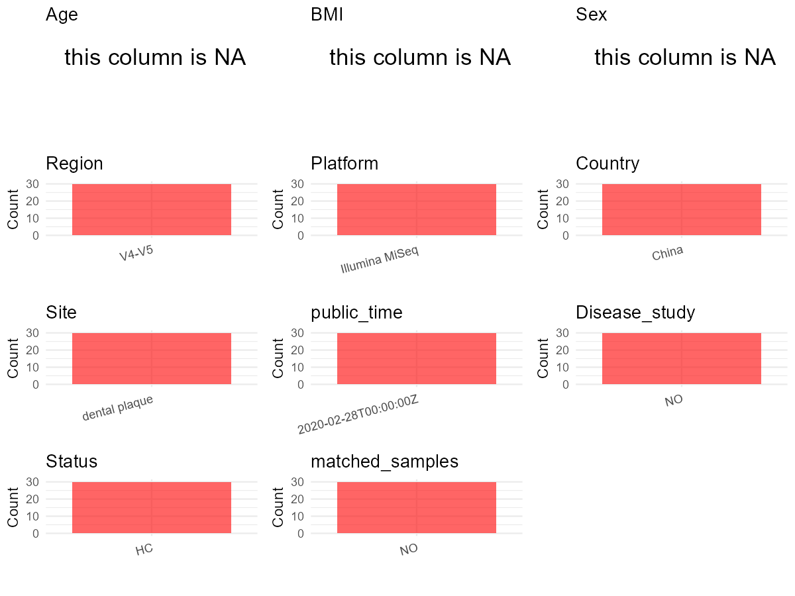

# Step 1: Obtain Initial Metadata from Each Project

To obtain the initial metadata: 1. Search for the BioProject ID (e.g.,
“PRJEBXXXX”) on the [NCBI SRA
website](https://www.ncbi.nlm.nih.gov/Traces/study/). 2. In the “Select”
table, click on “Metadata” and download the file. 3. The downloaded file
is typically named “SraRunTable.csv” and contains metadata for the
project.

    library(tidyverse)
    library(ggplot2)
    library(cowplot)

    setwd("C:/Users/zyc/Desktop/oral_project/data/projects/PRJNA511568")
    initial_meta <- read.csv("SraRunTable.csv", header = TRUE) 
    head(initial_meta)

    ##          Run Assay.Type AvgSpotLen    Bases  BioProject    BioSample              BioSampleModel    Bytes            Center.Name
    ## 1 SRR8497113   AMPLICON        473 30485239 PRJNA511568 SAMN10834315 Metagenome or environmental 19587267 SUN YAT-SEN UNIVERSITY
    ## 2 SRR8497114   AMPLICON        473 29216085 PRJNA511568 SAMN10834316 Metagenome or environmental 18722208 SUN YAT-SEN UNIVERSITY
    ## 3 SRR8497115   AMPLICON        473 31260563 PRJNA511568 SAMN10834317 Metagenome or environmental 19895407 SUN YAT-SEN UNIVERSITY
    ## 4 SRR8497116   AMPLICON        475 34187713 PRJNA511568 SAMN10834318 Metagenome or environmental 21617625 SUN YAT-SEN UNIVERSITY
    ## 5 SRR8497117   AMPLICON        474 35750629 PRJNA511568 SAMN10834311 Metagenome or environmental 22708387 SUN YAT-SEN UNIVERSITY
    ## 6 SRR8497118   AMPLICON        474 33073169 PRJNA511568 SAMN10834312 Metagenome or environmental 20928425 SUN YAT-SEN UNIVERSITY
    ##   Collection_Date Consent DATASTORE.filetype DATASTORE.provider                     DATASTORE.region Experiment geo_loc_name_country
    ## 1      2016-12-24  public         run.zq,sra         gs,ncbi,s3 gs.us-east1,ncbi.public,s3.us-east-1 SRX5301186         uncalculated
    ## 2      2016-12-24  public         run.zq,sra         gs,ncbi,s3 gs.us-east1,ncbi.public,s3.us-east-1 SRX5301185         uncalculated
    ## 3      2016-12-24  public         run.zq,sra         gs,ncbi,s3 gs.us-east1,ncbi.public,s3.us-east-1 SRX5301184         uncalculated
    ## 4      2016-12-24  public         run.zq,sra         gs,ncbi,s3 gs.us-east1,ncbi.public,s3.us-east-1 SRX5301183         uncalculated
    ## 5      2016-12-24  public         run.zq,sra         gs,ncbi,s3 gs.us-east1,ncbi.public,s3.us-east-1 SRX5301182         uncalculated
    ## 6      2016-12-24  public         run.zq,sra         gs,ncbi,s3 gs.us-east1,ncbi.public,s3.us-east-1 SRX5301181         uncalculated
    ##   geo_loc_name_country_continent   geo_loc_name              HOST     Instrument isolation_source        lat_lon
    ## 1                   uncalculated not applicable Homo sapiens No.5 Illumina MiSeq    dental plaque not applicable
    ## 2                   uncalculated not applicable Homo sapiens No.6 Illumina MiSeq    dental plaque not applicable
    ## 3                   uncalculated not applicable Homo sapiens No.7 Illumina MiSeq    dental plaque not applicable
    ## 4                   uncalculated not applicable Homo sapiens No.8 Illumina MiSeq    dental plaque not applicable
    ## 5                   uncalculated not applicable Homo sapiens No.1 Illumina MiSeq    dental plaque not applicable
    ## 6                   uncalculated not applicable Homo sapiens No.2 Illumina MiSeq    dental plaque not applicable
    ##                     Library.Name LibraryLayout LibrarySelection LibrarySource              Organism Platform          ReleaseDate
    ## 1 dental plaque 16S rRNA 2016 C5        PAIRED              PCR   METAGENOMIC human oral metagenome ILLUMINA 2020-02-28T00:00:00Z
    ## 2 dental plaque 16S rRNA 2016 C6        PAIRED              PCR   METAGENOMIC human oral metagenome ILLUMINA 2020-02-28T00:00:00Z
    ## 3 dental plaque 16S rRNA 2016 C7        PAIRED              PCR   METAGENOMIC human oral metagenome ILLUMINA 2020-02-28T00:00:00Z
    ## 4 dental plaque 16S rRNA 2016 C8        PAIRED              PCR   METAGENOMIC human oral metagenome ILLUMINA 2020-02-28T00:00:00Z
    ## 5 dental plaque 16S rRNA 2016 C1        PAIRED              PCR   METAGENOMIC human oral metagenome ILLUMINA 2020-02-28T00:00:00Z
    ## 6 dental plaque 16S rRNA 2016 C2        PAIRED              PCR   METAGENOMIC human oral metagenome ILLUMINA 2020-02-28T00:00:00Z
    ##            create_date version Sample.Name SRA.Study
    ## 1 2019-01-28T13:58:00Z       1          C5 SRP182703
    ## 2 2019-01-28T13:58:00Z       1          C6 SRP182703
    ## 3 2019-01-28T13:58:00Z       1          C7 SRP182703
    ## 4 2019-01-28T13:58:00Z       1          C8 SRP182703
    ## 5 2019-01-28T13:58:00Z       1          C1 SRP182703
    ## 6 2019-01-28T13:58:00Z       1          C2 SRP182703

# Step 2: Create a Uniform Metadata Template

The uniform metadata should include the following columns:

1.  **BioProject**: Project ID (e.g., “PRJNA339212”)
2.  **Run**: Sample ID (e.g., “ERRXXXXXX” or “SRRXXXXXX”)
3.  **sample\_name**: Original sample name submitted by the authors (not
    the database-assigned ID)
4.  **Age**: Age of the subject (if available)
5.  **BMI**: Body Mass Index (if available)
6.  **Sex**: Sex of the subject (“F” or “M”)
7.  **Region**: Targeted 16S rRNA region (e.g., “V3-V4”)
8.  **Platform**: Sequencing platform (e.g., “Illumina MiSeq”)
9.  **Country**: Country of sample origin (e.g., “China”)
10. **Site**: Sample site (e.g., “saliva”, “dental plaque”)
11. **public\_time**: Data release date (format: “YYYY-MM-DD”)
12. **PCR\_primers**: PCR primers used (e.g., “515F-806R”)
13. **title**: Title of the associated publication
14. **Disease\_study**: Whether the study involves a disease (“YES” or
    “NO”)
15. **Status**: Disease status (e.g., “T2DM”, “HC”). Note: If the study
    includes both disease and healthy samples, this must be specified
    per sample.
16. **matched\_samples**: matched samples (“YES” or “NO”)

<!-- -->

    metadata <- data.frame(
      BioProject = initial_meta$BioProject,
      Run = initial_meta$Run,
      sample_name = initial_meta$Sample.Name,
      Age = NA,
      BMI = NA,
      Sex = NA,
      Platform = initial_meta$Instrument,
      # Country = initial_meta$geo_loc_name_country,
      Site = initial_meta$isolation_source,
      public_time = initial_meta$ReleaseDate,
      # Status = initial_meta$Sample.Name,
      stringsAsFactors = FALSE
    )

# Step 3: Manually Add Information from the Publication

Some information (e.g. PCR primers, study title, disease status) must be
manually extracted from the publication and added to the metadata.

     # metadata <- metadata %>%
     #  mutate(Sex = recode(Sex, "female" = "F", "male" = "M"))
    # metadata <-metadata%>%
    #   mutate(Status = case_when(Site == "mucous" ~ "OSCC",
    #                             Site == "dental plaque" ~ "OSCC",
    #                             Site == "tumor" ~ "OSCC",
    #                             TRUE ~ NA))

    metadata$Country <- "China"
    metadata$Status <- "HC"
    metadata$matched_samples <- "NO"
    metadata$Region <- "V4-V5"
    metadata$title <- "Effects of a probiotic drink containing Lactobacillus casei strain Shirota on dental plaque microbiota"
    metadata$Disease_study <- "NO"
    metadata$PCR_primers <- "(forward, 5'-GTGACAGCAGCCGCGGTAA-3' and reverse, 5'-CCGTCAATTTATTTAAGTTT-3')"
    head(metadata)

    ##    BioProject        Run sample_name Age BMI Sex       Platform          Site          public_time Country Status matched_samples Region
    ## 1 PRJNA511568 SRR8497113          C5  NA  NA  NA Illumina MiSeq dental plaque 2020-02-28T00:00:00Z   China     HC              NO  V4-V5
    ## 2 PRJNA511568 SRR8497114          C6  NA  NA  NA Illumina MiSeq dental plaque 2020-02-28T00:00:00Z   China     HC              NO  V4-V5
    ## 3 PRJNA511568 SRR8497115          C7  NA  NA  NA Illumina MiSeq dental plaque 2020-02-28T00:00:00Z   China     HC              NO  V4-V5
    ## 4 PRJNA511568 SRR8497116          C8  NA  NA  NA Illumina MiSeq dental plaque 2020-02-28T00:00:00Z   China     HC              NO  V4-V5
    ## 5 PRJNA511568 SRR8497117          C1  NA  NA  NA Illumina MiSeq dental plaque 2020-02-28T00:00:00Z   China     HC              NO  V4-V5
    ## 6 PRJNA511568 SRR8497118          C2  NA  NA  NA Illumina MiSeq dental plaque 2020-02-28T00:00:00Z   China     HC              NO  V4-V5
    ##                                                                                                    title Disease_study
    ## 1 Effects of a probiotic drink containing Lactobacillus casei strain Shirota on dental plaque microbiota            NO
    ## 2 Effects of a probiotic drink containing Lactobacillus casei strain Shirota on dental plaque microbiota            NO
    ## 3 Effects of a probiotic drink containing Lactobacillus casei strain Shirota on dental plaque microbiota            NO
    ## 4 Effects of a probiotic drink containing Lactobacillus casei strain Shirota on dental plaque microbiota            NO
    ## 5 Effects of a probiotic drink containing Lactobacillus casei strain Shirota on dental plaque microbiota            NO
    ## 6 Effects of a probiotic drink containing Lactobacillus casei strain Shirota on dental plaque microbiota            NO
    ##                                                                    PCR_primers
    ## 1 (forward, 5'-GTGACAGCAGCCGCGGTAA-3' and reverse, 5'-CCGTCAATTTATTTAAGTTT-3')
    ## 2 (forward, 5'-GTGACAGCAGCCGCGGTAA-3' and reverse, 5'-CCGTCAATTTATTTAAGTTT-3')
    ## 3 (forward, 5'-GTGACAGCAGCCGCGGTAA-3' and reverse, 5'-CCGTCAATTTATTTAAGTTT-3')
    ## 4 (forward, 5'-GTGACAGCAGCCGCGGTAA-3' and reverse, 5'-CCGTCAATTTATTTAAGTTT-3')
    ## 5 (forward, 5'-GTGACAGCAGCCGCGGTAA-3' and reverse, 5'-CCGTCAATTTATTTAAGTTT-3')
    ## 6 (forward, 5'-GTGACAGCAGCCGCGGTAA-3' and reverse, 5'-CCGTCAATTTATTTAAGTTT-3')

# Step 4: Summarize and Validate the Metadata

    print(paste("Number of unique runs:", length(unique(metadata$Run))))

    ## [1] "Number of unique runs: 30"

    print(paste("Number of unique sample names:", length(unique(metadata$sample_name))))

    ## [1] "Number of unique sample names: 30"

# Step 5: Visualize the Metadata

    plot_data <- metadata %>%
      select(-BioProject, -Run, -sample_name, -title)

    # Function to create simple plots for each column
    create_simple_plots <- function(data) {
      plots <- list()

      for (col in colnames(data)) {
        # Check if the column is all NA
        if (all(is.na(data[[col]]))) {
          # Create an empty plot with text indicating all NA
          p <- ggplot() +
            annotate("text", x = 0.5, y = 0.5, label = "this column is NA", size = 6) +
            labs(title = col) +
            theme_void()
        } else if (is.numeric(data[[col]])) {
          # Numeric variable: histogram
          p <- ggplot(data, aes(x = .data[[col]])) +
            geom_histogram(fill = "blue", alpha = 0.6, bins = 20, na.rm = T) +
            labs(title = col) +
            theme_minimal()
        } else {
          # Categorical variable: bar plot (remove NA values)
          count_data <- as.data.frame(table(data[[col]], useNA = "ifany"))
          p <- ggplot(count_data, aes(x = reorder(Var1, -Freq), y = Freq)) +
            geom_col(fill = "red", alpha = 0.6) +
            labs(title = col, x = NULL, y = "Count") +
            theme_minimal() +
            theme(axis.text.x = element_text(angle = 15, hjust = 1))
        }
        plots[[col]] <- p
      }

      return(plots)
    }

    plots <- create_simple_plots(plot_data)
    p<-plot_grid(plots$Age,
              plots$BMI,
              plots$Sex,
              plots$Region,
              plots$Platform,
              plots$Country,
              plots$Site,
              plots$public_time,
              # plots$PCR_primers,
              plots$Disease_study,
              plots$Status,
              plots$matched_samples,# add
              ncol = 3, align = "hv", axis = "lb")
    ggsave("Metadata_Summary.png", plot = p, width = 8, height = 6, dpi = 150)

    

 \# Step 6: Finalize and Export the Metadata

    metadata <- metadata[, c(
      "BioProject", "Run", "sample_name", "Age", "BMI", "Sex",
      "Region", "Platform", "Country", "Site", "public_time",
      "PCR_primers", "title", "Disease_study", "Status","matched_samples"
    )]

    write.csv(metadata, file = "metadata.csv", quote = FALSE)
