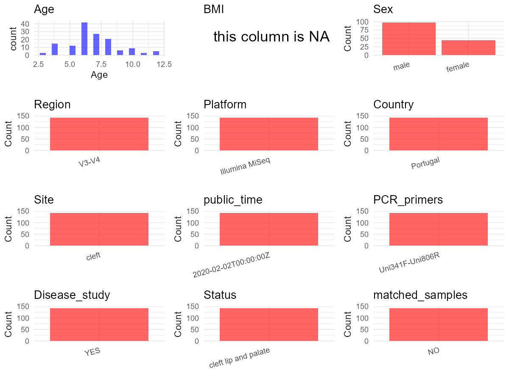

# Step 1: Obtain Initial Metadata from Each Project

To obtain the initial metadata: 1. Search for the BioProject ID (e.g.,
“PRJEBXXXX”) on the [NCBI SRA
website](https://www.ncbi.nlm.nih.gov/Traces/study/). 2. In the “Select”
table, click on “Metadata” and download the file. 3. The downloaded file
is typically named “SraRunTable.csv” and contains metadata for the
project.

    library(tidyverse)
    library(ggplot2)
    library(cowplot)

    setwd("C:/Users/zyc/Desktop/oral_project/data/projects/PRJNA512456")
    initial_meta <- read.csv("SraRunTable.csv", header = TRUE) 
    head(initial_meta)

    ##          Run AGE Assay.Type AvgSpotLen    Bases  BioProject    BioSample              BioSampleModel    Bytes              Center.Name
    ## 1 SRR8382828   5   AMPLICON        502 33001480 PRJNA512456 SAMN10669013 Metagenome or environmental 19079774 UNIVERSITY OF COPENHAGEN
    ## 2 SRR8382829   5   AMPLICON        502 52060412 PRJNA512456 SAMN10669014 Metagenome or environmental 30882126 UNIVERSITY OF COPENHAGEN
    ## 3 SRR8382830   7   AMPLICON        502 39823158 PRJNA512456 SAMN10669007 Metagenome or environmental 23337130 UNIVERSITY OF COPENHAGEN
    ## 4 SRR8382831   7   AMPLICON        502 32514540 PRJNA512456 SAMN10669008 Metagenome or environmental 19735049 UNIVERSITY OF COPENHAGEN
    ## 5 SRR8382832   7   AMPLICON        502 39127386 PRJNA512456 SAMN10669009 Metagenome or environmental 23018177 UNIVERSITY OF COPENHAGEN
    ## 6 SRR8382833   7   AMPLICON        502 25621578 PRJNA512456 SAMN10669010 Metagenome or environmental 15465508 UNIVERSITY OF COPENHAGEN
    ##   Collection_Date Consent DATASTORE.filetype DATASTORE.provider                     DATASTORE.region Experiment geo_loc_name_country
    ## 1      2016-12-10  public   fastq,run.zq,sra         gs,ncbi,s3 gs.us-east1,ncbi.public,s3.us-east-1 SRX5192859             Portugal
    ## 2      2016-12-22  public   fastq,run.zq,sra         gs,ncbi,s3 gs.us-east1,ncbi.public,s3.us-east-1 SRX5192858             Portugal
    ## 3      2017-01-09  public   fastq,run.zq,sra         gs,ncbi,s3 gs.us-east1,ncbi.public,s3.us-east-1 SRX5192857             Portugal
    ## 4      2016-12-12  public   fastq,run.zq,sra         gs,ncbi,s3 gs.us-east1,ncbi.public,s3.us-east-1 SRX5192856             Portugal
    ## 5      2016-12-23  public   fastq,run.zq,sra         gs,ncbi,s3 gs.us-east1,ncbi.public,s3.us-east-1 SRX5192855             Portugal
    ## 6      2017-01-06  public   fastq,run.zq,sra         gs,ncbi,s3 gs.us-east1,ncbi.public,s3.us-east-1 SRX5192854             Portugal
    ##   geo_loc_name_country_continent    geo_loc_name Group         HOST     Instrument        lat_lon Library.Name LibraryLayout LibrarySelection
    ## 1                         Europe Portugal: Porto Child Homo sapiens Illumina MiSeq 41.10 N 8.36 W     Oral_04B        PAIRED              PCR
    ## 2                         Europe Portugal: Porto Child Homo sapiens Illumina MiSeq 41.10 N 8.36 W     Oral_04C        PAIRED              PCR
    ## 3                         Europe Portugal: Porto Tween Homo sapiens Illumina MiSeq 41.10 N 8.36 W     Oral_42C        PAIRED              PCR
    ## 4                         Europe Portugal: Porto Tween Homo sapiens Illumina MiSeq 41.10 N 8.36 W     Oral_43A        PAIRED              PCR
    ## 5                         Europe Portugal: Porto Tween Homo sapiens Illumina MiSeq 41.10 N 8.36 W     Oral_43B        PAIRED              PCR
    ## 6                         Europe Portugal: Porto Tween Homo sapiens Illumina MiSeq 41.10 N 8.36 W     Oral_43C        PAIRED              PCR
    ##   LibrarySource              Organism patient Platform          ReleaseDate          create_date version       samp_collect_device
    ## 1   METAGENOMIC human oral metagenome       4 ILLUMINA 2020-02-02T00:00:00Z 2019-01-02T09:08:00Z       1 FLOQSwabs™ (COPAN\\, USA)
    ## 2   METAGENOMIC human oral metagenome       4 ILLUMINA 2020-02-02T00:00:00Z 2019-01-02T09:08:00Z       1 FLOQSwabs™ (COPAN\\, USA)
    ## 3   METAGENOMIC human oral metagenome      42 ILLUMINA 2020-02-02T00:00:00Z 2019-01-02T09:08:00Z       1 FLOQSwabs™ (COPAN\\, USA)
    ## 4   METAGENOMIC human oral metagenome      43 ILLUMINA 2020-02-02T00:00:00Z 2019-01-02T09:08:00Z       1 FLOQSwabs™ (COPAN\\, USA)
    ## 5   METAGENOMIC human oral metagenome      43 ILLUMINA 2020-02-02T00:00:00Z 2019-01-02T09:08:00Z       1 FLOQSwabs™ (COPAN\\, USA)
    ## 6   METAGENOMIC human oral metagenome      43 ILLUMINA 2020-02-02T00:00:00Z 2019-01-02T09:08:00Z       1 FLOQSwabs™ (COPAN\\, USA)
    ##              Sample.Name    sex SRA.Study timepoint
    ## 1 Oral_Patient_04_Time_B female SRP174995         B
    ## 2 Oral_Patient_04_Time_C female SRP174995         C
    ## 3 Oral_Patient_42_Time_C female SRP174995         C
    ## 4 Oral_Patient_43_Time_A   male SRP174995         A
    ## 5 Oral_Patient_43_Time_B   male SRP174995         B
    ## 6 Oral_Patient_43_Time_C   male SRP174995         C

# Step 2: Create a Uniform Metadata Template

The uniform metadata should include the following columns:

1.  **BioProject**: Project ID (e.g., “PRJNA339212”)
2.  **Run**: Sample ID (e.g., “ERRXXXXXX” or “SRRXXXXXX”)
3.  **sample\_name**: Original sample name submitted by the authors (not
    the database-assigned ID)
4.  **Age**: Age of the subject (if available)
5.  **BMI**: Body Mass Index (if available)
6.  **Sex**: Sex of the subject (“F” or “M”)
7.  **Region**: Targeted 16S rRNA region (e.g., “V3-V4”)
8.  **Platform**: Sequencing platform (e.g., “Illumina MiSeq”)
9.  **Country**: Country of sample origin (e.g., “China”)
10. **Site**: Sample site (e.g., “saliva”, “dental plaque”)
11. **public\_time**: Data release date (format: “YYYY-MM-DD”)
12. **PCR\_primers**: PCR primers used (e.g., “515F-806R”)
13. **title**: Title of the associated publication
14. **Disease\_study**: Whether the study involves a disease (“YES” or
    “NO”)
15. **Status**: Disease status (e.g., “T2DM”, “HC”). Note: If the study
    includes both disease and healthy samples, this must be specified
    per sample.
16. **matched\_samples**: matched samples (“YES” or “NO”)

<!-- -->

    metadata <- data.frame(
      BioProject = initial_meta$BioProject,
      Run = initial_meta$Run,
      sample_name = initial_meta$Sample.Name,
      Age = initial_meta$AGE,
      BMI = NA,
      Sex = initial_meta$sex,
      Platform = initial_meta$Instrument,
      Country = initial_meta$geo_loc_name_country,
      # Site = initial_meta$isolation_source,
      public_time = initial_meta$ReleaseDate,
      # Status = initial_meta$Sample.Name,
      stringsAsFactors = FALSE
    )

# Step 3: Manually Add Information from the Publication

Some information (e.g. PCR primers, study title, disease status) must be
manually extracted from the publication and added to the metadata.

     # metadata <- metadata %>%
     #  mutate(Sex = recode(Sex, "female" = "F", "male" = "M"))
    # metadata <-metadata%>%
    #   mutate(Status = case_when(Site == "mucous" ~ "OSCC",
    #                             Site == "dental plaque" ~ "OSCC",
    #                             Site == "tumor" ~ "OSCC",
    #                             TRUE ~ NA))

    metadata$Site <- "cleft"
    metadata$Status <- "cleft lip and palate"
    metadata$matched_samples <- "NO"
    metadata$Region <- "V3-V4"
    metadata$title <- "Temporal oral microbiome changes with brushing in children with cleft lip and palate"
    metadata$Disease_study <- "YES"
    metadata$PCR_primers <- "Uni341F-Uni806R"
    head(metadata)

    ##    BioProject        Run            sample_name Age BMI    Sex       Platform  Country          public_time  Site               Status
    ## 1 PRJNA512456 SRR8382828 Oral_Patient_04_Time_B   5  NA female Illumina MiSeq Portugal 2020-02-02T00:00:00Z cleft cleft lip and palate
    ## 2 PRJNA512456 SRR8382829 Oral_Patient_04_Time_C   5  NA female Illumina MiSeq Portugal 2020-02-02T00:00:00Z cleft cleft lip and palate
    ## 3 PRJNA512456 SRR8382830 Oral_Patient_42_Time_C   7  NA female Illumina MiSeq Portugal 2020-02-02T00:00:00Z cleft cleft lip and palate
    ## 4 PRJNA512456 SRR8382831 Oral_Patient_43_Time_A   7  NA   male Illumina MiSeq Portugal 2020-02-02T00:00:00Z cleft cleft lip and palate
    ## 5 PRJNA512456 SRR8382832 Oral_Patient_43_Time_B   7  NA   male Illumina MiSeq Portugal 2020-02-02T00:00:00Z cleft cleft lip and palate
    ## 6 PRJNA512456 SRR8382833 Oral_Patient_43_Time_C   7  NA   male Illumina MiSeq Portugal 2020-02-02T00:00:00Z cleft cleft lip and palate
    ##   matched_samples Region                                                                                title Disease_study     PCR_primers
    ## 1              NO  V3-V4 Temporal oral microbiome changes with brushing in children with cleft lip and palate           YES Uni341F-Uni806R
    ## 2              NO  V3-V4 Temporal oral microbiome changes with brushing in children with cleft lip and palate           YES Uni341F-Uni806R
    ## 3              NO  V3-V4 Temporal oral microbiome changes with brushing in children with cleft lip and palate           YES Uni341F-Uni806R
    ## 4              NO  V3-V4 Temporal oral microbiome changes with brushing in children with cleft lip and palate           YES Uni341F-Uni806R
    ## 5              NO  V3-V4 Temporal oral microbiome changes with brushing in children with cleft lip and palate           YES Uni341F-Uni806R
    ## 6              NO  V3-V4 Temporal oral microbiome changes with brushing in children with cleft lip and palate           YES Uni341F-Uni806R

# Step 4: Summarize and Validate the Metadata

    print(paste("Number of unique runs:", length(unique(metadata$Run))))

    ## [1] "Number of unique runs: 143"

    print(paste("Number of unique sample names:", length(unique(metadata$sample_name))))

    ## [1] "Number of unique sample names: 143"

# Step 5: Visualize the Metadata

    plot_data <- metadata %>%
      select(-BioProject, -Run, -sample_name, -title)

    # Function to create simple plots for each column
    create_simple_plots <- function(data) {
      plots <- list()

      for (col in colnames(data)) {
        # Check if the column is all NA
        if (all(is.na(data[[col]]))) {
          # Create an empty plot with text indicating all NA
          p <- ggplot() +
            annotate("text", x = 0.5, y = 0.5, label = "this column is NA", size = 6) +
            labs(title = col) +
            theme_void()
        } else if (is.numeric(data[[col]])) {
          # Numeric variable: histogram
          p <- ggplot(data, aes(x = .data[[col]])) +
            geom_histogram(fill = "blue", alpha = 0.6, bins = 20, na.rm = T) +
            labs(title = col) +
            theme_minimal()
        } else {
          # Categorical variable: bar plot (remove NA values)
          count_data <- as.data.frame(table(data[[col]], useNA = "ifany"))
          p <- ggplot(count_data, aes(x = reorder(Var1, -Freq), y = Freq)) +
            geom_col(fill = "red", alpha = 0.6) +
            labs(title = col, x = NULL, y = "Count") +
            theme_minimal() +
            theme(axis.text.x = element_text(angle = 15, hjust = 1))
        }
        plots[[col]] <- p
      }

      return(plots)
    }

    plots <- create_simple_plots(plot_data)
    p<-plot_grid(plots$Age,
              plots$BMI,
              plots$Sex,
              plots$Region,
              plots$Platform,
              plots$Country,
              plots$Site,
              plots$public_time,
              plots$PCR_primers,
              plots$Disease_study,
              plots$Status,
              plots$matched_samples,# add
              ncol = 3, align = "hv", axis = "lb")
    ggsave("Metadata_Summary.png", plot = p, width = 8, height = 6, dpi = 150)

    

 \# Step 6: Finalize and Export the Metadata

    metadata <- metadata[, c(
      "BioProject", "Run", "sample_name", "Age", "BMI", "Sex",
      "Region", "Platform", "Country", "Site", "public_time",
      "PCR_primers", "title", "Disease_study", "Status","matched_samples"
    )]

    write.csv(metadata, file = "metadata.csv", quote = FALSE)
