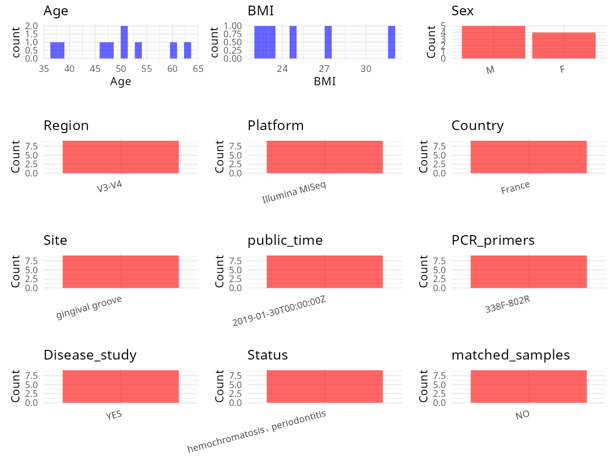

R Notebook: Metadata Processing Workflow
================

# Step 1: Obtain Initial Metadata from Each Project

To obtain the initial metadata: 1. Search for the BioProject ID (e.g.,
“PRJEBXXXX”) on the [NCBI SRA
website](https://www.ncbi.nlm.nih.gov/Traces/study/). 2. In the “Select”
table, click on “Metadata” and download the file. 3. The downloaded file
is typically named “SraRunTable.csv” and contains metadata for the
project.

``` r
# Load necessary libraries
library(dplyr)
library(ggplot2)
library(cowplot)
library(stringr)

# Set working directory (update this path to your local directory)
setwd("/home/hby/oral_project/PRJNA517671")

# Read the initial metadata files
initial_meta <- read.csv("SraRunTable.csv", header = T)

# Combine the two metadata files
# meta <- rbind(initial_meta, initial_meta1)

# Remove entries non-oral samples
# initial_meta <- subset(initial_meta,isolate %in% c("saliva","tongue coat"))

# Check the number of samples containing "HT" in Sample.Name (e.g., healthy controls)
# nrow(subset(meta, grepl("HT", Sample.Name)))

# Display the first few rows of the metadata
head(initial_meta)
```

    ##          Run Assay.Type                                                                    assembly AvgSpotLen    Bases  BioProject    BioSample                       BioSampleModel
    ## 1 SRR8508166   AMPLICON Flash software;error rate of 1 in 100 bp;overlapping and merging read pairs        445  9694912 PRJNA517671 SAMN10840471 MIMS.me,MIGS/MIMS/MIMARKS.human-oral
    ## 2 SRR8508167   AMPLICON Flash software;error rate of 1 in 100 bp;overlapping and merging read pairs        448 11129904 PRJNA517671 SAMN10840470 MIMS.me,MIGS/MIMS/MIMARKS.human-oral
    ## 3 SRR8508168   AMPLICON Flash software;error rate of 1 in 100 bp;overlapping and merging read pairs        449 15388451 PRJNA517671 SAMN10840473 MIMS.me,MIGS/MIMS/MIMARKS.human-oral
    ## 4 SRR8508169   AMPLICON Flash software;error rate of 1 in 100 bp;overlapping and merging read pairs        449  8858824 PRJNA517671 SAMN10840472 MIMS.me,MIGS/MIMS/MIMARKS.human-oral
    ## 5 SRR8508170   AMPLICON Flash software;error rate of 1 in 100 bp;overlapping and merging read pairs        446 10716317 PRJNA517671 SAMN10840475 MIMS.me,MIGS/MIMS/MIMARKS.human-oral
    ## 6 SRR8508171   AMPLICON Flash software;error rate of 1 in 100 bp;overlapping and merging read pairs        445  8435711 PRJNA517671 SAMN10840474 MIMS.me,MIGS/MIMS/MIMARKS.human-oral
    ##     Bytes            Center.Name Collection_Date Consent DATASTORE.filetype DATASTORE.provider                     DATASTORE.region    env_biome env_feature     env_material env_package
    ## 1 2472987 UNIVERSITE DE RENNES 1        2010/8/9  public   fastq,run.zq,sra         gs,ncbi,s3 gs.us-east1,ncbi.public,s3.us-east-1 Homo sapiens     biofilm biofilm material  human-oral
    ## 2 2842154 UNIVERSITE DE RENNES 1        2010/2/9  public   fastq,run.zq,sra         gs,ncbi,s3 gs.us-east1,ncbi.public,s3.us-east-1 Homo sapiens     biofilm biofilm material  human-oral
    ## 3 3968138 UNIVERSITE DE RENNES 1        2011/4/5  public   fastq,run.zq,sra         gs,ncbi,s3 gs.us-east1,ncbi.public,s3.us-east-1 Homo sapiens     biofilm biofilm material  human-oral
    ## 4 2275693 UNIVERSITE DE RENNES 1      2010/12/22  public   fastq,run.zq,sra         gs,ncbi,s3 gs.us-east1,ncbi.public,s3.us-east-1 Homo sapiens     biofilm biofilm material  human-oral
    ## 5 2733304 UNIVERSITE DE RENNES 1        2011/7/7  public   fastq,run.zq,sra         gs,ncbi,s3 gs.us-east1,ncbi.public,s3.us-east-1 Homo sapiens     biofilm biofilm material  human-oral
    ## 6 2164992 UNIVERSITE DE RENNES 1        2011/4/5  public   fastq,run.zq,sra         gs,ncbi,s3 gs.us-east1,ncbi.public,s3.us-east-1 Homo sapiens     biofilm biofilm material  human-oral
    ##   ethnicity Experiment geo_loc_name_country geo_loc_name_country_continent             geo_loc_name Host_Age host_body_mass_index  host_body_site      host_disease_stat host_height
    ## 1 Caucasian SRX5311875               France                         Europe France:Brittany\\,Rennes       38                   NA gingival groove hemochromatosis type 1         173
    ## 2 Caucasian SRX5311874               France                         Europe France:Brittany\\,Rennes       53                 32.0 gingival groove hemochromatosis type 1         175
    ## 3 Caucasian SRX5311873               France                         Europe France:Brittany\\,Rennes       63                 27.5 gingival groove hemochromatosis type 1         182
    ## 4 Caucasian SRX5311872               France                         Europe France:Brittany\\,Rennes       60                 23.4 gingival groove hemochromatosis type 1         164
    ## 5 Caucasian SRX5311871               France                         Europe France:Brittany\\,Rennes       51                 24.9 gingival groove hemochromatosis type 1         159
    ## 6 Caucasian SRX5311870               France                         Europe France:Brittany\\,Rennes       37                 22.4 gingival groove hemochromatosis type 1         165
    ##           HOST host_sex host_subject_id host_weight     Instrument investigation_type                lat_lon lib_const_meth lib_reads_seqd Library.Name LibraryLayout LibrarySelection
    ## 1 Homo sapiens     male              15          NA Illumina MiSeq         metagenome 48.119547 N 1.694538 W     paired-end          11313    HP_16S_15        SINGLE              PCR
    ## 2 Homo sapiens     male              12          98 Illumina MiSeq         metagenome 48.119547 N 1.694538 W     paired-end          12617    HP_16S_12        SINGLE              PCR
    ## 3 Homo sapiens     male              74          91 Illumina MiSeq         metagenome 48.119547 N 1.694538 W     paired-end          20036    HP_16S_74        SINGLE              PCR
    ## 4 Homo sapiens   female              48          63 Illumina MiSeq         metagenome 48.119547 N 1.694538 W     paired-end           9353    HP_16S_48        SINGLE              PCR
    ## 5 Homo sapiens   female              81          63 Illumina MiSeq         metagenome 48.119547 N 1.694538 W     paired-end          12910    HP_16S_81        SINGLE              PCR
    ## 6 Homo sapiens   female              75          61 Illumina MiSeq         metagenome 48.119547 N 1.694538 W     paired-end           8765    HP_16S_75        SINGLE              PCR
    ##   LibrarySource mean_bleeding_on_probing mean_cal mean_gingival_index mean_plaque_index mean_ppd number_of_teeth              Organism
    ## 1       GENOMIC                     0.33     2.36                0.28              0.00     2.15              27 human oral metagenome
    ## 2       GENOMIC                     0.23     2.96                0.61              0.00     1.84              26 human oral metagenome
    ## 3       GENOMIC                     0.46     2.48                0.25              0.00     2.29              24 human oral metagenome
    ## 4       GENOMIC                     0.10     3.15                0.20              0.25     2.25              20 human oral metagenome
    ## 5       GENOMIC                     0.22     2.46                0.12              0.00     1.91              27 human oral metagenome
    ## 6       GENOMIC                     0.93     2.21                0.41              0.29     2.17              28 human oral metagenome
    ##                                                                                         pcr_cond                                     PCR_primers periodontitis_classification_eke_2012
    ## 1 initial denaturation:98_0.5; annealing:45_0.5; elongation: 72_0.75; final elongation:72_10; 25 FWD:ACTCCTACGGGAGGCAGCAG REV:TACNVGGGTATCTAATCC                                severe
    ## 2 initial denaturation:98_0.5; annealing:45_0.5; elongation: 72_0.75; final elongation:72_10; 25 FWD:ACTCCTACGGGAGGCAGCAG REV:TACNVGGGTATCTAATCC                                severe
    ## 3 initial denaturation:98_0.5; annealing:45_0.5; elongation: 72_0.75; final elongation:72_10; 25 FWD:ACTCCTACGGGAGGCAGCAG REV:TACNVGGGTATCTAATCC                              moderate
    ## 4 initial denaturation:98_0.5; annealing:45_0.5; elongation: 72_0.75; final elongation:72_10; 25 FWD:ACTCCTACGGGAGGCAGCAG REV:TACNVGGGTATCTAATCC                                severe
    ## 5 initial denaturation:98_0.5; annealing:45_0.5; elongation: 72_0.75; final elongation:72_10; 25 FWD:ACTCCTACGGGAGGCAGCAG REV:TACNVGGGTATCTAATCC                              moderate
    ## 6 initial denaturation:98_0.5; annealing:45_0.5; elongation: 72_0.75; final elongation:72_10; 25 FWD:ACTCCTACGGGAGGCAGCAG REV:TACNVGGGTATCTAATCC                              moderate
    ##   Platform                                                 project_name          ReleaseDate          create_date version samp_collect_device samp_store_temp Sample_Name       seq_meth
    ## 1 ILLUMINA Periopathogens and periodontal clinical parameters (partial) 2019-01-30T00:00:00Z 2019-01-30T14:58:00Z       1 sterile paper point             -80  Hemoparo15 Illumina MiSeq
    ## 2 ILLUMINA Periopathogens and periodontal clinical parameters (partial) 2019-01-30T00:00:00Z 2019-01-30T14:58:00Z       1 sterile paper point             -80  Hemoparo12 Illumina MiSeq
    ## 3 ILLUMINA Periopathogens and periodontal clinical parameters (partial) 2019-01-30T00:00:00Z 2019-01-30T14:58:00Z       1 sterile paper point             -80  Hemoparo74 Illumina MiSeq
    ## 4 ILLUMINA Periopathogens and periodontal clinical parameters (partial) 2019-01-30T00:00:00Z 2019-01-30T14:58:00Z       1 sterile paper point             -80  Hemoparo48 Illumina MiSeq
    ## 5 ILLUMINA Periopathogens and periodontal clinical parameters (partial) 2019-01-30T00:00:00Z 2019-01-30T14:58:00Z       1 sterile paper point             -80  Hemoparo81 Illumina MiSeq
    ## 6 ILLUMINA Periopathogens and periodontal clinical parameters (partial) 2019-01-30T00:00:00Z 2019-01-30T14:58:00Z       1 sterile paper point             -80  Hemoparo75 Illumina MiSeq
    ##            seq_quality_check serum_ferritin_micrograms_per_liter sites_with_cal_greater_or_equal_3mm_percentage sites_with_cal_greater_or_equal_5mm_percentage
    ## 1 manually edited using PhiX                                  57                                          37.65                                           3.70
    ## 2 manually edited using PhiX                                  79                                          63.46                                           8.33
    ## 3 manually edited using PhiX                                  54                                          40.28                                           5.56
    ## 4 manually edited using PhiX                                  53                                          57.50                                          15.00
    ## 5 manually edited using PhiX                                 379                                          43.83                                           1.85
    ## 6 manually edited using PhiX                                  60                                          30.95                                           0.00
    ##   sites_with_ppd_greater_or_equal_4mm_percentage sites_with_ppd_greater_or_equal_6mm_percentage SRA.Study target_gene target_subfragment transferrin_saturation_percentage
    ## 1                                           6.79                                           0.00 SRP182955    16S rRNA               V3V4                              42.2
    ## 2                                           3.21                                           0.00 SRP182955    16S rRNA               V3V4                              42.6
    ## 3                                          14.58                                           0.00 SRP182955    16S rRNA               V3V4                              38.0
    ## 4                                           9.17                                           0.83 SRP182955    16S rRNA               V3V4                              34.9
    ## 5                                           3.09                                           0.00 SRP182955    16S rRNA               V3V4                              39.8
    ## 6                                           3.57                                           0.00 SRP182955    16S rRNA               V3V4                              18.8

# Step 2: Create a Uniform Metadata Template

The uniform metadata should include the following columns:

1.  **BioProject**: Project ID (e.g., “PRJNA339212”)
2.  **Run**: Sample ID (e.g., “ERRXXXXXX” or “SRRXXXXXX”)
3.  **sample_name**: Original sample name submitted by the authors (not
    the database-assigned ID)
4.  **Age**: Age of the subject (if available)
5.  **BMI**: Body Mass Index (if available)
6.  **Sex**: Sex of the subject (“F” or “M”)
7.  **Region**: Targeted 16S rRNA region (e.g., “V3-V4”)
8.  **Platform**: Sequencing platform (e.g., “Illumina MiSeq”)
9.  **Country**: Country of sample origin (e.g., “China”)
10. **Site**: Sample site (e.g., “saliva”, “dental plaque”)
11. **public_time**: Data release date (format: “YYYY-MM-DD”)
12. **PCR_primers**: PCR primers used (e.g., “515F-806R”)
13. **title**: Title of the associated publication
14. **Disease_study**: Whether the study involves a disease (“YES” or
    “NO”)
15. **Status**: Disease status (e.g., “T2DM”, “HC”). Note: If the study
    includes both disease and healthy samples, this must be specified
    per sample.
16. **matched_samples**: matched samples (“YES” or “NO”)

``` r
# Create a uniform metadata dataframe
metadata <- data.frame(
  BioProject = initial_meta$BioProject,
  Run = initial_meta$Run,
  sample_name = initial_meta$Sample_Name,
  Platform = initial_meta$Instrument,
  Country = initial_meta$geo_loc_name_country,
  public_time = initial_meta$ReleaseDate,
  Site = initial_meta$host_body_site,
  Sex = initial_meta$host_sex,
  Age = initial_meta$Host_Age,
  BMI = initial_meta$host_body_mass_index
) %>%
  mutate(
    Sex = case_when(
      Sex == "female" ~ "F",
      Sex == "male" ~ "M",
    )
  )
```

# Step 3: Manually Add Information from the Publication

Some information (e.g. PCR primers, study title, disease status) must be
manually extracted from the publication and added to the metadata.

``` r
# Add information obtained from the publication
metadata$Status <- "hemochromatosis、periodontitis"
metadata$Region <- "V3-V4"
metadata$PCR_primers <- "338F-802R"
metadata$title <- "Periodontal pathogens and clinical parameters in chronic periodontitis"
metadata$Disease_study <- "YES"
metadata$matched_samples <- "NO"
```

# Step 4: Summarize and Validate the Metadata

``` r
# Check the number of unique runs and sample names
print(paste("Number of unique runs:", length(unique(metadata$Run))))
```

    ## [1] "Number of unique runs: 9"

``` r
print(paste("Number of unique sample names:", length(unique(metadata$sample_name))))
```

    ## [1] "Number of unique sample names: 9"

# Step 5: Visualize the Metadata

``` r

```


# Step 6: Finalize and Export the Metadata

``` r
# Reorder columns to match the desired format
metadata <- metadata[, c(
  "BioProject", "Run", "sample_name", "Age", "BMI", "Sex",
  "Region", "Platform", "Country", "Site", "public_time",
  "PCR_primers", "title", "Disease_study", "Status", "matched_samples"
)]

# Export the uniform metadata to a CSV file
write.csv(metadata, file = "metadata.csv", quote = FALSE)
head(metadata)
```

    ##    BioProject        Run sample_name Age  BMI Sex Region       Platform Country            Site          public_time PCR_primers
    ## 1 PRJNA517671 SRR8508166  Hemoparo15  38   NA   M  V3-V4 Illumina MiSeq  France gingival groove 2019-01-30T00:00:00Z   338F-802R
    ## 2 PRJNA517671 SRR8508167  Hemoparo12  53 32.0   M  V3-V4 Illumina MiSeq  France gingival groove 2019-01-30T00:00:00Z   338F-802R
    ## 3 PRJNA517671 SRR8508168  Hemoparo74  63 27.5   M  V3-V4 Illumina MiSeq  France gingival groove 2019-01-30T00:00:00Z   338F-802R
    ## 4 PRJNA517671 SRR8508169  Hemoparo48  60 23.4   F  V3-V4 Illumina MiSeq  France gingival groove 2019-01-30T00:00:00Z   338F-802R
    ## 5 PRJNA517671 SRR8508170  Hemoparo81  51 24.9   F  V3-V4 Illumina MiSeq  France gingival groove 2019-01-30T00:00:00Z   338F-802R
    ## 6 PRJNA517671 SRR8508171  Hemoparo75  37 22.4   F  V3-V4 Illumina MiSeq  France gingival groove 2019-01-30T00:00:00Z   338F-802R
    ##                                                                    title Disease_study                         Status matched_samples
    ## 1 Periodontal pathogens and clinical parameters in chronic periodontitis           YES hemochromatosis、periodontitis              NO
    ## 2 Periodontal pathogens and clinical parameters in chronic periodontitis           YES hemochromatosis、periodontitis              NO
    ## 3 Periodontal pathogens and clinical parameters in chronic periodontitis           YES hemochromatosis、periodontitis              NO
    ## 4 Periodontal pathogens and clinical parameters in chronic periodontitis           YES hemochromatosis、periodontitis              NO
    ## 5 Periodontal pathogens and clinical parameters in chronic periodontitis           YES hemochromatosis、periodontitis              NO
    ## 6 Periodontal pathogens and clinical parameters in chronic periodontitis           YES hemochromatosis、periodontitis              NO

## Notes for Students:

1.  **Metadata Accuracy**: Always cross-check the metadata with the
    original publication to ensure accuracy.
2.  **Manual Entries**: Columns like `PCR_primers`, and `Status` often
    require manual entry based on the publication.
3.  **Disease Status**: Be careful when assigning `Status`—some studies
    include both disease and healthy samples.
4.  **Visualization**: The plots help quickly identify the distribution
    of values in each column, which is useful for quality control.
5.  **Reproducibility**: Update the working directory and file paths to
    match your local environment.
