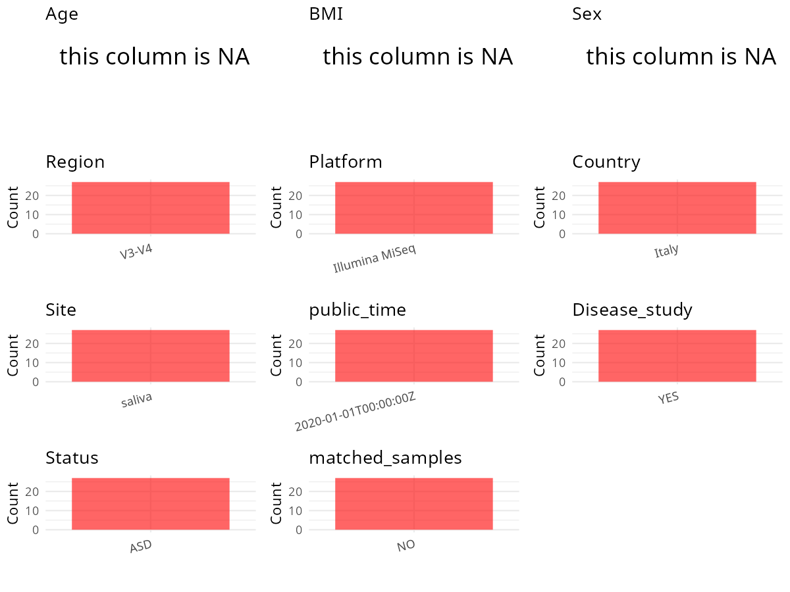

R Notebook: Metadata Processing Workflow
================

# Step 1: Obtain Initial Metadata from Each Project

To obtain the initial metadata: 1. Search for the BioProject ID (e.g.,
“PRJEBXXXX”) on the [NCBI SRA
website](https://www.ncbi.nlm.nih.gov/Traces/study/). 2. In the “Select”
table, click on “Metadata” and download the file. 3. The downloaded file
is typically named “SraRunTable.csv” and contains metadata for the
project.

``` r
# Load necessary libraries
library(dplyr)
library(ggplot2)
library(cowplot)
library(stringr)

# Set working directory (update this path to your local directory)
setwd("/home/hby/oral_project/PRJNA518756")

# Read the initial metadata files
initial_meta <- read.csv("SraRunTable.csv", header = T)

# Combine the two metadata files
# meta <- rbind(initial_meta, initial_meta1)

# Remove entries non-oral samples
# initial_meta <- subset(initial_meta,isolate %in% c("saliva","tongue coat"))

# Check the number of samples containing "HT" in Sample.Name (e.g., healthy controls)
# nrow(subset(meta, grepl("HT", Sample.Name)))

# Display the first few rows of the metadata
head(initial_meta)
```

    ##          Run Assay.Type AvgSpotLen    Bases  BioProject    BioSample              BioSampleModel    Bytes           Center.Name Collection_Date Consent DATASTORE.filetype
    ## 1 SRR8543713   AMPLICON        412 54611873 PRJNA518756 SAMN10851939 Metagenome or environmental 22403683 UNIVERSITY OF CATANIA      2018/10/15  public   fastq,run.zq,sra
    ## 2 SRR8543714   AMPLICON        413 62209227 PRJNA518756 SAMN10851940 Metagenome or environmental 25363879 UNIVERSITY OF CATANIA      2018/10/15  public   fastq,run.zq,sra
    ## 3 SRR8543715   AMPLICON        412 56728020 PRJNA518756 SAMN10851941 Metagenome or environmental 23123403 UNIVERSITY OF CATANIA      2018/10/15  public   fastq,run.zq,sra
    ## 4 SRR8543716   AMPLICON        410 51181474 PRJNA518756 SAMN10851942 Metagenome or environmental 21051060 UNIVERSITY OF CATANIA      2018/10/15  public   fastq,run.zq,sra
    ## 5 SRR8543717   AMPLICON        409 50080276 PRJNA518756 SAMN10851943 Metagenome or environmental 20404776 UNIVERSITY OF CATANIA      2018/10/15  public   fastq,run.zq,sra
    ## 6 SRR8543718   AMPLICON        411 53164107 PRJNA518756 SAMN10851944 Metagenome or environmental 21551598 UNIVERSITY OF CATANIA      2018/10/15  public   fastq,run.zq,sra
    ##   DATASTORE.provider                     DATASTORE.region Experiment geo_loc_name_country geo_loc_name_country_continent  geo_loc_name         HOST     Instrument isolation_source
    ## 1         gs,ncbi,s3 gs.us-east1,ncbi.public,s3.us-east-1 SRX5345868                Italy                         Europe Italy:Catania Homo sapiens Illumina MiSeq           saliva
    ## 2         gs,ncbi,s3 gs.us-east1,ncbi.public,s3.us-east-1 SRX5345867                Italy                         Europe Italy:Catania Homo sapiens Illumina MiSeq           saliva
    ## 3         gs,ncbi,s3 gs.us-east1,ncbi.public,s3.us-east-1 SRX5345866                Italy                         Europe Italy:Catania Homo sapiens Illumina MiSeq           saliva
    ## 4         gs,ncbi,s3 gs.us-east1,ncbi.public,s3.us-east-1 SRX5345865                Italy                         Europe Italy:Catania Homo sapiens Illumina MiSeq           saliva
    ## 5         gs,ncbi,s3 gs.us-east1,ncbi.public,s3.us-east-1 SRX5345864                Italy                         Europe Italy:Catania Homo sapiens Illumina MiSeq           saliva
    ## 6         gs,ncbi,s3 gs.us-east1,ncbi.public,s3.us-east-1 SRX5345863                Italy                         Europe Italy:Catania Homo sapiens Illumina MiSeq           saliva
    ##   lat_lon Library.Name LibraryLayout LibrarySelection LibrarySource                Organism Platform          ReleaseDate          create_date version Sample_Name SRA.Study
    ## 1      NA      CTRL034        PAIRED              PCR   METAGENOMIC human saliva metagenome ILLUMINA 2020-01-01T00:00:00Z 2019-02-07T04:53:00Z       1     H34-Sal SRP184428
    ## 2      NA      CTRL033        PAIRED              PCR   METAGENOMIC human saliva metagenome ILLUMINA 2020-01-01T00:00:00Z 2019-02-07T04:53:00Z       1     H33-Sal SRP184428
    ## 3      NA      CTRL036        PAIRED              PCR   METAGENOMIC human saliva metagenome ILLUMINA 2020-01-01T00:00:00Z 2019-02-07T04:53:00Z       1     H36-Sal SRP184428
    ## 4      NA      CTRL035        PAIRED              PCR   METAGENOMIC human saliva metagenome ILLUMINA 2020-01-01T00:00:00Z 2019-02-07T04:53:00Z       1     H35-Sal SRP184428
    ## 5      NA      CTRL038        PAIRED              PCR   METAGENOMIC human saliva metagenome ILLUMINA 2020-01-01T00:00:00Z 2019-02-07T04:53:00Z       1     H38-Sal SRP184428
    ## 6      NA      CTRL037        PAIRED              PCR   METAGENOMIC human saliva metagenome ILLUMINA 2020-01-01T00:00:00Z 2019-02-07T04:53:00Z       1     H37-Sal SRP184428

# Step 2: Create a Uniform Metadata Template

The uniform metadata should include the following columns:

1.  **BioProject**: Project ID (e.g., “PRJNA339212”)
2.  **Run**: Sample ID (e.g., “ERRXXXXXX” or “SRRXXXXXX”)
3.  **sample_name**: Original sample name submitted by the authors (not
    the database-assigned ID)
4.  **Age**: Age of the subject (if available)
5.  **BMI**: Body Mass Index (if available)
6.  **Sex**: Sex of the subject (“F” or “M”)
7.  **Region**: Targeted 16S rRNA region (e.g., “V3-V4”)
8.  **Platform**: Sequencing platform (e.g., “Illumina MiSeq”)
9.  **Country**: Country of sample origin (e.g., “China”)
10. **Site**: Sample site (e.g., “saliva”, “dental plaque”)
11. **public_time**: Data release date (format: “YYYY-MM-DD”)
12. **PCR_primers**: PCR primers used (e.g., “515F-806R”)
13. **title**: Title of the associated publication
14. **Disease_study**: Whether the study involves a disease (“YES” or
    “NO”)
15. **Status**: Disease status (e.g., “T2DM”, “HC”). Note: If the study
    includes both disease and healthy samples, this must be specified
    per sample.
16. **matched_samples**: matched samples (“YES” or “NO”)

``` r
# Create a uniform metadata dataframe
metadata <- data.frame(
  BioProject = initial_meta$BioProject,
  Run = initial_meta$Run,
  sample_name = initial_meta$Sample_Name,
  Platform = initial_meta$Instrument,
  Country = initial_meta$geo_loc_name_country,
  public_time = initial_meta$ReleaseDate,
  Site = initial_meta$isolation_source,
  Sex = NA,
  Age = NA,
  BMI = NA
)
```

# Step 3: Manually Add Information from the Publication

Some information (e.g. PCR primers, study title, disease status) must be
manually extracted from the publication and added to the metadata.

``` r
# Add information obtained from the publication
metadata$Status <- "ASD"
metadata$Region <- "V3-V4"
metadata$PCR_primers <- "FWD:CCTACGGGNGGCWGCAG; REV:GACTACHVGGGTATCTAATCC"
metadata$title <- "Potential Associations Among Alteration of Salivary miRNAs、Saliva Microbiome Structure、 and Cognitive Impairments in Autistic Children"
metadata$Disease_study <- "YES"
metadata$matched_samples <- "NO"
```

# Step 4: Summarize and Validate the Metadata

``` r
# Check the number of unique runs and sample names
print(paste("Number of unique runs:", length(unique(metadata$Run))))
```

    ## [1] "Number of unique runs: 27"

``` r
print(paste("Number of unique sample names:", length(unique(metadata$sample_name))))
```

    ## [1] "Number of unique sample names: 27"

# Step 5: Visualize the Metadata

``` r

```


# Step 6: Finalize and Export the Metadata

``` r
# Reorder columns to match the desired format
metadata <- metadata[, c(
  "BioProject", "Run", "sample_name", "Age", "BMI", "Sex",
  "Region", "Platform", "Country", "Site", "public_time",
  "PCR_primers", "title", "Disease_study", "Status", "matched_samples"
)]

# Export the uniform metadata to a CSV file
write.csv(metadata, file = "metadata.csv", quote = FALSE)
head(metadata)
```

    ##    BioProject        Run sample_name Age BMI Sex Region       Platform Country   Site          public_time                                      PCR_primers
    ## 1 PRJNA518756 SRR8543713     H34-Sal  NA  NA  NA  V3-V4 Illumina MiSeq   Italy saliva 2020-01-01T00:00:00Z FWD:CCTACGGGNGGCWGCAG; REV:GACTACHVGGGTATCTAATCC
    ## 2 PRJNA518756 SRR8543714     H33-Sal  NA  NA  NA  V3-V4 Illumina MiSeq   Italy saliva 2020-01-01T00:00:00Z FWD:CCTACGGGNGGCWGCAG; REV:GACTACHVGGGTATCTAATCC
    ## 3 PRJNA518756 SRR8543715     H36-Sal  NA  NA  NA  V3-V4 Illumina MiSeq   Italy saliva 2020-01-01T00:00:00Z FWD:CCTACGGGNGGCWGCAG; REV:GACTACHVGGGTATCTAATCC
    ## 4 PRJNA518756 SRR8543716     H35-Sal  NA  NA  NA  V3-V4 Illumina MiSeq   Italy saliva 2020-01-01T00:00:00Z FWD:CCTACGGGNGGCWGCAG; REV:GACTACHVGGGTATCTAATCC
    ## 5 PRJNA518756 SRR8543717     H38-Sal  NA  NA  NA  V3-V4 Illumina MiSeq   Italy saliva 2020-01-01T00:00:00Z FWD:CCTACGGGNGGCWGCAG; REV:GACTACHVGGGTATCTAATCC
    ## 6 PRJNA518756 SRR8543718     H37-Sal  NA  NA  NA  V3-V4 Illumina MiSeq   Italy saliva 2020-01-01T00:00:00Z FWD:CCTACGGGNGGCWGCAG; REV:GACTACHVGGGTATCTAATCC
    ##                                                                                                                                      title Disease_study Status matched_samples
    ## 1 Potential Associations Among Alteration of Salivary miRNAs、Saliva Microbiome Structure、 and Cognitive Impairments in Autistic Children           YES    ASD              NO
    ## 2 Potential Associations Among Alteration of Salivary miRNAs、Saliva Microbiome Structure、 and Cognitive Impairments in Autistic Children           YES    ASD              NO
    ## 3 Potential Associations Among Alteration of Salivary miRNAs、Saliva Microbiome Structure、 and Cognitive Impairments in Autistic Children           YES    ASD              NO
    ## 4 Potential Associations Among Alteration of Salivary miRNAs、Saliva Microbiome Structure、 and Cognitive Impairments in Autistic Children           YES    ASD              NO
    ## 5 Potential Associations Among Alteration of Salivary miRNAs、Saliva Microbiome Structure、 and Cognitive Impairments in Autistic Children           YES    ASD              NO
    ## 6 Potential Associations Among Alteration of Salivary miRNAs、Saliva Microbiome Structure、 and Cognitive Impairments in Autistic Children           YES    ASD              NO

## Notes for Students:

1.  **Metadata Accuracy**: Always cross-check the metadata with the
    original publication to ensure accuracy.
2.  **Manual Entries**: Columns like `PCR_primers`, and `Status` often
    require manual entry based on the publication.
3.  **Disease Status**: Be careful when assigning `Status`—some studies
    include both disease and healthy samples.
4.  **Visualization**: The plots help quickly identify the distribution
    of values in each column, which is useful for quality control.
5.  **Reproducibility**: Update the working directory and file paths to
    match your local environment.
