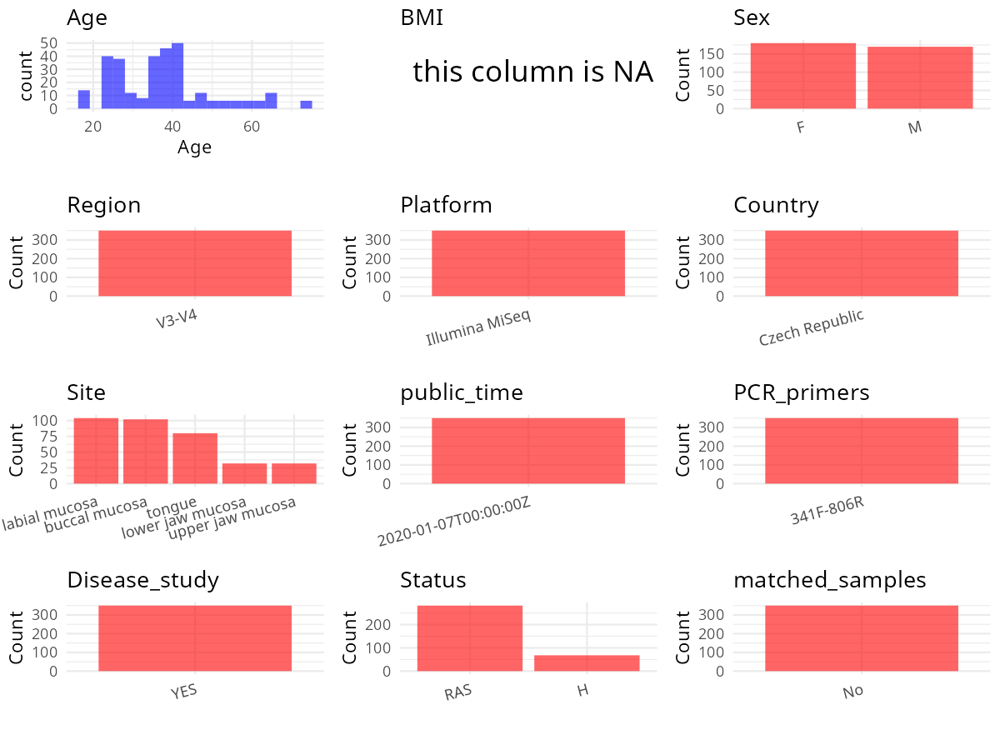

R Notebook: Metadata Processing Workflow
================

# Step 1: Obtain Initial Metadata from Each Project

To obtain the initial metadata: 1. Search for the BioProject ID (e.g.,
“PRJEBXXXX”) on the [NCBI SRA
website](https://www.ncbi.nlm.nih.gov/Traces/study/). 2. In the “Select”
table, click on “Metadata” and download the file. 3. The downloaded file
is typically named “SraRunTable.csv” and contains metadata for the
project.

``` r
# Load necessary libraries
library(dplyr)
library(ggplot2)
library(cowplot)
library(stringr)

# Set working directory (update this path to your local directory)
setwd("/home/hby/oral_project/PRJNA521448")

# Read the initial metadata files
initial_meta <- read.csv("SraRunTable.csv", header = T)

# Combine the two metadata files
# meta <- rbind(initial_meta, initial_meta1)

# Remove entries non-oral samples
# initial_meta <- subset(initial_meta,isolate %in% c("saliva","tongue coat"))

# Check the number of samples containing "HT" in Sample.Name (e.g., healthy controls)
# nrow(subset(meta, grepl("HT", Sample.Name)))

# Display the first few rows of the metadata
head(initial_meta)
```

    ##          Run AdjacentDiseases allergy Assay.Type AvgSpotLen    Bases  BioProject    BioSample                              BioSampleModel    Bytes              Center.Name
    ## 1 SRR8555713               NA      NA   AMPLICON        602  4227244 PRJNA521448 SAMN10906521 MIMARKS.survey,MIGS/MIMS/MIMARKS.human-oral  2460770 CZECH ACADEMY OF SCIENCE
    ## 2 SRR8555714                1       1   AMPLICON        602  4612524 PRJNA521448 SAMN10906522 MIMARKS.survey,MIGS/MIMS/MIMARKS.human-oral  2713993 CZECH ACADEMY OF SCIENCE
    ## 3 SRR8555715                1       1   AMPLICON        602 29142820 PRJNA521448 SAMN10906484 MIMARKS.survey,MIGS/MIMS/MIMARKS.human-oral 16166977 CZECH ACADEMY OF SCIENCE
    ## 4 SRR8555716                1       1   AMPLICON        602 29527498 PRJNA521448 SAMN10906483 MIMARKS.survey,MIGS/MIMS/MIMARKS.human-oral 16315722 CZECH ACADEMY OF SCIENCE
    ## 5 SRR8555717                0       1   AMPLICON        602 16090256 PRJNA521448 SAMN10906413 MIMARKS.survey,MIGS/MIMS/MIMARKS.human-oral  8922287 CZECH ACADEMY OF SCIENCE
    ## 6 SRR8555718               NA      NA   AMPLICON        602 29749034 PRJNA521448 SAMN10906414 MIMARKS.survey,MIGS/MIMS/MIMARKS.human-oral 16560348 CZECH ACADEMY OF SCIENCE
    ##   Collection_Date Consent DATASTORE.filetype DATASTORE.provider                     DATASTORE.region disease                   env_broad_scale env_local_scale     env_medium Experiment
    ## 1       2017/2018  public   fastq,run.zq,sra         gs,ncbi,s3 gs.us-east1,ncbi.public,s3.us-east-1     RAS mouth environment [ENVO:08000002]  not applicable not applicable SRX5357811
    ## 2       2017/2018  public   fastq,run.zq,sra         gs,ncbi,s3 gs.us-east1,ncbi.public,s3.us-east-1     RAS mouth environment [ENVO:08000002]  not applicable not applicable SRX5357810
    ## 3       2017/2018  public   fastq,run.zq,sra         gs,ncbi,s3 gs.us-east1,ncbi.public,s3.us-east-1     RAS mouth environment [ENVO:08000002]  not applicable not applicable SRX5357809
    ## 4       2017/2018  public   fastq,run.zq,sra         gs,ncbi,s3 gs.us-east1,ncbi.public,s3.us-east-1     RAS mouth environment [ENVO:08000002]  not applicable not applicable SRX5357808
    ## 5       2017/2018  public   fastq,run.zq,sra         gs,ncbi,s3 gs.us-east1,ncbi.public,s3.us-east-1     RAS mouth environment [ENVO:08000002]  not applicable not applicable SRX5357807
    ## 6       2017/2018  public   fastq,run.zq,sra         gs,ncbi,s3 gs.us-east1,ncbi.public,s3.us-east-1     RAS mouth environment [ENVO:08000002]  not applicable not applicable SRX5357806
    ##   GastricUlcer geo_loc_name_country geo_loc_name_country_continent   geo_loc_name Host_age         HOST host_sex host_subject_id Immunologist     Instrument        lat_lon Library.Name
    ## 1           NA       Czech Republic                         Europe Czech Republic       NA Homo sapiens   female              32           NA Illumina MiSeq not applicable      H4_A012
    ## 2            0       Czech Republic                         Europe Czech Republic       34 Homo sapiens   female              33            1 Illumina MiSeq not applicable      A5_A012
    ## 3            0       Czech Republic                         Europe Czech Republic       42 Homo sapiens   female              76            1 Illumina MiSeq not applicable     D10_A006
    ## 4            0       Czech Republic                         Europe Czech Republic       38 Homo sapiens     male              74            1 Illumina MiSeq not applicable     B10_A006
    ## 5            0       Czech Republic                         Europe Czech Republic       37 Homo sapiens   female               3            1 Illumina MiSeq not applicable      C1_A006
    ## 6           NA       Czech Republic                         Europe Czech Republic       NA Homo sapiens     male               4           NA Illumina MiSeq not applicable      D1_A006
    ##   LibraryLayout LibrarySelection LibrarySource MedicalTreat              Organism Platform                primers RAS_amount RAS_family RAS_freq RAS_healing RAS_incidence RAS_LastOcc
    ## 1        PAIRED              PCR   METAGENOMIC           NA human oral metagenome ILLUMINA ITS1-18Sfw/ITS1-5.8Srv         NA         NA     <NA>          NA            NA        <NA>
    ## 2        PAIRED              PCR   METAGENOMIC            1 human oral metagenome ILLUMINA ITS1-18Sfw/ITS1-5.8Srv          2          1        5           1             9           P
    ## 3        PAIRED              PCR   METAGENOMIC            0 human oral metagenome ILLUMINA              341f/806r          2          1        P           2             9           1
    ## 4        PAIRED              PCR   METAGENOMIC            1 human oral metagenome ILLUMINA              341f/806r          1          0        P           1             9           P
    ## 5        PAIRED              PCR   METAGENOMIC            1 human oral metagenome ILLUMINA              341f/806r          2          0        4           1             2           2
    ## 6        PAIRED              PCR   METAGENOMIC           NA human oral metagenome ILLUMINA              341f/806r         NA         NA     <NA>          NA            NA        <NA>
    ##   RAS_LastOccAmount RAS_StartAge RAS_Treatment RAS_triggers RAS_Type          ReleaseDate          create_date version Sample_Name SampleSite sampletype smoking SRA.Study status
    ## 1                NA           NA            NA         <NA>       NA 2020-01-07T00:00:00Z 2019-02-14T12:21:00Z       2     H4_A012         Ch          A      NA SRP185388    Act
    ## 2                 1            2             1            C        0 2020-01-07T00:00:00Z 2019-02-14T12:21:00Z       2     A5_A012         LL         AS       0 SRP185388    Act
    ## 3                 3            2             1            C        0 2020-01-07T00:00:00Z 2019-02-14T12:23:00Z       2    D10_A006         UM          P       0 SRP185388    Pas
    ## 4                NA            0             0            0        0 2020-01-07T00:00:00Z 2019-02-14T12:23:00Z       2    B10_A006         LM          P       0 SRP185388    Pas
    ## 5                 1            0             0            3        0 2020-01-07T00:00:00Z 2019-02-14T12:22:00Z       2     C1_A006         LL          P       0 SRP185388    Pas
    ## 6                NA           NA            NA         <NA>       NA 2020-01-07T00:00:00Z 2019-02-14T12:22:00Z       2     D1_A006         LL          P      NA SRP185388    Pas
    ##   Thyroiditis VitaminTreat
    ## 1          NA           NA
    ## 2           0            0
    ## 3           0            1
    ## 4           0            0
    ## 5           0            0
    ## 6          NA           NA

# Step 2: Create a Uniform Metadata Template

The uniform metadata should include the following columns:

1.  **BioProject**: Project ID (e.g., “PRJNA339212”)
2.  **Run**: Sample ID (e.g., “ERRXXXXXX” or “SRRXXXXXX”)
3.  **sample_name**: Original sample name submitted by the authors (not
    the database-assigned ID)
4.  **Age**: Age of the subject (if available)
5.  **BMI**: Body Mass Index (if available)
6.  **Sex**: Sex of the subject (“F” or “M”)
7.  **Region**: Targeted 16S rRNA region (e.g., “V3-V4”)
8.  **Platform**: Sequencing platform (e.g., “Illumina MiSeq”)
9.  **Country**: Country of sample origin (e.g., “China”)
10. **Site**: Sample site (e.g., “saliva”, “dental plaque”)
11. **public_time**: Data release date (format: “YYYY-MM-DD”)
12. **PCR_primers**: PCR primers used (e.g., “515F-806R”)
13. **title**: Title of the associated publication
14. **Disease_study**: Whether the study involves a disease (“YES” or
    “NO”)
15. **Status**: Disease status (e.g., “T2DM”, “HC”). Note: If the study
    includes both disease and healthy samples, this must be specified
    per sample.
16. **matched_samples**: matched samples (“YES” or “NO”)

``` r
# Create a uniform metadata dataframe
metadata <- data.frame(
  BioProject = initial_meta$BioProject,
  Run = initial_meta$Run,
  sample_name = initial_meta$host_subject_id,
  Sex = initial_meta$host_sex,
  Age = initial_meta$Host_age,
  Platform = initial_meta$Instrument,
  Country = initial_meta$geo_loc_name_country,
  Site = initial_meta$SampleSite,
  public_time = initial_meta$ReleaseDate,
  Status = initial_meta$disease,
  BMI = NA,
  stringsAsFactors = FALSE
) %>%
  mutate(
    Status = case_when(
      Status == "Ctrl" ~ "H",
      Status == "RAS" ~ "RAS",
    ),
    Sex = case_when(
      Sex == "male" ~ "M",
      Sex == "female" ~ "F"
    ),
    Site = case_when(
      Site == "Ch" ~ "buccal mucosa",
      Site == "LL" ~ "lower labial mucosa",
      Site == "UM" ~ "upper jaw mucosa",
      Site == "T" ~ "tongue",
      Site == "LM" ~ "lower jaw mucosa",
    )
  )
```

# Step 3: Manually Add Information from the Publication

Some information (e.g. PCR primers, study title, disease status) must be
manually extracted from the publication and added to the metadata.

``` r
# Add information obtained from the publication
metadata$Region <- "V3-V4"
metadata$PCR_primers <- "341F-806R"
metadata$title <- "Oral Microbiota Composition and Antimicrobial Antibody Response in Patients with Recurrent Aphthous Stomatitis"
metadata$Disease_study <- "YES"
metadata$matched_samples <- "No"

cat("\nFinal sample distribution:\n")
```

    ## 
    ## Final sample distribution:

``` r
table(metadata$sample_name)
```

    ## 
    ##  1  2  3  4  5  6  7  8  9 10 11 12 13 14 15 16 17 18 19 20 21 22 23 24 25 26 27 28 29 30 31 32 33 34 35 36 37 38 39 40 41 42 43 44 45 46 47 48 49 50 51 52 53 54 55 56 57 58 59 60 61 62 
    ##  4  4  4  4  4  4  4  4  4  4  4  4  4  4  4  4  4  4  4  4  4  4  4  4  4  4  4  4  4  4  4  4  4  4  4  4  4  4  4  4  4  4  4  4  4  4  4  4  4  4  4  4  4  4  4  4  4  4  4  4  4  4 
    ## 63 64 65 66 67 68 69 70 71 72 73 74 75 76 77 78 79 80 81 82 83 84 85 86 87 88 89 90 91 92 93 94 95 96 
    ##  4  4  4  4  4  4  4  4  4  4  2  4  2  4  2  4  4  4  2  2  2  4  4  2  2  2  2  2  2  2  2  2  2  2

``` r
table(metadata$Site)
```

    ## 
    ##       buccal mucosa    lower jaw mucosa lower labial mucosa              tongue    upper jaw mucosa 
    ##                 102                  32                 104                  80                  32

``` r
table(metadata$matched_samples)
```

    ## 
    ##  No 
    ## 350

# Step 4: Summarize and Validate the Metadata

``` r
# Check the number of unique runs and sample names
print(paste("Number of unique runs:", length(unique(metadata$Run))))
```

    ## [1] "Number of unique runs: 350"

``` r
print(paste("Number of unique sample names:", length(unique(metadata$sample_name))))
```

    ## [1] "Number of unique sample names: 96"

# Step 5: Visualize the Metadata

``` r

```


# Step 6: Finalize and Export the Metadata

``` r
# Reorder columns to match the desired format
metadata <- metadata[, c(
  "BioProject", "Run", "sample_name", "Age", "BMI", "Sex",
  "Region", "Platform", "Country", "Site", "public_time",
  "PCR_primers", "title", "Disease_study", "Status", "matched_samples"
)]

# Export the uniform metadata to a CSV file
write.csv(metadata, file = "metadata.csv", quote = FALSE)
head(metadata)
```

    ##    BioProject        Run sample_name Age BMI Sex Region       Platform        Country                Site          public_time PCR_primers
    ## 1 PRJNA521448 SRR8555713          32  NA  NA   F  V3-V4 Illumina MiSeq Czech Republic       buccal mucosa 2020-01-07T00:00:00Z   341F-806R
    ## 2 PRJNA521448 SRR8555714          33  34  NA   F  V3-V4 Illumina MiSeq Czech Republic lower labial mucosa 2020-01-07T00:00:00Z   341F-806R
    ## 3 PRJNA521448 SRR8555715          76  42  NA   F  V3-V4 Illumina MiSeq Czech Republic    upper jaw mucosa 2020-01-07T00:00:00Z   341F-806R
    ## 4 PRJNA521448 SRR8555716          74  38  NA   M  V3-V4 Illumina MiSeq Czech Republic    lower jaw mucosa 2020-01-07T00:00:00Z   341F-806R
    ## 5 PRJNA521448 SRR8555717           3  37  NA   F  V3-V4 Illumina MiSeq Czech Republic lower labial mucosa 2020-01-07T00:00:00Z   341F-806R
    ## 6 PRJNA521448 SRR8555718           4  NA  NA   M  V3-V4 Illumina MiSeq Czech Republic lower labial mucosa 2020-01-07T00:00:00Z   341F-806R
    ##                                                                                                            title Disease_study Status matched_samples
    ## 1 Oral Microbiota Composition and Antimicrobial Antibody Response in Patients with Recurrent Aphthous Stomatitis           YES    RAS              No
    ## 2 Oral Microbiota Composition and Antimicrobial Antibody Response in Patients with Recurrent Aphthous Stomatitis           YES    RAS              No
    ## 3 Oral Microbiota Composition and Antimicrobial Antibody Response in Patients with Recurrent Aphthous Stomatitis           YES    RAS              No
    ## 4 Oral Microbiota Composition and Antimicrobial Antibody Response in Patients with Recurrent Aphthous Stomatitis           YES    RAS              No
    ## 5 Oral Microbiota Composition and Antimicrobial Antibody Response in Patients with Recurrent Aphthous Stomatitis           YES    RAS              No
    ## 6 Oral Microbiota Composition and Antimicrobial Antibody Response in Patients with Recurrent Aphthous Stomatitis           YES    RAS              No

## Notes for Students:

1.  **Metadata Accuracy**: Always cross-check the metadata with the
    original publication to ensure accuracy.
2.  **Manual Entries**: Columns like `PCR_primers`, and `Status` often
    require manual entry based on the publication.
3.  **Disease Status**: Be careful when assigning `Status`—some studies
    include both disease and healthy samples.
4.  **Visualization**: The plots help quickly identify the distribution
    of values in each column, which is useful for quality control.
5.  **Reproducibility**: Update the working directory and file paths to
    match your local environment.
