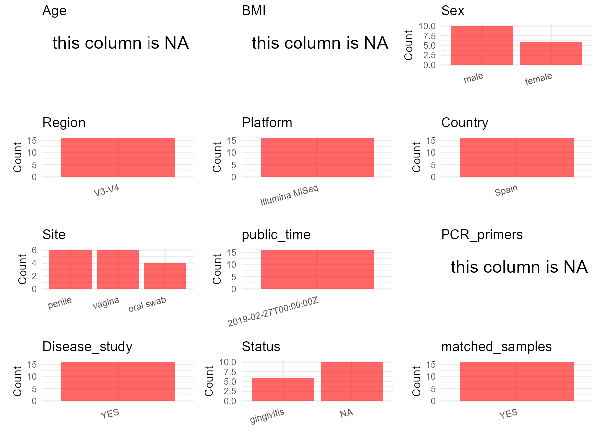

R Notebook: Metadata Processing Workflow
================

# Step 1: Obtain Initial Metadata from Each Project

To obtain the initial metadata: 1. Search for the BioProject ID (e.g.,
“PRJEBXXXX”) on the [NCBI SRA
website](https://www.ncbi.nlm.nih.gov/Traces/study/). 2. In the “Select”
table, click on “Metadata” and download the file. 3. The downloaded file
is typically named “SraRunTable.csv” and contains metadata for the
project.

``` r
# Load necessary libraries
library(dplyr)
library(ggplot2)
library(cowplot)

# Set working directory (update this path to your local directory)
setwd("D:/studylearning/董彪师兄项目/任务4_20251009/PRJNA524629")

# Read the initial metadata files
initial_meta<-read.csv("SraRunTable.csv",header = T)

# Display the first few rows of the metadata
head(initial_meta)
```

    ##          Run Assay.Type AvgSpotLen    Bases  BioProject    BioSample
    ## 1 SRR8643706   AMPLICON        598 41158619 PRJNA524629 SAMN11029303
    ## 2 SRR8643707   AMPLICON        598 42562956 PRJNA524629 SAMN11029304
    ## 3 SRR8643708   AMPLICON        598 45307292 PRJNA524629 SAMN11029305
    ## 4 SRR8643709   AMPLICON        596 49953411 PRJNA524629 SAMN11029306
    ## 5 SRR8643710   AMPLICON        230   782616 PRJNA524629 SAMN11029307
    ## 6 SRR8643711   AMPLICON        595 37692051 PRJNA524629 SAMN11029308
    ##                BioSampleModel    Bytes Center.Name Collection_Date Consent
    ## 1 Metagenome or environmental 26242680     FISABIO         2017-11  public
    ## 2 Metagenome or environmental 26888035     FISABIO         2017-11  public
    ## 3 Metagenome or environmental 29599261     FISABIO         2017-11  public
    ## 4 Metagenome or environmental 30855025     FISABIO         2017-11  public
    ## 5 Metagenome or environmental   581939     FISABIO         2017-11  public
    ## 6 Metagenome or environmental 22540626     FISABIO         2017-11  public
    ##   DATASTORE.filetype DATASTORE.provider                     DATASTORE.region
    ## 1   fastq,run.zq,sra         gs,ncbi,s3 gs.us-east1,ncbi.public,s3.us-east-1
    ## 2   fastq,run.zq,sra         gs,ncbi,s3 gs.us-east1,ncbi.public,s3.us-east-1
    ## 3   fastq,run.zq,sra         gs,ncbi,s3 gs.us-east1,ncbi.public,s3.us-east-1
    ## 4   fastq,run.zq,sra         gs,ncbi,s3 gs.us-east1,ncbi.public,s3.us-east-1
    ## 5   fastq,run.zq,sra         gs,ncbi,s3 gs.us-east1,ncbi.public,s3.us-east-1
    ## 6   fastq,run.zq,sra         gs,ncbi,s3 gs.us-east1,ncbi.public,s3.us-east-1
    ##   Experiment geo_loc_name_country geo_loc_name_country_continent geo_loc_name
    ## 1 SRX5441971                Spain                         Europe Spain:Madrid
    ## 2 SRX5441970                Spain                         Europe Spain:Madrid
    ## 3 SRX5441969                Spain                         Europe Spain:Madrid
    ## 4 SRX5441968                Spain                         Europe Spain:Madrid
    ## 5 SRX5441967                Spain                         Europe Spain:Madrid
    ## 6 SRX5441966                Spain                         Europe Spain:Madrid
    ##           HOST     Instrument        lat_lon  Library.Name LibraryLayout
    ## 1 Homo sapiens Illumina MiSeq 40.48 N 3.68 W     H2O2_Male        PAIRED
    ## 2 Homo sapiens Illumina MiSeq 40.48 N 3.68 W   H2O2_Female        PAIRED
    ## 3 Homo sapiens Illumina MiSeq 40.48 N 3.68 W   15H2O2_Male        PAIRED
    ## 4 Homo sapiens Illumina MiSeq 40.48 N 3.68 W 15H2O2_Female        PAIRED
    ## 5 Homo sapiens Illumina MiSeq 40.48 N 3.68 W OralBe_Female        PAIRED
    ## 6 Homo sapiens Illumina MiSeq 40.48 N 3.68 W OralAf_Female        PAIRED
    ##   LibrarySelection LibrarySource                             Organism Platform
    ## 1              PCR   METAGENOMIC human reproductive system metagenome ILLUMINA
    ## 2              PCR   METAGENOMIC human reproductive system metagenome ILLUMINA
    ## 3              PCR   METAGENOMIC human reproductive system metagenome ILLUMINA
    ## 4              PCR   METAGENOMIC human reproductive system metagenome ILLUMINA
    ## 5              PCR   METAGENOMIC human reproductive system metagenome ILLUMINA
    ## 6              PCR   METAGENOMIC human reproductive system metagenome ILLUMINA
    ##            ReleaseDate          create_date version
    ## 1 2019-02-27T00:00:00Z 2019-02-27T12:47:00Z       1
    ## 2 2019-02-27T00:00:00Z 2019-02-27T12:47:00Z       1
    ## 3 2019-02-27T00:00:00Z 2019-02-27T12:47:00Z       1
    ## 4 2019-02-27T00:00:00Z 2019-02-27T12:47:00Z       1
    ## 5 2019-02-27T00:00:00Z 2019-02-27T12:47:00Z       1
    ## 6 2019-02-27T00:00:00Z 2019-02-27T12:47:00Z       1
    ##                                                           Sample.Name SRA.Study
    ## 1                     Male penile after 24h peroxide treatment (H2O2) SRP187036
    ## 2          Female Vagina after 24h hydrogen peroxide treatment (H2O2) SRP187036
    ## 3   Male penile after 15 days of hydrogen peroxide treatment (15H2O2) SRP187036
    ## 4 Female vagina after 15 days of hydrogen peroxide treatment (15H2O2) SRP187036
    ## 5                            Oral swab female before oral sex on male SRP187036
    ## 6                             Oral swab female after oral sex on male SRP187036
    ##   isolation_source
    ## 1                 
    ## 2                 
    ## 3                 
    ## 4                 
    ## 5                 
    ## 6

# Step 2: Create a Uniform Metadata Template

The uniform metadata should include the following columns:

1.  **BioProject**: Project ID (e.g., “PRJNA339212”)
2.  **Run**: Sample ID (e.g., “ERRXXXXXX” or “SRRXXXXXX”)
3.  **sample_name**: Original sample name submitted by the authors (not
    the database-assigned ID)
4.  **Age**: Age of the subject (if available)
5.  **BMI**: Body Mass Index (if available)
6.  **Sex**: Sex of the subject (“F” or “M”)
7.  **Region**: Targeted 16S rRNA region (e.g., “V3-V4”)
8.  **Platform**: Sequencing platform (e.g., “Illumina MiSeq”)
9.  **Country**: Country of sample origin (e.g., “China”)
10. **Site**: Sample site (e.g., “saliva”, “dental plaque”)
11. **public_time**: Data release date (format: “YYYY-MM-DD”)
12. **PCR_primers**: PCR primers used (e.g., “515F-806R”)
13. **title**: Title of the associated publication
14. **Disease_study**: Whether the study involves a disease (“YES” or
    “NO”)
15. **Status**: Disease status (e.g., “T2DM”, “HC”). Note: If the study
    includes both disease and healthy samples, this must be specified
    per sample.

``` r
# Create a uniform metadata dataframe
metadata <- data.frame(
  BioProject = initial_meta$BioProject,
  Run = initial_meta$Run,
  sample_name = initial_meta$Sample.Name,
  Age = NA,
  BMI = NA,
  Sex= NA,
  Region = "V3-V4",
  Platform = initial_meta$Instrument,
  Country = initial_meta$geo_loc_name_country,
  Site = NA,
  public_time = initial_meta$ReleaseDate,
  stringsAsFactors = FALSE
)
```

# Step 3: Manually Add Information from the Publication

Some information (e.g. PCR primers, study title, disease status) must be
manually extracted from the publication and added to the metadata.

``` r
# Add information obtained from the publication
metadata$PCR_primers <- NA_character_  # Update based on the publication
metadata$title <- "Variations in Vaginal, Penile, and Oral Microbiota After Sexual Intercourse: A Case Report"
metadata$Disease_study <- "YES"
metadata <- metadata %>% 
  mutate(Site=case_when(
    grepl("penile",sample_name)~"penile",
    grepl("vagina",sample_name)~"vagina",
    grepl("Vagina",sample_name)~"vagina",
    grepl("Oral swab",sample_name)~"oral swab"
  ))
metadata <- metadata %>% 
  mutate(Sex=case_when(
    grepl("Male",sample_name)~"male",
    grepl("Female",sample_name)~"female",
    grepl("male",sample_name)~"male",
    grepl("female",sample_name)~"female"
  ))
metadata <- metadata %>% 
  mutate(Status=case_when(
    grepl("female",Sex)~"gingivitis",
    TRUE~NA
  ))
metadata <- metadata %>% 
  mutate(sample_name=case_when(
    grepl("Male penile",sample_name)~"Male penile",
    grepl("Female Vagina",sample_name)~"Female vagina",
    grepl("Oral swab",sample_name)~"Oral swab",
    grepl("Female vagina",sample_name)~"Female vagina"
  ))
#extract subject id by remove prefix of sample_name
#metadata$sample_name <- gsub("_st|_sal", "", metadata$sample_name)

# Check initial data distribution
cat("Initial sample distribution:\n")
```

    ## Initial sample distribution:

``` r
table(metadata$sample_name)
```

    ## 
    ## Female vagina   Male penile     Oral swab 
    ##             6             6             4

``` r
table(metadata$Site)
```

    ## 
    ## oral swab    penile    vagina 
    ##         4         6         6

``` r
# Calculate sampling frequency per subject
sample_counts <- table(metadata$sample_name)
cat("\nNumber of samples per subject:\n")
```

    ## 
    ## Number of samples per subject:

``` r
print(sample_counts)
```

    ## 
    ## Female vagina   Male penile     Oral swab 
    ##             6             6             4

``` r
# Create matched_samples column
metadata$matched_samples <- ifelse(metadata$sample_name %in% names(sample_counts[sample_counts >= 2]), "YES", "NO")

cat("\nMatched samples distribution:\n")
```

    ## 
    ## Matched samples distribution:

``` r
table(metadata$matched_samples)
```

    ## 
    ## YES 
    ##  16

``` r
# Identify samples for removal: single samples excluding oral swab 
single_samples <- names(sample_counts[sample_counts == 1])
samples_to_remove <- metadata$sample_name %in% single_samples & !(metadata$Site %in% c("oral swab"))

cat("\nNumber of samples to be removed:", sum(samples_to_remove), "\n")
```

    ## 
    ## Number of samples to be removed: 0

``` r
# Remove identified samples
metadata_clean <- metadata[!samples_to_remove, ]

cat("\nFinal sample distribution after cleaning:\n")
```

    ## 
    ## Final sample distribution after cleaning:

``` r
table(metadata_clean$sample_name)
```

    ## 
    ## Female vagina   Male penile     Oral swab 
    ##             6             6             4

``` r
table(metadata_clean$Site)
```

    ## 
    ## oral swab    penile    vagina 
    ##         4         6         6

``` r
table(metadata_clean$matched_samples)
```

    ## 
    ## YES 
    ##  16

``` r
# Use cleaned dataset for subsequent analysis
metadata <- metadata_clean
```

# Step 4: Summarize and Validate the Metadata

``` r
# Check the number of unique runs and sample names
print(paste("Number of unique runs:", length(unique(metadata$Run))))
```

    ## [1] "Number of unique runs: 16"

``` r
print(paste("Number of unique sample names:", length(unique(metadata$sample_name))))
```

    ## [1] "Number of unique sample names: 3"

# Step 5: Visualize the Metadata

``` r

```


# Step 6: Finalize and Export the Metadata

``` r
# Reorder columns to match the desired format
metadata <- metadata[, c(
  "BioProject", "Run", "sample_name", "Age", "BMI", "Sex", 
  "Region", "Platform", "Country", "Site", "public_time", 
  "PCR_primers", "title", "Disease_study", "Status","matched_samples"
)]

# Export the uniform metadata to a CSV file
write.csv(metadata, file = "metadata.csv", quote = T)
head(metadata)
```

    ##    BioProject        Run   sample_name Age BMI    Sex Region       Platform
    ## 1 PRJNA524629 SRR8643706   Male penile  NA  NA   male  V3-V4 Illumina MiSeq
    ## 2 PRJNA524629 SRR8643707 Female vagina  NA  NA female  V3-V4 Illumina MiSeq
    ## 3 PRJNA524629 SRR8643708   Male penile  NA  NA   male  V3-V4 Illumina MiSeq
    ## 4 PRJNA524629 SRR8643709 Female vagina  NA  NA female  V3-V4 Illumina MiSeq
    ## 5 PRJNA524629 SRR8643710     Oral swab  NA  NA   male  V3-V4 Illumina MiSeq
    ## 6 PRJNA524629 SRR8643711     Oral swab  NA  NA   male  V3-V4 Illumina MiSeq
    ##   Country      Site          public_time PCR_primers
    ## 1   Spain    penile 2019-02-27T00:00:00Z        <NA>
    ## 2   Spain    vagina 2019-02-27T00:00:00Z        <NA>
    ## 3   Spain    penile 2019-02-27T00:00:00Z        <NA>
    ## 4   Spain    vagina 2019-02-27T00:00:00Z        <NA>
    ## 5   Spain oral swab 2019-02-27T00:00:00Z        <NA>
    ## 6   Spain oral swab 2019-02-27T00:00:00Z        <NA>
    ##                                                                                        title
    ## 1 Variations in Vaginal, Penile, and Oral Microbiota After Sexual Intercourse: A Case Report
    ## 2 Variations in Vaginal, Penile, and Oral Microbiota After Sexual Intercourse: A Case Report
    ## 3 Variations in Vaginal, Penile, and Oral Microbiota After Sexual Intercourse: A Case Report
    ## 4 Variations in Vaginal, Penile, and Oral Microbiota After Sexual Intercourse: A Case Report
    ## 5 Variations in Vaginal, Penile, and Oral Microbiota After Sexual Intercourse: A Case Report
    ## 6 Variations in Vaginal, Penile, and Oral Microbiota After Sexual Intercourse: A Case Report
    ##   Disease_study     Status matched_samples
    ## 1           YES       <NA>             YES
    ## 2           YES gingivitis             YES
    ## 3           YES       <NA>             YES
    ## 4           YES gingivitis             YES
    ## 5           YES       <NA>             YES
    ## 6           YES       <NA>             YES

## Notes for Students:

1.  **Metadata Accuracy**: Always cross-check the metadata with the
    original publication to ensure accuracy.
2.  **Manual Entries**: Columns like `PCR_primers`, and `Status` often
    require manual entry based on the publication.
3.  **Disease Status**: Be careful when assigning `Status`—some studies
    include both disease and healthy samples.
4.  **Visualization**: The plots help quickly identify the distribution
    of values in each column, which is useful for quality control.
5.  **Reproducibility**: Update the working directory and file paths to
    match your local environment.
