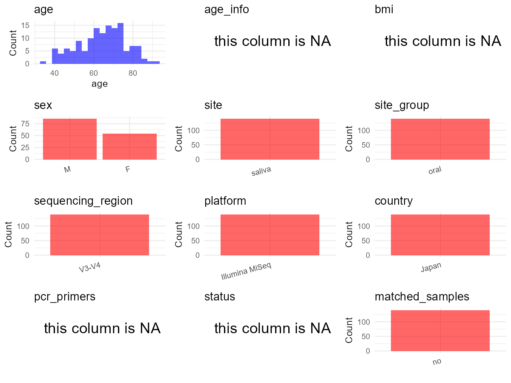

R Notebook: Metadata Processing Workflow
================

# Step 1: Obtain Initial Metadata from Each Project

This step sets the project directory, loads the raw SRA metadata, and
optionally merges supplement tables.

``` r
# Load libraries
library(dplyr)
library(ggplot2)
library(cowplot)

# (1) Setting working directory
# EDIT HERE: change project_id for each study
project_id <- "PRJNA525734" 

base_dir <- "E:/oral/26/metadata-2604/Oral-Metadata-YL-02"
setwd(file.path(base_dir, project_id))

# (2) Loading raw SRA metadata file
sra_file <- "SraRunTable.csv"
initial_meta <- read.csv(sra_file, header = TRUE)

# (3) OPTIONAL: If extra metadata (e.g., Table.x or supplemental materials) are available from the article, you may need to merge the file with initial_meta manually. Below is example code for merging. Depending on the specific case of each study, you can customize the code as needed.
#supp_table <- read.csv("supplemental_table_v2.csv", header = TRUE)
#initial_meta <- left_join(initial_meta, supp_table, by = "Sample.Name")
```

# Step 2: Data Overview

First, you need to get an overview of the data, which includes two
steps: reading the article and reading the initial metadata. This step
is very IMPORTANT!

``` r
# (1) Read the article in the following order: abstract, the beginning of the results section, and the methods. Understand the sample size, experimental design, and disease group overview. Clarify the sampling sites; for oral and gut samples, specify the exact sites like supragingival plaque, tongue, etc.

# (2) IMPORTANT: MUST go through each column of initial_meta
head(initial_meta, 10)
```

    ##           Run AGE Assay.Type AvgSpotLen    Bases  BioProject    BioSample
    ## 1  SRR8675978  74   AMPLICON        600 61129682 PRJNA525734 SAMN11066338
    ## 2  SRR8675979  56   AMPLICON        600 58035758 PRJNA525734 SAMN11066337
    ## 3  SRR8675980  63   AMPLICON        600 66754443 PRJNA525734 SAMN11066336
    ## 4  SRR8675981  62   AMPLICON        600 60616131 PRJNA525734 SAMN11066335
    ## 5  SRR8675982  81   AMPLICON        601 59409038 PRJNA525734 SAMN11066342
    ## 6  SRR8675983  60   AMPLICON        600 36703463 PRJNA525734 SAMN11066341
    ## 7  SRR8675984  75   AMPLICON        600 51733674 PRJNA525734 SAMN11066340
    ## 8  SRR8675985  75   AMPLICON        600 57494379 PRJNA525734 SAMN11066339
    ## 9  SRR8675986  75   AMPLICON        601 78541196 PRJNA525734 SAMN11066344
    ## 10 SRR8675987  76   AMPLICON        600 80938082 PRJNA525734 SAMN11066343
    ##                 BioSampleModel    Bytes
    ## 1  Metagenome or environmental 40895270
    ## 2  Metagenome or environmental 38529471
    ## 3  Metagenome or environmental 44705977
    ## 4  Metagenome or environmental 40361658
    ## 5  Metagenome or environmental 39420462
    ## 6  Metagenome or environmental 24367785
    ## 7  Metagenome or environmental 34802474
    ## 8  Metagenome or environmental 38324040
    ## 9  Metagenome or environmental 52287296
    ## 10 Metagenome or environmental 53767035
    ##                                                           Center.Name
    ## 1  NATIONAL INSTITUTES OF BIOMEDICAL INNOVATION, HEALTH AND NUTRITION
    ## 2  NATIONAL INSTITUTES OF BIOMEDICAL INNOVATION, HEALTH AND NUTRITION
    ## 3  NATIONAL INSTITUTES OF BIOMEDICAL INNOVATION, HEALTH AND NUTRITION
    ## 4  NATIONAL INSTITUTES OF BIOMEDICAL INNOVATION, HEALTH AND NUTRITION
    ## 5  NATIONAL INSTITUTES OF BIOMEDICAL INNOVATION, HEALTH AND NUTRITION
    ## 6  NATIONAL INSTITUTES OF BIOMEDICAL INNOVATION, HEALTH AND NUTRITION
    ## 7  NATIONAL INSTITUTES OF BIOMEDICAL INNOVATION, HEALTH AND NUTRITION
    ## 8  NATIONAL INSTITUTES OF BIOMEDICAL INNOVATION, HEALTH AND NUTRITION
    ## 9  NATIONAL INSTITUTES OF BIOMEDICAL INNOVATION, HEALTH AND NUTRITION
    ## 10 NATIONAL INSTITUTES OF BIOMEDICAL INNOVATION, HEALTH AND NUTRITION
    ##    Collection_Date Consent DATASTORE.filetype DATASTORE.provider
    ## 1          2016-11  public   fastq,run.zq,sra         gs,ncbi,s3
    ## 2          2016-11  public   fastq,run.zq,sra         gs,ncbi,s3
    ## 3          2016-11  public   fastq,run.zq,sra         gs,ncbi,s3
    ## 4          2016-11  public   fastq,run.zq,sra         gs,ncbi,s3
    ## 5          2016-11  public   fastq,run.zq,sra         gs,ncbi,s3
    ## 6          2016-11  public   fastq,run.zq,sra         gs,ncbi,s3
    ## 7          2016-11  public   fastq,run.zq,sra         gs,ncbi,s3
    ## 8          2016-11  public   fastq,run.zq,sra         gs,ncbi,s3
    ## 9          2016-11  public   fastq,run.zq,sra         gs,ncbi,s3
    ## 10         2016-11  public   fastq,run.zq,sra         gs,ncbi,s3
    ##                        DATASTORE.region Experiment geo_loc_name_country
    ## 1  gs.us-east1,ncbi.public,s3.us-east-1 SRX5472037                Japan
    ## 2  gs.us-east1,ncbi.public,s3.us-east-1 SRX5472036                Japan
    ## 3  gs.us-east1,ncbi.public,s3.us-east-1 SRX5472035                Japan
    ## 4  gs.us-east1,ncbi.public,s3.us-east-1 SRX5472034                Japan
    ## 5  gs.us-east1,ncbi.public,s3.us-east-1 SRX5472033                Japan
    ## 6  gs.us-east1,ncbi.public,s3.us-east-1 SRX5472032                Japan
    ## 7  gs.us-east1,ncbi.public,s3.us-east-1 SRX5472031                Japan
    ## 8  gs.us-east1,ncbi.public,s3.us-east-1 SRX5472030                Japan
    ## 9  gs.us-east1,ncbi.public,s3.us-east-1 SRX5472029                Japan
    ## 10 gs.us-east1,ncbi.public,s3.us-east-1 SRX5472028                Japan
    ##    geo_loc_name_country_continent geo_loc_name         HOST     Instrument
    ## 1                            Asia        Japan Homo sapiens Illumina MiSeq
    ## 2                            Asia        Japan Homo sapiens Illumina MiSeq
    ## 3                            Asia        Japan Homo sapiens Illumina MiSeq
    ## 4                            Asia        Japan Homo sapiens Illumina MiSeq
    ## 5                            Asia        Japan Homo sapiens Illumina MiSeq
    ## 6                            Asia        Japan Homo sapiens Illumina MiSeq
    ## 7                            Asia        Japan Homo sapiens Illumina MiSeq
    ## 8                            Asia        Japan Homo sapiens Illumina MiSeq
    ## 9                            Asia        Japan Homo sapiens Illumina MiSeq
    ## 10                           Asia        Japan Homo sapiens Illumina MiSeq
    ##    isolation_source lat_lon Library.Name LibraryLayout LibrarySelection
    ## 1              Oral    none        MT-44        PAIRED              PCR
    ## 2              Oral    none        MT-43        PAIRED              PCR
    ## 3              Oral    none        MT-42        PAIRED              PCR
    ## 4              Oral    none        MT-41        PAIRED              PCR
    ## 5              Oral    none        MT-48        PAIRED              PCR
    ## 6              Oral    none        MT-47        PAIRED              PCR
    ## 7              Oral    none        MT-46        PAIRED              PCR
    ## 8              Oral    none        MT-45        PAIRED              PCR
    ## 9              Oral    none        MT-50        PAIRED              PCR
    ## 10             Oral    none        MT-49        PAIRED              PCR
    ##    LibrarySource   Organism Platform          ReleaseDate          create_date
    ## 1        GENOMIC metagenome ILLUMINA 2019-05-29T00:00:00Z 2019-03-05T22:54:00Z
    ## 2        GENOMIC metagenome ILLUMINA 2019-05-29T00:00:00Z 2019-03-05T22:54:00Z
    ## 3        GENOMIC metagenome ILLUMINA 2019-05-29T00:00:00Z 2019-03-05T22:54:00Z
    ## 4        GENOMIC metagenome ILLUMINA 2019-05-29T00:00:00Z 2019-03-05T22:54:00Z
    ## 5        GENOMIC metagenome ILLUMINA 2019-05-29T00:00:00Z 2019-03-05T22:55:00Z
    ## 6        GENOMIC metagenome ILLUMINA 2019-05-29T00:00:00Z 2019-03-05T22:54:00Z
    ## 7        GENOMIC metagenome ILLUMINA 2019-05-29T00:00:00Z 2019-03-05T22:54:00Z
    ## 8        GENOMIC metagenome ILLUMINA 2019-05-29T00:00:00Z 2019-03-05T22:55:00Z
    ## 9        GENOMIC metagenome ILLUMINA 2019-05-29T00:00:00Z 2019-03-05T22:54:00Z
    ## 10       GENOMIC metagenome ILLUMINA 2019-05-29T00:00:00Z 2019-03-05T22:54:00Z
    ##    version  Sample.Name SampleID    sex SRA.Study
    ## 1        1 tsurumiMT-44    MT-44 female SRP187636
    ## 2        1 tsurumiMT-43    MT-43   male SRP187636
    ## 3        1 tsurumiMT-42    MT-42   male SRP187636
    ## 4        1 tsurumiMT-41    MT-41 female SRP187636
    ## 5        1 tsurumiMT-48    MT-48   male SRP187636
    ## 6        1 tsurumiMT-47    MT-47   male SRP187636
    ## 7        1 tsurumiMT-46    MT-46   male SRP187636
    ## 8        1 tsurumiMT-45    MT-45 female SRP187636
    ## 9        1 tsurumiMT-50    MT-50 female SRP187636
    ## 10       1 tsurumiMT-49    MT-49 female SRP187636

``` r
# IMPORTANT: Check the unique values in the column of interest or query column.
lapply(initial_meta[c('isolation_source')], table) # site
```

    ## $isolation_source
    ## 
    ## Oral 
    ##  140

``` r
lapply(initial_meta[c('HOST', 'Organism')], table) # organism
```

    ## $HOST
    ## 
    ## Homo sapiens 
    ##          140 
    ## 
    ## $Organism
    ## 
    ## metagenome 
    ##        140

``` r
table(initial_meta$SampleID) # subject id
```

    ## 
    ##   MT-1  MT-10 MT-100 MT-102 MT-103 MT-104 MT-105 MT-106 MT-107 MT-108 MT-109 
    ##      1      1      1      1      1      1      1      1      1      1      1 
    ##  MT-11 MT-110 MT-111 MT-112 MT-114 MT-115 MT-116 MT-117 MT-118 MT-119  MT-12 
    ##      1      1      1      1      1      1      1      1      1      1      1 
    ## MT-120 MT-121 MT-123 MT-124 MT-125 MT-126 MT-127 MT-128 MT-129  MT-13 MT-130 
    ##      1      1      1      1      1      1      1      1      1      1      1 
    ## MT-131 MT-132 MT-133 MT-134 MT-135 MT-136 MT-137 MT-138 MT-139  MT-14 MT-140 
    ##      1      1      1      1      1      1      1      1      1      1      1 
    ## MT-141 MT-142 MT-143 MT-144 MT-145  MT-15  MT-16  MT-17  MT-18  MT-19   MT-2 
    ##      1      1      1      1      1      1      1      1      1      1      1 
    ##  MT-20  MT-21  MT-22  MT-23  MT-24  MT-25  MT-26  MT-27  MT-28  MT-29   MT-3 
    ##      1      1      1      1      1      1      1      1      1      1      1 
    ##  MT-30  MT-31  MT-32  MT-33  MT-34  MT-35  MT-36  MT-37  MT-38  MT-39   MT-4 
    ##      1      1      1      1      1      1      1      1      1      1      1 
    ##  MT-40  MT-41  MT-42  MT-43  MT-44  MT-45  MT-46  MT-47  MT-48  MT-49   MT-5 
    ##      1      1      1      1      1      1      1      1      1      1      1 
    ##  MT-50  MT-51  MT-52  MT-53  MT-54  MT-55  MT-56  MT-57  MT-59   MT-6  MT-60 
    ##      1      1      1      1      1      1      1      1      1      1      1 
    ##  MT-61  MT-62  MT-63  MT-64  MT-65  MT-67  MT-68  MT-69   MT-7  MT-70  MT-71 
    ##      1      1      1      1      1      1      1      1      1      1      1 
    ##  MT-72  MT-73  MT-74  MT-75  MT-76  MT-77  MT-78  MT-79   MT-8  MT-80  MT-81 
    ##      1      1      1      1      1      1      1      1      1      1      1 
    ##  MT-82  MT-83  MT-84  MT-85  MT-86  MT-87  MT-88  MT-89   MT-9  MT-90  MT-91 
    ##      1      1      1      1      1      1      1      1      1      1      1 
    ##  MT-92  MT-93  MT-94  MT-95  MT-96  MT-97  MT-98  MT-99 
    ##      1      1      1      1      1      1      1      1

``` r
#table(initial_meta$sequencing_meth..exp.) # output is Sequencing by synthesis
table(initial_meta$Platform) # output is Illumina. according to the methods,  Illumina is correct.
```

    ## 
    ## ILLUMINA 
    ##      140

``` r
#table(initial_meta$target_subfragment..exp.)
```

# Step 3: Removing Control and Non-human Samples

First, we need to remove control samples(including both negative
controls and positive controls) and non-human samples.

``` r
# (1) EDIT HERE: Parameter setup
control_column <- "" # column name in initial_meta
# unique(initial_meta[[control_column]])
control_keywords <- c() # Enter exact keywords

species_column <- "" # column name in initial_meta
unique(initial_meta[[species_column]])
```

    ## NULL

``` r
non_human_keywords <- c() # Enter exact keywords

# (2) Remove controls and non-human samples. DO NOT need to modify code in this part, just run it.
n_samples <- nrow(initial_meta)
# Control evaluation
if (length(control_keywords) > 0) {
  if (is.null(control_column) || control_column == "") {
    stop("Error: control_keywords provided but control_column is missing.")
  }
  
  if (!(control_column %in% colnames(initial_meta))) {
    stop(sprintf("Error: Column '%s' not found in initial_meta.", control_column))
  }
  
  control_pattern <- paste(control_keywords, collapse = "|")
  control_text <- initial_meta[[control_column]]
  is_control <- grepl(control_pattern, control_text)
  
} else {
  is_control <- rep(FALSE, n_samples)
}

# Non-human evaluation
if (length(non_human_keywords) > 0) {
  if (is.null(species_column) || species_column == "") {
    stop("Error: non_human_keywords provided but species_column is missing.")
  }
  
  if (!(species_column %in% colnames(initial_meta))) {
    stop(sprintf("Error: Column '%s' not found in initial_meta.", species_column))
  }
  
  non_human_pattern <- paste(non_human_keywords, collapse = "|")
  species_text <- initial_meta[[species_column]]
  is_non_human <- grepl(non_human_pattern, species_text)
} else {
  is_non_human <- rep(FALSE, n_samples)
}

# Execute removal
samples_to_remove <- is_control | is_non_human
initial_meta <- initial_meta[!samples_to_remove, ]

cat("Initial samples counts:",n_samples,"\n")
```

    ## Initial samples counts: 140

``` r
cat("Removed control samples:", sum(is_control), "\n")
```

    ## Removed control samples: 0

``` r
cat("Removed non-human samples:", sum(is_non_human), "\n")
```

    ## Removed non-human samples: 0

``` r
cat("Total samples removed ", sum(samples_to_remove), "\n")
```

    ## Total samples removed  0

``` r
cat("Remaining samples after Step 2:", nrow(initial_meta), "\n")
```

    ## Remaining samples after Step 2: 140

# Step 4: Creating a Uniform Metadata Template

This step converts the raw SRA table into the standard metadata format
used in our meta-analysis. The uniform metadata should include the
following columns: 1. **bioproject**: Project ID from SRA or other
database e.g. `PRJNA1234`, `CNP1234`, ‘OEP1234’, ‘qiita_1234’ 2.
**sample_id**: SRA sample/run ID. Unique id for each sample!
e.g. `DRR1234567`, `ERR1234567` and `SRR1234567`. If no such column
exists, can use column like sample_name. 3. **subject_id**: subject id
for each person if available. e.g. `patient_01`, `Host_03_before`,
`subject12` 4. **age**: Age of the subject if available. e.g. `35`, `42`
\| not `adult`, `chilren` 5. **age_info**: If the age is not explicitly
stated but approximate age range information is available, mark it in
this column. e.g., `18-55`, `children`, `infant`, `elder` 6. **bmi**:
Body Mass Index if available. e.g. `22.5`, `18.9` \| not `normal`,
`overweight` 7. **sex**: Sex of the subject. Mandatory to write as M/F
\| not `female`, `woman` 8. **sequencing_region**: Targeted 16S rRNA
region. e.g. `V3-V4`, `V4` 9. **platform**: Sequencing platform.
e.g. `Illumina MiSeq`, `454 GS FLX Titanium`, `Ion Torrent` 10.
**country**: Country of sample origin. e.g. `China`, `Japan` \| not city
name like `Beijing` 11. **site**: Sampling site. For oral and gut sites,
specify the exact sites as detailed as possible. For example, if it is
known to be supragingival plaque, do not record it as ‘dental plaque’,
unless the original text provides only a vague description.
e.g. `saliva`, `tongue coating` \| not broad term like `oral` 12.
**site_group**: only accepts one of following three values: ‘oral’,
‘gut’, or ‘other’. 13. **public_time**: Data release date.
e.g. `2021-06-22` \| not `June 2021` 14. **pcr_primers**: PCR primers
used. e.g. `515F-806R`, `27F-338R` \| not primer sequences 15.
**title**: Title of the associated publication. 16. **disease_study**:
Whether the study involves disease samples. If it’s not clear, can
record as NA. Only three values accepted: ‘yes’, ‘no’ or NA 17.
**status**: Disease status for each sample if available, else record as
NA. Only accept following abbreviations, Write full names for all other
diseases. HC: healthy control CD: Crohn’s disease CRC: colorectal cancer
COPD: chronic obstructive pulmonary disease HIV: human immunodeficiency
virus ICU: intensive care unit OSCC: oral squamous cell carcinoma RA:
rheumatoid arthritis UC: ulcerative colitis 18. **matched_samples**:
Whether the subject has matched samples. Only accept ‘yes’ or ‘no’. 19.
**is_time_series**: Whether the study is a time series study. Only
accept ‘yes’ or ‘no’.

``` r
# Extract columns from initial_meta as follows: (1) No modification needed → extract directly. (2) Modification needed → create a new column with the prefix raw_ and mark the original column as “pending”. (3) Need to find or determine based on the article.
metadata <- data.frame(
  bioproject = initial_meta$BioProject,
  sample_id = initial_meta$Run,
  subject_id = initial_meta$SampleID,
  age = initial_meta$AGE,
  age_info = NA, 
  bmi = NA,
  raw_sex = initial_meta$sex,
  sex = "pending", # modify later
  sequencing_region = "V3-V4", # extract from methods section
  platform = "Illumina MiSeq", # extract from methods section, NOT initial_meta
  country = initial_meta$geo_loc_name_country,
  raw_site = initial_meta$isolation_source,
  site = "pending", # modify later
  site_group = "pending", # modify later
  public_time = initial_meta$ReleaseDate,
  pcr_primers = NA, # Format: xxF-xxR
  title = "Analysis of oral microbiota in Japanese oral cancer patients using 16S rRNA sequencing", # extract from article
  disease_study = "yes", # determine according to the article
  status = NA, # Can not distinguish between patients and healthy people, so fill in the NA
  matched_samples = "pending", # modify later
  is_time_series = "no", 
  stringsAsFactors = FALSE
)
metadata$public_time <- as.Date(metadata$public_time)
```

# Step 5: Manually solving pending issues

This step involves two parts: (1) handle the columns with the `raw_`
prefix, and next (2) handle the `site_group` and `matched_samples`
columns.

``` r
# (1) Handle the columns with the `raw_` prefix.
# In this part, you need to customize the code based on the situation of the raw_ columns to obtain the content of the target columns. IMPORTANT: Add comments if the modification is not straightforward!!
metadata <- metadata %>%
  mutate(sex = case_when(
    raw_sex == "male" ~ "M",
    raw_sex == "female" ~ "F",
    TRUE ~ NA_character_
  )) # according to the 'sex' column of initial_meta

metadata <- metadata %>%
  mutate(site = case_when(
    grepl("Oral", raw_site) ~ "saliva",
    TRUE ~ NA_character_
  )) # according to the 'isolation_source' column of initial_meta
```

``` r
# (2) Filling the 'site_group' and 'matched_samples' columns
# editing site_group
unique(metadata$site)
```

    ## [1] "saliva"

``` r
# EDIT HERE: add oral sites
Oral_site = unique(metadata$site)
# EDIT HERE: add gut sites
Gut_site = c()
# just run
metadata <- metadata %>%
  mutate(site_group = case_when(
    site %in% Oral_site ~ "oral",
    site %in% Gut_site ~ "gut",
    TRUE ~ "other" 
  ))

# editing matched_samples, just run.
metadata$matched_samples <- ifelse(
  ave(metadata$subject_id, metadata$subject_id, FUN = length) > 1, 
  "yes", 
  "no"
)
```

``` r
# (3) check if there is pending value in metadata. If there is pending value, go on modify the metadata.
# Function to check if a column contains "pending"
has_pending <- function(col) {
  if (is.character(col) || is.factor(col)) {
    any(col == "pending", na.rm = TRUE)
  } else {
    FALSE
  }
}

# Check for any pending value
any_pending_value <- any(sapply(metadata, has_pending))

if (!any_pending_value) {
  message("Good! No cell contains the value 'pending'.")
} else {
  pending_cols <- names(metadata)[sapply(metadata, has_pending)]
  message("Columns containing 'pending': ", paste(pending_cols, collapse = ", "))
  message("Please continue to resolve these pending columns!")
}
```

    ## Good! No cell contains the value 'pending'.

# Step 6: Visualize the Metadata

This step makes a quick set of plots for checking the distribution of
key metadata fields.

``` r
# Select columns for visualization, just run
plot_data <- metadata %>%
  select(-bioproject, -sample_id, -subject_id, -title)

create_simple_plots <- function(data) {
  plots <- list()
  continuous_vars <- c("age", "bmi")

  for (col in colnames(data)) {
    if (all(is.na(data[[col]]))) {
      p <- ggplot() +
        annotate("text", x = 0.5, y = 0.5, label = "this column is NA", size = 6) +
        labs(title = col) +
        theme_void()
    } else if (col %in% continuous_vars && is.numeric(data[[col]])) {
      p <- ggplot(data, aes(x = .data[[col]])) +
        geom_histogram(fill = "blue", alpha = 0.6, bins = 20, na.rm = TRUE) +
        labs(title = col, x = col, y = "Count") +
        theme_minimal()
    } else {
      count_data <- as.data.frame(table(data[[col]], useNA = "ifany"))
      p <- ggplot(count_data, aes(x = reorder(Var1, -Freq), y = Freq)) +
        geom_col(fill = "red", alpha = 0.6) +
        labs(title = col, x = NULL, y = "Count") +
        theme_minimal() +
        theme(axis.text.x = element_text(angle = 15, hjust = 1))
    }
    plots[[col]] <- p
  }

  return(plots)
}

# Generate and arrange plots
plots <- create_simple_plots(plot_data)
p <- plot_grid(plots$age,
               plots$age_info,
               plots$bmi,
               plots$sex,
               plots$site,
               plots$site_group,
               plots$sequencing_region,
               plots$platform,
               plots$country,
               plots$pcr_primers,
               plots$status,
               plots$matched_samples,
               ncol = 3, align = "hv", axis = "lb")
ggsave("Metadata_Summary_v2.png", plot = p, width = 8, height = 6, dpi = 150)
```

``` r
# Insert Metadata_Summary.png into the current Rmd output

```


# Step 7: Sort and export the metadata

This step saves the cleaned metadata table as the final `metadata.csv`
file.

``` r
# Reorder the data frame
fixed_cols <- c("bioproject", "sample_id", "subject_id", "age", "age_info",
                "bmi", "sex", "platform", "sequencing_region", "pcr_primers", 
                "country", "site", "site_group", "disease_study", "status", 
                "title", "public_time", "matched_samples", "is_time_series")  
metadata <- metadata %>%
  select(all_of(fixed_cols), everything())

# save metadata 
# head(metadata)
write.csv(metadata, file = "metadata_v2.csv", quote = TRUE)
```
