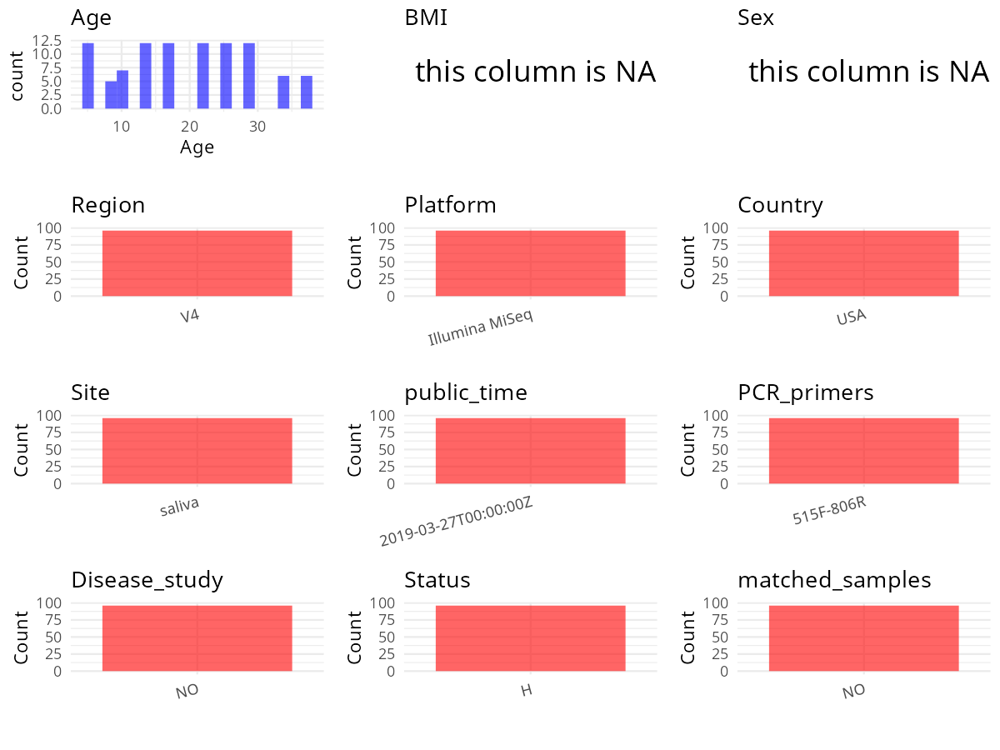

R Notebook: Metadata Processing Workflow
================

# Step 1: Obtain Initial Metadata from Each Project

To obtain the initial metadata: 1. Search for the BioProject ID (e.g.,
“PRJEBXXXX”) on the [NCBI SRA
website](https://www.ncbi.nlm.nih.gov/Traces/study/). 2. In the “Select”
table, click on “Metadata” and download the file. 3. The downloaded file
is typically named “SraRunTable.csv” and contains metadata for the
project.

``` r
# Load necessary libraries
library(dplyr)
library(ggplot2)
library(cowplot)
library(stringr)

# Set working directory (update this path to your local directory)
setwd("/home/hby/oral_project/PRJNA529227")

# Read the initial metadata files
initial_meta <- read.csv("SraRunTable.csv", header = T)

# Combine the two metadata files
# meta <- rbind(initial_meta, initial_meta1)

# Remove entries non-oral samples
# initial_meta <- subset(initial_meta,isolate %in% c("saliva","tongue coat"))

# Check the number of samples containing "HT" in Sample.Name (e.g., healthy controls)
# nrow(subset(meta, grepl("HT", Sample.Name)))

# Display the first few rows of the metadata
head(initial_meta)
```

    ##          Run Assay.Type AvgSpotLen    Bases  BioProject    BioSample              BioSampleModel   Bytes                    Center.Name Collection_Date Consent DATASTORE.filetype
    ## 1 SRR8793035   AMPLICON        302 22403870 PRJNA529227 SAMN11259749 Metagenome or environmental 7753748 RUSH UNIVERSITY MEDICAL CENTER            2018  public   fastq,run.zq,sra
    ## 2 SRR8793036   AMPLICON        302 23872194 PRJNA529227 SAMN11259748 Metagenome or environmental 8226461 RUSH UNIVERSITY MEDICAL CENTER            2018  public   fastq,run.zq,sra
    ## 3 SRR8793038   AMPLICON        302 21236640 PRJNA529227 SAMN11259746 Metagenome or environmental 7292380 RUSH UNIVERSITY MEDICAL CENTER            2018  public   fastq,run.zq,sra
    ## 4 SRR8793039   AMPLICON        302 17366510 PRJNA529227 SAMN11259753 Metagenome or environmental 5985522 RUSH UNIVERSITY MEDICAL CENTER            2018  public   fastq,run.zq,sra
    ## 5 SRR8793043   AMPLICON        302 23430368 PRJNA529227 SAMN11259755 Metagenome or environmental 8077669 RUSH UNIVERSITY MEDICAL CENTER            2018  public   fastq,run.zq,sra
    ## 6 SRR8793045   AMPLICON        302 22676274 PRJNA529227 SAMN11259744 Metagenome or environmental 7798130 RUSH UNIVERSITY MEDICAL CENTER            2018  public   fastq,run.zq,sra
    ##   DATASTORE.provider                     DATASTORE.region      env_biome    env_feature env_material Experiment geo_loc_name_country geo_loc_name_country_continent geo_loc_name Host_Age
    ## 1         gs,ncbi,s3 gs.us-east1,ncbi.public,s3.us-east-1 not applicable not applicable    Saliva 54 SRX5582445                  USA                  North America          USA    25.28
    ## 2         gs,ncbi,s3 gs.us-east1,ncbi.public,s3.us-east-1 not applicable not applicable    Saliva 53 SRX5582444                  USA                  North America          USA    21.33
    ## 3         gs,ncbi,s3 gs.us-east1,ncbi.public,s3.us-east-1 not applicable not applicable    Saliva 51 SRX5582442                  USA                  North America          USA    13.32
    ## 4         gs,ncbi,s3 gs.us-east1,ncbi.public,s3.us-east-1 not applicable not applicable    Saliva 58 SRX5582441                  USA                  North America          USA    13.32
    ## 5         gs,ncbi,s3 gs.us-east1,ncbi.public,s3.us-east-1 not applicable not applicable    Saliva 60 SRX5582437                  USA                  North America          USA    21.32
    ## 6         gs,ncbi,s3 gs.us-east1,ncbi.public,s3.us-east-1 not applicable not applicable    Saliva 49 SRX5582435                  USA                  North America          USA     5.32
    ##   host_body_product         HOST host_subject_id     Instrument        lat_lon             Library.Name LibraryLayout LibrarySelection LibrarySource                Organism Platform
    ## 1            Saliva Homo sapiens           CM16A Illumina MiSeq not applicable Engen54.CM16A.688692.S54        PAIRED              PCR   METAGENOMIC human saliva metagenome ILLUMINA
    ## 2            Saliva Homo sapiens           CM16A Illumina MiSeq not applicable Engen53.CM16A.688690.S53        PAIRED              PCR   METAGENOMIC human saliva metagenome ILLUMINA
    ## 3            Saliva Homo sapiens           CM16A Illumina MiSeq not applicable Engen51.CM16A.688686.S51        PAIRED              PCR   METAGENOMIC human saliva metagenome ILLUMINA
    ## 4            Saliva Homo sapiens           CM16A Illumina MiSeq not applicable Engen58.CM16A.688716.S58        PAIRED              PCR   METAGENOMIC human saliva metagenome ILLUMINA
    ## 5            Saliva Homo sapiens           CM16A Illumina MiSeq not applicable Engen60.CM16A.688720.S60        PAIRED              PCR   METAGENOMIC human saliva metagenome ILLUMINA
    ## 6            Saliva Homo sapiens           CM16A Illumina MiSeq not applicable Engen49.CM16A.688682.S49        PAIRED              PCR   METAGENOMIC human saliva metagenome ILLUMINA
    ##            ReleaseDate          create_date version              Sample.Name SRA.Study
    ## 1 2019-03-27T00:00:00Z 2019-03-27T12:44:00Z       1 Engen54.CM16A.688692.S54 SRP189617
    ## 2 2019-03-27T00:00:00Z 2019-03-27T12:44:00Z       1 Engen53.CM16A.688690.S53 SRP189617
    ## 3 2019-03-27T00:00:00Z 2019-03-27T12:44:00Z       1 Engen51.CM16A.688686.S51 SRP189617
    ## 4 2019-03-27T00:00:00Z 2019-03-27T12:44:00Z       1 Engen58.CM16A.688716.S58 SRP189617
    ## 5 2019-03-27T00:00:00Z 2019-03-27T12:44:00Z       1 Engen60.CM16A.688720.S60 SRP189617
    ## 6 2019-03-27T00:00:00Z 2019-03-27T12:44:00Z       1 Engen49.CM16A.688682.S49 SRP189617

# Step 2: Create a Uniform Metadata Template

The uniform metadata should include the following columns:

1.  **BioProject**: Project ID (e.g., “PRJNA339212”)
2.  **Run**: Sample ID (e.g., “ERRXXXXXX” or “SRRXXXXXX”)
3.  **sample_name**: Original sample name submitted by the authors (not
    the database-assigned ID)
4.  **Age**: Age of the subject (if available)
5.  **BMI**: Body Mass Index (if available)
6.  **Sex**: Sex of the subject (“F” or “M”)
7.  **Region**: Targeted 16S rRNA region (e.g., “V3-V4”)
8.  **Platform**: Sequencing platform (e.g., “Illumina MiSeq”)
9.  **Country**: Country of sample origin (e.g., “China”)
10. **Site**: Sample site (e.g., “saliva”, “dental plaque”)
11. **public_time**: Data release date (format: “YYYY-MM-DD”)
12. **PCR_primers**: PCR primers used (e.g., “515F-806R”)
13. **title**: Title of the associated publication
14. **Disease_study**: Whether the study involves a disease (“YES” or
    “NO”)
15. **Status**: Disease status (e.g., “T2DM”, “HC”). Note: If the study
    includes both disease and healthy samples, this must be specified
    per sample.
16. **matched_samples**: matched samples (“YES” or “NO”)

``` r
# Create a uniform metadata dataframe
metadata <- data.frame(
  BioProject = initial_meta$BioProject,
  Run = initial_meta$Run,
  sample_name = initial_meta$host_subject_id,
  Platform = initial_meta$Instrument,
  Country = initial_meta$geo_loc_name_country,
  public_time = initial_meta$ReleaseDate,
  Site = initial_meta$host_body_product,
  Sex = NA,
  Age = initial_meta$Host_Age,
  BMI = NA
) %>%
  mutate(
    Site = case_when(
      Site == "Saliva" ~ "saliva"
    )
  )
```

# Step 3: Manually Add Information from the Publication

Some information (e.g. PCR primers, study title, disease status) must be
manually extracted from the publication and added to the metadata.

``` r
# Add information obtained from the publication
metadata$Status <- "H"
metadata$Region <- "V4"
metadata$PCR_primers <- "515F-806R"
metadata$title <- "Proof-of-principle demonstration of endogenous circadian system and circadian misalignment effects on human oral microbiota"
metadata$Disease_study <- "NO"
metadata$matched_samples <- "NO"
```

# Step 4: Summarize and Validate the Metadata

``` r
# Check the number of unique runs and sample names
print(paste("Number of unique runs:", length(unique(metadata$Run))))
```

    ## [1] "Number of unique runs: 96"

``` r
print(paste("Number of unique sample names:", length(unique(metadata$sample_name))))
```

    ## [1] "Number of unique sample names: 6"

# Step 5: Visualize the Metadata

``` r

```


# Step 6: Finalize and Export the Metadata

``` r
# Reorder columns to match the desired format
metadata <- metadata[, c(
  "BioProject", "Run", "sample_name", "Age", "BMI", "Sex",
  "Region", "Platform", "Country", "Site", "public_time",
  "PCR_primers", "title", "Disease_study", "Status", "matched_samples"
)]

# Export the uniform metadata to a CSV file
write.csv(metadata, file = "metadata.csv", quote = FALSE)
head(metadata)
```

    ##    BioProject        Run sample_name   Age BMI Sex Region       Platform Country   Site          public_time PCR_primers
    ## 1 PRJNA529227 SRR8793035       CM16A 25.28  NA  NA     V4 Illumina MiSeq     USA saliva 2019-03-27T00:00:00Z   515F-806R
    ## 2 PRJNA529227 SRR8793036       CM16A 21.33  NA  NA     V4 Illumina MiSeq     USA saliva 2019-03-27T00:00:00Z   515F-806R
    ## 3 PRJNA529227 SRR8793038       CM16A 13.32  NA  NA     V4 Illumina MiSeq     USA saliva 2019-03-27T00:00:00Z   515F-806R
    ## 4 PRJNA529227 SRR8793039       CM16A 13.32  NA  NA     V4 Illumina MiSeq     USA saliva 2019-03-27T00:00:00Z   515F-806R
    ## 5 PRJNA529227 SRR8793043       CM16A 21.32  NA  NA     V4 Illumina MiSeq     USA saliva 2019-03-27T00:00:00Z   515F-806R
    ## 6 PRJNA529227 SRR8793045       CM16A  5.32  NA  NA     V4 Illumina MiSeq     USA saliva 2019-03-27T00:00:00Z   515F-806R
    ##                                                                                                                         title Disease_study Status matched_samples
    ## 1 Proof-of-principle demonstration of endogenous circadian system and circadian misalignment effects on human oral microbiota            NO      H              NO
    ## 2 Proof-of-principle demonstration of endogenous circadian system and circadian misalignment effects on human oral microbiota            NO      H              NO
    ## 3 Proof-of-principle demonstration of endogenous circadian system and circadian misalignment effects on human oral microbiota            NO      H              NO
    ## 4 Proof-of-principle demonstration of endogenous circadian system and circadian misalignment effects on human oral microbiota            NO      H              NO
    ## 5 Proof-of-principle demonstration of endogenous circadian system and circadian misalignment effects on human oral microbiota            NO      H              NO
    ## 6 Proof-of-principle demonstration of endogenous circadian system and circadian misalignment effects on human oral microbiota            NO      H              NO

## Notes for Students:

1.  **Metadata Accuracy**: Always cross-check the metadata with the
    original publication to ensure accuracy.
2.  **Manual Entries**: Columns like `PCR_primers`, and `Status` often
    require manual entry based on the publication.
3.  **Disease Status**: Be careful when assigning `Status`—some studies
    include both disease and healthy samples.
4.  **Visualization**: The plots help quickly identify the distribution
    of values in each column, which is useful for quality control.
5.  **Reproducibility**: Update the working directory and file paths to
    match your local environment.
