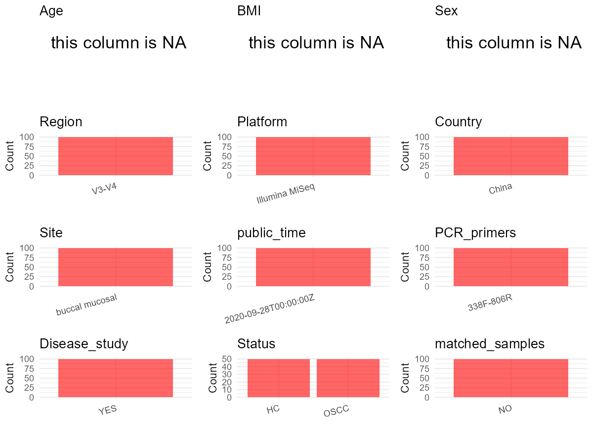

R Notebook: Metadata Processing Workflow
================

# Step 1: Obtain Initial Metadata from Each Project

To obtain the initial metadata: 1. Search for the BioProject ID (e.g.,
“PRJEBXXXX”) on the [NCBI SRA
website](https://www.ncbi.nlm.nih.gov/Traces/study/). 2. In the “Select”
table, click on “Metadata” and download the file. 3. The downloaded file
is typically named “SraRunTable.csv” and contains metadata for the
project.

``` r
# Load necessary libraries
library(dplyr)
library(ggplot2)
library(cowplot)

# Set working directory (update this path to your local directory)
setwd("D:/studylearning/董彪师兄项目/任务4_20251009/PRJNA533177")

# Read the initial metadata files
initial_meta<-read.csv("SraRunTable.csv",header = T)

# Display the first few rows of the metadata
head(initial_meta)
```

    ##           Run Assay.Type AvgSpotLen     Bases  BioProject    BioSample
    ## 1 SRR11887586   AMPLICON        590  42354920 PRJNA533177 SAMN15050775
    ## 2 SRR11887587   AMPLICON        586  18791848 PRJNA533177 SAMN15050774
    ## 3 SRR11887588   AMPLICON        590  36631920 PRJNA533177 SAMN15050773
    ## 4 SRR11887589   AMPLICON        590 100120050 PRJNA533177 SAMN15050772
    ## 5 SRR11887590   AMPLICON        590 112515360 PRJNA533177 SAMN15050771
    ## 6 SRR11887591   AMPLICON        590 114908990 PRJNA533177 SAMN15050770
    ##                BioSampleModel    Bytes                      Center.Name
    ## 1 Metagenome or environmental 26564690 SHANGHAI NINTH PEOPLE'S HOSPITAL
    ## 2 Metagenome or environmental 11051130 SHANGHAI NINTH PEOPLE'S HOSPITAL
    ## 3 Metagenome or environmental 22699831 SHANGHAI NINTH PEOPLE'S HOSPITAL
    ## 4 Metagenome or environmental 62848639 SHANGHAI NINTH PEOPLE'S HOSPITAL
    ## 5 Metagenome or environmental 65841895 SHANGHAI NINTH PEOPLE'S HOSPITAL
    ## 6 Metagenome or environmental 71550787 SHANGHAI NINTH PEOPLE'S HOSPITAL
    ##   Collection_Date Consent DATASTORE.filetype DATASTORE.provider
    ## 1            2018  public   fastq,run.zq,sra         gs,ncbi,s3
    ## 2            2018  public   fastq,run.zq,sra         gs,ncbi,s3
    ## 3            2018  public   fastq,run.zq,sra         gs,ncbi,s3
    ## 4            2018  public   fastq,run.zq,sra         gs,ncbi,s3
    ## 5            2018  public   fastq,run.zq,sra         gs,ncbi,s3
    ## 6            2018  public   fastq,run.zq,sra         gs,ncbi,s3
    ##                       DATASTORE.region Experiment geo_loc_name_country
    ## 1 gs.us-east1,ncbi.public,s3.us-east-1 SRX8435192                China
    ## 2 gs.us-east1,ncbi.public,s3.us-east-1 SRX8435191                China
    ## 3 gs.us-east1,ncbi.public,s3.us-east-1 SRX8435190                China
    ## 4 gs.us-east1,ncbi.public,s3.us-east-1 SRX8435189                China
    ## 5 gs.us-east1,ncbi.public,s3.us-east-1 SRX8435188                China
    ## 6 gs.us-east1,ncbi.public,s3.us-east-1 SRX8435187                China
    ##   geo_loc_name_country_continent   geo_loc_name         HOST     Instrument
    ## 1                           Asia China:Shanghai Homo sapiens Illumina MiSeq
    ## 2                           Asia China:Shanghai Homo sapiens Illumina MiSeq
    ## 3                           Asia China:Shanghai Homo sapiens Illumina MiSeq
    ## 4                           Asia China:Shanghai Homo sapiens Illumina MiSeq
    ## 5                           Asia China:Shanghai Homo sapiens Illumina MiSeq
    ## 6                           Asia China:Shanghai Homo sapiens Illumina MiSeq
    ##          lat_lon Library.Name LibraryLayout LibrarySelection LibrarySource
    ## 1 31.2 N 121.4 E    control50        PAIRED              PCR   METAGENOMIC
    ## 2 31.2 N 121.4 E    control49        PAIRED              PCR   METAGENOMIC
    ## 3 31.2 N 121.4 E    control48        PAIRED              PCR   METAGENOMIC
    ## 4 31.2 N 121.4 E    control47        PAIRED              PCR   METAGENOMIC
    ## 5 31.2 N 121.4 E    control46        PAIRED              PCR   METAGENOMIC
    ## 6 31.2 N 121.4 E    control45        PAIRED              PCR   METAGENOMIC
    ##                Organism Platform          ReleaseDate          create_date
    ## 1 human oral metagenome ILLUMINA 2020-09-28T00:00:00Z 2020-06-01T01:08:00Z
    ## 2 human oral metagenome ILLUMINA 2020-09-28T00:00:00Z 2020-06-01T01:08:00Z
    ## 3 human oral metagenome ILLUMINA 2020-09-28T00:00:00Z 2020-06-01T01:08:00Z
    ## 4 human oral metagenome ILLUMINA 2020-09-28T00:00:00Z 2020-06-01T01:09:00Z
    ## 5 human oral metagenome ILLUMINA 2020-09-28T00:00:00Z 2020-06-01T01:09:00Z
    ## 6 human oral metagenome ILLUMINA 2020-09-28T00:00:00Z 2020-06-01T01:08:00Z
    ##   version Sample.Name source_material_id SRA.Study
    ## 1       1   control50          control50 SRP192791
    ## 2       1   control49          control49 SRP192791
    ## 3       1   control48          control48 SRP192791
    ## 4       1   control47          control47 SRP192791
    ## 5       1   control46          control46 SRP192791
    ## 6       1   control45          control45 SRP192791

# Step 2: Create a Uniform Metadata Template

The uniform metadata should include the following columns:

1.  **BioProject**: Project ID (e.g., “PRJNA339212”)
2.  **Run**: Sample ID (e.g., “ERRXXXXXX” or “SRRXXXXXX”)
3.  **sample_name**: Original sample name submitted by the authors (not
    the database-assigned ID)
4.  **Age**: Age of the subject (if available)
5.  **BMI**: Body Mass Index (if available)
6.  **Sex**: Sex of the subject (“F” or “M”)
7.  **Region**: Targeted 16S rRNA region (e.g., “V3-V4”)
8.  **Platform**: Sequencing platform (e.g., “Illumina MiSeq”)
9.  **Country**: Country of sample origin (e.g., “China”)
10. **Site**: Sample site (e.g., “saliva”, “dental plaque”)
11. **public_time**: Data release date (format: “YYYY-MM-DD”)
12. **PCR_primers**: PCR primers used (e.g., “515F-806R”)
13. **title**: Title of the associated publication
14. **Disease_study**: Whether the study involves a disease (“YES” or
    “NO”)
15. **Status**: Disease status (e.g., “T2DM”, “HC”). Note: If the study
    includes both disease and healthy samples, this must be specified
    per sample.

``` r
# Create a uniform metadata dataframe
metadata <- data.frame(
  BioProject = initial_meta$BioProject,
  Run = initial_meta$Run,
  sample_name = initial_meta$Sample.Name,
  Age = NA,
  BMI = NA,
  Sex= NA,
  Region = "V3-V4",
  Platform = initial_meta$Instrument,
  Country = initial_meta$geo_loc_name_country,
  Site = "buccal mucosal",
  public_time = initial_meta$ReleaseDate,
  stringsAsFactors = FALSE
)
```

# Step 3: Manually Add Information from the Publication

Some information (e.g. PCR primers, study title, disease status) must be
manually extracted from the publication and added to the metadata.

``` r
# Add information obtained from the publication
metadata$PCR_primers <- "338F-806R"  # Update based on the publication
metadata$title <- "The Oral Microbiota May Have Influence on Oral Cancer"
metadata$Disease_study <- "YES"
metadata <- metadata %>% 
  mutate(Status=case_when(
    grepl("control",sample_name)~"HC",
    grepl("case",sample_name)~"OSCC"
  ))

#extract subject id by remove prefix of sample_name
#metadata$sample_name <- gsub("_st|_sal", "", metadata$sample_name)

# Check initial data distribution
cat("Initial sample distribution:\n")
```

    ## Initial sample distribution:

``` r
table(metadata$sample_name)
```

    ## 
    ##    case01    case02    case03    case04    case05    case06    case07    case08 
    ##         1         1         1         1         1         1         1         1 
    ##    case09    case10    case11    case12    case13    case14    case15    case16 
    ##         1         1         1         1         1         1         1         1 
    ##    case17    case18    case19    case20    case21    case22    case23    case24 
    ##         1         1         1         1         1         1         1         1 
    ##    case25    case26    case27    case28    case29    case30    case31    case32 
    ##         1         1         1         1         1         1         1         1 
    ##    case33    case34    case35    case36    case37    case38    case39    case40 
    ##         1         1         1         1         1         1         1         1 
    ##    case41    case42    case43    case44    case45    case46    case47    case48 
    ##         1         1         1         1         1         1         1         1 
    ##    case49    case50 control01 control02 control03 control04 control05 control06 
    ##         1         1         1         1         1         1         1         1 
    ## control07 control08 control09 control10 control11 control12 control13 control14 
    ##         1         1         1         1         1         1         1         1 
    ## control15 control16 control17 control18 control19 control20 control21 control22 
    ##         1         1         1         1         1         1         1         1 
    ## control23 control24 control25 control26 control27 control28 control29 control30 
    ##         1         1         1         1         1         1         1         1 
    ## control31 control32 control33 control34 control35 control36 control37 control38 
    ##         1         1         1         1         1         1         1         1 
    ## control39 control40 control41 control42 control43 control44 control45 control46 
    ##         1         1         1         1         1         1         1         1 
    ## control47 control48 control49 control50 
    ##         1         1         1         1

``` r
table(metadata$Site)
```

    ## 
    ## buccal mucosal 
    ##            100

``` r
# Calculate sampling frequency per subject
sample_counts <- table(metadata$sample_name)
cat("\nNumber of samples per subject:\n")
```

    ## 
    ## Number of samples per subject:

``` r
print(sample_counts)
```

    ## 
    ##    case01    case02    case03    case04    case05    case06    case07    case08 
    ##         1         1         1         1         1         1         1         1 
    ##    case09    case10    case11    case12    case13    case14    case15    case16 
    ##         1         1         1         1         1         1         1         1 
    ##    case17    case18    case19    case20    case21    case22    case23    case24 
    ##         1         1         1         1         1         1         1         1 
    ##    case25    case26    case27    case28    case29    case30    case31    case32 
    ##         1         1         1         1         1         1         1         1 
    ##    case33    case34    case35    case36    case37    case38    case39    case40 
    ##         1         1         1         1         1         1         1         1 
    ##    case41    case42    case43    case44    case45    case46    case47    case48 
    ##         1         1         1         1         1         1         1         1 
    ##    case49    case50 control01 control02 control03 control04 control05 control06 
    ##         1         1         1         1         1         1         1         1 
    ## control07 control08 control09 control10 control11 control12 control13 control14 
    ##         1         1         1         1         1         1         1         1 
    ## control15 control16 control17 control18 control19 control20 control21 control22 
    ##         1         1         1         1         1         1         1         1 
    ## control23 control24 control25 control26 control27 control28 control29 control30 
    ##         1         1         1         1         1         1         1         1 
    ## control31 control32 control33 control34 control35 control36 control37 control38 
    ##         1         1         1         1         1         1         1         1 
    ## control39 control40 control41 control42 control43 control44 control45 control46 
    ##         1         1         1         1         1         1         1         1 
    ## control47 control48 control49 control50 
    ##         1         1         1         1

``` r
# Create matched_samples column
metadata$matched_samples <- ifelse(metadata$sample_name %in% names(sample_counts[sample_counts >= 2]), "YES", "NO")

cat("\nMatched samples distribution:\n")
```

    ## 
    ## Matched samples distribution:

``` r
table(metadata$matched_samples)
```

    ## 
    ##  NO 
    ## 100

``` r
# Identify samples for removal: single samples excluding buccal mucosal 
single_samples <- names(sample_counts[sample_counts == 1])
samples_to_remove <- metadata$sample_name %in% single_samples & !(metadata$Site %in% c("buccal mucosal"))

cat("\nNumber of samples to be removed:", sum(samples_to_remove), "\n")
```

    ## 
    ## Number of samples to be removed: 0

``` r
# Remove identified samples
metadata_clean <- metadata[!samples_to_remove, ]

cat("\nFinal sample distribution after cleaning:\n")
```

    ## 
    ## Final sample distribution after cleaning:

``` r
table(metadata_clean$sample_name)
```

    ## 
    ##    case01    case02    case03    case04    case05    case06    case07    case08 
    ##         1         1         1         1         1         1         1         1 
    ##    case09    case10    case11    case12    case13    case14    case15    case16 
    ##         1         1         1         1         1         1         1         1 
    ##    case17    case18    case19    case20    case21    case22    case23    case24 
    ##         1         1         1         1         1         1         1         1 
    ##    case25    case26    case27    case28    case29    case30    case31    case32 
    ##         1         1         1         1         1         1         1         1 
    ##    case33    case34    case35    case36    case37    case38    case39    case40 
    ##         1         1         1         1         1         1         1         1 
    ##    case41    case42    case43    case44    case45    case46    case47    case48 
    ##         1         1         1         1         1         1         1         1 
    ##    case49    case50 control01 control02 control03 control04 control05 control06 
    ##         1         1         1         1         1         1         1         1 
    ## control07 control08 control09 control10 control11 control12 control13 control14 
    ##         1         1         1         1         1         1         1         1 
    ## control15 control16 control17 control18 control19 control20 control21 control22 
    ##         1         1         1         1         1         1         1         1 
    ## control23 control24 control25 control26 control27 control28 control29 control30 
    ##         1         1         1         1         1         1         1         1 
    ## control31 control32 control33 control34 control35 control36 control37 control38 
    ##         1         1         1         1         1         1         1         1 
    ## control39 control40 control41 control42 control43 control44 control45 control46 
    ##         1         1         1         1         1         1         1         1 
    ## control47 control48 control49 control50 
    ##         1         1         1         1

``` r
table(metadata_clean$Site)
```

    ## 
    ## buccal mucosal 
    ##            100

``` r
table(metadata_clean$matched_samples)
```

    ## 
    ##  NO 
    ## 100

``` r
# Use cleaned dataset for subsequent analysis
metadata <- metadata_clean
```

# Step 4: Summarize and Validate the Metadata

``` r
# Check the number of unique runs and sample names
print(paste("Number of unique runs:", length(unique(metadata$Run))))
```

    ## [1] "Number of unique runs: 100"

``` r
print(paste("Number of unique sample names:", length(unique(metadata$sample_name))))
```

    ## [1] "Number of unique sample names: 100"

# Step 5: Visualize the Metadata

``` r

```


# Step 6: Finalize and Export the Metadata

``` r
# Reorder columns to match the desired format
metadata <- metadata[, c(
  "BioProject", "Run", "sample_name", "Age", "BMI", "Sex", 
  "Region", "Platform", "Country", "Site", "public_time", 
  "PCR_primers", "title", "Disease_study", "Status","matched_samples"
)]

# Export the uniform metadata to a CSV file
write.csv(metadata, file = "metadata.csv", quote = FALSE)
head(metadata)
```

    ##    BioProject         Run sample_name Age BMI Sex Region       Platform Country
    ## 1 PRJNA533177 SRR11887586   control50  NA  NA  NA  V3-V4 Illumina MiSeq   China
    ## 2 PRJNA533177 SRR11887587   control49  NA  NA  NA  V3-V4 Illumina MiSeq   China
    ## 3 PRJNA533177 SRR11887588   control48  NA  NA  NA  V3-V4 Illumina MiSeq   China
    ## 4 PRJNA533177 SRR11887589   control47  NA  NA  NA  V3-V4 Illumina MiSeq   China
    ## 5 PRJNA533177 SRR11887590   control46  NA  NA  NA  V3-V4 Illumina MiSeq   China
    ## 6 PRJNA533177 SRR11887591   control45  NA  NA  NA  V3-V4 Illumina MiSeq   China
    ##             Site          public_time PCR_primers
    ## 1 buccal mucosal 2020-09-28T00:00:00Z   338F-806R
    ## 2 buccal mucosal 2020-09-28T00:00:00Z   338F-806R
    ## 3 buccal mucosal 2020-09-28T00:00:00Z   338F-806R
    ## 4 buccal mucosal 2020-09-28T00:00:00Z   338F-806R
    ## 5 buccal mucosal 2020-09-28T00:00:00Z   338F-806R
    ## 6 buccal mucosal 2020-09-28T00:00:00Z   338F-806R
    ##                                                   title Disease_study Status
    ## 1 The Oral Microbiota May Have Influence on Oral Cancer           YES     HC
    ## 2 The Oral Microbiota May Have Influence on Oral Cancer           YES     HC
    ## 3 The Oral Microbiota May Have Influence on Oral Cancer           YES     HC
    ## 4 The Oral Microbiota May Have Influence on Oral Cancer           YES     HC
    ## 5 The Oral Microbiota May Have Influence on Oral Cancer           YES     HC
    ## 6 The Oral Microbiota May Have Influence on Oral Cancer           YES     HC
    ##   matched_samples
    ## 1              NO
    ## 2              NO
    ## 3              NO
    ## 4              NO
    ## 5              NO
    ## 6              NO

## Notes for Students:

1.  **Metadata Accuracy**: Always cross-check the metadata with the
    original publication to ensure accuracy.
2.  **Manual Entries**: Columns like `PCR_primers`, and `Status` often
    require manual entry based on the publication.
3.  **Disease Status**: Be careful when assigning `Status`—some studies
    include both disease and healthy samples.
4.  **Visualization**: The plots help quickly identify the distribution
    of values in each column, which is useful for quality control.
5.  **Reproducibility**: Update the working directory and file paths to
    match your local environment.
