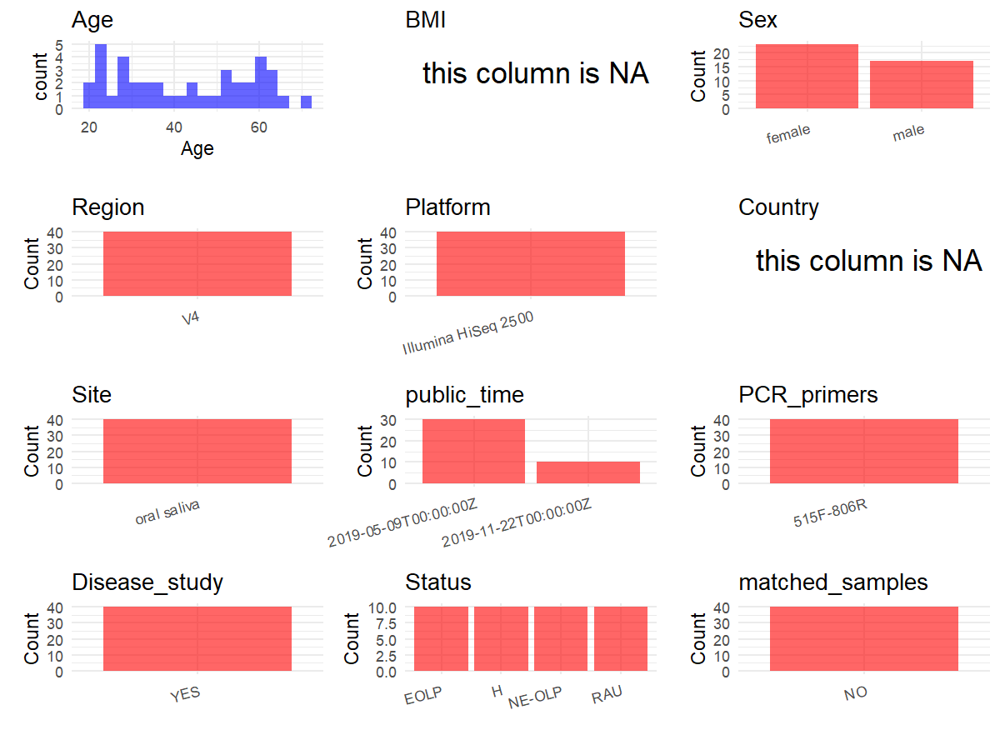

R Notebook: Metadata Processing Workflow
================

# Step 1: Obtain Initial Metadata from Each Project

To obtain the initial metadata: 1. Search for the BioProject ID (e.g.,
“PRJEBXXXX”) on the [NCBI SRA
website](https://www.ncbi.nlm.nih.gov/Traces/study/). 2. In the “Select”
table, click on “Metadata” and download the file. 3. The downloaded file
is typically named “SraRunTable.csv” and contains metadata for the
project.

``` r
# Load necessary libraries
library(dplyr)
library(ggplot2)
library(cowplot)

# Set working directory (update this path to your local directory)
setwd("D:/metadata/3/PRJNA542018")

# Read the initial metadata files
initial_meta<-read.csv("SraRunTable.csv",header = T)

# Combine the two metadata files
#meta <- rbind(initial_meta, initial_meta1)

#Remove entries non-oral samples
#initial_meta <- subset(initial_meta,BioSampleModel != "Metagenome or environmental")

# Check the number of samples containing "HT" in Sample.Name (e.g., healthy controls)
#nrow(subset(meta, grepl("HT", Sample.Name)))

# Display the first few rows of the metadata
head(initial_meta)
```

    ##           Run AGE Assay.Type AvgSpotLen    Bases
    ## 1 SRR10123104  62   AMPLICON        291  4408491
    ## 2 SRR10123105  20   AMPLICON        291 13546436
    ## 3 SRR10123106  24   AMPLICON        291 12231386
    ## 4 SRR10123107  22   AMPLICON        291 12340481
    ## 5 SRR10123108  32   AMPLICON        291  8507630
    ## 6 SRR10123109  59   AMPLICON        293  3239858
    ##                                 BIOMATERIAL_PROVIDER  BioProject    BioSample
    ## 1 The Dental Laboratory of Shanxi Medical University PRJNA542018 SAMN12754418
    ## 2 The Dental Laboratory of Shanxi Medical University PRJNA542018 SAMN12754417
    ## 3 The Dental Laboratory of Shanxi Medical University PRJNA542018 SAMN12754416
    ## 4 The Dental Laboratory of Shanxi Medical University PRJNA542018 SAMN12754415
    ## 5 The Dental Laboratory of Shanxi Medical University PRJNA542018 SAMN12754414
    ## 6 The Dental Laboratory of Shanxi Medical University PRJNA542018 SAMN12754413
    ##                BioSampleModel   Bytes
    ## 1 Metagenome or environmental 2531804
    ## 2 Metagenome or environmental 7686938
    ## 3 Metagenome or environmental 6963928
    ## 4 Metagenome or environmental 6990574
    ## 5 Metagenome or environmental 4841017
    ## 6 Metagenome or environmental 1896600
    ##                                                    Center.Name Collection_Date
    ## 1 SHANXI MEDICAL UNIVERSITY SCHOOL AND HOSPITAL OF STOMATOLOGY         missing
    ## 2 SHANXI MEDICAL UNIVERSITY SCHOOL AND HOSPITAL OF STOMATOLOGY         missing
    ## 3 SHANXI MEDICAL UNIVERSITY SCHOOL AND HOSPITAL OF STOMATOLOGY         missing
    ## 4 SHANXI MEDICAL UNIVERSITY SCHOOL AND HOSPITAL OF STOMATOLOGY         missing
    ## 5 SHANXI MEDICAL UNIVERSITY SCHOOL AND HOSPITAL OF STOMATOLOGY         missing
    ## 6 SHANXI MEDICAL UNIVERSITY SCHOOL AND HOSPITAL OF STOMATOLOGY         missing
    ##   Consent DATASTORE.filetype DATASTORE.provider
    ## 1  public   fastq,run.zq,sra         gs,ncbi,s3
    ## 2  public   fastq,run.zq,sra         gs,ncbi,s3
    ## 3  public   fastq,run.zq,sra         gs,ncbi,s3
    ## 4  public   fastq,run.zq,sra         gs,ncbi,s3
    ## 5  public   fastq,run.zq,sra         gs,ncbi,s3
    ## 6  public   fastq,run.zq,sra         gs,ncbi,s3
    ##                       DATASTORE.region Experiment geo_loc_name_country
    ## 1 gs.us-east1,ncbi.public,s3.us-east-1 SRX6852623         uncalculated
    ## 2 gs.us-east1,ncbi.public,s3.us-east-1 SRX6852622         uncalculated
    ## 3 gs.us-east1,ncbi.public,s3.us-east-1 SRX6852621         uncalculated
    ## 4 gs.us-east1,ncbi.public,s3.us-east-1 SRX6852620         uncalculated
    ## 5 gs.us-east1,ncbi.public,s3.us-east-1 SRX6852619         uncalculated
    ## 6 gs.us-east1,ncbi.public,s3.us-east-1 SRX6852618         uncalculated
    ##   geo_loc_name_country_continent geo_loc_name    HOST          Instrument
    ## 1                   uncalculated      missing missing Illumina HiSeq 2500
    ## 2                   uncalculated      missing missing Illumina HiSeq 2500
    ## 3                   uncalculated      missing missing Illumina HiSeq 2500
    ## 4                   uncalculated      missing missing Illumina HiSeq 2500
    ## 5                   uncalculated      missing missing Illumina HiSeq 2500
    ## 6                   uncalculated      missing missing Illumina HiSeq 2500
    ##   isolate isolation_source lat_lon Library.Name LibraryLayout LibrarySelection
    ## 1   oral1          missing missing         U-10        SINGLE              PCR
    ## 2   oral1          missing missing          U-9        SINGLE              PCR
    ## 3   oral1          missing missing          U-8        SINGLE              PCR
    ## 4   oral1          missing missing          U-7        SINGLE              PCR
    ## 5   oral1          missing missing          U-6        SINGLE              PCR
    ## 6   oral1          missing missing          U-5        SINGLE              PCR
    ##   LibrarySource              Organism Platform          ReleaseDate
    ## 1       GENOMIC human oral metagenome ILLUMINA 2019-11-22T00:00:00Z
    ## 2       GENOMIC human oral metagenome ILLUMINA 2019-11-22T00:00:00Z
    ## 3       GENOMIC human oral metagenome ILLUMINA 2019-11-22T00:00:00Z
    ## 4       GENOMIC human oral metagenome ILLUMINA 2019-11-22T00:00:00Z
    ## 5       GENOMIC human oral metagenome ILLUMINA 2019-11-22T00:00:00Z
    ## 6       GENOMIC human oral metagenome ILLUMINA 2019-11-22T00:00:00Z
    ##                              replicate          create_date version Sample.Name
    ## 1 replicate = biological replicate 10' 2019-11-21T15:08:00Z       1         U10
    ## 2  replicate = biological replicate 9' 2019-11-21T15:09:00Z       1          U9
    ## 3  replicate = biological replicate 8' 2019-11-21T15:09:00Z       1          U8
    ## 4  replicate = biological replicate 7' 2019-11-21T15:09:00Z       1          U7
    ## 5  replicate = biological replicate 6' 2019-11-21T15:10:00Z       1          U6
    ## 6  replicate = biological replicate 5' 2019-11-21T15:08:00Z       1          U5
    ##      sex SRA.Study      tissue
    ## 1   male SRP197276 oral saliva
    ## 2 female SRP197276 oral saliva
    ## 3 female SRP197276 oral saliva
    ## 4 female SRP197276 oral saliva
    ## 5 female SRP197276 oral saliva
    ## 6   male SRP197276 oral saliva

# Step 2: Create a Uniform Metadata Template

The uniform metadata should include the following columns:

1.  **BioProject**: Project ID (e.g., “PRJNA339212”)
2.  **Run**: Sample ID (e.g., “ERRXXXXXX” or “SRRXXXXXX”)
3.  **sample_name**: Original sample name submitted by the authors (not
    the database-assigned ID)
4.  **Age**: Age of the subject (if available)
5.  **BMI**: Body Mass Index (if available)
6.  **Sex**: Sex of the subject (“F” or “M”)
7.  **Region**: Targeted 16S rRNA region (e.g., “V3-V4”)
8.  **Platform**: Sequencing platform (e.g., “Illumina MiSeq”)
9.  **Country**: Country of sample origin (e.g., “China”)
10. **Site**: Sample site (e.g., “saliva”, “dental plaque”)
11. **public_time**: Data release date (format: “YYYY-MM-DD”)
12. **PCR_primers**: PCR primers used (e.g., “515F-806R”)
13. **title**: Title of the associated publication
14. **Disease_study**: Whether the study involves a disease (“YES” or
    “NO”)
15. **Status**: Disease status (e.g., “T2DM”, “HC”). Note: If the study
    includes both disease and healthy samples, this must be specified
    per sample.
16. **matched_samples**: matched samples (“YES” or “NO”)

``` r
# Create a uniform metadata dataframe
metadata <- data.frame(
  BioProject = initial_meta$BioProject,
  Run = initial_meta$Run,
  sample_name = initial_meta$Sample.Name,
  Age = initial_meta$AGE,
  BMI = NA,
  Sex=initial_meta$sex,
  Region = "V4",
  Platform = initial_meta$Instrument,
  Country = NA,
  Site = initial_meta$tissue,
  public_time = initial_meta$ReleaseDate,
  Status      = ifelse(grepl("^U",  initial_meta$Sample.Name), "RAU",
                       ifelse(grepl("^E",  initial_meta$Sample.Name), "EOLP",
                              ifelse(grepl("^NE", initial_meta$Sample.Name), "NE-OLP",
                                     ifelse(grepl("^C",  initial_meta$Sample.Name), "H", NA)))),
  stringsAsFactors = FALSE
)
```

# Step 3: Manually Add Information from the Publication

Some information (e.g. PCR primers, study title, disease status) must be
manually extracted from the publication and added to the metadata.

``` r
# Add information obtained from the publication
metadata$PCR_primers <- "515F-806R"
metadata$title <- "Dysbiosis of saliva microbiome in patients with oral lichen planus"
metadata$Disease_study <- "YES"
# Assign disease status based on sample_name patterns


metadata$matched_samples <- "NO"
```

# Step 4: Summarize and Validate the Metadata

``` r
# Check the number of unique runs and sample names
print(paste("Number of unique runs:", length(unique(metadata$Run))))
```

    ## [1] "Number of unique runs: 40"

``` r
print(paste("Number of unique sample names:", length(unique(metadata$sample_name))))
```

    ## [1] "Number of unique sample names: 40"

# Step 5: Visualize the Metadata

``` r

```

<!-- -->

# Step 6: Finalize and Export the Metadata

``` r
# Reorder columns to match the desired format
metadata <- metadata[, c(
  "BioProject", "Run", "sample_name", "Age", "BMI", "Sex", 
  "Region", "Platform", "Country", "Site", "public_time", 
  "PCR_primers", "title", "Disease_study", "Status","matched_samples"
)]

# Export the uniform metadata to a CSV file
write.csv(metadata, file = "metadata.csv", quote = TRUE)
head(metadata)
```

    ##    BioProject         Run sample_name Age BMI    Sex Region            Platform
    ## 1 PRJNA542018 SRR10123104         U10  62  NA   male     V4 Illumina HiSeq 2500
    ## 2 PRJNA542018 SRR10123105          U9  20  NA female     V4 Illumina HiSeq 2500
    ## 3 PRJNA542018 SRR10123106          U8  24  NA female     V4 Illumina HiSeq 2500
    ## 4 PRJNA542018 SRR10123107          U7  22  NA female     V4 Illumina HiSeq 2500
    ## 5 PRJNA542018 SRR10123108          U6  32  NA female     V4 Illumina HiSeq 2500
    ## 6 PRJNA542018 SRR10123109          U5  59  NA   male     V4 Illumina HiSeq 2500
    ##   Country        Site          public_time PCR_primers
    ## 1      NA oral saliva 2019-11-22T00:00:00Z   515F-806R
    ## 2      NA oral saliva 2019-11-22T00:00:00Z   515F-806R
    ## 3      NA oral saliva 2019-11-22T00:00:00Z   515F-806R
    ## 4      NA oral saliva 2019-11-22T00:00:00Z   515F-806R
    ## 5      NA oral saliva 2019-11-22T00:00:00Z   515F-806R
    ## 6      NA oral saliva 2019-11-22T00:00:00Z   515F-806R
    ##                                                                title
    ## 1 Dysbiosis of saliva microbiome in patients with oral lichen planus
    ## 2 Dysbiosis of saliva microbiome in patients with oral lichen planus
    ## 3 Dysbiosis of saliva microbiome in patients with oral lichen planus
    ## 4 Dysbiosis of saliva microbiome in patients with oral lichen planus
    ## 5 Dysbiosis of saliva microbiome in patients with oral lichen planus
    ## 6 Dysbiosis of saliva microbiome in patients with oral lichen planus
    ##   Disease_study Status matched_samples
    ## 1           YES    RAU              NO
    ## 2           YES    RAU              NO
    ## 3           YES    RAU              NO
    ## 4           YES    RAU              NO
    ## 5           YES    RAU              NO
    ## 6           YES    RAU              NO

## Notes for Students:

1.  **Metadata Accuracy**: Always cross-check the metadata with the
    original publication to ensure accuracy.
2.  **Manual Entries**: Columns like `PCR_primers`, and `Status` often
    require manual entry based on the publication.
3.  **Disease Status**: Be careful when assigning `Status`—some studies
    include both disease and healthy samples.
4.  **Visualization**: The plots help quickly identify the distribution
    of values in each column, which is useful for quality control.
5.  **Reproducibility**: Update the working directory and file paths to
    match your local environment.
