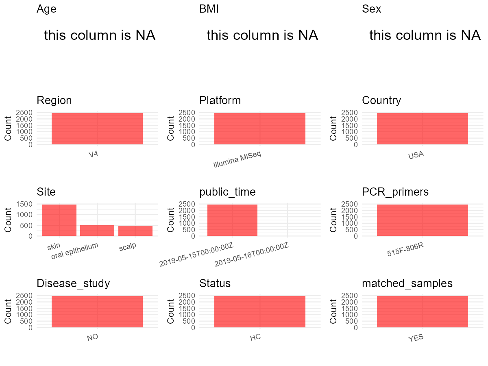

R Notebook: Metadata Processing Workflow
================

# Step 1: Obtain Initial Metadata from Each Project

To obtain the initial metadata: 1. Search for the BioProject ID (e.g.,
“PRJEBXXXX”) on the [NCBI SRA
website](https://www.ncbi.nlm.nih.gov/Traces/study/). 2. In the “Select”
table, click on “Metadata” and download the file. 3. The downloaded file
is typically named “SraRunTable.csv” and contains metadata for the
project.

``` r
# Load necessary libraries
library(dplyr)
library(ggplot2)
library(cowplot)

# Set working directory (update this path to your local directory)
setwd("D:/oral_project/PRJNA542898")

# Read the initial metadata files
initial_meta<-read.csv("SraRunTable.csv",header = T)

# Combine the two metadata files
#meta <- rbind(initial_meta, initial_meta1)

#Remove entries non-oral samples
#initial_meta <- subset(initial_meta,isolate %in% c("saliva","tongue coat"))

# Check the number of samples containing "HT" in Sample.Name (e.g., healthy controls)
#nrow(subset(meta, grepl("HT", Sample.Name)))

# Display the first few rows of the metadata
head(initial_meta)
```

    ##          Run Assay.Type AvgSpotLen   Bases  BioProject    BioSample
    ## 1 SRR9063868   AMPLICON        499     499 PRJNA542898 SAMN11649569
    ## 2 SRR9063869   AMPLICON        498  384138 PRJNA542898 SAMN11642938
    ## 3 SRR9063870   AMPLICON        498 1758278 PRJNA542898 SAMN11646468
    ## 4 SRR9063871   AMPLICON        498  172470 PRJNA542898 SAMN11642933
    ## 5 SRR9063872   AMPLICON        498 1314183 PRJNA542898 SAMN11643023
    ## 6 SRR9063873   AMPLICON        498 5890403 PRJNA542898 SAMN11646420
    ##                     BioSampleModel   Bytes Center.Name Collection_Date Consent
    ## 1 MIMARKS.survey.miscellaneous.4.0   78133      MOTHUR            2015  public
    ## 2 MIMARKS.survey.miscellaneous.4.0  363233      MOTHUR            2015  public
    ## 3 MIMARKS.survey.miscellaneous.4.0 1098818      MOTHUR            2015  public
    ## 4 MIMARKS.survey.miscellaneous.4.0  191589      MOTHUR            2015  public
    ## 5 MIMARKS.survey.miscellaneous.4.0  898549      MOTHUR            2015  public
    ## 6 MIMARKS.survey.miscellaneous.4.0 4097984      MOTHUR            2015  public
    ##   DATASTORE.filetype DATASTORE.provider                     DATASTORE.region
    ## 1          fastq,sra         gs,ncbi,s3 gs.us-east1,ncbi.public,s3.us-east-1
    ## 2   fastq,run.zq,sra         gs,ncbi,s3 gs.us-east1,ncbi.public,s3.us-east-1
    ## 3   fastq,run.zq,sra         gs,ncbi,s3 gs.us-east1,ncbi.public,s3.us-east-1
    ## 4   fastq,run.zq,sra         gs,ncbi,s3 gs.us-east1,ncbi.public,s3.us-east-1
    ## 5   fastq,run.zq,sra         gs,ncbi,s3 gs.us-east1,ncbi.public,s3.us-east-1
    ## 6   fastq,run.zq,sra         gs,ncbi,s3 gs.us-east1,ncbi.public,s3.us-east-1
    ##             Description                env_biome     env_feature
    ## 1 ArtPrize study sample human-associated habitat organic feature
    ## 2                 blank                lab blank organic feature
    ## 3 ArtPrize study sample human-associated habitat organic feature
    ## 4                 blank                lab blank organic feature
    ## 5 ArtPrize study sample human-associated habitat organic feature
    ## 6 ArtPrize study sample human-associated habitat organic feature
    ##       env_material Experiment geo_loc_name_country
    ## 1 organic material SRX5840277                  USA
    ## 2 organic material SRX5840276                  USA
    ## 3 organic material SRX5840275                  USA
    ## 4 organic material SRX5840274                  USA
    ## 5 organic material SRX5840273                  USA
    ## 6 organic material SRX5840272                  USA
    ##   geo_loc_name_country_continent  geo_loc_name         HOST Instrument
    ## 1                  North America USA: Michigan Homo sapiens     454 GS
    ## 2                  North America USA: Michigan   Laboratory     454 GS
    ## 3                  North America USA: Michigan Homo sapiens     454 GS
    ## 4                  North America USA: Michigan   Laboratory     454 GS
    ## 5                  North America USA: Michigan Homo sapiens     454 GS
    ## 6                  North America USA: Michigan Homo sapiens     454 GS
    ##               lat_lon                                 Library.Name
    ## 1 42.9607 N 85.4955 W         ARM101_S360_L001_R1_001.fastq.ARM101
    ## 2 42.9607 N 85.4955 W     P11-Swab_S384_L001_R1_001.fastq.P11-Swab
    ## 3 42.9607 N 85.4955 W       NOSE079_S273_L001_R1_001.fastq.NOSE079
    ## 4 42.9607 N 85.4955 W P13-Kitome_S352_L001_R1_001.fastq.P13-Kitome
    ## 5 42.9607 N 85.4955 W        ORAL420_S48_L001_R1_001.fastq.ORAL420
    ## 6 42.9607 N 85.4955 W         NOSE127_S3_L001_R1_001.fastq.NOSE127
    ##   LibraryLayout LibrarySelection LibrarySource              Organism
    ## 1        PAIRED              PCR   METAGENOMIC human skin metagenome
    ## 2        PAIRED              PCR   METAGENOMIC            metagenome
    ## 3        PAIRED              PCR   METAGENOMIC human skin metagenome
    ## 4        PAIRED              PCR   METAGENOMIC            metagenome
    ## 5        PAIRED              PCR   METAGENOMIC human oral metagenome
    ## 6        PAIRED              PCR   METAGENOMIC human skin metagenome
    ##                organism Platform          ReleaseDate          create_date
    ## 1 human skin metagenome    LS454 2019-05-15T00:00:00Z 2019-05-15T17:45:00Z
    ## 2            metagenome    LS454 2019-05-15T00:00:00Z 2019-05-15T17:45:00Z
    ## 3 human skin metagenome    LS454 2019-05-15T00:00:00Z 2019-05-15T17:45:00Z
    ## 4            metagenome    LS454 2019-05-15T00:00:00Z 2019-05-15T17:45:00Z
    ## 5 human oral metagenome    LS454 2019-05-15T00:00:00Z 2019-05-15T17:45:00Z
    ## 6 human skin metagenome    LS454 2019-05-15T00:00:00Z 2019-05-15T17:45:00Z
    ##   version Sample.Name          sample_title seq_methods SRA.Study     tissue
    ## 1       1      ARM101        forearm_ARM101    MiSeq V4 SRP198544       skin
    ## 2       1    P11-Swab   Laboratory_P11-Swab    MiSeq V4 SRP198544 Laboratory
    ## 3       1     NOSE079          nose_NOSE079    MiSeq V4 SRP198544       skin
    ## 4       1  P13-Kitome Laboratory_P13-Kitome    MiSeq V4 SRP198544 Laboratory
    ## 5       1     ORAL420         mouth_ORAL420    MiSeq V4 SRP198544       skin
    ## 6       1     NOSE127          nose_NOSE127    MiSeq V4 SRP198544       skin

# Step 2: Create a Uniform Metadata Template

The uniform metadata should include the following columns:

1.  **BioProject**: Project ID (e.g., “PRJNA339212”)
2.  **Run**: Sample ID (e.g., “ERRXXXXXX” or “SRRXXXXXX”)
3.  **sample_name**: Original sample name submitted by the authors (not
    the database-assigned ID)
4.  **Age**: Age of the subject (if available)
5.  **BMI**: Body Mass Index (if available)
6.  **Sex**: Sex of the subject (“F” or “M”)
7.  **Region**: Targeted 16S rRNA region (e.g., “V3-V4”)
8.  **Platform**: Sequencing platform (e.g., “Illumina MiSeq”)
9.  **Country**: Country of sample origin (e.g., “China”)
10. **Site**: Sample site (e.g., “saliva”, “dental plaque”)
11. **public_time**: Data release date (format: “YYYY-MM-DD”)
12. **PCR_primers**: PCR primers used (e.g., “515F-806R”)
13. **title**: Title of the associated publication
14. **Disease_study**: Whether the study involves a disease (“YES” or
    “NO”)
15. **Status**: Disease status (e.g., “T2DM”, “HC”). Note: If the study
    includes both disease and healthy samples, this must be specified
    per sample.
16. **matched_samples**: matched samples (“YES” or “NO”)

``` r
# Create a uniform metadata dataframe
metadata <- data.frame(
  BioProject = initial_meta$BioProject,
  Run = initial_meta$Run,
  sample_name = initial_meta$sample_title,
  Age = NA,
  BMI = NA,
  Sex = NA,
  Region = "V4",
  Platform = "Illumina MiSeq",
  Country = initial_meta$geo_loc_name_country,
  #Site = initial_meta$isolate,
  public_time = initial_meta$ReleaseDate,
  stringsAsFactors = FALSE
)
```

# Step 3: Manually Add Information from the Publication

Some information (e.g. PCR primers, study title, disease status) must be
manually extracted from the publication and added to the metadata.

``` r
metadata <- metadata %>%
  mutate(
    Site = case_when(
      grepl("forearm|nose|forehead|Laboratory", sample_name) ~ "skin",  
      grepl("mouth", sample_name) ~ "oral epithelium",
      grepl("scalp", sample_name) ~ "scalp",
    )
  )

# Add information obtained from the publication
metadata$PCR_primers <- "515F-806R"
metadata$title <- "New Insights into the Intrinsic and Extrinsic Factors That Shape the Human Skin Microbiome"
metadata$Disease_study <- "NO"
# Assign disease status based on sample_name patterns
metadata$Status<-"HC"

#get subjects id according to sample id
metadata$sample_name<-gsub("forearm_ARM|forehead_FHD|forehead_FHED|Laboratory_|mouth_ORAL|nose_NOSE|scalp_SCLP|-Kitome|-Swab|-Blank","",metadata$sample_name)
#get subjects id with Saliva available
keep_subjects<-subset(metadata,Site %in% "oral epithelium")
#remove subjects without Saliva samples
metadata<-subset(metadata,sample_name %in% keep_subjects$sample_name)
#get subjects sampling counts
sample_counts <- table(metadata$sample_name)
# Create matched_samples column, any subjects have >=2 samples will be label "YES", otherwise "NO"
metadata$matched_samples <- ifelse(metadata$sample_name %in% names(sample_counts[sample_counts >= 2]), "YES", "NO")
```

# Step 4: Summarize and Validate the Metadata

``` r
# Check the number of unique runs and sample names
print(paste("Number of unique runs:", length(unique(metadata$Run))))
```

    ## [1] "Number of unique runs: 2469"

``` r
print(paste("Number of unique sample names:", length(unique(metadata$sample_name))))
```

    ## [1] "Number of unique sample names: 495"

# Step 5: Visualize the Metadata

``` r

```


# Step 6: Finalize and Export the Metadata

``` r
# Reorder columns to match the desired format
metadata <- metadata[, c(
  "BioProject", "Run", "sample_name", "Age", "BMI", "Sex", 
  "Region", "Platform", "Country", "Site", "public_time", 
  "PCR_primers", "title", "Disease_study", "Status","matched_samples"
)]

# Export the uniform metadata to a CSV file
write.csv(metadata, file = "metadata.csv", quote = TRUE)
head(metadata)
```

    ##    BioProject        Run sample_name Age BMI Sex Region       Platform Country
    ## 1 PRJNA542898 SRR9063868         101  NA  NA  NA     V4 Illumina MiSeq     USA
    ## 3 PRJNA542898 SRR9063870         079  NA  NA  NA     V4 Illumina MiSeq     USA
    ## 5 PRJNA542898 SRR9063872         420  NA  NA  NA     V4 Illumina MiSeq     USA
    ## 6 PRJNA542898 SRR9063873         127  NA  NA  NA     V4 Illumina MiSeq     USA
    ## 7 PRJNA542898 SRR9063874         147  NA  NA  NA     V4 Illumina MiSeq     USA
    ## 8 PRJNA542898 SRR9063875         319  NA  NA  NA     V4 Illumina MiSeq     USA
    ##              Site          public_time PCR_primers
    ## 1            skin 2019-05-15T00:00:00Z   515F-806R
    ## 3            skin 2019-05-15T00:00:00Z   515F-806R
    ## 5 oral epithelium 2019-05-15T00:00:00Z   515F-806R
    ## 6            skin 2019-05-15T00:00:00Z   515F-806R
    ## 7            skin 2019-05-15T00:00:00Z   515F-806R
    ## 8            skin 2019-05-15T00:00:00Z   515F-806R
    ##                                                                                        title
    ## 1 New Insights into the Intrinsic and Extrinsic Factors That Shape the Human Skin Microbiome
    ## 3 New Insights into the Intrinsic and Extrinsic Factors That Shape the Human Skin Microbiome
    ## 5 New Insights into the Intrinsic and Extrinsic Factors That Shape the Human Skin Microbiome
    ## 6 New Insights into the Intrinsic and Extrinsic Factors That Shape the Human Skin Microbiome
    ## 7 New Insights into the Intrinsic and Extrinsic Factors That Shape the Human Skin Microbiome
    ## 8 New Insights into the Intrinsic and Extrinsic Factors That Shape the Human Skin Microbiome
    ##   Disease_study Status matched_samples
    ## 1            NO     HC             YES
    ## 3            NO     HC             YES
    ## 5            NO     HC             YES
    ## 6            NO     HC             YES
    ## 7            NO     HC             YES
    ## 8            NO     HC             YES

## Notes for Students:

1.  **Metadata Accuracy**: Always cross-check the metadata with the
    original publication to ensure accuracy.
2.  **Manual Entries**: Columns like `PCR_primers`, and `Status` often
    require manual entry based on the publication.
3.  **Disease Status**: Be careful when assigning `Status`—some studies
    include both disease and healthy samples.
4.  **Visualization**: The plots help quickly identify the distribution
    of values in each column, which is useful for quality control.
5.  **Reproducibility**: Update the working directory and file paths to
    match your local environment.
