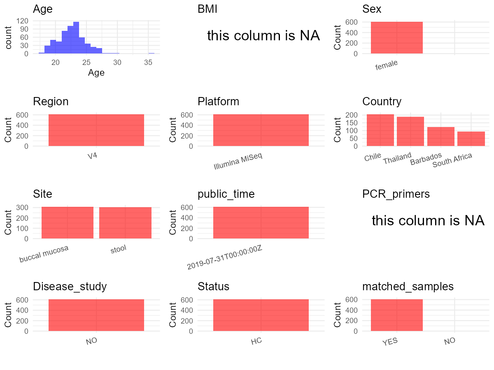

R Notebook: Metadata Processing Workflow
================

# Step 1: Obtain Initial Metadata from Each Project

To obtain the initial metadata: 1. Search for the BioProject ID (e.g.,
“PRJEBXXXX”) on the [NCBI SRA
website](https://www.ncbi.nlm.nih.gov/Traces/study/). 2. In the “Select”
table, click on “Metadata” and download the file. 3. The downloaded file
is typically named “SraRunTable.csv” and contains metadata for the
project.

``` r
# Load necessary libraries
library(dplyr)
library(ggplot2)
library(cowplot)

# Set working directory (update this path to your local directory)
setwd("D:/studylearning/董彪师兄项目/任务3_20251004/PRJNA545251")

# Read the initial metadata files
initial_meta<-read.csv("SraRunTable.csv",header = T)

# Display the first few rows of the metadata
head(initial_meta)
```

    ##          Run Assay.Type AvgSpotLen    Bases  BioProject    BioSample
    ## 1 SRR9606767   AMPLICON        502 24381638 PRJNA545251 SAMN12146872
    ## 2 SRR9606768   AMPLICON        502  9696632 PRJNA545251 SAMN12146466
    ## 3 SRR9606769   AMPLICON        502 13459122 PRJNA545251 SAMN12146467
    ## 4 SRR9606770   AMPLICON        502 12763350 PRJNA545251 SAMN12146468
    ## 5 SRR9606771   AMPLICON        502 10962174 PRJNA545251 SAMN12146469
    ## 6 SRR9606772   AMPLICON        502 13569562 PRJNA545251 SAMN12146462
    ##                BioSampleModel    Bytes               Center.Name
    ## 1 Metagenome or environmental 16470910 J. CRAIG VENTER INSTITUTE
    ## 2 Metagenome or environmental  5866172 J. CRAIG VENTER INSTITUTE
    ## 3 Metagenome or environmental  8459680 J. CRAIG VENTER INSTITUTE
    ## 4 Metagenome or environmental  7947251 J. CRAIG VENTER INSTITUTE
    ## 5 Metagenome or environmental  6683284 J. CRAIG VENTER INSTITUTE
    ## 6 Metagenome or environmental  8141590 J. CRAIG VENTER INSTITUTE
    ##   Collection_Date Consent DATASTORE.filetype DATASTORE.provider
    ## 1            2018  public   fastq,run.zq,sra         gs,ncbi,s3
    ## 2            2018  public   fastq,run.zq,sra         gs,ncbi,s3
    ## 3            2018  public   fastq,run.zq,sra         gs,ncbi,s3
    ## 4            2018  public   fastq,run.zq,sra         gs,ncbi,s3
    ## 5            2018  public   fastq,run.zq,sra         gs,ncbi,s3
    ## 6            2018  public   fastq,run.zq,sra         gs,ncbi,s3
    ##                       DATASTORE.region Experiment geo_loc_name_country
    ## 1 gs.us-east1,ncbi.public,s3.us-east-1 SRX6370646             Thailand
    ## 2 gs.us-east1,ncbi.public,s3.us-east-1 SRX6370645                Chile
    ## 3 gs.us-east1,ncbi.public,s3.us-east-1 SRX6370644                Chile
    ## 4 gs.us-east1,ncbi.public,s3.us-east-1 SRX6370643                Chile
    ## 5 gs.us-east1,ncbi.public,s3.us-east-1 SRX6370642                Chile
    ## 6 gs.us-east1,ncbi.public,s3.us-east-1 SRX6370641                Chile
    ##   geo_loc_name_country_continent geo_loc_name         HOST     Instrument
    ## 1                           Asia     Thailand Homo sapiens Illumina MiSeq
    ## 2                  South America        Chile Homo sapiens Illumina MiSeq
    ## 3                  South America        Chile Homo sapiens Illumina MiSeq
    ## 4                  South America        Chile Homo sapiens Illumina MiSeq
    ## 5                  South America        Chile Homo sapiens Illumina MiSeq
    ## 6                  South America        Chile Homo sapiens Illumina MiSeq
    ##    isolation_source              lat_lon Library.Name LibraryLayout
    ## 1 Buccal Microbiome 13.7309 N 100.5348 E    OR000541O        PAIRED
    ## 2  Stool Microbiome  33.4464 S 70.6402 W    Q0000212G        PAIRED
    ## 3  Stool Microbiome  33.4464 S 70.6402 W    Q0000213G        PAIRED
    ## 4  Stool Microbiome  33.4464 S 70.6402 W    Q0000214G        PAIRED
    ## 5  Stool Microbiome  33.4464 S 70.6402 W    Q0000215G        PAIRED
    ## 6  Stool Microbiome  33.4464 S 70.6402 W    Q0000207G        PAIRED
    ##   LibrarySelection LibrarySource         Organism Platform          ReleaseDate
    ## 1              PCR   METAGENOMIC human metagenome ILLUMINA 2019-07-31T00:00:00Z
    ## 2              PCR   METAGENOMIC human metagenome ILLUMINA 2019-07-31T00:00:00Z
    ## 3              PCR   METAGENOMIC human metagenome ILLUMINA 2019-07-31T00:00:00Z
    ## 4              PCR   METAGENOMIC human metagenome ILLUMINA 2019-07-31T00:00:00Z
    ## 5              PCR   METAGENOMIC human metagenome ILLUMINA 2019-07-31T00:00:00Z
    ## 6              PCR   METAGENOMIC human metagenome ILLUMINA 2019-07-31T00:00:00Z
    ##   Sample_ID Sample.Name SRA.Study          create_date version    sex
    ## 1 OR000541O   OR000541O SRP212190 2019-06-27T23:47:00Z       1 female
    ## 2 Q0000212G   Q0000212G SRP212190 2019-06-27T23:47:00Z       1 female
    ## 3 Q0000213G   Q0000213G SRP212190 2019-06-27T23:47:00Z       1 female
    ## 4 Q0000214G   Q0000214G SRP212190 2019-06-27T23:47:00Z       1 female
    ## 5 Q0000215G   Q0000215G SRP212190 2019-06-27T23:47:00Z       1 female
    ## 6 Q0000207G   Q0000207G SRP212190 2019-06-27T23:47:00Z       1 female
    ##   Weight_.kg. Height_.cm.   AGE ethnicity
    ## 1          57         161 23.48      Thai
    ## 2          58         163 25.04   Mapuche
    ## 3          48         160 22.11          
    ## 4          57         165 19.74          
    ## 5          45         150 22.66          
    ## 6          56         154 22.59

# Step 2: Create a Uniform Metadata Template

The uniform metadata should include the following columns:

1.  **BioProject**: Project ID (e.g., “PRJNA339212”)
2.  **Run**: Sample ID (e.g., “ERRXXXXXX” or “SRRXXXXXX”)
3.  **sample_name**: Original sample name submitted by the authors (not
    the database-assigned ID)
4.  **Age**: Age of the subject (if available)
5.  **BMI**: Body Mass Index (if available)
6.  **Sex**: Sex of the subject (“F” or “M”)
7.  **Region**: Targeted 16S rRNA region (e.g., “V3-V4”)
8.  **Platform**: Sequencing platform (e.g., “Illumina MiSeq”)
9.  **Country**: Country of sample origin (e.g., “China”)
10. **Site**: Sample site (e.g., “saliva”, “dental plaque”)
11. **public_time**: Data release date (format: “YYYY-MM-DD”)
12. **PCR_primers**: PCR primers used (e.g., “515F-806R”)
13. **title**: Title of the associated publication
14. **Disease_study**: Whether the study involves a disease (“YES” or
    “NO”)
15. **Status**: Disease status (e.g., “T2DM”, “HC”). Note: If the study
    includes both disease and healthy samples, this must be specified
    per sample.

``` r
# Create a uniform metadata dataframe
metadata <- data.frame(
  BioProject = initial_meta$BioProject,
  Run = initial_meta$Run,
  sample_name = initial_meta$Sample.Name,
  Age = initial_meta$AGE,
  BMI = NA,
  Sex= initial_meta$sex,
  Region = "V4",
  Platform = initial_meta$Instrument,
  Country = initial_meta$geo_loc_name_country,
  Site = initial_meta$isolation_source,
  public_time = initial_meta$ReleaseDate,
  stringsAsFactors = FALSE
)
```

# Step 3: Manually Add Information from the Publication

Some information (e.g. PCR primers, study title, disease status) must be
manually extracted from the publication and added to the metadata.

``` r
# Add information obtained from the publication
metadata$PCR_primers <- NA_character_  # Update based on the publication
metadata$title <- "Sampling from four geographically divergent young female populations demonstrates forensic geolocation potential in microbiomes"
metadata$Disease_study <- "NO"
metadata$Status <- "HC"
metadata <- metadata %>% 
  mutate(Site=case_when(
    grepl("B",Site)~"buccal mucosa",
    grepl("S",Site)~"stool"
  ))
#extract subject id by remove prefix of sample_name
metadata$sample_name <- sub(".$", "", metadata$sample_name)

# Check initial data distribution
cat("Initial sample distribution:\n")
```

    ## Initial sample distribution:

``` r
table(metadata$sample_name)
```

    ## 
    ## GU000522 GU000533 GU000560 GU000566 GU000574 GU000585 GU000593 GU000597 
    ##        2        2        2        2        2        2        2        2 
    ## GU000611 GU000612 GU000614 GU000618 GU000628 GU000636 GU000649 OR000523 
    ##        2        2        2        2        2        2        2        2 
    ## OR000524 OR000528 OR000530 OR000531 OR000532 OR000539 OR000540 OR000541 
    ##        2        2        2        2        2        2        2        2 
    ## OR000542 OR000543 OR000545 OR000547 OR000549 OR000550 OR000563 OR000568 
    ##        2        2        2        2        2        2        2        2 
    ## OR000570 OR000572 OR000573 OR000575 OR000576 OR000577 OR000578 OR000581 
    ##        1        2        2        2        1        2        2        2 
    ## OR000582 OR000584 OR000586 OR000587 OR000591 OR000592 OR000595 OR000600 
    ##        2        2        2        2        2        2        2        2 
    ## OR000601 OR000604 OR000606 OR000607 OR000615 OR000619 OR000625 OR000627 
    ##        2        2        2        2        2        2        2        2 
    ## OR000631 OR000632 OR000639 OR000641 OR000643 OR000644 OR000647 OR000648 
    ##        2        2        2        2        2        2        2        2 
    ## OR000650 Q0000001 Q0000004 Q0000005 Q0000008 Q0000009 Q0000012 Q0000013 
    ##        2        2        2        2        2        2        2        2 
    ## Q0000016 Q0000017 Q0000020 Q0000021 Q0000022 Q0000023 Q0000028 Q0000029 
    ##        2        2        2        2        2        2        2        2 
    ## Q0000031 Q0000033 Q0000034 Q0000035 Q0000054 Q0000055 Q0000056 Q0000057 
    ##        2        2        2        2        2        2        2        2 
    ## Q0000058 Q0000059 Q0000060 Q0000061 Q0000062 Q0000068 Q0000069 Q0000070 
    ##        2        2        2        2        2        2        2        2 
    ## Q0000071 Q0000074 Q0000076 Q0000078 Q0000082 Q0000083 Q0000084 Q0000087 
    ##        2        2        2        2        2        2        2        2 
    ## Q0000090 Q0000092 Q0000094 Q0000095 Q0000096 Q0000099 Q0000101 Q0000104 
    ##        2        2        2        2        2        2        2        2 
    ## Q0000105 Q0000106 Q0000111 Q0000113 Q0000116 Q0000117 Q0000118 Q0000119 
    ##        2        2        2        2        1        2        2        2 
    ## Q0000121 Q0000123 Q0000124 Q0000125 Q0000126 Q0000132 Q0000133 Q0000134 
    ##        2        2        2        2        2        2        2        2 
    ## Q0000135 Q0000136 Q0000137 Q0000139 Q0000140 Q0000142 Q0000143 Q0000145 
    ##        2        2        2        2        2        2        2        2 
    ## Q0000146 Q0000147 Q0000148 Q0000149 Q0000150 Q0000151 Q0000152 Q0000153 
    ##        2        2        2        2        2        2        2        2 
    ## Q0000154 Q0000155 Q0000156 Q0000159 Q0000162 Q0000163 Q0000165 Q0000166 
    ##        2        2        2        2        2        2        2        2 
    ## Q0000167 Q0000168 Q0000169 Q0000170 Q0000172 Q0000173 Q0000174 Q0000175 
    ##        2        2        2        2        2        2        2        2 
    ## Q0000176 Q0000177 Q0000178 Q0000179 Q0000180 Q0000181 Q0000183 Q0000185 
    ##        2        2        2        2        2        2        2        2 
    ## Q0000186 Q0000187 Q0000188 Q0000189 Q0000190 Q0000192 Q0000193 Q0000197 
    ##        2        2        2        2        2        2        2        2 
    ## Q0000199 Q0000200 Q0000201 Q0000202 Q0000203 Q0000204 Q0000205 Q0000206 
    ##        2        2        2        2        2        2        2        2 
    ## Q0000207 Q0000208 Q0000209 Q0000210 Q0000212 Q0000213 Q0000214 Q0000215 
    ##        2        2        2        2        2        2        2        2 
    ## Q0000216 Q0000217 Q0000218 Q0000220 Q0000221 Q0000223 Q0000224 Q0000225 
    ##        2        2        2        2        2        2        2        2 
    ## Q0000226 Q0000227 Q0000228 Q0000229 Q0000231 Q0000233 Q0000234 Q0000236 
    ##        2        2        2        2        2        2        2        2 
    ## Q0000237 Q0000239 Q0000240 Q0000241 Q0000242 Q0000243 Q0000244 Q0000245 
    ##        2        2        2        2        2        2        2        2 
    ## Q0000247 Q0000248 Q0000249 Q0000250 Q0000251 Q0000252 Q0000253 Q0000254 
    ##        2        2        2        2        2        2        2        2 
    ## Q0000255 Q0000258 Q0000259 Q0000260 Q0000261 Q0000392 Q0000393 Q0000394 
    ##        2        2        2        2        2        2        2        2 
    ## Q0000395 Q0000396 Q0000397 Q0000398 Q0000399 Q0000400 Q0000401 Q0000402 
    ##        2        2        2        2        2        2        2        2 
    ## Q0000403 Q0000404 Q0000405 Q0000406 Q0000407 Q0000408 Q0000409 Q0000410 
    ##        2        2        2        2        2        2        2        2 
    ## Q0000411 Q0000412 Q0000413 Q0000414 Q0000415 Q0000416 Q0000417 Q0000418 
    ##        2        2        2        2        2        2        2        2 
    ## Q0000419 Q0000420 Q0000421 Q0000422 Q0000423 Q0000424 Q0000425 Q0000426 
    ##        2        2        2        2        2        2        2        2 
    ## Q0000427 Q0000428 Q0000429 Q0000430 Q0000431 Q0000432 Q0000433 Q0000434 
    ##        2        2        2        2        2        2        2        2 
    ## Q0000435 Q0000436 Q0000437 Q0000438 Q0000439 Q0000534 Q0000535 Q0000537 
    ##        2        1        2        2        2        2        2        2 
    ## Q0000544 Q0000546 Q0000552 Q0000559 Q0000562 Q0000564 Q0000565 Q0000569 
    ##        2        2        2        1        2        2        2        2 
    ## Q0000579 Q0000580 Q0000583 Q0000590 Q0000596 Q0000598 Q0000602 Q0000605 
    ##        2        2        2        2        2        1        2        2 
    ## Q0000609 Q0000613 Q0000617 Q0000620 Q0000621 Q0000623 Q0000624 Q0000626 
    ##        2        2        2        2        2        2        2        2 
    ## Q0000630 Q0000635 Q0000637 Q0000640 Q0000642 QR000003 
    ##        2        2        2        2        2        2

``` r
table(metadata$Site)
```

    ## 
    ## buccal mucosa         stool 
    ##           309           305

``` r
# Calculate sampling frequency per subject
sample_counts <- table(metadata$sample_name)
cat("\nNumber of samples per subject:\n")
```

    ## 
    ## Number of samples per subject:

``` r
print(sample_counts)
```

    ## 
    ## GU000522 GU000533 GU000560 GU000566 GU000574 GU000585 GU000593 GU000597 
    ##        2        2        2        2        2        2        2        2 
    ## GU000611 GU000612 GU000614 GU000618 GU000628 GU000636 GU000649 OR000523 
    ##        2        2        2        2        2        2        2        2 
    ## OR000524 OR000528 OR000530 OR000531 OR000532 OR000539 OR000540 OR000541 
    ##        2        2        2        2        2        2        2        2 
    ## OR000542 OR000543 OR000545 OR000547 OR000549 OR000550 OR000563 OR000568 
    ##        2        2        2        2        2        2        2        2 
    ## OR000570 OR000572 OR000573 OR000575 OR000576 OR000577 OR000578 OR000581 
    ##        1        2        2        2        1        2        2        2 
    ## OR000582 OR000584 OR000586 OR000587 OR000591 OR000592 OR000595 OR000600 
    ##        2        2        2        2        2        2        2        2 
    ## OR000601 OR000604 OR000606 OR000607 OR000615 OR000619 OR000625 OR000627 
    ##        2        2        2        2        2        2        2        2 
    ## OR000631 OR000632 OR000639 OR000641 OR000643 OR000644 OR000647 OR000648 
    ##        2        2        2        2        2        2        2        2 
    ## OR000650 Q0000001 Q0000004 Q0000005 Q0000008 Q0000009 Q0000012 Q0000013 
    ##        2        2        2        2        2        2        2        2 
    ## Q0000016 Q0000017 Q0000020 Q0000021 Q0000022 Q0000023 Q0000028 Q0000029 
    ##        2        2        2        2        2        2        2        2 
    ## Q0000031 Q0000033 Q0000034 Q0000035 Q0000054 Q0000055 Q0000056 Q0000057 
    ##        2        2        2        2        2        2        2        2 
    ## Q0000058 Q0000059 Q0000060 Q0000061 Q0000062 Q0000068 Q0000069 Q0000070 
    ##        2        2        2        2        2        2        2        2 
    ## Q0000071 Q0000074 Q0000076 Q0000078 Q0000082 Q0000083 Q0000084 Q0000087 
    ##        2        2        2        2        2        2        2        2 
    ## Q0000090 Q0000092 Q0000094 Q0000095 Q0000096 Q0000099 Q0000101 Q0000104 
    ##        2        2        2        2        2        2        2        2 
    ## Q0000105 Q0000106 Q0000111 Q0000113 Q0000116 Q0000117 Q0000118 Q0000119 
    ##        2        2        2        2        1        2        2        2 
    ## Q0000121 Q0000123 Q0000124 Q0000125 Q0000126 Q0000132 Q0000133 Q0000134 
    ##        2        2        2        2        2        2        2        2 
    ## Q0000135 Q0000136 Q0000137 Q0000139 Q0000140 Q0000142 Q0000143 Q0000145 
    ##        2        2        2        2        2        2        2        2 
    ## Q0000146 Q0000147 Q0000148 Q0000149 Q0000150 Q0000151 Q0000152 Q0000153 
    ##        2        2        2        2        2        2        2        2 
    ## Q0000154 Q0000155 Q0000156 Q0000159 Q0000162 Q0000163 Q0000165 Q0000166 
    ##        2        2        2        2        2        2        2        2 
    ## Q0000167 Q0000168 Q0000169 Q0000170 Q0000172 Q0000173 Q0000174 Q0000175 
    ##        2        2        2        2        2        2        2        2 
    ## Q0000176 Q0000177 Q0000178 Q0000179 Q0000180 Q0000181 Q0000183 Q0000185 
    ##        2        2        2        2        2        2        2        2 
    ## Q0000186 Q0000187 Q0000188 Q0000189 Q0000190 Q0000192 Q0000193 Q0000197 
    ##        2        2        2        2        2        2        2        2 
    ## Q0000199 Q0000200 Q0000201 Q0000202 Q0000203 Q0000204 Q0000205 Q0000206 
    ##        2        2        2        2        2        2        2        2 
    ## Q0000207 Q0000208 Q0000209 Q0000210 Q0000212 Q0000213 Q0000214 Q0000215 
    ##        2        2        2        2        2        2        2        2 
    ## Q0000216 Q0000217 Q0000218 Q0000220 Q0000221 Q0000223 Q0000224 Q0000225 
    ##        2        2        2        2        2        2        2        2 
    ## Q0000226 Q0000227 Q0000228 Q0000229 Q0000231 Q0000233 Q0000234 Q0000236 
    ##        2        2        2        2        2        2        2        2 
    ## Q0000237 Q0000239 Q0000240 Q0000241 Q0000242 Q0000243 Q0000244 Q0000245 
    ##        2        2        2        2        2        2        2        2 
    ## Q0000247 Q0000248 Q0000249 Q0000250 Q0000251 Q0000252 Q0000253 Q0000254 
    ##        2        2        2        2        2        2        2        2 
    ## Q0000255 Q0000258 Q0000259 Q0000260 Q0000261 Q0000392 Q0000393 Q0000394 
    ##        2        2        2        2        2        2        2        2 
    ## Q0000395 Q0000396 Q0000397 Q0000398 Q0000399 Q0000400 Q0000401 Q0000402 
    ##        2        2        2        2        2        2        2        2 
    ## Q0000403 Q0000404 Q0000405 Q0000406 Q0000407 Q0000408 Q0000409 Q0000410 
    ##        2        2        2        2        2        2        2        2 
    ## Q0000411 Q0000412 Q0000413 Q0000414 Q0000415 Q0000416 Q0000417 Q0000418 
    ##        2        2        2        2        2        2        2        2 
    ## Q0000419 Q0000420 Q0000421 Q0000422 Q0000423 Q0000424 Q0000425 Q0000426 
    ##        2        2        2        2        2        2        2        2 
    ## Q0000427 Q0000428 Q0000429 Q0000430 Q0000431 Q0000432 Q0000433 Q0000434 
    ##        2        2        2        2        2        2        2        2 
    ## Q0000435 Q0000436 Q0000437 Q0000438 Q0000439 Q0000534 Q0000535 Q0000537 
    ##        2        1        2        2        2        2        2        2 
    ## Q0000544 Q0000546 Q0000552 Q0000559 Q0000562 Q0000564 Q0000565 Q0000569 
    ##        2        2        2        1        2        2        2        2 
    ## Q0000579 Q0000580 Q0000583 Q0000590 Q0000596 Q0000598 Q0000602 Q0000605 
    ##        2        2        2        2        2        1        2        2 
    ## Q0000609 Q0000613 Q0000617 Q0000620 Q0000621 Q0000623 Q0000624 Q0000626 
    ##        2        2        2        2        2        2        2        2 
    ## Q0000630 Q0000635 Q0000637 Q0000640 Q0000642 QR000003 
    ##        2        2        2        2        2        2

``` r
# Create matched_samples column
metadata$matched_samples <- ifelse(metadata$sample_name %in% names(sample_counts[sample_counts >= 2]), "YES", "NO")

cat("\nMatched samples distribution:\n")
```

    ## 
    ## Matched samples distribution:

``` r
table(metadata$matched_samples)
```

    ## 
    ##  NO YES 
    ##   6 608

``` r
# Identify samples for removal: single samples excluding saliva 
single_samples <- names(sample_counts[sample_counts == 1])
samples_to_remove <- metadata$sample_name %in% single_samples & !(metadata$Site %in% c("buccal mucosa"))

cat("\nNumber of samples to be removed:", sum(samples_to_remove), "\n")
```

    ## 
    ## Number of samples to be removed: 1

``` r
# Remove identified samples
metadata_clean <- metadata[!samples_to_remove, ]

cat("\nFinal sample distribution after cleaning:\n")
```

    ## 
    ## Final sample distribution after cleaning:

``` r
table(metadata_clean$sample_name)
```

    ## 
    ## GU000522 GU000533 GU000560 GU000566 GU000574 GU000585 GU000593 GU000597 
    ##        2        2        2        2        2        2        2        2 
    ## GU000611 GU000612 GU000614 GU000618 GU000628 GU000636 GU000649 OR000523 
    ##        2        2        2        2        2        2        2        2 
    ## OR000524 OR000528 OR000530 OR000531 OR000532 OR000539 OR000540 OR000541 
    ##        2        2        2        2        2        2        2        2 
    ## OR000542 OR000543 OR000545 OR000547 OR000549 OR000550 OR000563 OR000568 
    ##        2        2        2        2        2        2        2        2 
    ## OR000570 OR000572 OR000573 OR000575 OR000576 OR000577 OR000578 OR000581 
    ##        1        2        2        2        1        2        2        2 
    ## OR000582 OR000584 OR000586 OR000587 OR000591 OR000592 OR000595 OR000600 
    ##        2        2        2        2        2        2        2        2 
    ## OR000601 OR000604 OR000606 OR000607 OR000615 OR000619 OR000625 OR000627 
    ##        2        2        2        2        2        2        2        2 
    ## OR000631 OR000632 OR000639 OR000641 OR000643 OR000644 OR000647 OR000648 
    ##        2        2        2        2        2        2        2        2 
    ## OR000650 Q0000001 Q0000004 Q0000005 Q0000008 Q0000009 Q0000012 Q0000013 
    ##        2        2        2        2        2        2        2        2 
    ## Q0000016 Q0000017 Q0000020 Q0000021 Q0000022 Q0000023 Q0000028 Q0000029 
    ##        2        2        2        2        2        2        2        2 
    ## Q0000031 Q0000033 Q0000034 Q0000035 Q0000054 Q0000055 Q0000056 Q0000057 
    ##        2        2        2        2        2        2        2        2 
    ## Q0000058 Q0000059 Q0000060 Q0000061 Q0000062 Q0000068 Q0000069 Q0000070 
    ##        2        2        2        2        2        2        2        2 
    ## Q0000071 Q0000074 Q0000076 Q0000078 Q0000082 Q0000083 Q0000084 Q0000087 
    ##        2        2        2        2        2        2        2        2 
    ## Q0000090 Q0000092 Q0000094 Q0000095 Q0000096 Q0000099 Q0000101 Q0000104 
    ##        2        2        2        2        2        2        2        2 
    ## Q0000105 Q0000106 Q0000111 Q0000113 Q0000117 Q0000118 Q0000119 Q0000121 
    ##        2        2        2        2        2        2        2        2 
    ## Q0000123 Q0000124 Q0000125 Q0000126 Q0000132 Q0000133 Q0000134 Q0000135 
    ##        2        2        2        2        2        2        2        2 
    ## Q0000136 Q0000137 Q0000139 Q0000140 Q0000142 Q0000143 Q0000145 Q0000146 
    ##        2        2        2        2        2        2        2        2 
    ## Q0000147 Q0000148 Q0000149 Q0000150 Q0000151 Q0000152 Q0000153 Q0000154 
    ##        2        2        2        2        2        2        2        2 
    ## Q0000155 Q0000156 Q0000159 Q0000162 Q0000163 Q0000165 Q0000166 Q0000167 
    ##        2        2        2        2        2        2        2        2 
    ## Q0000168 Q0000169 Q0000170 Q0000172 Q0000173 Q0000174 Q0000175 Q0000176 
    ##        2        2        2        2        2        2        2        2 
    ## Q0000177 Q0000178 Q0000179 Q0000180 Q0000181 Q0000183 Q0000185 Q0000186 
    ##        2        2        2        2        2        2        2        2 
    ## Q0000187 Q0000188 Q0000189 Q0000190 Q0000192 Q0000193 Q0000197 Q0000199 
    ##        2        2        2        2        2        2        2        2 
    ## Q0000200 Q0000201 Q0000202 Q0000203 Q0000204 Q0000205 Q0000206 Q0000207 
    ##        2        2        2        2        2        2        2        2 
    ## Q0000208 Q0000209 Q0000210 Q0000212 Q0000213 Q0000214 Q0000215 Q0000216 
    ##        2        2        2        2        2        2        2        2 
    ## Q0000217 Q0000218 Q0000220 Q0000221 Q0000223 Q0000224 Q0000225 Q0000226 
    ##        2        2        2        2        2        2        2        2 
    ## Q0000227 Q0000228 Q0000229 Q0000231 Q0000233 Q0000234 Q0000236 Q0000237 
    ##        2        2        2        2        2        2        2        2 
    ## Q0000239 Q0000240 Q0000241 Q0000242 Q0000243 Q0000244 Q0000245 Q0000247 
    ##        2        2        2        2        2        2        2        2 
    ## Q0000248 Q0000249 Q0000250 Q0000251 Q0000252 Q0000253 Q0000254 Q0000255 
    ##        2        2        2        2        2        2        2        2 
    ## Q0000258 Q0000259 Q0000260 Q0000261 Q0000392 Q0000393 Q0000394 Q0000395 
    ##        2        2        2        2        2        2        2        2 
    ## Q0000396 Q0000397 Q0000398 Q0000399 Q0000400 Q0000401 Q0000402 Q0000403 
    ##        2        2        2        2        2        2        2        2 
    ## Q0000404 Q0000405 Q0000406 Q0000407 Q0000408 Q0000409 Q0000410 Q0000411 
    ##        2        2        2        2        2        2        2        2 
    ## Q0000412 Q0000413 Q0000414 Q0000415 Q0000416 Q0000417 Q0000418 Q0000419 
    ##        2        2        2        2        2        2        2        2 
    ## Q0000420 Q0000421 Q0000422 Q0000423 Q0000424 Q0000425 Q0000426 Q0000427 
    ##        2        2        2        2        2        2        2        2 
    ## Q0000428 Q0000429 Q0000430 Q0000431 Q0000432 Q0000433 Q0000434 Q0000435 
    ##        2        2        2        2        2        2        2        2 
    ## Q0000436 Q0000437 Q0000438 Q0000439 Q0000534 Q0000535 Q0000537 Q0000544 
    ##        1        2        2        2        2        2        2        2 
    ## Q0000546 Q0000552 Q0000559 Q0000562 Q0000564 Q0000565 Q0000569 Q0000579 
    ##        2        2        1        2        2        2        2        2 
    ## Q0000580 Q0000583 Q0000590 Q0000596 Q0000598 Q0000602 Q0000605 Q0000609 
    ##        2        2        2        2        1        2        2        2 
    ## Q0000613 Q0000617 Q0000620 Q0000621 Q0000623 Q0000624 Q0000626 Q0000630 
    ##        2        2        2        2        2        2        2        2 
    ## Q0000635 Q0000637 Q0000640 Q0000642 QR000003 
    ##        2        2        2        2        2

``` r
table(metadata_clean$Site)
```

    ## 
    ## buccal mucosa         stool 
    ##           309           304

``` r
table(metadata_clean$matched_samples)
```

    ## 
    ##  NO YES 
    ##   5 608

``` r
# Use cleaned dataset for subsequent analysis
metadata <- metadata_clean
```

# Step 4: Summarize and Validate the Metadata

``` r
# Check the number of unique runs and sample names
print(paste("Number of unique runs:", length(unique(metadata$Run))))
```

    ## [1] "Number of unique runs: 613"

``` r
print(paste("Number of unique sample names:", length(unique(metadata$sample_name))))
```

    ## [1] "Number of unique sample names: 309"

# Step 5: Visualize the Metadata

``` r

```


# Step 6: Finalize and Export the Metadata

``` r
# Reorder columns to match the desired format
metadata <- metadata[, c(
  "BioProject", "Run", "sample_name", "Age", "BMI", "Sex", 
  "Region", "Platform", "Country", "Site", "public_time", 
  "PCR_primers", "title", "Disease_study", "Status","matched_samples"
)]

# Export the uniform metadata to a CSV file
write.csv(metadata, file = "metadata.csv", quote = FALSE)
head(metadata)
```

    ##    BioProject        Run sample_name   Age BMI    Sex Region       Platform
    ## 1 PRJNA545251 SRR9606767    OR000541 23.48  NA female     V4 Illumina MiSeq
    ## 2 PRJNA545251 SRR9606768    Q0000212 25.04  NA female     V4 Illumina MiSeq
    ## 3 PRJNA545251 SRR9606769    Q0000213 22.11  NA female     V4 Illumina MiSeq
    ## 4 PRJNA545251 SRR9606770    Q0000214 19.74  NA female     V4 Illumina MiSeq
    ## 5 PRJNA545251 SRR9606771    Q0000215 22.66  NA female     V4 Illumina MiSeq
    ## 6 PRJNA545251 SRR9606772    Q0000207 22.59  NA female     V4 Illumina MiSeq
    ##    Country          Site          public_time PCR_primers
    ## 1 Thailand buccal mucosa 2019-07-31T00:00:00Z        <NA>
    ## 2    Chile         stool 2019-07-31T00:00:00Z        <NA>
    ## 3    Chile         stool 2019-07-31T00:00:00Z        <NA>
    ## 4    Chile         stool 2019-07-31T00:00:00Z        <NA>
    ## 5    Chile         stool 2019-07-31T00:00:00Z        <NA>
    ## 6    Chile         stool 2019-07-31T00:00:00Z        <NA>
    ##                                                                                                                             title
    ## 1 Sampling from four geographically divergent young female populations demonstrates forensic geolocation potential in microbiomes
    ## 2 Sampling from four geographically divergent young female populations demonstrates forensic geolocation potential in microbiomes
    ## 3 Sampling from four geographically divergent young female populations demonstrates forensic geolocation potential in microbiomes
    ## 4 Sampling from four geographically divergent young female populations demonstrates forensic geolocation potential in microbiomes
    ## 5 Sampling from four geographically divergent young female populations demonstrates forensic geolocation potential in microbiomes
    ## 6 Sampling from four geographically divergent young female populations demonstrates forensic geolocation potential in microbiomes
    ##   Disease_study Status matched_samples
    ## 1            NO     HC             YES
    ## 2            NO     HC             YES
    ## 3            NO     HC             YES
    ## 4            NO     HC             YES
    ## 5            NO     HC             YES
    ## 6            NO     HC             YES

## Notes for Students:

1.  **Metadata Accuracy**: Always cross-check the metadata with the
    original publication to ensure accuracy.
2.  **Manual Entries**: Columns like `PCR_primers`, and `Status` often
    require manual entry based on the publication.
3.  **Disease Status**: Be careful when assigning `Status`—some studies
    include both disease and healthy samples.
4.  **Visualization**: The plots help quickly identify the distribution
    of values in each column, which is useful for quality control.
5.  **Reproducibility**: Update the working directory and file paths to
    match your local environment.
