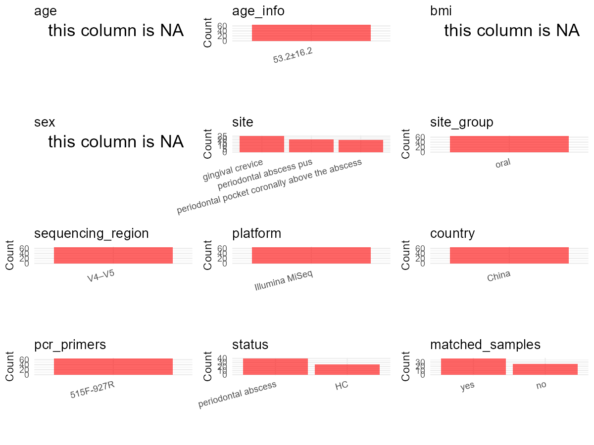

R Notebook: Metadata Processing Workflow
================

# Step 1: Obtain Initial Metadata from Each Project

This step sets the project directory, loads the raw SRA metadata, and
optionally merges supplement tables.

``` r
# Load libraries
library(dplyr)
library(ggplot2)
library(cowplot)

# (1) Setting working directory
# EDIT HERE: change project_id for each study
project_id <- "PRJNA547446" 

base_dir <- "E:/oral/26/metadata-2604/Oral-Metadata-YL-02"
setwd(file.path(base_dir, project_id))

# (2) Loading raw SRA metadata file
sra_file <- "SraRunTable.csv"
initial_meta <- read.csv(sra_file, header = TRUE)

# (3) OPTIONAL: If extra metadata (e.g., Table.x or supplemental materials) are available from the article, you may need to merge the file with initial_meta manually. Below is example code for merging. Depending on the specific case of each study, you can customize the code as needed.
#supp_table <- read.csv("supplemental_table_v2.csv", header = TRUE)
#initial_meta <- left_join(initial_meta, supp_table, by = "Sample.Name")
```

# Step 2: Data Overview

First, you need to get an overview of the data, which includes two
steps: reading the article and reading the initial metadata. This step
is very IMPORTANT!

``` r
# (1) Read the article in the following order: abstract, the beginning of the results section, and the methods. Understand the sample size, experimental design, and disease group overview. Clarify the sampling sites; for oral and gut samples, specify the exact sites like supragingival plaque, tongue, etc.

# (2) IMPORTANT: MUST go through each column of initial_meta
head(initial_meta, 10)
```

    ##           Run Assay.Type AvgSpotLen     Bases  BioProject    BioSample
    ## 1  SRR9214805   AMPLICON        550 105647534 PRJNA547446 SAMN11963818
    ## 2  SRR9214806   AMPLICON        550  92738444 PRJNA547446 SAMN11963817
    ## 3  SRR9214807   AMPLICON        525 100753058 PRJNA547446 SAMN11963820
    ## 4  SRR9214808   AMPLICON        526 108584697 PRJNA547446 SAMN11963819
    ## 5  SRR9214809   AMPLICON        551  66755922 PRJNA547446 SAMN11963822
    ## 6  SRR9214810   AMPLICON        551 115066794 PRJNA547446 SAMN11963821
    ## 7  SRR9214811   AMPLICON        525  45034506 PRJNA547446 SAMN11963824
    ## 8  SRR9214812   AMPLICON        551  46686909 PRJNA547446 SAMN11963823
    ## 9  SRR9214813   AMPLICON        551 141921633 PRJNA547446 SAMN11963826
    ## 10 SRR9214814   AMPLICON        551  23288151 PRJNA547446 SAMN11963825
    ##                 BioSampleModel    Bytes                          Center.Name
    ## 1  Metagenome or environmental 60447267 ZHONGSHAN HOSPITAL, FUDAN UNIVERSITY
    ## 2  Metagenome or environmental 53121693 ZHONGSHAN HOSPITAL, FUDAN UNIVERSITY
    ## 3  Metagenome or environmental 65716351 ZHONGSHAN HOSPITAL, FUDAN UNIVERSITY
    ## 4  Metagenome or environmental 70665224 ZHONGSHAN HOSPITAL, FUDAN UNIVERSITY
    ## 5  Metagenome or environmental 37126036 ZHONGSHAN HOSPITAL, FUDAN UNIVERSITY
    ## 6  Metagenome or environmental 64040802 ZHONGSHAN HOSPITAL, FUDAN UNIVERSITY
    ## 7  Metagenome or environmental 28897329 ZHONGSHAN HOSPITAL, FUDAN UNIVERSITY
    ## 8  Metagenome or environmental 25839879 ZHONGSHAN HOSPITAL, FUDAN UNIVERSITY
    ## 9  Metagenome or environmental 82543297 ZHONGSHAN HOSPITAL, FUDAN UNIVERSITY
    ## 10 Metagenome or environmental 13850044 ZHONGSHAN HOSPITAL, FUDAN UNIVERSITY
    ##    Collection_Date Consent DATASTORE.filetype DATASTORE.provider
    ## 1             2015  public   fastq,run.zq,sra         gs,ncbi,s3
    ## 2             2015  public   fastq,run.zq,sra         gs,ncbi,s3
    ## 3             2015  public   fastq,run.zq,sra         gs,ncbi,s3
    ## 4             2015  public   fastq,run.zq,sra         gs,ncbi,s3
    ## 5             2015  public   fastq,run.zq,sra         gs,ncbi,s3
    ## 6             2015  public   fastq,run.zq,sra         gs,ncbi,s3
    ## 7             2015  public   fastq,run.zq,sra         gs,ncbi,s3
    ## 8             2015  public   fastq,run.zq,sra         gs,ncbi,s3
    ## 9             2014  public   fastq,run.zq,sra         gs,ncbi,s3
    ## 10            2014  public   fastq,run.zq,sra         gs,ncbi,s3
    ##                        DATASTORE.region Experiment geo_loc_name_country
    ## 1  gs.us-east1,ncbi.public,s3.us-east-1 SRX5985583                China
    ## 2  gs.us-east1,ncbi.public,s3.us-east-1 SRX5985582                China
    ## 3  gs.us-east1,ncbi.public,s3.us-east-1 SRX5985581                China
    ## 4  gs.us-east1,ncbi.public,s3.us-east-1 SRX5985580                China
    ## 5  gs.us-east1,ncbi.public,s3.us-east-1 SRX5985579                China
    ## 6  gs.us-east1,ncbi.public,s3.us-east-1 SRX5985578                China
    ## 7  gs.us-east1,ncbi.public,s3.us-east-1 SRX5985577                China
    ## 8  gs.us-east1,ncbi.public,s3.us-east-1 SRX5985576                China
    ## 9  gs.us-east1,ncbi.public,s3.us-east-1 SRX5985575                China
    ## 10 gs.us-east1,ncbi.public,s3.us-east-1 SRX5985574                China
    ##    geo_loc_name_country_continent geo_loc_name         HOST     Instrument
    ## 1                            Asia        China Homo sapiens Illumina MiSeq
    ## 2                            Asia        China Homo sapiens Illumina MiSeq
    ## 3                            Asia        China Homo sapiens Illumina MiSeq
    ## 4                            Asia        China Homo sapiens Illumina MiSeq
    ## 5                            Asia        China Homo sapiens Illumina MiSeq
    ## 6                            Asia        China Homo sapiens Illumina MiSeq
    ## 7                            Asia        China Homo sapiens Illumina MiSeq
    ## 8                            Asia        China Homo sapiens Illumina MiSeq
    ## 9                            Asia        China Homo sapiens Illumina MiSeq
    ## 10                           Asia        China Homo sapiens Illumina MiSeq
    ##                isolate isolation_source lat_lon   Library.Name LibraryLayout
    ## 1   periodontal pocket           052004 missing 052004A_Pocket        PAIRED
    ## 2   periodontal pocket           052003 missing 052003A_Pocket        PAIRED
    ## 3   periodontal pocket           070101 missing 070101C_Pocket        PAIRED
    ## 4   periodontal pocket           062403 missing 062403B_Pocket        PAIRED
    ## 5   periodontal pocket           081102 missing 081102A_Pocket        PAIRED
    ## 6   periodontal pocket           072801 missing 072801A_Pocket        PAIRED
    ## 7   periodontal pocket           141201 missing 141201A_Pocket        PAIRED
    ## 8   periodontal pocket           101302 missing 101302A_Pocket        PAIRED
    ## 9  periodontal abscess            04301 missing 04301C_Abscess        PAIRED
    ## 10  periodontal pocket            06231 missing  06231B_Pocket        PAIRED
    ##    LibrarySelection LibrarySource              Organism Platform
    ## 1               PCR   METAGENOMIC human oral metagenome ILLUMINA
    ## 2               PCR   METAGENOMIC human oral metagenome ILLUMINA
    ## 3               PCR   METAGENOMIC human oral metagenome ILLUMINA
    ## 4               PCR   METAGENOMIC human oral metagenome ILLUMINA
    ## 5               PCR   METAGENOMIC human oral metagenome ILLUMINA
    ## 6               PCR   METAGENOMIC human oral metagenome ILLUMINA
    ## 7               PCR   METAGENOMIC human oral metagenome ILLUMINA
    ## 8               PCR   METAGENOMIC human oral metagenome ILLUMINA
    ## 9               PCR   METAGENOMIC human oral metagenome ILLUMINA
    ## 10              PCR   METAGENOMIC human oral metagenome ILLUMINA
    ##             ReleaseDate          create_date version    Sample.Name
    ## 1  2020-07-01T00:00:00Z 2019-06-07T14:17:00Z       1 052004A_Pocket
    ## 2  2020-07-01T00:00:00Z 2019-06-07T14:18:00Z       1 052003A_Pocket
    ## 3  2020-07-01T00:00:00Z 2019-06-07T14:18:00Z       1 070101C_Pocket
    ## 4  2020-07-01T00:00:00Z 2019-06-07T14:18:00Z       1 062403B_Pocket
    ## 5  2020-07-01T00:00:00Z 2019-06-07T14:18:00Z       1 081102A_Pocket
    ## 6  2020-07-01T00:00:00Z 2019-06-07T14:18:00Z       1 072801A_Pocket
    ## 7  2020-07-01T00:00:00Z 2019-06-07T14:18:00Z       1 141201A_Pocket
    ## 8  2020-07-01T00:00:00Z 2019-06-07T14:18:00Z       1 101302A_Pocket
    ## 9  2020-07-01T00:00:00Z 2019-06-07T14:18:00Z       1 04301C_Abscess
    ## 10 2020-07-01T00:00:00Z 2019-06-07T14:18:00Z       1  06231B_Pocket
    ##             sample_type SRA.Study
    ## 1  metagenomic assembly SRP200763
    ## 2  metagenomic assembly SRP200763
    ## 3  metagenomic assembly SRP200763
    ## 4  metagenomic assembly SRP200763
    ## 5  metagenomic assembly SRP200763
    ## 6  metagenomic assembly SRP200763
    ## 7  metagenomic assembly SRP200763
    ## 8  metagenomic assembly SRP200763
    ## 9  metagenomic assembly SRP200763
    ## 10 metagenomic assembly SRP200763

``` r
# IMPORTANT: Check the unique values in the column of interest or query column.
lapply(initial_meta[c('isolate')], table) # site
```

    ## $isolate
    ## 
    ##         periodontal abscess  periodontal health control 
    ##                          20                          25 
    ## periodontal patient control          periodontal pocket 
    ##                          20                          19

``` r
lapply(initial_meta[c('HOST', 'Organism')], table) # organism
```

    ## $HOST
    ## 
    ## Homo sapiens 
    ##           84 
    ## 
    ## $Organism
    ## 
    ## human oral metagenome 
    ##                    84

``` r
table(initial_meta$isolation_source) # subject id
```

    ## 
    ##  010311  010511  010512  010513  010515  010711  010811  010812  011311  012611 
    ##       1       1       3       1       1       1       1       1       1       1 
    ##  031711  041202   04301   05041  051302  052001  052002  052003  052004  052005 
    ##       3       3       3       3       1       1       1       3       3       1 
    ##   05301   05302   06231  062403  062802  070101  070803 070901l  071601  071602 
    ##       3       3       3       3       1       3       1       1       1       1 
    ##  071603   07211  072302  072801  072902   07301  080702  081102   08181  081902 
    ##       2       3       1       3       1       3       1       3       3       1 
    ##  082002  082101  101302  141201 1501061 
    ##       1       1       3       3       1

``` r
#table(initial_meta$sequencing_meth..exp.) # output is Sequencing by synthesis
table(initial_meta$Platform) # output is Illumina. according to the methods,  Illumina is correct.
```

    ## 
    ## ILLUMINA 
    ##       84

``` r
#table(initial_meta$target_subfragment..exp.)
```

# Step 3: Removing Control and Non-human Samples

First, we need to remove control samples(including both negative
controls and positive controls) and non-human samples.

``` r
# (1) EDIT HERE: Parameter setup
control_column <- "isolate" # column name in initial_meta
# unique(initial_meta[[control_column]])
control_keywords <- c("periodontal patient control") # Enter exact keywords

species_column <- "" # column name in initial_meta
unique(initial_meta[[species_column]])
```

    ## NULL

``` r
non_human_keywords <- c() # Enter exact keywords

# (2) Remove controls and non-human samples. DO NOT need to modify code in this part, just run it.
n_samples <- nrow(initial_meta)
# Control evaluation
if (length(control_keywords) > 0) {
  if (is.null(control_column) || control_column == "") {
    stop("Error: control_keywords provided but control_column is missing.")
  }
  
  if (!(control_column %in% colnames(initial_meta))) {
    stop(sprintf("Error: Column '%s' not found in initial_meta.", control_column))
  }
  
  control_pattern <- paste(control_keywords, collapse = "|")
  control_text <- initial_meta[[control_column]]
  is_control <- grepl(control_pattern, control_text)
  
} else {
  is_control <- rep(FALSE, n_samples)
}

# Non-human evaluation
if (length(non_human_keywords) > 0) {
  if (is.null(species_column) || species_column == "") {
    stop("Error: non_human_keywords provided but species_column is missing.")
  }
  
  if (!(species_column %in% colnames(initial_meta))) {
    stop(sprintf("Error: Column '%s' not found in initial_meta.", species_column))
  }
  
  non_human_pattern <- paste(non_human_keywords, collapse = "|")
  species_text <- initial_meta[[species_column]]
  is_non_human <- grepl(non_human_pattern, species_text)
} else {
  is_non_human <- rep(FALSE, n_samples)
}

# Execute removal
samples_to_remove <- is_control | is_non_human
initial_meta <- initial_meta[!samples_to_remove, ]

cat("Initial samples counts:",n_samples,"\n")
```

    ## Initial samples counts: 84

``` r
cat("Removed control samples:", sum(is_control), "\n")
```

    ## Removed control samples: 20

``` r
cat("Removed non-human samples:", sum(is_non_human), "\n")
```

    ## Removed non-human samples: 0

``` r
cat("Total samples removed ", sum(samples_to_remove), "\n")
```

    ## Total samples removed  20

``` r
cat("Remaining samples after Step 2:", nrow(initial_meta), "\n")
```

    ## Remaining samples after Step 2: 64

# Step 4: Creating a Uniform Metadata Template

This step converts the raw SRA table into the standard metadata format
used in our meta-analysis. The uniform metadata should include the
following columns: 1. **bioproject**: Project ID from SRA or other
database e.g. `PRJNA1234`, `CNP1234`, ‘OEP1234’, ‘qiita_1234’ 2.
**sample_id**: SRA sample/run ID. Unique id for each sample!
e.g. `DRR1234567`, `ERR1234567` and `SRR1234567`. If no such column
exists, can use column like sample_name. 3. **subject_id**: subject id
for each person if available. e.g. `patient_01`, `Host_03_before`,
`subject12` 4. **age**: Age of the subject if available. e.g. `35`, `42`
\| not `adult`, `chilren` 5. **age_info**: If the age is not explicitly
stated but approximate age range information is available, mark it in
this column. e.g., `18-55`, `children`, `infant`, `elder` 6. **bmi**:
Body Mass Index if available. e.g. `22.5`, `18.9` \| not `normal`,
`overweight` 7. **sex**: Sex of the subject. Mandatory to write as M/F
\| not `female`, `woman` 8. **sequencing_region**: Targeted 16S rRNA
region. e.g. `V3-V4`, `V4` 9. **platform**: Sequencing platform.
e.g. `Illumina MiSeq`, `454 GS FLX Titanium`, `Ion Torrent` 10.
**country**: Country of sample origin. e.g. `China`, `Japan` \| not city
name like `Beijing` 11. **site**: Sampling site. For oral and gut sites,
specify the exact sites as detailed as possible. For example, if it is
known to be supragingival plaque, do not record it as ‘dental plaque’,
unless the original text provides only a vague description.
e.g. `saliva`, `tongue coating` \| not broad term like `oral` 12.
**site_group**: only accepts one of following three values: ‘oral’,
‘gut’, or ‘other’. 13. **public_time**: Data release date.
e.g. `2021-06-22` \| not `June 2021` 14. **pcr_primers**: PCR primers
used. e.g. `515F-806R`, `27F-338R` \| not primer sequences 15.
**title**: Title of the associated publication. 16. **disease_study**:
Whether the study involves disease samples. If it’s not clear, can
record as NA. Only three values accepted: ‘yes’, ‘no’ or NA 17.
**status**: Disease status for each sample if available, else record as
NA. Only accept following abbreviations, Write full names for all other
diseases. HC: healthy control CD: Crohn’s disease CRC: colorectal cancer
COPD: chronic obstructive pulmonary disease HIV: human immunodeficiency
virus ICU: intensive care unit OSCC: oral squamous cell carcinoma RA:
rheumatoid arthritis UC: ulcerative colitis 18. **matched_samples**:
Whether the subject has matched samples. Only accept ‘yes’ or ‘no’. 19.
**is_time_series**: Whether the study is a time series study. Only
accept ‘yes’ or ‘no’.

``` r
# Extract columns from initial_meta as follows: (1) No modification needed → extract directly. (2) Modification needed → create a new column with the prefix raw_ and mark the original column as “pending”. (3) Need to find or determine based on the article.
metadata <- data.frame(
  bioproject = initial_meta$BioProject,
  sample_id = initial_meta$Run,
  subject_id = initial_meta$isolation_source,
  age = NA,
  age_info = "53.2±16.2", # extract from TABLE 1：Patient (N = 20)
  bmi = NA,
  sex = NA, 
  sequencing_region = "V4–V5", # extract from methods section
  platform = "Illumina MiSeq", # extract from methods section, NOT initial_meta
  country = initial_meta$geo_loc_name_country,
  raw_site = initial_meta$isolate,
  site = "pending", # modify later
  site_group = "pending", # modify later
  public_time = initial_meta$ReleaseDate,
  pcr_primers = "515F-927R", # Format: xxF-xxR
  title = "Microbiota in human periodontal abscess revealed by 16S rDNA sequencing", # extract from article
  disease_study = "yes", # determine according to the article
  raw_status = initial_meta$Library.Name,
  status = "pending", # modify later
  matched_samples = "pending", # modify later
  is_time_series = "no", 
  stringsAsFactors = FALSE
)
metadata$public_time <- as.Date(metadata$public_time)
```

# Step 5: Manually solving pending issues

This step involves two parts: (1) handle the columns with the `raw_`
prefix, and next (2) handle the `site_group` and `matched_samples`
columns.

``` r
# (1) Handle the columns with the `raw_` prefix.
# In this part, you need to customize the code based on the situation of the raw_ columns to obtain the content of the target columns. IMPORTANT: Add comments if the modification is not straightforward!!
metadata <- metadata %>%
  mutate(site = case_when(
    grepl("periodontal health control", raw_site) ~ "gingival crevice",
    grepl("periodontal abscess", raw_site) ~ "periodontal abscess pus",
    grepl("periodontal pocket", raw_site) ~ "periodontal pocket coronally above the abscess",
    TRUE ~ NA_character_
  )) # according to the 'isolate' column of initial_meta

metadata <- metadata %>%
  mutate(status = case_when(
    grepl("Health Control", raw_status) ~ "HC",
    grepl("Pocket|Abscess", raw_status) ~ "periodontal abscess",
    TRUE ~ NA_character_
  )) # according to the 'Library.Name' column of initial_meta
```

``` r
# (2) Filling the 'site_group' and 'matched_samples' columns
# editing site_group
unique(metadata$site)
```

    ## [1] "periodontal pocket coronally above the abscess"
    ## [2] "periodontal abscess pus"                       
    ## [3] "gingival crevice"

``` r
# EDIT HERE: add oral sites
Oral_site = unique(metadata$site)
# EDIT HERE: add gut sites
Gut_site = c()
# just run
metadata <- metadata %>%
  mutate(site_group = case_when(
    site %in% Oral_site ~ "oral",
    site %in% Gut_site ~ "gut",
    TRUE ~ "other" 
  ))

# editing matched_samples, just run.
metadata$matched_samples <- ifelse(
  ave(metadata$subject_id, metadata$subject_id, FUN = length) > 1, 
  "yes", 
  "no"
)
```

``` r
# (3) check if there is pending value in metadata. If there is pending value, go on modify the metadata.
# Function to check if a column contains "pending"
has_pending <- function(col) {
  if (is.character(col) || is.factor(col)) {
    any(col == "pending", na.rm = TRUE)
  } else {
    FALSE
  }
}

# Check for any pending value
any_pending_value <- any(sapply(metadata, has_pending))

if (!any_pending_value) {
  message("Good! No cell contains the value 'pending'.")
} else {
  pending_cols <- names(metadata)[sapply(metadata, has_pending)]
  message("Columns containing 'pending': ", paste(pending_cols, collapse = ", "))
  message("Please continue to resolve these pending columns!")
}
```

    ## Good! No cell contains the value 'pending'.

# Step 6: Visualize the Metadata

This step makes a quick set of plots for checking the distribution of
key metadata fields.

``` r
# Select columns for visualization, just run
plot_data <- metadata %>%
  select(-bioproject, -sample_id, -subject_id, -title)

create_simple_plots <- function(data) {
  plots <- list()
  continuous_vars <- c("age", "bmi")

  for (col in colnames(data)) {
    if (all(is.na(data[[col]]))) {
      p <- ggplot() +
        annotate("text", x = 0.5, y = 0.5, label = "this column is NA", size = 6) +
        labs(title = col) +
        theme_void()
    } else if (col %in% continuous_vars && is.numeric(data[[col]])) {
      p <- ggplot(data, aes(x = .data[[col]])) +
        geom_histogram(fill = "blue", alpha = 0.6, bins = 20, na.rm = TRUE) +
        labs(title = col, x = col, y = "Count") +
        theme_minimal()
    } else {
      count_data <- as.data.frame(table(data[[col]], useNA = "ifany"))
      p <- ggplot(count_data, aes(x = reorder(Var1, -Freq), y = Freq)) +
        geom_col(fill = "red", alpha = 0.6) +
        labs(title = col, x = NULL, y = "Count") +
        theme_minimal() +
        theme(axis.text.x = element_text(angle = 15, hjust = 1))
    }
    plots[[col]] <- p
  }

  return(plots)
}

# Generate and arrange plots
plots <- create_simple_plots(plot_data)
p <- plot_grid(plots$age,
               plots$age_info,
               plots$bmi,
               plots$sex,
               plots$site,
               plots$site_group,
               plots$sequencing_region,
               plots$platform,
               plots$country,
               plots$pcr_primers,
               plots$status,
               plots$matched_samples,
               ncol = 3, align = "hv", axis = "lb")
ggsave("Metadata_Summary_v2.png", plot = p, width = 8, height = 6, dpi = 150)
```

``` r
# Insert Metadata_Summary.png into the current Rmd output

```


# Step 7: Sort and export the metadata

This step saves the cleaned metadata table as the final `metadata.csv`
file.

``` r
# Reorder the data frame
fixed_cols <- c("bioproject", "sample_id", "subject_id", "age", "age_info",
                "bmi", "sex", "platform", "sequencing_region", "pcr_primers", 
                "country", "site", "site_group", "disease_study", "status", 
                "title", "public_time", "matched_samples", "is_time_series")  
metadata <- metadata %>%
  select(all_of(fixed_cols), everything())

# save metadata 
# head(metadata)
write.csv(metadata, file = "metadata_v2.csv", quote = TRUE)
```
