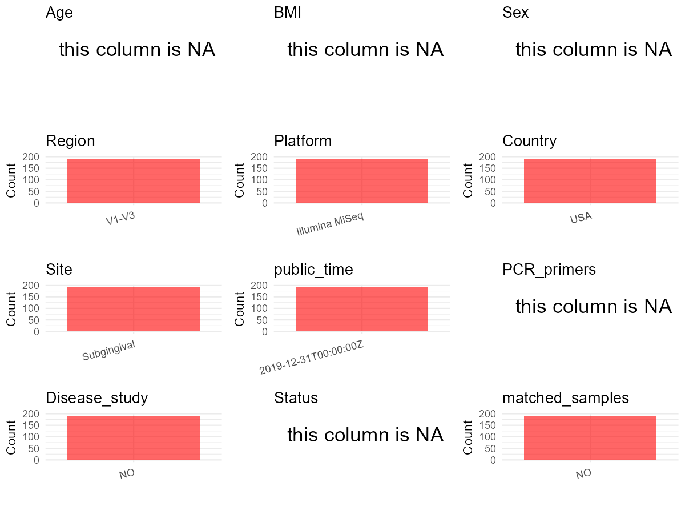

R Notebook: Metadata Processing Workflow
================

# Step 1: Obtain Initial Metadata from Each Project

To obtain the initial metadata: 1. Search for the BioProject ID (e.g.,
“PRJEBXXXX”) on the [NCBI SRA
website](https://www.ncbi.nlm.nih.gov/Traces/study/). 2. In the “Select”
table, click on “Metadata” and download the file. 3. The downloaded file
is typically named “SraRunTable.csv” and contains metadata for the
project.

``` r
# Load necessary libraries
library(dplyr)
library(ggplot2)
library(cowplot)

# Set working directory (update this path to your local directory)
setwd("D:/studylearning/董彪师兄项目/任务3_20251004/PRJNA552608")

# Read the initial metadata files
initial_meta<-read.csv("SraRunTable.csv",header = T)

# Display the first few rows of the metadata
head(initial_meta)
```

    ##          Run Assay.Type AvgSpotLen    Bases  BioProject    BioSample
    ## 1 SRR9654724   AMPLICON        600 23353925 PRJNA552608 SAMN12213982
    ## 2 SRR9654725   AMPLICON        601 15566240 PRJNA552608 SAMN12213983
    ## 3 SRR9654726   AMPLICON        601  8076463 PRJNA552608 SAMN12213984
    ## 4 SRR9654727   AMPLICON        601 24296536 PRJNA552608 SAMN12213985
    ## 5 SRR9654728   AMPLICON        601 16995408 PRJNA552608 SAMN12213986
    ## 6 SRR9654729   AMPLICON        600  3821500 PRJNA552608 SAMN12213987
    ##                BioSampleModel    Bytes               Center.Name
    ## 1 Metagenome or environmental 14585848 UNIVERSITY OF CONNECTICUT
    ## 2 Metagenome or environmental  9220792 UNIVERSITY OF CONNECTICUT
    ## 3 Metagenome or environmental  4776330 UNIVERSITY OF CONNECTICUT
    ## 4 Metagenome or environmental 14336751 UNIVERSITY OF CONNECTICUT
    ## 5 Metagenome or environmental 10402737 UNIVERSITY OF CONNECTICUT
    ## 6 Metagenome or environmental  2491116 UNIVERSITY OF CONNECTICUT
    ##   Collection_Date Consent DATASTORE.filetype DATASTORE.provider
    ## 1              NA  public   fastq,run.zq,sra         gs,ncbi,s3
    ## 2              NA  public   fastq,run.zq,sra         gs,ncbi,s3
    ## 3              NA  public   fastq,run.zq,sra         gs,ncbi,s3
    ## 4              NA  public   fastq,run.zq,sra         gs,ncbi,s3
    ## 5              NA  public   fastq,run.zq,sra         gs,ncbi,s3
    ## 6              NA  public   fastq,run.zq,sra         gs,ncbi,s3
    ##                       DATASTORE.region Experiment geo_loc_name_country
    ## 1 gs.us-east1,ncbi.public,s3.us-east-1 SRX6416250         uncalculated
    ## 2 gs.us-east1,ncbi.public,s3.us-east-1 SRX6416249         uncalculated
    ## 3 gs.us-east1,ncbi.public,s3.us-east-1 SRX6416248         uncalculated
    ## 4 gs.us-east1,ncbi.public,s3.us-east-1 SRX6416247         uncalculated
    ## 5 gs.us-east1,ncbi.public,s3.us-east-1 SRX6416246         uncalculated
    ## 6 gs.us-east1,ncbi.public,s3.us-east-1 SRX6416245         uncalculated
    ##   geo_loc_name_country_continent geo_loc_name         HOST     Instrument
    ## 1                   uncalculated           NA Homo sapiens Illumina MiSeq
    ## 2                   uncalculated           NA Homo sapiens Illumina MiSeq
    ## 3                   uncalculated           NA Homo sapiens Illumina MiSeq
    ## 4                   uncalculated           NA Homo sapiens Illumina MiSeq
    ## 5                   uncalculated           NA Homo sapiens Illumina MiSeq
    ## 6                   uncalculated           NA Homo sapiens Illumina MiSeq
    ##   lat_lon Library.Name LibraryLayout LibrarySelection LibrarySource
    ## 1      NA        B_3_1        PAIRED              PCR   METAGENOMIC
    ## 2      NA        B_3_2        PAIRED              PCR   METAGENOMIC
    ## 3      NA        B_3_3        PAIRED              PCR   METAGENOMIC
    ## 4      NA        B_3_4        PAIRED              PCR   METAGENOMIC
    ## 5      NA        C_1_1        PAIRED              PCR   METAGENOMIC
    ## 6      NA        C_1_2        PAIRED              PCR   METAGENOMIC
    ##                Organism Platform          ReleaseDate          create_date
    ## 1 human oral metagenome ILLUMINA 2019-12-31T00:00:00Z 2019-07-08T15:06:00Z
    ## 2 human oral metagenome ILLUMINA 2019-12-31T00:00:00Z 2019-07-08T15:06:00Z
    ## 3 human oral metagenome ILLUMINA 2019-12-31T00:00:00Z 2019-07-08T15:06:00Z
    ## 4 human oral metagenome ILLUMINA 2019-12-31T00:00:00Z 2019-07-08T15:06:00Z
    ## 5 human oral metagenome ILLUMINA 2019-12-31T00:00:00Z 2019-07-08T15:06:00Z
    ## 6 human oral metagenome ILLUMINA 2019-12-31T00:00:00Z 2019-07-08T15:06:00Z
    ##   version Sample.Name source_material_id SRA.Study
    ## 1       1       B_3_1                 21 SRP213699
    ## 2       1       B_3_2                 22 SRP213699
    ## 3       1       B_3_3                 23 SRP213699
    ## 4       1       B_3_4                 24 SRP213699
    ## 5       1       C_1_1                 25 SRP213699
    ## 6       1       C_1_2                 26 SRP213699

# Step 2: Create a Uniform Metadata Template

The uniform metadata should include the following columns:

1.  **BioProject**: Project ID (e.g., “PRJNA339212”)
2.  **Run**: Sample ID (e.g., “ERRXXXXXX” or “SRRXXXXXX”)
3.  **sample_name**: Original sample name submitted by the authors (not
    the database-assigned ID)
4.  **Age**: Age of the subject (if available)
5.  **BMI**: Body Mass Index (if available)
6.  **Sex**: Sex of the subject (“F” or “M”)
7.  **Region**: Targeted 16S rRNA region (e.g., “V3-V4”)
8.  **Platform**: Sequencing platform (e.g., “Illumina MiSeq”)
9.  **Country**: Country of sample origin (e.g., “China”)
10. **Site**: Sample site (e.g., “saliva”, “dental plaque”)
11. **public_time**: Data release date (format: “YYYY-MM-DD”)
12. **PCR_primers**: PCR primers used (e.g., “515F-806R”)
13. **title**: Title of the associated publication
14. **Disease_study**: Whether the study involves a disease (“YES” or
    “NO”)
15. **Status**: Disease status (e.g., “T2DM”, “HC”). Note: If the study
    includes both disease and healthy samples, this must be specified
    per sample.

``` r
# Create a uniform metadata dataframe
metadata <- data.frame(
  BioProject = initial_meta$BioProject,
  Run = initial_meta$Run,
  sample_name = initial_meta$Sample.Name,
  Age = NA,
  BMI = NA,
  Sex= NA,
  Region = "V1-V3",
  Platform = initial_meta$Instrument,
  Country = "USA",
  Site = "Subgingival",
  public_time = initial_meta$ReleaseDate,
  stringsAsFactors = FALSE
)
```

# Step 3: Manually Add Information from the Publication

Some information (e.g. PCR primers, study title, disease status) must be
manually extracted from the publication and added to the metadata.

``` r
# Add information obtained from the publication
metadata$PCR_primers <- NA_character_  # Update based on the publication
metadata$title <- "Alterations in subgingival microbiota during full-fixed appliance orthodontic treatment—A prospective study"
metadata$Disease_study <- "NO"
metadata$Status <- NA_character_

#extract subject id by remove prefix of sample_name
#metadata$sample_name <- gsub("_st|_sal", "", metadata$sample_name)

# Check initial data distribution
cat("Initial sample distribution:\n")
```

    ## Initial sample distribution:

``` r
table(metadata$sample_name)
```

    ## 
    ## A_1_1 A_1_2 A_1_3 A_1_4 A_2_1 A_2_2 A_2_3 A_2_4 A_3_1 A_3_2 A_3_3 A_3_4 B_1_1 
    ##     1     1     1     1     1     1     1     1     1     1     1     1     1 
    ## B_1_2 B_1_3 B_1_4 B_2_1 B_2_2 B_2_3 B_2_4 B_3_1 B_3_2 B_3_3 B_3_4 C_1_1 C_1_2 
    ##     1     1     1     1     1     1     1     1     1     1     1     1     1 
    ## C_1_3 C_1_4 C_2_1 C_2_2 C_2_3 C_2_4 C_3_1 C_3_2 C_3_3 C_3_4 D_1_1 D_1_2 D_1_3 
    ##     1     1     1     1     1     1     1     1     1     1     1     1     1 
    ## D_1_4 D_2_1 D_2_2 D_2_3 D_2_4 D_3_1 D_3_2 D_3_3 D_3_4 E_1_1 E_1_2 E_1_3 E_1_4 
    ##     1     1     1     1     1     1     1     1     1     1     1     1     1 
    ## E_2_1 E_2_2 E_2_3 E_2_4 E_3_1 E_3_2 E_3_3 E_3_4 F_1_1 F_1_2 F_1_3 F_1_4 F_2_1 
    ##     1     1     1     1     1     1     1     1     1     1     1     1     1 
    ## F_2_2 F_2_3 F_2_4 F_3_1 F_3_2 F_3_3 F_3_4 G_1_1 G_1_2 G_1_3 G_1_4 G_2_1 G_2_2 
    ##     1     1     1     1     1     1     1     1     1     1     1     1     1 
    ## G_2_3 G_2_4 G_3_1 G_3_2 G_3_3 G_3_4 H_1_1 H_1_2 H_1_3 H_1_4 H_2_1 H_2_2 H_2_3 
    ##     1     1     1     1     1     1     1     1     1     1     1     1     1 
    ## H_2_4 H_3_1 H_3_2 H_3_3 H_3_4 I_1_1 I_1_2 I_1_3 I_1_4 I_2_1 I_2_2 I_2_3 I_2_4 
    ##     1     1     1     1     1     1     1     1     1     1     1     1     1 
    ## I_3_1 I_3_2 I_3_3 I_3_4 J_1_1 J_1_2 J_1_3 J_1_4 J_2_1 J_2_2 J_2_3 J_2_4 J_3_1 
    ##     1     1     1     1     1     1     1     1     1     1     1     1     1 
    ## J_3_2 J_3_3 J_3_4 K_1_1 K_1_2 K_1_3 K_1_4 K_2_1 K_2_2 K_2_3 K_2_4 K_3_1 K_3_2 
    ##     1     1     1     1     1     1     1     1     1     1     1     1     1 
    ## K_3_3 K_3_4 L_1_1 L_1_2 L_1_3 L_1_4 L_2_1 L_2_2 L_2_3 L_2_4 L_3_1 L_3_2 L_3_3 
    ##     1     1     1     1     1     1     1     1     1     1     1     1     1 
    ## L_3_4 M_1_1 M_1_2 M_1_3 M_1_4 M_2_1 M_2_2 M_2_3 M_2_4 M_3_1 M_3_2 M_3_3 M_3_4 
    ##     1     1     1     1     1     1     1     1     1     1     1     1     1 
    ## N_1_1 N_1_2 N_1_3 N_1_4 N_2_1 N_2_2 N_2_3 N_2_4 N_3_1 N_3_2 N_3_3 N_3_4 O_1_1 
    ##     1     1     1     1     1     1     1     1     1     1     1     1     1 
    ## O_1_2 O_1_3 O_1_4 O_2_1 O_2_2 O_2_3 O_2_4 O_3_1 O_3_2 O_3_3 O_3_4 P_1_1 P_1_2 
    ##     1     1     1     1     1     1     1     1     1     1     1     1     1 
    ## P_1_3 P_1_4 P_2_1 P_2_2 P_2_3 P_2_4 P_3_1 P_3_2 P_3_3 P_3_4 
    ##     1     1     1     1     1     1     1     1     1     1

``` r
table(metadata$Site)
```

    ## 
    ## Subgingival 
    ##         192

``` r
# Calculate sampling frequency per subject
sample_counts <- table(metadata$sample_name)
cat("\nNumber of samples per subject:\n")
```

    ## 
    ## Number of samples per subject:

``` r
print(sample_counts)
```

    ## 
    ## A_1_1 A_1_2 A_1_3 A_1_4 A_2_1 A_2_2 A_2_3 A_2_4 A_3_1 A_3_2 A_3_3 A_3_4 B_1_1 
    ##     1     1     1     1     1     1     1     1     1     1     1     1     1 
    ## B_1_2 B_1_3 B_1_4 B_2_1 B_2_2 B_2_3 B_2_4 B_3_1 B_3_2 B_3_3 B_3_4 C_1_1 C_1_2 
    ##     1     1     1     1     1     1     1     1     1     1     1     1     1 
    ## C_1_3 C_1_4 C_2_1 C_2_2 C_2_3 C_2_4 C_3_1 C_3_2 C_3_3 C_3_4 D_1_1 D_1_2 D_1_3 
    ##     1     1     1     1     1     1     1     1     1     1     1     1     1 
    ## D_1_4 D_2_1 D_2_2 D_2_3 D_2_4 D_3_1 D_3_2 D_3_3 D_3_4 E_1_1 E_1_2 E_1_3 E_1_4 
    ##     1     1     1     1     1     1     1     1     1     1     1     1     1 
    ## E_2_1 E_2_2 E_2_3 E_2_4 E_3_1 E_3_2 E_3_3 E_3_4 F_1_1 F_1_2 F_1_3 F_1_4 F_2_1 
    ##     1     1     1     1     1     1     1     1     1     1     1     1     1 
    ## F_2_2 F_2_3 F_2_4 F_3_1 F_3_2 F_3_3 F_3_4 G_1_1 G_1_2 G_1_3 G_1_4 G_2_1 G_2_2 
    ##     1     1     1     1     1     1     1     1     1     1     1     1     1 
    ## G_2_3 G_2_4 G_3_1 G_3_2 G_3_3 G_3_4 H_1_1 H_1_2 H_1_3 H_1_4 H_2_1 H_2_2 H_2_3 
    ##     1     1     1     1     1     1     1     1     1     1     1     1     1 
    ## H_2_4 H_3_1 H_3_2 H_3_3 H_3_4 I_1_1 I_1_2 I_1_3 I_1_4 I_2_1 I_2_2 I_2_3 I_2_4 
    ##     1     1     1     1     1     1     1     1     1     1     1     1     1 
    ## I_3_1 I_3_2 I_3_3 I_3_4 J_1_1 J_1_2 J_1_3 J_1_4 J_2_1 J_2_2 J_2_3 J_2_4 J_3_1 
    ##     1     1     1     1     1     1     1     1     1     1     1     1     1 
    ## J_3_2 J_3_3 J_3_4 K_1_1 K_1_2 K_1_3 K_1_4 K_2_1 K_2_2 K_2_3 K_2_4 K_3_1 K_3_2 
    ##     1     1     1     1     1     1     1     1     1     1     1     1     1 
    ## K_3_3 K_3_4 L_1_1 L_1_2 L_1_3 L_1_4 L_2_1 L_2_2 L_2_3 L_2_4 L_3_1 L_3_2 L_3_3 
    ##     1     1     1     1     1     1     1     1     1     1     1     1     1 
    ## L_3_4 M_1_1 M_1_2 M_1_3 M_1_4 M_2_1 M_2_2 M_2_3 M_2_4 M_3_1 M_3_2 M_3_3 M_3_4 
    ##     1     1     1     1     1     1     1     1     1     1     1     1     1 
    ## N_1_1 N_1_2 N_1_3 N_1_4 N_2_1 N_2_2 N_2_3 N_2_4 N_3_1 N_3_2 N_3_3 N_3_4 O_1_1 
    ##     1     1     1     1     1     1     1     1     1     1     1     1     1 
    ## O_1_2 O_1_3 O_1_4 O_2_1 O_2_2 O_2_3 O_2_4 O_3_1 O_3_2 O_3_3 O_3_4 P_1_1 P_1_2 
    ##     1     1     1     1     1     1     1     1     1     1     1     1     1 
    ## P_1_3 P_1_4 P_2_1 P_2_2 P_2_3 P_2_4 P_3_1 P_3_2 P_3_3 P_3_4 
    ##     1     1     1     1     1     1     1     1     1     1

``` r
# Create matched_samples column
metadata$matched_samples <- ifelse(metadata$sample_name %in% names(sample_counts[sample_counts >= 2]), "YES", "NO")

cat("\nMatched samples distribution:\n")
```

    ## 
    ## Matched samples distribution:

``` r
table(metadata$matched_samples)
```

    ## 
    ##  NO 
    ## 192

``` r
# Identify samples for removal: single samples excluding Subgingival 
single_samples <- names(sample_counts[sample_counts == 1])
samples_to_remove <- metadata$sample_name %in% single_samples & !(metadata$Site %in% c("Subgingival"))

cat("\nNumber of samples to be removed:", sum(samples_to_remove), "\n")
```

    ## 
    ## Number of samples to be removed: 0

``` r
# Remove identified samples
metadata_clean <- metadata[!samples_to_remove, ]

cat("\nFinal sample distribution after cleaning:\n")
```

    ## 
    ## Final sample distribution after cleaning:

``` r
table(metadata_clean$sample_name)
```

    ## 
    ## A_1_1 A_1_2 A_1_3 A_1_4 A_2_1 A_2_2 A_2_3 A_2_4 A_3_1 A_3_2 A_3_3 A_3_4 B_1_1 
    ##     1     1     1     1     1     1     1     1     1     1     1     1     1 
    ## B_1_2 B_1_3 B_1_4 B_2_1 B_2_2 B_2_3 B_2_4 B_3_1 B_3_2 B_3_3 B_3_4 C_1_1 C_1_2 
    ##     1     1     1     1     1     1     1     1     1     1     1     1     1 
    ## C_1_3 C_1_4 C_2_1 C_2_2 C_2_3 C_2_4 C_3_1 C_3_2 C_3_3 C_3_4 D_1_1 D_1_2 D_1_3 
    ##     1     1     1     1     1     1     1     1     1     1     1     1     1 
    ## D_1_4 D_2_1 D_2_2 D_2_3 D_2_4 D_3_1 D_3_2 D_3_3 D_3_4 E_1_1 E_1_2 E_1_3 E_1_4 
    ##     1     1     1     1     1     1     1     1     1     1     1     1     1 
    ## E_2_1 E_2_2 E_2_3 E_2_4 E_3_1 E_3_2 E_3_3 E_3_4 F_1_1 F_1_2 F_1_3 F_1_4 F_2_1 
    ##     1     1     1     1     1     1     1     1     1     1     1     1     1 
    ## F_2_2 F_2_3 F_2_4 F_3_1 F_3_2 F_3_3 F_3_4 G_1_1 G_1_2 G_1_3 G_1_4 G_2_1 G_2_2 
    ##     1     1     1     1     1     1     1     1     1     1     1     1     1 
    ## G_2_3 G_2_4 G_3_1 G_3_2 G_3_3 G_3_4 H_1_1 H_1_2 H_1_3 H_1_4 H_2_1 H_2_2 H_2_3 
    ##     1     1     1     1     1     1     1     1     1     1     1     1     1 
    ## H_2_4 H_3_1 H_3_2 H_3_3 H_3_4 I_1_1 I_1_2 I_1_3 I_1_4 I_2_1 I_2_2 I_2_3 I_2_4 
    ##     1     1     1     1     1     1     1     1     1     1     1     1     1 
    ## I_3_1 I_3_2 I_3_3 I_3_4 J_1_1 J_1_2 J_1_3 J_1_4 J_2_1 J_2_2 J_2_3 J_2_4 J_3_1 
    ##     1     1     1     1     1     1     1     1     1     1     1     1     1 
    ## J_3_2 J_3_3 J_3_4 K_1_1 K_1_2 K_1_3 K_1_4 K_2_1 K_2_2 K_2_3 K_2_4 K_3_1 K_3_2 
    ##     1     1     1     1     1     1     1     1     1     1     1     1     1 
    ## K_3_3 K_3_4 L_1_1 L_1_2 L_1_3 L_1_4 L_2_1 L_2_2 L_2_3 L_2_4 L_3_1 L_3_2 L_3_3 
    ##     1     1     1     1     1     1     1     1     1     1     1     1     1 
    ## L_3_4 M_1_1 M_1_2 M_1_3 M_1_4 M_2_1 M_2_2 M_2_3 M_2_4 M_3_1 M_3_2 M_3_3 M_3_4 
    ##     1     1     1     1     1     1     1     1     1     1     1     1     1 
    ## N_1_1 N_1_2 N_1_3 N_1_4 N_2_1 N_2_2 N_2_3 N_2_4 N_3_1 N_3_2 N_3_3 N_3_4 O_1_1 
    ##     1     1     1     1     1     1     1     1     1     1     1     1     1 
    ## O_1_2 O_1_3 O_1_4 O_2_1 O_2_2 O_2_3 O_2_4 O_3_1 O_3_2 O_3_3 O_3_4 P_1_1 P_1_2 
    ##     1     1     1     1     1     1     1     1     1     1     1     1     1 
    ## P_1_3 P_1_4 P_2_1 P_2_2 P_2_3 P_2_4 P_3_1 P_3_2 P_3_3 P_3_4 
    ##     1     1     1     1     1     1     1     1     1     1

``` r
table(metadata_clean$Site)
```

    ## 
    ## Subgingival 
    ##         192

``` r
table(metadata_clean$matched_samples)
```

    ## 
    ##  NO 
    ## 192

``` r
# Use cleaned dataset for subsequent analysis
metadata <- metadata_clean
```

# Step 4: Summarize and Validate the Metadata

``` r
# Check the number of unique runs and sample names
print(paste("Number of unique runs:", length(unique(metadata$Run))))
```

    ## [1] "Number of unique runs: 192"

``` r
print(paste("Number of unique sample names:", length(unique(metadata$sample_name))))
```

    ## [1] "Number of unique sample names: 192"

# Step 5: Visualize the Metadata

``` r

```


# Step 6: Finalize and Export the Metadata

``` r
# Reorder columns to match the desired format
metadata <- metadata[, c(
  "BioProject", "Run", "sample_name", "Age", "BMI", "Sex", 
  "Region", "Platform", "Country", "Site", "public_time", 
  "PCR_primers", "title", "Disease_study", "Status","matched_samples"
)]

# Export the uniform metadata to a CSV file
write.csv(metadata, file = "metadata.csv", quote = FALSE)
head(metadata)
```

    ##    BioProject        Run sample_name Age BMI Sex Region       Platform Country
    ## 1 PRJNA552608 SRR9654724       B_3_1  NA  NA  NA  V1-V3 Illumina MiSeq     USA
    ## 2 PRJNA552608 SRR9654725       B_3_2  NA  NA  NA  V1-V3 Illumina MiSeq     USA
    ## 3 PRJNA552608 SRR9654726       B_3_3  NA  NA  NA  V1-V3 Illumina MiSeq     USA
    ## 4 PRJNA552608 SRR9654727       B_3_4  NA  NA  NA  V1-V3 Illumina MiSeq     USA
    ## 5 PRJNA552608 SRR9654728       C_1_1  NA  NA  NA  V1-V3 Illumina MiSeq     USA
    ## 6 PRJNA552608 SRR9654729       C_1_2  NA  NA  NA  V1-V3 Illumina MiSeq     USA
    ##          Site          public_time PCR_primers
    ## 1 Subgingival 2019-12-31T00:00:00Z        <NA>
    ## 2 Subgingival 2019-12-31T00:00:00Z        <NA>
    ## 3 Subgingival 2019-12-31T00:00:00Z        <NA>
    ## 4 Subgingival 2019-12-31T00:00:00Z        <NA>
    ## 5 Subgingival 2019-12-31T00:00:00Z        <NA>
    ## 6 Subgingival 2019-12-31T00:00:00Z        <NA>
    ##                                                                                                         title
    ## 1 Alterations in subgingival microbiota during full-fixed appliance orthodontic treatment—A prospective study
    ## 2 Alterations in subgingival microbiota during full-fixed appliance orthodontic treatment—A prospective study
    ## 3 Alterations in subgingival microbiota during full-fixed appliance orthodontic treatment—A prospective study
    ## 4 Alterations in subgingival microbiota during full-fixed appliance orthodontic treatment—A prospective study
    ## 5 Alterations in subgingival microbiota during full-fixed appliance orthodontic treatment—A prospective study
    ## 6 Alterations in subgingival microbiota during full-fixed appliance orthodontic treatment—A prospective study
    ##   Disease_study Status matched_samples
    ## 1            NO   <NA>              NO
    ## 2            NO   <NA>              NO
    ## 3            NO   <NA>              NO
    ## 4            NO   <NA>              NO
    ## 5            NO   <NA>              NO
    ## 6            NO   <NA>              NO

## Notes for Students:

1.  **Metadata Accuracy**: Always cross-check the metadata with the
    original publication to ensure accuracy.
2.  **Manual Entries**: Columns like `PCR_primers`, and `Status` often
    require manual entry based on the publication.
3.  **Disease Status**: Be careful when assigning `Status`—some studies
    include both disease and healthy samples.
4.  **Visualization**: The plots help quickly identify the distribution
    of values in each column, which is useful for quality control.
5.  **Reproducibility**: Update the working directory and file paths to
    match your local environment.
