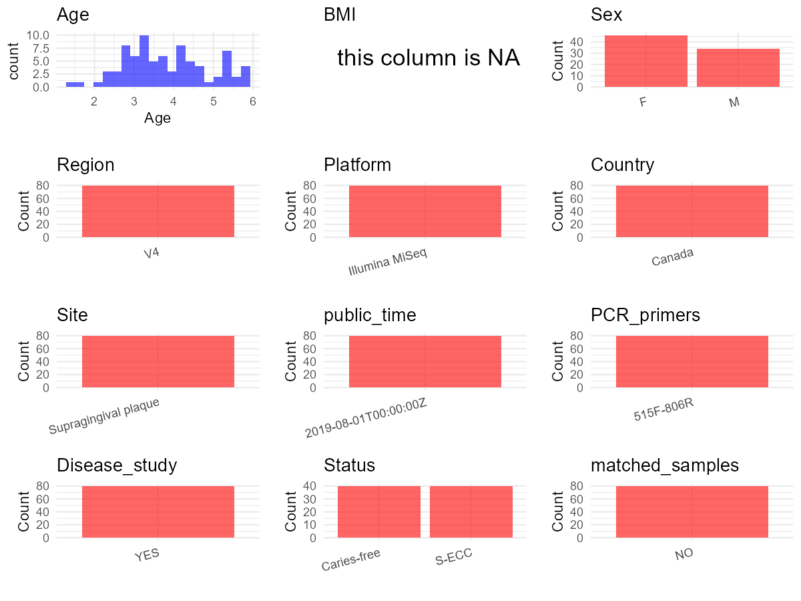

# Step 1: Obtain Initial Metadata from Each Project

To obtain the initial metadata: 1. Search for the BioProject ID (e.g.,
“PRJEBXXXX”) on the [NCBI SRA
website](https://www.ncbi.nlm.nih.gov/Traces/study/). 2. In the “Select”
table, click on “Metadata” and download the file. 3. The downloaded file
is typically named “SraRunTable.csv” and contains metadata for the
project.

    library(tidyverse)
    library(ggplot2)
    library(cowplot)

    setwd("C:/Users/zyc/Desktop/oral_project/PRJNA555320")
    initial_meta <- read.csv("SraRunTable.csv", header = TRUE) 
    head(initial_meta)

    ##          Run Assay.Type AvgSpotLen    Bases  BioProject    BioSample              BioSampleModel    Bytes            Center.Name       Collection_Date
    ## 1 SRR9712101   AMPLICON        500 48941500 PRJNA555320 SAMN12315831 Metagenome or environmental 33731586 UNIVERSITY OF MANITOBA 2017-12-13/2018-08-14
    ## 2 SRR9712102   AMPLICON        500 53358500 PRJNA555320 SAMN12315832 Metagenome or environmental 36837880 UNIVERSITY OF MANITOBA 2017-12-13/2018-08-14
    ## 3 SRR9712103   AMPLICON        500 61944500 PRJNA555320 SAMN12315829 Metagenome or environmental 42734452 UNIVERSITY OF MANITOBA 2017-12-13/2018-08-14
    ## 4 SRR9712104   AMPLICON        500 52753500 PRJNA555320 SAMN12315830 Metagenome or environmental 35919270 UNIVERSITY OF MANITOBA 2017-12-13/2018-08-14
    ## 5 SRR9712105   AMPLICON        500 53674000 PRJNA555320 SAMN12315827 Metagenome or environmental 36352205 UNIVERSITY OF MANITOBA 2017-12-13/2018-08-14
    ## 6 SRR9712106   AMPLICON        500 61955000 PRJNA555320 SAMN12315828 Metagenome or environmental 42090802 UNIVERSITY OF MANITOBA 2017-12-13/2018-08-14
    ##   Consent DATASTORE.filetype DATASTORE.provider                     DATASTORE.region Experiment geo_loc_name_country geo_loc_name_country_continent
    ## 1  public         run.zq,sra         gs,ncbi,s3 gs.us-east1,ncbi.public,s3.us-east-1 SRX6470174               Canada                  North America
    ## 2  public         run.zq,sra         gs,ncbi,s3 gs.us-east1,ncbi.public,s3.us-east-1 SRX6470173               Canada                  North America
    ## 3  public         run.zq,sra         gs,ncbi,s3 gs.us-east1,ncbi.public,s3.us-east-1 SRX6470172               Canada                  North America
    ## 4  public         run.zq,sra         gs,ncbi,s3 gs.us-east1,ncbi.public,s3.us-east-1 SRX6470171               Canada                  North America
    ## 5  public         run.zq,sra         gs,ncbi,s3 gs.us-east1,ncbi.public,s3.us-east-1 SRX6470170               Canada                  North America
    ## 6  public         run.zq,sra         gs,ncbi,s3 gs.us-east1,ncbi.public,s3.us-east-1 SRX6470169               Canada                  North America
    ##       geo_loc_name Host_disease         HOST host_sex     Instrument         lat_lon    Library.Name LibraryLayout LibrarySelection LibrarySource
    ## 1 Canada: Winnipeg  Caries-free Homo sapiens   female Illumina MiSeq 49.89 N 97.14 W 16S_FLD0110.P62        PAIRED              PCR   METAGENOMIC
    ## 2 Canada: Winnipeg  Caries-free Homo sapiens   female Illumina MiSeq 49.89 N 97.14 W 16S_FLD0118.P63        PAIRED              PCR   METAGENOMIC
    ## 3 Canada: Winnipeg  Caries-free Homo sapiens     male Illumina MiSeq 49.89 N 97.14 W 16S_FLD0189.P60        PAIRED              PCR   METAGENOMIC
    ## 4 Canada: Winnipeg  Caries-free Homo sapiens     male Illumina MiSeq 49.89 N 97.14 W 16S_FLD0102.P61        PAIRED              PCR   METAGENOMIC
    ## 5 Canada: Winnipeg  Caries-free Homo sapiens   female Illumina MiSeq 49.89 N 97.14 W 16S_FLD0181.P59        PAIRED              PCR   METAGENOMIC
    ## 6 Canada: Winnipeg        S-ECC Homo sapiens   female Illumina MiSeq 49.89 N 97.14 W  16S_FLD0137.P6        PAIRED              PCR   METAGENOMIC
    ##          Organism Platform          ReleaseDate          create_date version     Sample.Name SRA.Study env_broad_scale env_local_scale env_medium Host_Age
    ## 1 oral metagenome ILLUMINA 2019-08-01T00:00:00Z 2019-07-22T12:07:00Z       3 16S_FLD0110.P62 SRP215323                                                  NA
    ## 2 oral metagenome ILLUMINA 2019-08-01T00:00:00Z 2019-07-22T12:06:00Z       3 16S_FLD0118.P63 SRP215323                                                  NA
    ## 3 oral metagenome ILLUMINA 2019-08-01T00:00:00Z 2019-07-22T12:06:00Z       3 16S_FLD0189.P60 SRP215323                                                  NA
    ## 4 oral metagenome ILLUMINA 2019-08-01T00:00:00Z 2019-07-22T12:06:00Z       3 16S_FLD0102.P61 SRP215323                                                  NA
    ## 5 oral metagenome ILLUMINA 2019-08-01T00:00:00Z 2019-07-22T12:06:00Z       3 16S_FLD0181.P59 SRP215323                                                  NA
    ## 6 oral metagenome ILLUMINA 2019-08-01T00:00:00Z 2019-07-22T12:06:00Z       3  16S_FLD0137.P6 SRP215323                                                  NA
    ##   host_subject_id sequencing_run Barcode_ID host_age_in_months     isolation_source
    ## 1                                   FLD0110                 51 Supragingival plaque
    ## 2                                   FLD0118                 69 Supragingival plaque
    ## 3                                   FLD0189                 18 Supragingival plaque
    ## 4                                   FLD0102                 44 Supragingival plaque
    ## 5                                   FLD0181                 20 Supragingival plaque
    ## 6                                   FLD0137                 68 Supragingival plaque

# Step 2: Create a Uniform Metadata Template

The uniform metadata should include the following columns:

1.  **BioProject**: Project ID (e.g., “PRJNA339212”)
2.  **Run**: Sample ID (e.g., “ERRXXXXXX” or “SRRXXXXXX”)
3.  **sample\_name**: Original sample name submitted by the authors (not
    the database-assigned ID)
4.  **Age**: Age of the subject (if available)
5.  **BMI**: Body Mass Index (if available)
6.  **Sex**: Sex of the subject (“F” or “M”)
7.  **Region**: Targeted 16S rRNA region (e.g., “V3-V4”)
8.  **Platform**: Sequencing platform (e.g., “Illumina MiSeq”)
9.  **Country**: Country of sample origin (e.g., “China”)
10. **Site**: Sample site (e.g., “saliva”, “dental plaque”)
11. **public\_time**: Data release date (format: “YYYY-MM-DD”)
12. **PCR\_primers**: PCR primers used (e.g., “515F-806R”)
13. **title**: Title of the associated publication
14. **Disease\_study**: Whether the study involves a disease (“YES” or
    “NO”)
15. **Status**: Disease status (e.g., “T2DM”, “HC”). Note: If the study
    includes both disease and healthy samples, this must be specified
    per sample.
16. **matched\_samples**: matched samples (“YES” or “NO”)

<!-- -->

    metadata <- data.frame(
      BioProject = initial_meta$BioProject,
      Run = initial_meta$Run,
      sample_name = initial_meta$Sample.Name,
      Age = initial_meta$host_age_in_months, 
      BMI = NA,  
      Sex = initial_meta$host_sex,
      Platform = initial_meta$Instrument,
      Country = initial_meta$geo_loc_name_country,
      Status = initial_meta$Host_disease,
      Site = initial_meta$isolation_source,
      public_time = initial_meta$ReleaseDate,
      stringsAsFactors = FALSE
    )

# Step 3: Manually Add Information from the Publication

Some information (e.g. PCR primers, study title, disease status) must be
manually extracted from the publication and added to the metadata.

     metadata <- metadata %>%filter(Site == "Supragingival plaque")%>% filter(grepl("16S",sample_name))

     metadata <- metadata %>%
      mutate(Sex = recode(Sex, "female" = "F", "male" = "M"))
     metadata <- metadata %>%mutate(Age = Age/12)

    metadata$matched_samples = "NO"
    metadata$Region = "V4"
    metadata$title <- "Characterization of Supragingival Plaque and Oral Swab Microbiomes in Children With Severe Early Childhood Caries"
    metadata$Disease_study <- "YES"
    metadata$PCR_primers <- "515F-806R"
    head(metadata)

    ##    BioProject        Run     sample_name      Age BMI Sex       Platform Country      Status                 Site          public_time matched_samples
    ## 1 PRJNA555320 SRR9712101 16S_FLD0110.P62 4.250000  NA   F Illumina MiSeq  Canada Caries-free Supragingival plaque 2019-08-01T00:00:00Z              NO
    ## 2 PRJNA555320 SRR9712102 16S_FLD0118.P63 5.750000  NA   F Illumina MiSeq  Canada Caries-free Supragingival plaque 2019-08-01T00:00:00Z              NO
    ## 3 PRJNA555320 SRR9712103 16S_FLD0189.P60 1.500000  NA   M Illumina MiSeq  Canada Caries-free Supragingival plaque 2019-08-01T00:00:00Z              NO
    ## 4 PRJNA555320 SRR9712104 16S_FLD0102.P61 3.666667  NA   M Illumina MiSeq  Canada Caries-free Supragingival plaque 2019-08-01T00:00:00Z              NO
    ## 5 PRJNA555320 SRR9712105 16S_FLD0181.P59 1.666667  NA   F Illumina MiSeq  Canada Caries-free Supragingival plaque 2019-08-01T00:00:00Z              NO
    ## 6 PRJNA555320 SRR9712106  16S_FLD0137.P6 5.666667  NA   F Illumina MiSeq  Canada       S-ECC Supragingival plaque 2019-08-01T00:00:00Z              NO
    ##   Region                                                                                                             title Disease_study PCR_primers
    ## 1     V4 Characterization of Supragingival Plaque and Oral Swab Microbiomes in Children With Severe Early Childhood Caries           YES   515F-806R
    ## 2     V4 Characterization of Supragingival Plaque and Oral Swab Microbiomes in Children With Severe Early Childhood Caries           YES   515F-806R
    ## 3     V4 Characterization of Supragingival Plaque and Oral Swab Microbiomes in Children With Severe Early Childhood Caries           YES   515F-806R
    ## 4     V4 Characterization of Supragingival Plaque and Oral Swab Microbiomes in Children With Severe Early Childhood Caries           YES   515F-806R
    ## 5     V4 Characterization of Supragingival Plaque and Oral Swab Microbiomes in Children With Severe Early Childhood Caries           YES   515F-806R
    ## 6     V4 Characterization of Supragingival Plaque and Oral Swab Microbiomes in Children With Severe Early Childhood Caries           YES   515F-806R

# Step 4: Summarize and Validate the Metadata

    print(paste("Number of unique runs:", length(unique(metadata$Run))))

    ## [1] "Number of unique runs: 80"

    print(paste("Number of unique sample names:", length(unique(metadata$sample_name))))

    ## [1] "Number of unique sample names: 80"

# Step 5: Visualize the Metadata

    plot_data <- metadata %>%
      select(-BioProject, -Run, -sample_name, -title)

    # Function to create simple plots for each column
    create_simple_plots <- function(data) {
      plots <- list()
      
      for (col in colnames(data)) {
        # Check if the column is all NA
        if (all(is.na(data[[col]]))) {
          # Create an empty plot with text indicating all NA
          p <- ggplot() +
            annotate("text", x = 0.5, y = 0.5, label = "this column is NA", size = 6) +
            labs(title = col) +
            theme_void()
        } else if (is.numeric(data[[col]])) {
          # Numeric variable: histogram
          p <- ggplot(data, aes(x = .data[[col]])) +
            geom_histogram(fill = "blue", alpha = 0.6, bins = 20, na.rm = T) +
            labs(title = col) +
            theme_minimal()
        } else {
          # Categorical variable: bar plot (remove NA values)
          count_data <- as.data.frame(table(data[[col]], useNA = "ifany"))
          p <- ggplot(count_data, aes(x = reorder(Var1, -Freq), y = Freq)) +
            geom_col(fill = "red", alpha = 0.6) +
            labs(title = col, x = NULL, y = "Count") +
            theme_minimal() +
            theme(axis.text.x = element_text(angle = 15, hjust = 1))
        }
        plots[[col]] <- p
      }
      
      return(plots)
    }

    plots <- create_simple_plots(plot_data)
    p<-plot_grid(plots$Age, 
              plots$BMI, 
              plots$Sex, 
              plots$Region, 
              plots$Platform, 
              plots$Country, 
              plots$Site,
              plots$public_time, 
              plots$PCR_primers,
              plots$Disease_study,
              plots$Status,
              plots$matched_samples,# add 
              ncol = 3, align = "hv", axis = "lb")
    ggsave("Metadata_Summary.png", plot = p, width = 8, height = 6, dpi = 150)

    

 \# Step 6: Finalize and Export the Metadata

    metadata <- metadata[, c(
      "BioProject", "Run", "sample_name", "Age", "BMI", "Sex", 
      "Region", "Platform", "Country", "Site", "public_time", 
      "PCR_primers", "title", "Disease_study", "Status","matched_samples"
    )]

    write.csv(metadata, file = "metadata.csv", quote = FALSE)
