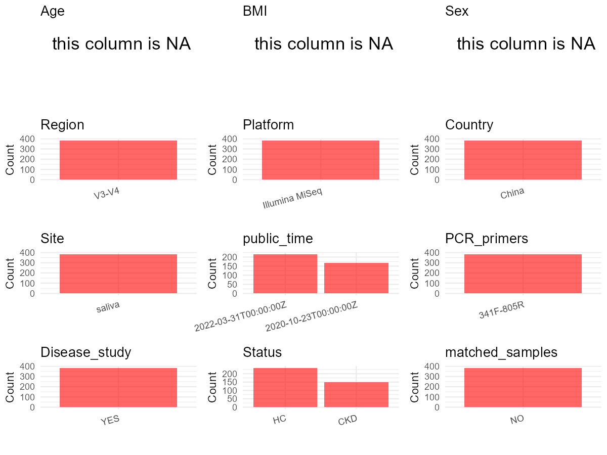

R Notebook: Metadata Processing Workflow
================

# Step 1: Obtain Initial Metadata from Each Project

To obtain the initial metadata: 1. Search for the BioProject ID (e.g.,
“PRJEBXXXX”) on the [NCBI SRA
website](https://www.ncbi.nlm.nih.gov/Traces/study/). 2. In the “Select”
table, click on “Metadata” and download the file. 3. The downloaded file
is typically named “SraRunTable.csv” and contains metadata for the
project.

``` r
# Load necessary libraries
library(dplyr)
library(ggplot2)
library(cowplot)

# Set working directory (update this path to your local directory)
setwd("E:/bioproject_YL/PRJNA557511")

# Read the initial metadata files
initial_meta <- read.csv("SraRunTable.csv", header = T) 

# Display the first few rows of the metadata
head(initial_meta)
```

    ##           Run Assay.Type AvgSpotLen    Bases  BioProject    BioSample
    ## 1 SRR11185924   AMPLICON        598 28954060 PRJNA557511 SAMN14209539
    ## 2 SRR11185925   AMPLICON        598 26032594 PRJNA557511 SAMN14209538
    ## 3 SRR11185926   AMPLICON        598 28690917 PRJNA557511 SAMN14209537
    ## 4 SRR11185927   AMPLICON        598 26246533 PRJNA557511 SAMN14209536
    ## 5 SRR11185928   AMPLICON        598 26178844 PRJNA557511 SAMN14209535
    ## 6 SRR11185929   AMPLICON        598 30480355 PRJNA557511 SAMN14209534
    ##                BioSampleModel    Bytes
    ## 1 Metagenome or environmental 16041460
    ## 2 Metagenome or environmental 13874110
    ## 3 Metagenome or environmental 15579731
    ## 4 Metagenome or environmental 14042537
    ## 5 Metagenome or environmental 14098035
    ## 6 Metagenome or environmental 16438793
    ##                                             Center.Name Collection_Date Consent
    ## 1 THE FIRST AFFILIATED HOSPITAL OF ZHENGZHOU UNIVERSITY          Jan-19  public
    ## 2 THE FIRST AFFILIATED HOSPITAL OF ZHENGZHOU UNIVERSITY          May-19  public
    ## 3 THE FIRST AFFILIATED HOSPITAL OF ZHENGZHOU UNIVERSITY          May-19  public
    ## 4 THE FIRST AFFILIATED HOSPITAL OF ZHENGZHOU UNIVERSITY          May-19  public
    ## 5 THE FIRST AFFILIATED HOSPITAL OF ZHENGZHOU UNIVERSITY          May-19  public
    ## 6 THE FIRST AFFILIATED HOSPITAL OF ZHENGZHOU UNIVERSITY          May-19  public
    ##   DATASTORE.filetype DATASTORE.provider                     DATASTORE.region
    ## 1   fastq,run.zq,sra         gs,ncbi,s3 gs.us-east1,ncbi.public,s3.us-east-1
    ## 2   fastq,run.zq,sra         gs,ncbi,s3 gs.us-east1,ncbi.public,s3.us-east-1
    ## 3   fastq,run.zq,sra         gs,ncbi,s3 gs.us-east1,ncbi.public,s3.us-east-1
    ## 4   fastq,run.zq,sra         gs,ncbi,s3 gs.us-east1,ncbi.public,s3.us-east-1
    ## 5   fastq,run.zq,sra         gs,ncbi,s3 gs.us-east1,ncbi.public,s3.us-east-1
    ## 6   fastq,run.zq,sra         gs,ncbi,s3 gs.us-east1,ncbi.public,s3.us-east-1
    ##   Experiment geo_loc_name_country geo_loc_name_country_continent
    ## 1 SRX7806472                China                           Asia
    ## 2 SRX7806471                China                           Asia
    ## 3 SRX7806470                China                           Asia
    ## 4 SRX7806469                China                           Asia
    ## 5 SRX7806468                China                           Asia
    ## 6 SRX7806467                China                           Asia
    ##      geo_loc_name   HOST     Instrument isolation_source          lat_lon
    ## 1 China:Zhengzhou AIH_39 Illumina MiSeq           saliva 34.44 N 113.42 E
    ## 2 China:Zhengzhou AIH_38 Illumina MiSeq           saliva 34.44 N 113.42 E
    ## 3 China:Zhengzhou AIH_37 Illumina MiSeq           saliva 34.44 N 113.42 E
    ## 4 China:Zhengzhou AIH_36 Illumina MiSeq           saliva 34.44 N 113.42 E
    ## 5 China:Zhengzhou AIH_35 Illumina MiSeq           saliva 34.44 N 113.42 E
    ## 6 China:Zhengzhou AIH_34 Illumina MiSeq           saliva 34.44 N 113.42 E
    ##     Library.Name LibraryLayout LibrarySelection LibrarySource
    ## 1 ZZ_ORAL_AIH_39        PAIRED              PCR         OTHER
    ## 2 ZZ_ORAL_AIH_38        PAIRED              PCR         OTHER
    ## 3 ZZ_ORAL_AIH_37        PAIRED              PCR         OTHER
    ## 4 ZZ_ORAL_AIH_36        PAIRED              PCR         OTHER
    ## 5 ZZ_ORAL_AIH_35        PAIRED              PCR         OTHER
    ## 6 ZZ_ORAL_AIH_34        PAIRED              PCR         OTHER
    ##                Organism Platform          ReleaseDate          create_date
    ## 1 human oral metagenome ILLUMINA 2022-03-31T00:00:00Z 2020-02-26T13:06:00Z
    ## 2 human oral metagenome ILLUMINA 2022-03-31T00:00:00Z 2020-02-26T13:06:00Z
    ## 3 human oral metagenome ILLUMINA 2022-03-31T00:00:00Z 2020-02-26T13:06:00Z
    ## 4 human oral metagenome ILLUMINA 2022-03-31T00:00:00Z 2020-02-26T13:07:00Z
    ## 5 human oral metagenome ILLUMINA 2022-03-31T00:00:00Z 2020-02-26T13:07:00Z
    ## 6 human oral metagenome ILLUMINA 2022-03-31T00:00:00Z 2020-02-26T13:07:00Z
    ##   version    Sample.Name SRA.Study
    ## 1       1 ZZ_ORAL_AIH_39 SRP223308
    ## 2       1 ZZ_ORAL_AIH_38 SRP223308
    ## 3       1 ZZ_ORAL_AIH_37 SRP223308
    ## 4       1 ZZ_ORAL_AIH_36 SRP223308
    ## 5       1 ZZ_ORAL_AIH_35 SRP223308
    ## 6       1 ZZ_ORAL_AIH_34 SRP223308

# Step 2: Create a Uniform Metadata Template

The uniform metadata should include the following columns:

1.  **BioProject**: Project ID (e.g., “PRJNA339212”)
2.  **Run**: Sample ID (e.g., “ERRXXXXXX” or “SRRXXXXXX”)
3.  **sample_name**: Original sample name submitted by the authors (not
    the database-assigned ID)
4.  **Age**: Age of the subject (if available)
5.  **BMI**: Body Mass Index (if available)
6.  **Sex**: Sex of the subject (“F” or “M”)
7.  **Region**: Targeted 16S rRNA region (e.g., “V3-V4”)
8.  **Platform**: Sequencing platform (e.g., “Illumina MiSeq”)
9.  **Country**: Country of sample origin (e.g., “China”)
10. **Site**: Sample site (e.g., “saliva”, “dental plaque”)
11. **public_time**: Data release date (format: “YYYY-MM-DD”)
12. **PCR_primers**: PCR primers used (e.g., “515F-806R”)
13. **title**: Title of the associated publication
14. **Disease_study**: Whether the study involves a disease (“YES” or
    “NO”)
15. **Status**: Disease status (e.g., “T2DM”, “HC”). Note: If the study
    includes both disease and healthy samples, this must be specified
    per sample.
16. **matched_samples**: matched samples (“YES” or “NO”)

``` r
# Create a uniform metadata dataframe
metadata<-data.frame(
  BioProject=initial_meta$BioProject,
  Run=initial_meta$Run,
  sample_name=initial_meta$HOST,
  Age = NA, 
  BMI = NA, 
  Sex = NA,  
  Region = "V3-V4",
  Platform=initial_meta$Instrument,
  Country=initial_meta$geo_loc_name_country,
  Site=initial_meta$isolation_source,
  public_time=initial_meta$ReleaseDate,
  Status=initial_meta$Library.Name,
  stringsAsFactors = FALSE
)
```

# Step 3: Manually Add Information from the Publication

Some information (e.g. PCR primers, study title, disease status) must be
manually extracted from the publication and added to the metadata.

``` r
# Add information obtained from the publication
metadata$PCR_primers <- "341F-805R"
metadata$title <- "Characteristics of human oral microbiome and its non-invasive diagnostic value in chronic kidney disease"
metadata$Disease_study <- "YES"
# Assign disease status based on sample_name patterns
metadata <- metadata %>%
  mutate(Status = case_when(
      grepl("HC", Status) ~ "HC",
      TRUE ~ "CKD"))

# Check initial data distribution
cat("Initial sample distribution:\n")
```

    ## Initial sample distribution:

``` r
table(metadata$sample_name)
```

    ## 
    ##     AIH_1    AIH_10    AIH_11    AIH_12    AIH_13    AIH_15    AIH_16    AIH_17 
    ##         1         1         1         1         1         1         1         1 
    ##    AIH_18    AIH_19     AIH_2    AIH_20    AIH_21    AIH_22    AIH_23    AIH_24 
    ##         1         1         1         1         1         1         1         1 
    ##    AIH_25    AIH_26    AIH_27    AIH_28    AIH_29     AIH_3    AIH_30    AIH_31 
    ##         1         1         1         1         1         1         1         1 
    ##    AIH_32    AIH_33    AIH_34    AIH_35    AIH_36    AIH_37    AIH_38    AIH_39 
    ##         1         1         1         1         1         1         1         1 
    ##     AIH_4    AIH_40    AIH_41    AIH_42    AIH_43    AIH_44    AIH_45    AIH_46 
    ##         1         1         1         1         1         1         1         1 
    ##    AIH_47    AIH_48    AIH_49     AIH_5    AIH_50    AIH_51    AIH_52    AIH_53 
    ##         1         1         1         1         1         1         1         1 
    ##    AIH_54    AIH_55    AIH_56    AIH_57    AIH_58    AIH_59     AIH_6    AIH_60 
    ##         1         1         1         1         1         1         1         1 
    ##    AIH_61    AIH_62    AIH_63    AIH_64    AIH_65    AIH_66    AIH_67    AIH_68 
    ##         1         1         1         1         1         1         1         1 
    ##    AIH_69     AIH_7     AIH_8     AIH_9      HC_1    HC_103    HC_104    HC_105 
    ##         1         1         1         1         1         1         1         1 
    ##    HC_106    HC_108    HC_109    HC_110    HC_111    HC_112    HC_114    HC_115 
    ##         1         1         1         1         1         1         1         1 
    ##    HC_116    HC_117    HC_118    HC_119    HC_120    HC_122    HC_126    HC_128 
    ##         1         1         1         1         1         1         1         1 
    ##    HC_129     HC_13    HC_130    HC_131    HC_134    HC_135    HC_136    HC_137 
    ##         1         1         1         1         1         1         1         1 
    ##    HC_138    HC_139     HC_14    HC_140    HC_142    HC_143    HC_144    HC_145 
    ##         1         1         1         1         1         1         1         1 
    ##    HC_147    HC_148    HC_149    HC_150    HC_152    HC_153    HC_154    HC_156 
    ##         1         1         1         1         1         1         1         1 
    ##    HC_157    HC_159    HC_160    HC_161    HC_162    HC_163    HC_164    HC_166 
    ##         1         1         1         1         1         1         1         1 
    ##    HC_167    HC_168    HC_169     HC_17    HC_171    HC_173    HC_174    HC_176 
    ##         1         1         1         1         1         1         1         1 
    ##    HC_177    HC_179     HC_18    HC_180    HC_181    HC_182    HC_183    HC_184 
    ##         1         1         1         1         1         1         1         1 
    ##    HC_185    HC_186     HC_19     HC_20     HC_21     HC_22     HC_23     HC_24 
    ##         1         1         1         1         1         1         1         1 
    ##     HC_25     HC_26     HC_27     HC_28     HC_29      HC_3     HC_30     HC_32 
    ##         1         1         1         1         1         1         1         1 
    ##     HC_33     HC_34     HC_35     HC_38     HC_39      HC_4     HC_40     HC_41 
    ##         1         1         1         1         1         1         1         1 
    ##     HC_42     HC_43     HC_45     HC_47     HC_48     HC_49      HC_5     HC_50 
    ##         1         1         1         1         1         1         1         1 
    ##     HC_53     HC_54     HC_55     HC_56     HC_57     HC_58      HC_6     HC_60 
    ##         1         1         1         1         1         1         1         1 
    ##     HC_62     HC_65     HC_66     HC_68     HC_69     HC_70     HC_71     HC_72 
    ##         1         1         1         1         1         1         1         1 
    ##     HC_73     HC_75     HC_78     HC_79      HC_8     HC_80     HC_82     HC_83 
    ##         1         1         1         1         1         1         1         1 
    ##     HC_84     HC_85     HC_87     HC_88     HC_90     HC_92     HC_93     HC_94 
    ##         1         1         1         1         1         1         1         1 
    ##     HC_95     HC_96     HC_97     HC_98   hzAIH_1  hzAIH_10  hzAIH_11  hzAIH_12 
    ##         1         1         1         1         1         1         1         1 
    ##   hzAIH_2   hzAIH_3   hzAIH_4   hzAIH_5   hzAIH_6   hzAIH_7   hzAIH_8   hzAIH_9 
    ##         1         1         1         1         1         1         1         1 
    ## Sample001 Sample002 Sample003 Sample004 Sample005 Sample006 Sample007 Sample008 
    ##         1         1         1         1         1         1         1         1 
    ## Sample009 Sample010 Sample011 Sample012 Sample013 Sample014 Sample015 Sample016 
    ##         1         1         1         1         1         1         1         1 
    ## Sample017 Sample018 Sample019 Sample020 Sample021 Sample022 Sample023 Sample024 
    ##         1         1         1         1         1         1         1         1 
    ## Sample025 Sample026 Sample027 Sample028 Sample029 Sample030 Sample031 Sample032 
    ##         1         1         1         1         1         1         1         1 
    ## Sample033 Sample034 Sample035 Sample036 Sample037 Sample038 Sample039 Sample040 
    ##         1         1         1         1         1         1         1         1 
    ## Sample041 Sample042 Sample043 Sample044 Sample045 Sample046 Sample047 Sample048 
    ##         1         1         1         1         1         1         1         1 
    ## Sample049 Sample050 Sample051 Sample052 Sample053 Sample054 Sample055 Sample056 
    ##         1         1         1         1         1         1         1         1 
    ## Sample057 Sample058 Sample059 Sample060 Sample061 Sample062 Sample063 Sample064 
    ##         1         1         1         1         1         1         1         1 
    ## Sample065 Sample066 Sample067 Sample068 Sample069 Sample070 Sample071 Sample072 
    ##         1         1         1         1         1         1         1         1 
    ## Sample073 Sample074 Sample075 Sample076 Sample077 Sample078 Sample079 Sample080 
    ##         1         1         1         1         1         1         1         1 
    ## Sample081 Sample082 Sample083 Sample084 Sample085 Sample086 Sample087 Sample088 
    ##         1         1         1         1         1         1         1         1 
    ## Sample089 Sample090 Sample091 Sample092 Sample093 Sample094 Sample095 Sample096 
    ##         1         1         1         1         1         1         1         1 
    ## Sample097 Sample098 Sample099 Sample100 Sample101 Sample102 Sample103 Sample104 
    ##         1         1         1         1         1         1         1         1 
    ## Sample105 Sample106 Sample107 Sample108 Sample109 Sample110 Sample111 Sample112 
    ##         1         1         1         1         1         1         1         1 
    ## Sample113 Sample114 Sample115 Sample116 Sample117 Sample118 Sample119 Sample120 
    ##         1         1         1         1         1         1         1         1 
    ## Sample121 Sample122 Sample123 Sample124 Sample125 Sample126 Sample127 Sample128 
    ##         1         1         1         1         1         1         1         1 
    ## Sample129 Sample130 Sample131 Sample132 Sample133 Sample134 Sample135 Sample136 
    ##         1         1         1         1         1         1         1         1 
    ## Sample137 Sample138 Sample139 Sample140 Sample141 Sample142 Sample143 Sample144 
    ##         1         1         1         1         1         1         1         1 
    ## Sample145 Sample146 Sample147 Sample148 Sample149 Sample150 Sample151 Sample152 
    ##         1         1         1         1         1         1         1         1 
    ## Sample153 Sample154 Sample155 Sample156 Sample157 Sample158 Sample159 Sample160 
    ##         1         1         1         1         1         1         1         1 
    ## Sample161 Sample162 Sample163 Sample164 Sample165 Sample166 Sample167 Sample168 
    ##         1         1         1         1         1         1         1         1

``` r
table(metadata$Site)
```

    ## 
    ## saliva 
    ##    384

``` r
# Calculate sampling frequency per subject
sample_counts <- table(metadata$sample_name)
cat("\nNumber of samples per subject:\n")
```

    ## 
    ## Number of samples per subject:

``` r
print(sample_counts)
```

    ## 
    ##     AIH_1    AIH_10    AIH_11    AIH_12    AIH_13    AIH_15    AIH_16    AIH_17 
    ##         1         1         1         1         1         1         1         1 
    ##    AIH_18    AIH_19     AIH_2    AIH_20    AIH_21    AIH_22    AIH_23    AIH_24 
    ##         1         1         1         1         1         1         1         1 
    ##    AIH_25    AIH_26    AIH_27    AIH_28    AIH_29     AIH_3    AIH_30    AIH_31 
    ##         1         1         1         1         1         1         1         1 
    ##    AIH_32    AIH_33    AIH_34    AIH_35    AIH_36    AIH_37    AIH_38    AIH_39 
    ##         1         1         1         1         1         1         1         1 
    ##     AIH_4    AIH_40    AIH_41    AIH_42    AIH_43    AIH_44    AIH_45    AIH_46 
    ##         1         1         1         1         1         1         1         1 
    ##    AIH_47    AIH_48    AIH_49     AIH_5    AIH_50    AIH_51    AIH_52    AIH_53 
    ##         1         1         1         1         1         1         1         1 
    ##    AIH_54    AIH_55    AIH_56    AIH_57    AIH_58    AIH_59     AIH_6    AIH_60 
    ##         1         1         1         1         1         1         1         1 
    ##    AIH_61    AIH_62    AIH_63    AIH_64    AIH_65    AIH_66    AIH_67    AIH_68 
    ##         1         1         1         1         1         1         1         1 
    ##    AIH_69     AIH_7     AIH_8     AIH_9      HC_1    HC_103    HC_104    HC_105 
    ##         1         1         1         1         1         1         1         1 
    ##    HC_106    HC_108    HC_109    HC_110    HC_111    HC_112    HC_114    HC_115 
    ##         1         1         1         1         1         1         1         1 
    ##    HC_116    HC_117    HC_118    HC_119    HC_120    HC_122    HC_126    HC_128 
    ##         1         1         1         1         1         1         1         1 
    ##    HC_129     HC_13    HC_130    HC_131    HC_134    HC_135    HC_136    HC_137 
    ##         1         1         1         1         1         1         1         1 
    ##    HC_138    HC_139     HC_14    HC_140    HC_142    HC_143    HC_144    HC_145 
    ##         1         1         1         1         1         1         1         1 
    ##    HC_147    HC_148    HC_149    HC_150    HC_152    HC_153    HC_154    HC_156 
    ##         1         1         1         1         1         1         1         1 
    ##    HC_157    HC_159    HC_160    HC_161    HC_162    HC_163    HC_164    HC_166 
    ##         1         1         1         1         1         1         1         1 
    ##    HC_167    HC_168    HC_169     HC_17    HC_171    HC_173    HC_174    HC_176 
    ##         1         1         1         1         1         1         1         1 
    ##    HC_177    HC_179     HC_18    HC_180    HC_181    HC_182    HC_183    HC_184 
    ##         1         1         1         1         1         1         1         1 
    ##    HC_185    HC_186     HC_19     HC_20     HC_21     HC_22     HC_23     HC_24 
    ##         1         1         1         1         1         1         1         1 
    ##     HC_25     HC_26     HC_27     HC_28     HC_29      HC_3     HC_30     HC_32 
    ##         1         1         1         1         1         1         1         1 
    ##     HC_33     HC_34     HC_35     HC_38     HC_39      HC_4     HC_40     HC_41 
    ##         1         1         1         1         1         1         1         1 
    ##     HC_42     HC_43     HC_45     HC_47     HC_48     HC_49      HC_5     HC_50 
    ##         1         1         1         1         1         1         1         1 
    ##     HC_53     HC_54     HC_55     HC_56     HC_57     HC_58      HC_6     HC_60 
    ##         1         1         1         1         1         1         1         1 
    ##     HC_62     HC_65     HC_66     HC_68     HC_69     HC_70     HC_71     HC_72 
    ##         1         1         1         1         1         1         1         1 
    ##     HC_73     HC_75     HC_78     HC_79      HC_8     HC_80     HC_82     HC_83 
    ##         1         1         1         1         1         1         1         1 
    ##     HC_84     HC_85     HC_87     HC_88     HC_90     HC_92     HC_93     HC_94 
    ##         1         1         1         1         1         1         1         1 
    ##     HC_95     HC_96     HC_97     HC_98   hzAIH_1  hzAIH_10  hzAIH_11  hzAIH_12 
    ##         1         1         1         1         1         1         1         1 
    ##   hzAIH_2   hzAIH_3   hzAIH_4   hzAIH_5   hzAIH_6   hzAIH_7   hzAIH_8   hzAIH_9 
    ##         1         1         1         1         1         1         1         1 
    ## Sample001 Sample002 Sample003 Sample004 Sample005 Sample006 Sample007 Sample008 
    ##         1         1         1         1         1         1         1         1 
    ## Sample009 Sample010 Sample011 Sample012 Sample013 Sample014 Sample015 Sample016 
    ##         1         1         1         1         1         1         1         1 
    ## Sample017 Sample018 Sample019 Sample020 Sample021 Sample022 Sample023 Sample024 
    ##         1         1         1         1         1         1         1         1 
    ## Sample025 Sample026 Sample027 Sample028 Sample029 Sample030 Sample031 Sample032 
    ##         1         1         1         1         1         1         1         1 
    ## Sample033 Sample034 Sample035 Sample036 Sample037 Sample038 Sample039 Sample040 
    ##         1         1         1         1         1         1         1         1 
    ## Sample041 Sample042 Sample043 Sample044 Sample045 Sample046 Sample047 Sample048 
    ##         1         1         1         1         1         1         1         1 
    ## Sample049 Sample050 Sample051 Sample052 Sample053 Sample054 Sample055 Sample056 
    ##         1         1         1         1         1         1         1         1 
    ## Sample057 Sample058 Sample059 Sample060 Sample061 Sample062 Sample063 Sample064 
    ##         1         1         1         1         1         1         1         1 
    ## Sample065 Sample066 Sample067 Sample068 Sample069 Sample070 Sample071 Sample072 
    ##         1         1         1         1         1         1         1         1 
    ## Sample073 Sample074 Sample075 Sample076 Sample077 Sample078 Sample079 Sample080 
    ##         1         1         1         1         1         1         1         1 
    ## Sample081 Sample082 Sample083 Sample084 Sample085 Sample086 Sample087 Sample088 
    ##         1         1         1         1         1         1         1         1 
    ## Sample089 Sample090 Sample091 Sample092 Sample093 Sample094 Sample095 Sample096 
    ##         1         1         1         1         1         1         1         1 
    ## Sample097 Sample098 Sample099 Sample100 Sample101 Sample102 Sample103 Sample104 
    ##         1         1         1         1         1         1         1         1 
    ## Sample105 Sample106 Sample107 Sample108 Sample109 Sample110 Sample111 Sample112 
    ##         1         1         1         1         1         1         1         1 
    ## Sample113 Sample114 Sample115 Sample116 Sample117 Sample118 Sample119 Sample120 
    ##         1         1         1         1         1         1         1         1 
    ## Sample121 Sample122 Sample123 Sample124 Sample125 Sample126 Sample127 Sample128 
    ##         1         1         1         1         1         1         1         1 
    ## Sample129 Sample130 Sample131 Sample132 Sample133 Sample134 Sample135 Sample136 
    ##         1         1         1         1         1         1         1         1 
    ## Sample137 Sample138 Sample139 Sample140 Sample141 Sample142 Sample143 Sample144 
    ##         1         1         1         1         1         1         1         1 
    ## Sample145 Sample146 Sample147 Sample148 Sample149 Sample150 Sample151 Sample152 
    ##         1         1         1         1         1         1         1         1 
    ## Sample153 Sample154 Sample155 Sample156 Sample157 Sample158 Sample159 Sample160 
    ##         1         1         1         1         1         1         1         1 
    ## Sample161 Sample162 Sample163 Sample164 Sample165 Sample166 Sample167 Sample168 
    ##         1         1         1         1         1         1         1         1

``` r
# Create matched_samples column
metadata$matched_samples <- ifelse(metadata$sample_name %in% names(sample_counts[sample_counts >= 2]), "YES", "NO")

cat("\nMatched samples distribution:\n")
```

    ## 
    ## Matched samples distribution:

``` r
table(metadata$matched_samples)
```

    ## 
    ##  NO 
    ## 384

``` r
# Identify samples for removal: single samples excluding saliva
single_samples <- names(sample_counts[sample_counts == 1])
samples_to_remove <- metadata$sample_name %in% single_samples & 
                     !(metadata$Site %in% c("saliva"))

cat("\nNumber of samples to be removed:", sum(samples_to_remove), "\n")
```

    ## 
    ## Number of samples to be removed: 0

``` r
# Remove identified samples
metadata_clean <- metadata[!samples_to_remove, ]

cat("\nFinal sample distribution after cleaning:\n")
```

    ## 
    ## Final sample distribution after cleaning:

``` r
table(metadata_clean$sample_name)
```

    ## 
    ##     AIH_1    AIH_10    AIH_11    AIH_12    AIH_13    AIH_15    AIH_16    AIH_17 
    ##         1         1         1         1         1         1         1         1 
    ##    AIH_18    AIH_19     AIH_2    AIH_20    AIH_21    AIH_22    AIH_23    AIH_24 
    ##         1         1         1         1         1         1         1         1 
    ##    AIH_25    AIH_26    AIH_27    AIH_28    AIH_29     AIH_3    AIH_30    AIH_31 
    ##         1         1         1         1         1         1         1         1 
    ##    AIH_32    AIH_33    AIH_34    AIH_35    AIH_36    AIH_37    AIH_38    AIH_39 
    ##         1         1         1         1         1         1         1         1 
    ##     AIH_4    AIH_40    AIH_41    AIH_42    AIH_43    AIH_44    AIH_45    AIH_46 
    ##         1         1         1         1         1         1         1         1 
    ##    AIH_47    AIH_48    AIH_49     AIH_5    AIH_50    AIH_51    AIH_52    AIH_53 
    ##         1         1         1         1         1         1         1         1 
    ##    AIH_54    AIH_55    AIH_56    AIH_57    AIH_58    AIH_59     AIH_6    AIH_60 
    ##         1         1         1         1         1         1         1         1 
    ##    AIH_61    AIH_62    AIH_63    AIH_64    AIH_65    AIH_66    AIH_67    AIH_68 
    ##         1         1         1         1         1         1         1         1 
    ##    AIH_69     AIH_7     AIH_8     AIH_9      HC_1    HC_103    HC_104    HC_105 
    ##         1         1         1         1         1         1         1         1 
    ##    HC_106    HC_108    HC_109    HC_110    HC_111    HC_112    HC_114    HC_115 
    ##         1         1         1         1         1         1         1         1 
    ##    HC_116    HC_117    HC_118    HC_119    HC_120    HC_122    HC_126    HC_128 
    ##         1         1         1         1         1         1         1         1 
    ##    HC_129     HC_13    HC_130    HC_131    HC_134    HC_135    HC_136    HC_137 
    ##         1         1         1         1         1         1         1         1 
    ##    HC_138    HC_139     HC_14    HC_140    HC_142    HC_143    HC_144    HC_145 
    ##         1         1         1         1         1         1         1         1 
    ##    HC_147    HC_148    HC_149    HC_150    HC_152    HC_153    HC_154    HC_156 
    ##         1         1         1         1         1         1         1         1 
    ##    HC_157    HC_159    HC_160    HC_161    HC_162    HC_163    HC_164    HC_166 
    ##         1         1         1         1         1         1         1         1 
    ##    HC_167    HC_168    HC_169     HC_17    HC_171    HC_173    HC_174    HC_176 
    ##         1         1         1         1         1         1         1         1 
    ##    HC_177    HC_179     HC_18    HC_180    HC_181    HC_182    HC_183    HC_184 
    ##         1         1         1         1         1         1         1         1 
    ##    HC_185    HC_186     HC_19     HC_20     HC_21     HC_22     HC_23     HC_24 
    ##         1         1         1         1         1         1         1         1 
    ##     HC_25     HC_26     HC_27     HC_28     HC_29      HC_3     HC_30     HC_32 
    ##         1         1         1         1         1         1         1         1 
    ##     HC_33     HC_34     HC_35     HC_38     HC_39      HC_4     HC_40     HC_41 
    ##         1         1         1         1         1         1         1         1 
    ##     HC_42     HC_43     HC_45     HC_47     HC_48     HC_49      HC_5     HC_50 
    ##         1         1         1         1         1         1         1         1 
    ##     HC_53     HC_54     HC_55     HC_56     HC_57     HC_58      HC_6     HC_60 
    ##         1         1         1         1         1         1         1         1 
    ##     HC_62     HC_65     HC_66     HC_68     HC_69     HC_70     HC_71     HC_72 
    ##         1         1         1         1         1         1         1         1 
    ##     HC_73     HC_75     HC_78     HC_79      HC_8     HC_80     HC_82     HC_83 
    ##         1         1         1         1         1         1         1         1 
    ##     HC_84     HC_85     HC_87     HC_88     HC_90     HC_92     HC_93     HC_94 
    ##         1         1         1         1         1         1         1         1 
    ##     HC_95     HC_96     HC_97     HC_98   hzAIH_1  hzAIH_10  hzAIH_11  hzAIH_12 
    ##         1         1         1         1         1         1         1         1 
    ##   hzAIH_2   hzAIH_3   hzAIH_4   hzAIH_5   hzAIH_6   hzAIH_7   hzAIH_8   hzAIH_9 
    ##         1         1         1         1         1         1         1         1 
    ## Sample001 Sample002 Sample003 Sample004 Sample005 Sample006 Sample007 Sample008 
    ##         1         1         1         1         1         1         1         1 
    ## Sample009 Sample010 Sample011 Sample012 Sample013 Sample014 Sample015 Sample016 
    ##         1         1         1         1         1         1         1         1 
    ## Sample017 Sample018 Sample019 Sample020 Sample021 Sample022 Sample023 Sample024 
    ##         1         1         1         1         1         1         1         1 
    ## Sample025 Sample026 Sample027 Sample028 Sample029 Sample030 Sample031 Sample032 
    ##         1         1         1         1         1         1         1         1 
    ## Sample033 Sample034 Sample035 Sample036 Sample037 Sample038 Sample039 Sample040 
    ##         1         1         1         1         1         1         1         1 
    ## Sample041 Sample042 Sample043 Sample044 Sample045 Sample046 Sample047 Sample048 
    ##         1         1         1         1         1         1         1         1 
    ## Sample049 Sample050 Sample051 Sample052 Sample053 Sample054 Sample055 Sample056 
    ##         1         1         1         1         1         1         1         1 
    ## Sample057 Sample058 Sample059 Sample060 Sample061 Sample062 Sample063 Sample064 
    ##         1         1         1         1         1         1         1         1 
    ## Sample065 Sample066 Sample067 Sample068 Sample069 Sample070 Sample071 Sample072 
    ##         1         1         1         1         1         1         1         1 
    ## Sample073 Sample074 Sample075 Sample076 Sample077 Sample078 Sample079 Sample080 
    ##         1         1         1         1         1         1         1         1 
    ## Sample081 Sample082 Sample083 Sample084 Sample085 Sample086 Sample087 Sample088 
    ##         1         1         1         1         1         1         1         1 
    ## Sample089 Sample090 Sample091 Sample092 Sample093 Sample094 Sample095 Sample096 
    ##         1         1         1         1         1         1         1         1 
    ## Sample097 Sample098 Sample099 Sample100 Sample101 Sample102 Sample103 Sample104 
    ##         1         1         1         1         1         1         1         1 
    ## Sample105 Sample106 Sample107 Sample108 Sample109 Sample110 Sample111 Sample112 
    ##         1         1         1         1         1         1         1         1 
    ## Sample113 Sample114 Sample115 Sample116 Sample117 Sample118 Sample119 Sample120 
    ##         1         1         1         1         1         1         1         1 
    ## Sample121 Sample122 Sample123 Sample124 Sample125 Sample126 Sample127 Sample128 
    ##         1         1         1         1         1         1         1         1 
    ## Sample129 Sample130 Sample131 Sample132 Sample133 Sample134 Sample135 Sample136 
    ##         1         1         1         1         1         1         1         1 
    ## Sample137 Sample138 Sample139 Sample140 Sample141 Sample142 Sample143 Sample144 
    ##         1         1         1         1         1         1         1         1 
    ## Sample145 Sample146 Sample147 Sample148 Sample149 Sample150 Sample151 Sample152 
    ##         1         1         1         1         1         1         1         1 
    ## Sample153 Sample154 Sample155 Sample156 Sample157 Sample158 Sample159 Sample160 
    ##         1         1         1         1         1         1         1         1 
    ## Sample161 Sample162 Sample163 Sample164 Sample165 Sample166 Sample167 Sample168 
    ##         1         1         1         1         1         1         1         1

``` r
table(metadata_clean$Site)
```

    ## 
    ## saliva 
    ##    384

``` r
table(metadata_clean$matched_samples)
```

    ## 
    ##  NO 
    ## 384

``` r
# Use cleaned dataset for subsequent analysis
metadata <- metadata_clean
```

# Step 4: Summarize and Validate the Metadata

``` r
# Check the number of unique runs and sample names
print(paste("Number of unique runs:", length(unique(metadata$Run))))
```

    ## [1] "Number of unique runs: 384"

``` r
print(paste("Number of unique sample names:", length(unique(metadata$sample_name))))
```

    ## [1] "Number of unique sample names: 384"

# Step 5: Visualize the Metadata

``` r

```


# Step 6: Finalize and Export the Metadata

``` r
# Reorder columns to match the desired format
metadata <- metadata[, c(
  "BioProject", "Run", "sample_name", "Age", "BMI", "Sex", 
  "Region", "Platform", "Country", "Site", "public_time", 
  "PCR_primers", "title", "Disease_study", "Status", "matched_samples"
)]

# Export the uniform metadata to a CSV file
write.csv(metadata, file = "metadata.csv", quote = FALSE)
head(metadata)
```

    ##    BioProject         Run sample_name Age BMI Sex Region       Platform Country
    ## 1 PRJNA557511 SRR11185924      AIH_39  NA  NA  NA  V3-V4 Illumina MiSeq   China
    ## 2 PRJNA557511 SRR11185925      AIH_38  NA  NA  NA  V3-V4 Illumina MiSeq   China
    ## 3 PRJNA557511 SRR11185926      AIH_37  NA  NA  NA  V3-V4 Illumina MiSeq   China
    ## 4 PRJNA557511 SRR11185927      AIH_36  NA  NA  NA  V3-V4 Illumina MiSeq   China
    ## 5 PRJNA557511 SRR11185928      AIH_35  NA  NA  NA  V3-V4 Illumina MiSeq   China
    ## 6 PRJNA557511 SRR11185929      AIH_34  NA  NA  NA  V3-V4 Illumina MiSeq   China
    ##     Site          public_time PCR_primers
    ## 1 saliva 2022-03-31T00:00:00Z   341F-805R
    ## 2 saliva 2022-03-31T00:00:00Z   341F-805R
    ## 3 saliva 2022-03-31T00:00:00Z   341F-805R
    ## 4 saliva 2022-03-31T00:00:00Z   341F-805R
    ## 5 saliva 2022-03-31T00:00:00Z   341F-805R
    ## 6 saliva 2022-03-31T00:00:00Z   341F-805R
    ##                                                                                                      title
    ## 1 Characteristics of human oral microbiome and its non-invasive diagnostic value in chronic kidney disease
    ## 2 Characteristics of human oral microbiome and its non-invasive diagnostic value in chronic kidney disease
    ## 3 Characteristics of human oral microbiome and its non-invasive diagnostic value in chronic kidney disease
    ## 4 Characteristics of human oral microbiome and its non-invasive diagnostic value in chronic kidney disease
    ## 5 Characteristics of human oral microbiome and its non-invasive diagnostic value in chronic kidney disease
    ## 6 Characteristics of human oral microbiome and its non-invasive diagnostic value in chronic kidney disease
    ##   Disease_study Status matched_samples
    ## 1           YES    CKD              NO
    ## 2           YES    CKD              NO
    ## 3           YES    CKD              NO
    ## 4           YES    CKD              NO
    ## 5           YES    CKD              NO
    ## 6           YES    CKD              NO

## Notes for Students:

1.  **Metadata Accuracy**: Always cross-check the metadata with the
    original publication to ensure accuracy.
2.  **Manual Entries**: Columns like `PCR_primers`, and `Status` often
    require manual entry based on the publication.
3.  **Disease Status**: Be careful when assigning `Status`—some studies
    include both disease and healthy samples.
4.  **Visualization**: The plots help quickly identify the distribution
    of values in each column, which is useful for quality control.
5.  **Reproducibility**: Update the working directory and file paths to
    match your local environment.
