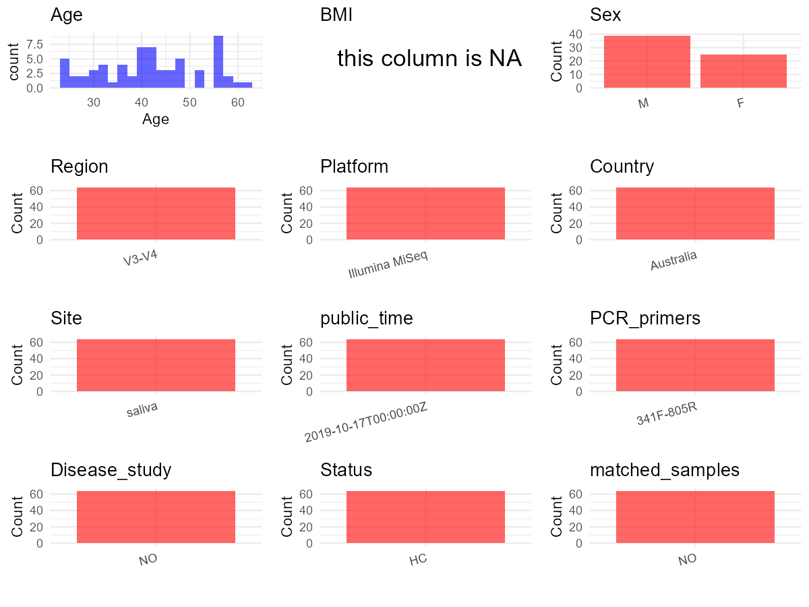

R Notebook: Metadata Processing Workflow
================

# Step 1: Obtain Initial Metadata from Each Project

To obtain the initial metadata: 1. Search for the BioProject ID (e.g.,
“PRJEBXXXX”) on the [NCBI SRA
website](https://www.ncbi.nlm.nih.gov/Traces/study/). 2. In the “Select”
table, click on “Metadata” and download the file. 3. The downloaded file
is typically named “SraRunTable.csv” and contains metadata for the
project.

``` r
# Load necessary libraries
library(dplyr)
library(ggplot2)
library(cowplot)

# Set working directory (update this path to your local directory)
setwd("D:/oral_project/PRJNA558132")

# Read the initial metadata files
initial_meta<-read.csv("SraRunTable.csv",header = T)

# Combine the two metadata files
#meta <- rbind(initial_meta, initial_meta1)

#Remove entries non-oral samples
#initial_meta <- subset(initial_meta,isolate %in% c("saliva","tongue coat"))

# Check the number of samples containing "HT" in Sample.Name (e.g., healthy controls)
#nrow(subset(meta, grepl("HT", Sample.Name)))

# Display the first few rows of the metadata
head(initial_meta)
```

    ##          Run AGE Assay.Type AvgSpotLen     Bases  BioProject    BioSample
    ## 1 SRR9955184  41   AMPLICON        600 128394048 PRJNA558132 SAMN12512055
    ## 2 SRR9955187  45   AMPLICON        599  66003956 PRJNA558132 SAMN12512058
    ## 3 SRR9955196  46   AMPLICON        600 101430359 PRJNA558132 SAMN12512086
    ## 4 SRR9955201  57   AMPLICON        599 158722704 PRJNA558132 SAMN12512053
    ## 5 SRR9955202  25   AMPLICON        600 148349537 PRJNA558132 SAMN12512092
    ## 6 SRR9955203  24   AMPLICON        600 102861656 PRJNA558132 SAMN12512091
    ##                BioSampleModel     Bytes                            Center.Name
    ## 1 Metagenome or environmental  89183582 THE AUSTRALIAN WINE RESEARCH INSTITUTE
    ## 2 Metagenome or environmental  46386323 THE AUSTRALIAN WINE RESEARCH INSTITUTE
    ## 3 Metagenome or environmental  70949775 THE AUSTRALIAN WINE RESEARCH INSTITUTE
    ## 4 Metagenome or environmental 109738874 THE AUSTRALIAN WINE RESEARCH INSTITUTE
    ## 5 Metagenome or environmental 102631661 THE AUSTRALIAN WINE RESEARCH INSTITUTE
    ## 6 Metagenome or environmental  70814713 THE AUSTRALIAN WINE RESEARCH INSTITUTE
    ##   Collection_Date Consent DATASTORE.filetype DATASTORE.provider
    ## 1      2018-06-18  public   fastq,run.zq,sra         gs,ncbi,s3
    ## 2      2018-06-01  public   fastq,run.zq,sra         gs,ncbi,s3
    ## 3      2018-06-25  public   fastq,run.zq,sra         gs,ncbi,s3
    ## 4      2018-06-18  public   fastq,run.zq,sra         gs,ncbi,s3
    ## 5      2018-06-01  public   fastq,run.zq,sra         gs,ncbi,s3
    ## 6      2018-06-25  public   fastq,run.zq,sra         gs,ncbi,s3
    ##                       DATASTORE.region Experiment gender geo_loc_name_country
    ## 1 gs.us-east1,ncbi.public,s3.us-east-1 SRX6703611   male            Australia
    ## 2 gs.us-east1,ncbi.public,s3.us-east-1 SRX6703608   male            Australia
    ## 3 gs.us-east1,ncbi.public,s3.us-east-1 SRX6703599   male            Australia
    ## 4 gs.us-east1,ncbi.public,s3.us-east-1 SRX6703594 female            Australia
    ## 5 gs.us-east1,ncbi.public,s3.us-east-1 SRX6703593 female            Australia
    ## 6 gs.us-east1,ncbi.public,s3.us-east-1 SRX6703592 female            Australia
    ##   geo_loc_name_country_continent       geo_loc_name         HOST     Instrument
    ## 1                        Oceania Australia:Adelaide Homo sapiens Illumina MiSeq
    ## 2                        Oceania Australia:Adelaide Homo sapiens Illumina MiSeq
    ## 3                        Oceania Australia:Adelaide Homo sapiens Illumina MiSeq
    ## 4                        Oceania Australia:Adelaide Homo sapiens Illumina MiSeq
    ## 5                        Oceania Australia:Adelaide Homo sapiens Illumina MiSeq
    ## 6                        Oceania Australia:Adelaide Homo sapiens Illumina MiSeq
    ##   isolation_source        lat_lon Library.Name LibraryLayout LibrarySelection
    ## 1      oral cavity not applicable       IND5.2        PAIRED              PCR
    ## 2      oral cavity not applicable        IND21        PAIRED              PCR
    ## 3      oral cavity not applicable      IND17.2        PAIRED              PCR
    ## 4      oral cavity not applicable       IND3.2        PAIRED              PCR
    ## 5      oral cavity not applicable        IND23        PAIRED              PCR
    ## 6      oral cavity not applicable      IND22.2        PAIRED              PCR
    ##   LibrarySource                Organism Platform          ReleaseDate
    ## 1   METAGENOMIC human saliva metagenome ILLUMINA 2019-10-17T00:00:00Z
    ## 2   METAGENOMIC human saliva metagenome ILLUMINA 2019-10-17T00:00:00Z
    ## 3   METAGENOMIC human saliva metagenome ILLUMINA 2019-10-17T00:00:00Z
    ## 4   METAGENOMIC human saliva metagenome ILLUMINA 2019-10-17T00:00:00Z
    ## 5   METAGENOMIC human saliva metagenome ILLUMINA 2019-10-17T00:00:00Z
    ## 6   METAGENOMIC human saliva metagenome ILLUMINA 2019-10-17T00:00:00Z
    ##            create_date version      Sample_id Sample.Name SRA.Study
    ## 1 2019-08-12T20:08:00Z       1  89-180618_S39      IND5.2 SRP218151
    ## 2 2019-08-12T20:08:00Z       1 216-180601_S58       IND21 SRP218151
    ## 3 2019-08-12T20:08:00Z       1  833-180625_S4     IND17.2 SRP218151
    ## 4 2019-08-12T20:09:00Z       1  49-180618_S31      IND3.2 SRP218151
    ## 5 2019-08-12T20:09:00Z       1 880-180601_S44       IND23 SRP218151
    ## 6 2019-08-12T20:08:00Z       1 867-180625_S36     IND22.2 SRP218151

# Step 2: Create a Uniform Metadata Template

The uniform metadata should include the following columns:

1.  **BioProject**: Project ID (e.g., “PRJNA339212”)
2.  **Run**: Sample ID (e.g., “ERRXXXXXX” or “SRRXXXXXX”)
3.  **sample_name**: Original sample name submitted by the authors (not
    the database-assigned ID)
4.  **Age**: Age of the subject (if available)
5.  **BMI**: Body Mass Index (if available)
6.  **Sex**: Sex of the subject (“F” or “M”)
7.  **Region**: Targeted 16S rRNA region (e.g., “V3-V4”)
8.  **Platform**: Sequencing platform (e.g., “Illumina MiSeq”)
9.  **Country**: Country of sample origin (e.g., “China”)
10. **Site**: Sample site (e.g., “saliva”, “dental plaque”)
11. **public_time**: Data release date (format: “YYYY-MM-DD”)
12. **PCR_primers**: PCR primers used (e.g., “515F-806R”)
13. **title**: Title of the associated publication
14. **Disease_study**: Whether the study involves a disease (“YES” or
    “NO”)
15. **Status**: Disease status (e.g., “T2DM”, “HC”). Note: If the study
    includes both disease and healthy samples, this must be specified
    per sample.
16. **matched_samples**: matched samples (“YES” or “NO”)

``` r
# Create a uniform metadata dataframe
metadata <- data.frame(
  BioProject = initial_meta$BioProject,
  Run = initial_meta$Run,
  sample_name = initial_meta$Sample.Name,
  Age = initial_meta$AGE,
  BMI = NA,
  Sex = initial_meta$gender,
  Region = "V3-V4",
  Platform = initial_meta$Instrument,
  Country = initial_meta$geo_loc_name_country,
  Site = gsub("human|metagenome| ", "", initial_meta$Organism),
  public_time = initial_meta$ReleaseDate,
  stringsAsFactors = FALSE
)
```

# Step 3: Manually Add Information from the Publication

Some information (e.g. PCR primers, study title, disease status) must be
manually extracted from the publication and added to the metadata.

``` r
# Add information obtained from the publication
metadata$PCR_primers <- "341F-805R"
metadata$title <- "Factors Contributing to Interindividual Variation in Retronasal Odor Perception from Aroma Glycosides: The Role of Odorant Sensory Detection Threshold Oral Microbiota and Hydrolysis in Saliva"
metadata$Disease_study <- "NO"
# Assign disease status based on sample_name patterns
metadata$Status<-"HC"

#get subjects id according to sample id
metadata$sample_name<-gsub("IND","",metadata$sample_name)
#get subjects id with Saliva available
keep_subjects<-subset(metadata,Site %in% "saliva")
#remove subjects without Saliva samples
metadata<-subset(metadata,sample_name %in% keep_subjects$sample_name)
#get subjects sampling counts
sample_counts <- table(metadata$sample_name)
# Create matched_samples column, any subjects have >=2 samples will be label "YES", otherwise "NO"
metadata$matched_samples <- ifelse(metadata$sample_name %in% names(sample_counts[sample_counts >= 2]), "YES", "NO")
```

metadata\$matched_samples=“No”

``` r
metadata <- metadata %>%
  mutate(             # 全部转小写，方便统一处理
    Sex = case_when(
      Sex == "female" ~ "F",
      Sex == "male" ~ "M",
    )
  )
```

# Step 4: Summarize and Validate the Metadata

``` r
# Check the number of unique runs and sample names
print(paste("Number of unique runs:", length(unique(metadata$Run))))
```

    ## [1] "Number of unique runs: 64"

``` r
print(paste("Number of unique sample names:", length(unique(metadata$sample_name))))
```

    ## [1] "Number of unique sample names: 64"

# Step 5: Visualize the Metadata

``` r

```


# Step 6: Finalize and Export the Metadata

``` r
# Reorder columns to match the desired format
metadata <- metadata[, c(
  "BioProject", "Run", "sample_name", "Age", "BMI", "Sex", 
  "Region", "Platform", "Country", "Site", "public_time", 
  "PCR_primers", "title", "Disease_study", "Status","matched_samples"
)]

# Export the uniform metadata to a CSV file
write.csv(metadata, file = "metadata.csv", quote = TRUE)
head(metadata)
```

    ##    BioProject        Run sample_name Age BMI Sex Region       Platform
    ## 1 PRJNA558132 SRR9955184         5.2  41  NA   M  V3-V4 Illumina MiSeq
    ## 2 PRJNA558132 SRR9955187          21  45  NA   M  V3-V4 Illumina MiSeq
    ## 3 PRJNA558132 SRR9955196        17.2  46  NA   M  V3-V4 Illumina MiSeq
    ## 4 PRJNA558132 SRR9955201         3.2  57  NA   F  V3-V4 Illumina MiSeq
    ## 5 PRJNA558132 SRR9955202          23  25  NA   F  V3-V4 Illumina MiSeq
    ## 6 PRJNA558132 SRR9955203        22.2  24  NA   F  V3-V4 Illumina MiSeq
    ##     Country   Site          public_time PCR_primers
    ## 1 Australia saliva 2019-10-17T00:00:00Z   341F-805R
    ## 2 Australia saliva 2019-10-17T00:00:00Z   341F-805R
    ## 3 Australia saliva 2019-10-17T00:00:00Z   341F-805R
    ## 4 Australia saliva 2019-10-17T00:00:00Z   341F-805R
    ## 5 Australia saliva 2019-10-17T00:00:00Z   341F-805R
    ## 6 Australia saliva 2019-10-17T00:00:00Z   341F-805R
    ##                                                                                                                                                                                             title
    ## 1 Factors Contributing to Interindividual Variation in Retronasal Odor Perception from Aroma Glycosides: The Role of Odorant Sensory Detection Threshold Oral Microbiota and Hydrolysis in Saliva
    ## 2 Factors Contributing to Interindividual Variation in Retronasal Odor Perception from Aroma Glycosides: The Role of Odorant Sensory Detection Threshold Oral Microbiota and Hydrolysis in Saliva
    ## 3 Factors Contributing to Interindividual Variation in Retronasal Odor Perception from Aroma Glycosides: The Role of Odorant Sensory Detection Threshold Oral Microbiota and Hydrolysis in Saliva
    ## 4 Factors Contributing to Interindividual Variation in Retronasal Odor Perception from Aroma Glycosides: The Role of Odorant Sensory Detection Threshold Oral Microbiota and Hydrolysis in Saliva
    ## 5 Factors Contributing to Interindividual Variation in Retronasal Odor Perception from Aroma Glycosides: The Role of Odorant Sensory Detection Threshold Oral Microbiota and Hydrolysis in Saliva
    ## 6 Factors Contributing to Interindividual Variation in Retronasal Odor Perception from Aroma Glycosides: The Role of Odorant Sensory Detection Threshold Oral Microbiota and Hydrolysis in Saliva
    ##   Disease_study Status matched_samples
    ## 1            NO     HC              NO
    ## 2            NO     HC              NO
    ## 3            NO     HC              NO
    ## 4            NO     HC              NO
    ## 5            NO     HC              NO
    ## 6            NO     HC              NO

## Notes for Students:

1.  **Metadata Accuracy**: Always cross-check the metadata with the
    original publication to ensure accuracy.
2.  **Manual Entries**: Columns like `PCR_primers`, and `Status` often
    require manual entry based on the publication.
3.  **Disease Status**: Be careful when assigning `Status`—some studies
    include both disease and healthy samples.
4.  **Visualization**: The plots help quickly identify the distribution
    of values in each column, which is useful for quality control.
5.  **Reproducibility**: Update the working directory and file paths to
    match your local environment.
