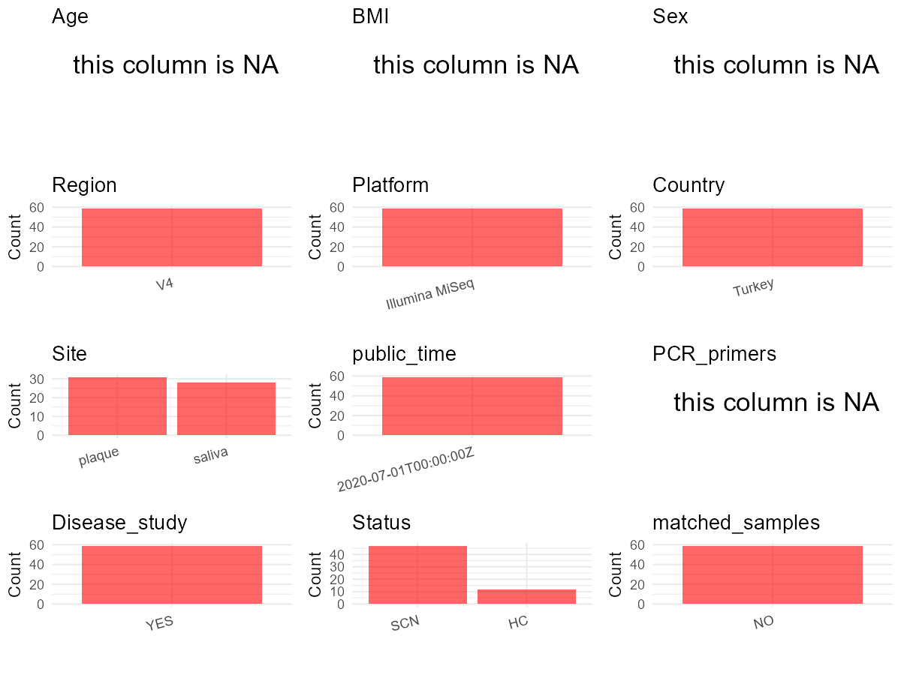

R Notebook: Metadata Processing Workflow
================

# Step 1: Obtain Initial Metadata from Each Project

To obtain the initial metadata: 1. Search for the BioProject ID (e.g.,
“PRJEBXXXX”) on the [NCBI SRA
website](https://www.ncbi.nlm.nih.gov/Traces/study/). 2. In the “Select”
table, click on “Metadata” and download the file. 3. The downloaded file
is typically named “SraRunTable.csv” and contains metadata for the
project.

``` r
# Load necessary libraries
library(dplyr)
library(ggplot2)
library(cowplot)

# Set working directory (update this path to your local directory)
setwd("D:/studylearning/董彪师兄项目/任务4_20251009/PRJNA564282")

# Read the initial metadata files
initial_meta<-read.csv("SraRunTable.csv",header = T)

# Display the first few rows of the metadata
head(initial_meta)
```

    ##           Run Assay.Type AvgSpotLen    Bases  BioProject    BioSample
    ## 1 SRR10948663   AMPLICON        502 19264250 PRJNA564282 SAMN13899510
    ## 2 SRR10948664   AMPLICON        502 21235102 PRJNA564282 SAMN13899509
    ## 3 SRR10948665   AMPLICON        502 16223636 PRJNA564282 SAMN13899508
    ## 4 SRR10948666   AMPLICON        502 15578064 PRJNA564282 SAMN13899507
    ## 5 SRR10948667   AMPLICON        502 16626742 PRJNA564282 SAMN13899559
    ## 6 SRR10948668   AMPLICON        502 17095610 PRJNA564282 SAMN13899558
    ##                                BioSampleModel    Bytes
    ## 1 MIMARKS.survey,MIGS/MIMS/MIMARKS.human-oral 10841398
    ## 2 MIMARKS.survey,MIGS/MIMS/MIMARKS.human-oral 11969378
    ## 3 MIMARKS.survey,MIGS/MIMS/MIMARKS.human-oral  9446323
    ## 4 MIMARKS.survey,MIGS/MIMS/MIMARKS.human-oral  8869360
    ## 5 MIMARKS.survey,MIGS/MIMS/MIMARKS.human-oral  9749644
    ## 6 MIMARKS.survey,MIGS/MIMS/MIMARKS.human-oral  9619812
    ##                               Center.Name Consent DATASTORE.filetype
    ## 1 ACADEMIC CENTRE FOR DENTISTRY AMSTERDAM  public   fastq,run.zq,sra
    ## 2 ACADEMIC CENTRE FOR DENTISTRY AMSTERDAM  public   fastq,run.zq,sra
    ## 3 ACADEMIC CENTRE FOR DENTISTRY AMSTERDAM  public   fastq,run.zq,sra
    ## 4 ACADEMIC CENTRE FOR DENTISTRY AMSTERDAM  public   fastq,run.zq,sra
    ## 5 ACADEMIC CENTRE FOR DENTISTRY AMSTERDAM  public   fastq,run.zq,sra
    ## 6 ACADEMIC CENTRE FOR DENTISTRY AMSTERDAM  public   fastq,run.zq,sra
    ##   DATASTORE.provider                     DATASTORE.region env_broad_scale
    ## 1         gs,ncbi,s3 gs.us-east1,ncbi.public,s3.us-east-1           human
    ## 2         gs,ncbi,s3 gs.us-east1,ncbi.public,s3.us-east-1           human
    ## 3         gs,ncbi,s3 gs.us-east1,ncbi.public,s3.us-east-1           human
    ## 4         gs,ncbi,s3 gs.us-east1,ncbi.public,s3.us-east-1           human
    ## 5         gs,ncbi,s3 gs.us-east1,ncbi.public,s3.us-east-1           human
    ## 6         gs,ncbi,s3 gs.us-east1,ncbi.public,s3.us-east-1           human
    ##   env_local_scale env_medium Experiment         HOST host_subject_id
    ## 1     oral cavity     plaque SRX7615800 Homo sapiens             110
    ## 2     oral cavity     plaque SRX7615799 Homo sapiens             109
    ## 3     oral cavity     plaque SRX7615798 Homo sapiens             108
    ## 4     oral cavity     plaque SRX7615797 Homo sapiens             107
    ## 5     oral cavity     saliva SRX7615796 Homo sapiens             212
    ## 6     oral cavity     saliva SRX7615795 Homo sapiens             211
    ##       Instrument Library.Name LibraryLayout LibrarySelection LibrarySource
    ## 1 Illumina MiSeq      110.bsl        PAIRED              PCR   METAGENOMIC
    ## 2 Illumina MiSeq      109.bsl        PAIRED              PCR   METAGENOMIC
    ## 3 Illumina MiSeq      108.bsl        PAIRED              PCR   METAGENOMIC
    ## 4 Illumina MiSeq      107.bsl        PAIRED              PCR   METAGENOMIC
    ## 5 Illumina MiSeq       C.P212        PAIRED              PCR   METAGENOMIC
    ## 6 Illumina MiSeq       C.P211        PAIRED              PCR   METAGENOMIC
    ##     Organism Platform          ReleaseDate          create_date version
    ## 1 metagenome ILLUMINA 2020-07-01T00:00:00Z 2020-01-22T08:02:00Z       1
    ## 2 metagenome ILLUMINA 2020-07-01T00:00:00Z 2020-01-22T08:03:00Z       1
    ## 3 metagenome ILLUMINA 2020-07-01T00:00:00Z 2020-01-22T08:03:00Z       1
    ## 4 metagenome ILLUMINA 2020-07-01T00:00:00Z 2020-01-22T08:04:00Z       1
    ## 5 metagenome ILLUMINA 2020-07-01T00:00:00Z 2020-01-22T08:04:00Z       1
    ## 6 metagenome ILLUMINA 2020-07-01T00:00:00Z 2020-01-22T08:05:00Z       1
    ##   Sample.Name sample_type SRA.Study    treat
    ## 1     110.bsl      plaque SRP243865 baseline
    ## 2     109.bsl      plaque SRP243865 baseline
    ## 3     108.bsl      plaque SRP243865 baseline
    ## 4     107.bsl      plaque SRP243865 baseline
    ## 5      C.P212      saliva SRP243865  control
    ## 6      C.P211      saliva SRP243865  control

# Step 2: Create a Uniform Metadata Template

The uniform metadata should include the following columns:

1.  **BioProject**: Project ID (e.g., “PRJNA339212”)
2.  **Run**: Sample ID (e.g., “ERRXXXXXX” or “SRRXXXXXX”)
3.  **sample_name**: Original sample name submitted by the authors (not
    the database-assigned ID)
4.  **Age**: Age of the subject (if available)
5.  **BMI**: Body Mass Index (if available)
6.  **Sex**: Sex of the subject (“F” or “M”)
7.  **Region**: Targeted 16S rRNA region (e.g., “V3-V4”)
8.  **Platform**: Sequencing platform (e.g., “Illumina MiSeq”)
9.  **Country**: Country of sample origin (e.g., “China”)
10. **Site**: Sample site (e.g., “saliva”, “dental plaque”)
11. **public_time**: Data release date (format: “YYYY-MM-DD”)
12. **PCR_primers**: PCR primers used (e.g., “515F-806R”)
13. **title**: Title of the associated publication
14. **Disease_study**: Whether the study involves a disease (“YES” or
    “NO”)
15. **Status**: Disease status (e.g., “T2DM”, “HC”). Note: If the study
    includes both disease and healthy samples, this must be specified
    per sample.

``` r
# Create a uniform metadata dataframe
metadata <- data.frame(
  BioProject = initial_meta$BioProject,
  Run = initial_meta$Run,
  sample_name = initial_meta$Sample.Name,
  Age = NA,
  BMI = NA,
  Sex= NA,
  Region = "V4",
  Platform = initial_meta$Instrument,
  Country = "Turkey",
  Site = initial_meta$env_medium,
  public_time = initial_meta$ReleaseDate,
  stringsAsFactors = FALSE
)
```

# Step 3: Manually Add Information from the Publication

Some information (e.g. PCR primers, study title, disease status) must be
manually extracted from the publication and added to the metadata.

``` r
# Add information obtained from the publication
metadata$PCR_primers <- NA_character_  # Update based on the publication
metadata$title <- "Dysbiosis of the Oral Ecosystem in Severe Congenital Neutropenia Patients"
metadata$Disease_study <- "YES"
metadata <- metadata %>% 
  mutate(Status=case_when(
    grepl("ctrl",sample_name)~"HC",
    TRUE~"SCN"
  ))

#extract subject id by remove prefix of sample_name
#metadata$sample_name <- gsub("_st|_sal", "", metadata$sample_name)

# Check initial data distribution
cat("Initial sample distribution:\n")
```

    ## Initial sample distribution:

``` r
table(metadata$sample_name)
```

    ## 
    ##   101.bsl 101.treat   102.bsl 102.treat   103.bsl 103.treat   104.bsl 104.treat 
    ##         1         1         1         1         1         1         1         1 
    ##   105.bsl 105.treat   106.bsl 106.treat   107.bsl   108.bsl 108.treat   109.bsl 
    ##         1         1         1         1         1         1         1         1 
    ## 109.treat   110.bsl 110.treat  201.ctrl  202.ctrl  203.ctrl  204.ctrl  205.ctrl 
    ##         1         1         1         1         1         1         1         1 
    ##  206.ctrl  207.ctrl  208.ctrl  209.ctrl  210.ctrl  211.ctrl  212.ctrl    C.P201 
    ##         1         1         1         1         1         1         1         1 
    ##    C.P202    C.P203    C.P204    C.P205    C.P206    C.P207    C.P208    C.P210 
    ##         1         1         1         1         1         1         1         1 
    ##    C.P211    C.P212  NDB.P101  NDB.P102  NDB.P104  NDB.P105  NDB.P106  NDB.P108 
    ##         1         1         1         1         1         1         1         1 
    ##  NDB.P109  NDB.P110  NDK.P101  NDK.P102  NDK.P103  NDK.P104  NDK.P105  NDK.P106 
    ##         1         1         1         1         1         1         1         1 
    ##  NDK.P108  NDK.P109  NDK.P110 
    ##         1         1         1

``` r
table(metadata$Site)
```

    ## 
    ## plaque saliva 
    ##     31     28

``` r
# Calculate sampling frequency per subject
sample_counts <- table(metadata$sample_name)
cat("\nNumber of samples per subject:\n")
```

    ## 
    ## Number of samples per subject:

``` r
print(sample_counts)
```

    ## 
    ##   101.bsl 101.treat   102.bsl 102.treat   103.bsl 103.treat   104.bsl 104.treat 
    ##         1         1         1         1         1         1         1         1 
    ##   105.bsl 105.treat   106.bsl 106.treat   107.bsl   108.bsl 108.treat   109.bsl 
    ##         1         1         1         1         1         1         1         1 
    ## 109.treat   110.bsl 110.treat  201.ctrl  202.ctrl  203.ctrl  204.ctrl  205.ctrl 
    ##         1         1         1         1         1         1         1         1 
    ##  206.ctrl  207.ctrl  208.ctrl  209.ctrl  210.ctrl  211.ctrl  212.ctrl    C.P201 
    ##         1         1         1         1         1         1         1         1 
    ##    C.P202    C.P203    C.P204    C.P205    C.P206    C.P207    C.P208    C.P210 
    ##         1         1         1         1         1         1         1         1 
    ##    C.P211    C.P212  NDB.P101  NDB.P102  NDB.P104  NDB.P105  NDB.P106  NDB.P108 
    ##         1         1         1         1         1         1         1         1 
    ##  NDB.P109  NDB.P110  NDK.P101  NDK.P102  NDK.P103  NDK.P104  NDK.P105  NDK.P106 
    ##         1         1         1         1         1         1         1         1 
    ##  NDK.P108  NDK.P109  NDK.P110 
    ##         1         1         1

``` r
# Create matched_samples column
metadata$matched_samples <- ifelse(metadata$sample_name %in% names(sample_counts[sample_counts >= 2]), "YES", "NO")

cat("\nMatched samples distribution:\n")
```

    ## 
    ## Matched samples distribution:

``` r
table(metadata$matched_samples)
```

    ## 
    ## NO 
    ## 59

``` r
# Identify samples for removal: single samples excluding saliva,plaque
single_samples <- names(sample_counts[sample_counts == 1])
samples_to_remove <- metadata$sample_name %in% single_samples & !(metadata$Site %in% c("saliva","plaque"))

cat("\nNumber of samples to be removed:", sum(samples_to_remove), "\n")
```

    ## 
    ## Number of samples to be removed: 0

``` r
# Remove identified samples
metadata_clean <- metadata[!samples_to_remove, ]

cat("\nFinal sample distribution after cleaning:\n")
```

    ## 
    ## Final sample distribution after cleaning:

``` r
table(metadata_clean$sample_name)
```

    ## 
    ##   101.bsl 101.treat   102.bsl 102.treat   103.bsl 103.treat   104.bsl 104.treat 
    ##         1         1         1         1         1         1         1         1 
    ##   105.bsl 105.treat   106.bsl 106.treat   107.bsl   108.bsl 108.treat   109.bsl 
    ##         1         1         1         1         1         1         1         1 
    ## 109.treat   110.bsl 110.treat  201.ctrl  202.ctrl  203.ctrl  204.ctrl  205.ctrl 
    ##         1         1         1         1         1         1         1         1 
    ##  206.ctrl  207.ctrl  208.ctrl  209.ctrl  210.ctrl  211.ctrl  212.ctrl    C.P201 
    ##         1         1         1         1         1         1         1         1 
    ##    C.P202    C.P203    C.P204    C.P205    C.P206    C.P207    C.P208    C.P210 
    ##         1         1         1         1         1         1         1         1 
    ##    C.P211    C.P212  NDB.P101  NDB.P102  NDB.P104  NDB.P105  NDB.P106  NDB.P108 
    ##         1         1         1         1         1         1         1         1 
    ##  NDB.P109  NDB.P110  NDK.P101  NDK.P102  NDK.P103  NDK.P104  NDK.P105  NDK.P106 
    ##         1         1         1         1         1         1         1         1 
    ##  NDK.P108  NDK.P109  NDK.P110 
    ##         1         1         1

``` r
table(metadata_clean$Site)
```

    ## 
    ## plaque saliva 
    ##     31     28

``` r
table(metadata_clean$matched_samples)
```

    ## 
    ## NO 
    ## 59

``` r
# Use cleaned dataset for subsequent analysis
metadata <- metadata_clean
```

# Step 4: Summarize and Validate the Metadata

``` r
# Check the number of unique runs and sample names
print(paste("Number of unique runs:", length(unique(metadata$Run))))
```

    ## [1] "Number of unique runs: 59"

``` r
print(paste("Number of unique sample names:", length(unique(metadata$sample_name))))
```

    ## [1] "Number of unique sample names: 59"

# Step 5: Visualize the Metadata

``` r

```


# Step 6: Finalize and Export the Metadata

``` r
# Reorder columns to match the desired format
metadata <- metadata[, c(
  "BioProject", "Run", "sample_name", "Age", "BMI", "Sex", 
  "Region", "Platform", "Country", "Site", "public_time", 
  "PCR_primers", "title", "Disease_study", "Status","matched_samples"
)]

# Export the uniform metadata to a CSV file
write.csv(metadata, file = "metadata.csv", quote = FALSE)
head(metadata)
```

    ##    BioProject         Run sample_name Age BMI Sex Region       Platform Country
    ## 1 PRJNA564282 SRR10948663     110.bsl  NA  NA  NA     V4 Illumina MiSeq  Turkey
    ## 2 PRJNA564282 SRR10948664     109.bsl  NA  NA  NA     V4 Illumina MiSeq  Turkey
    ## 3 PRJNA564282 SRR10948665     108.bsl  NA  NA  NA     V4 Illumina MiSeq  Turkey
    ## 4 PRJNA564282 SRR10948666     107.bsl  NA  NA  NA     V4 Illumina MiSeq  Turkey
    ## 5 PRJNA564282 SRR10948667      C.P212  NA  NA  NA     V4 Illumina MiSeq  Turkey
    ## 6 PRJNA564282 SRR10948668      C.P211  NA  NA  NA     V4 Illumina MiSeq  Turkey
    ##     Site          public_time PCR_primers
    ## 1 plaque 2020-07-01T00:00:00Z        <NA>
    ## 2 plaque 2020-07-01T00:00:00Z        <NA>
    ## 3 plaque 2020-07-01T00:00:00Z        <NA>
    ## 4 plaque 2020-07-01T00:00:00Z        <NA>
    ## 5 saliva 2020-07-01T00:00:00Z        <NA>
    ## 6 saliva 2020-07-01T00:00:00Z        <NA>
    ##                                                                       title
    ## 1 Dysbiosis of the Oral Ecosystem in Severe Congenital Neutropenia Patients
    ## 2 Dysbiosis of the Oral Ecosystem in Severe Congenital Neutropenia Patients
    ## 3 Dysbiosis of the Oral Ecosystem in Severe Congenital Neutropenia Patients
    ## 4 Dysbiosis of the Oral Ecosystem in Severe Congenital Neutropenia Patients
    ## 5 Dysbiosis of the Oral Ecosystem in Severe Congenital Neutropenia Patients
    ## 6 Dysbiosis of the Oral Ecosystem in Severe Congenital Neutropenia Patients
    ##   Disease_study Status matched_samples
    ## 1           YES    SCN              NO
    ## 2           YES    SCN              NO
    ## 3           YES    SCN              NO
    ## 4           YES    SCN              NO
    ## 5           YES    SCN              NO
    ## 6           YES    SCN              NO

## Notes for Students:

1.  **Metadata Accuracy**: Always cross-check the metadata with the
    original publication to ensure accuracy.
2.  **Manual Entries**: Columns like `PCR_primers`, and `Status` often
    require manual entry based on the publication.
3.  **Disease Status**: Be careful when assigning `Status`—some studies
    include both disease and healthy samples.
4.  **Visualization**: The plots help quickly identify the distribution
    of values in each column, which is useful for quality control.
5.  **Reproducibility**: Update the working directory and file paths to
    match your local environment.
