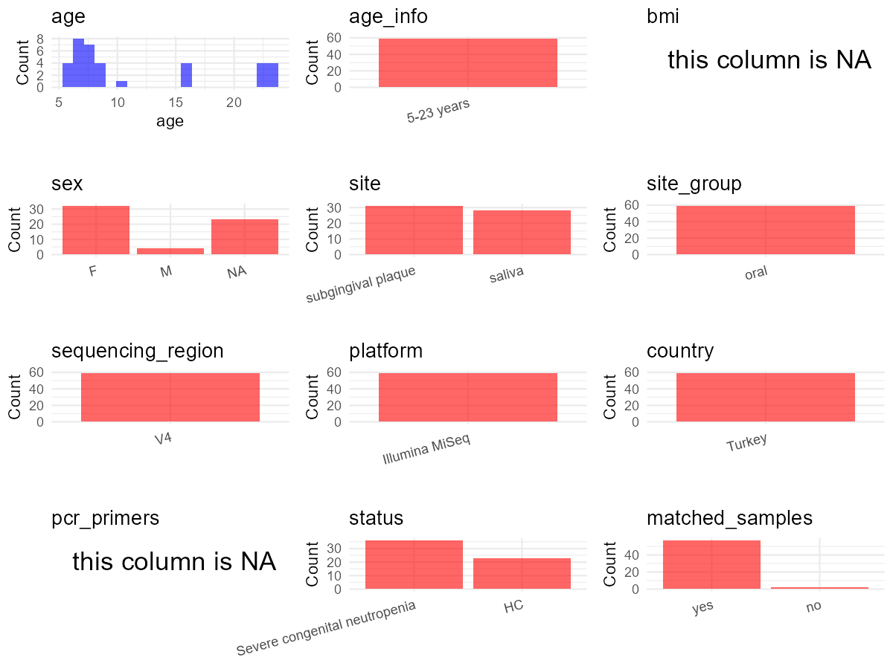

R Notebook: Metadata Processing Workflow
================

# Step 1: Obtain Initial Metadata from Each Project

This step sets the project directory, loads the raw SRA metadata, and
optionally merges supplement tables.

``` r
# Load libraries
library(dplyr)
library(ggplot2)
library(cowplot)

# (1) Setting working directory
# EDIT HERE: change project_id for each study
project_id <- "PRJNA564282"

base_dir <- "D:/metadata_collect/oral_metadata_new/update"
setwd(file.path(base_dir, project_id))

# (2) Loading raw SRA metadata file
sra_file <- "SraRunTable.csv"
initial_meta <- read.csv(sra_file, header = TRUE)

# (3) OPTIONAL: If extra metadata (e.g., Table.x or supplemental materials) are available from the article, you may need to merge the file with initial_meta manually. Below is example code for merging. Depending on the specific case of each study, you can customize the code as needed.
# supp_table <- read.csv("supplemental_table.csv", header = TRUE)
# initial_meta <- left_join(initial_meta, supp_table, by = merge_col_name)
```

# Step 2: Data Overview

First, you need to get an overview of the data, which includes two
steps: reading the article and reading the initial metadata. This step
is very IMPORTANT!

``` r
# (1) Article summary (from paper PDF):
# Title: "Dysbiosis of the Oral Ecosystem in Severe Congenital Neutropenia Patients"
# 10 SCN patients (5-23 years, 9F/1M) from Turkey + 12 healthy gender-matched controls (5-22 years, 11F/1M)
# Sampling sites: unstimulated saliva and subgingival plaque
# SCN patients re-evaluated after 6 months following oral hygiene therapy -> time series + matched samples
# Disease: Severe Congenital Neutropenia (SCN), a rare genetic disorder
# All subjects received scaling and oral hygiene instructions
# SCN patients given antibiotic prophylaxis (amoxicillin+clavulanic acid) 1 day before sample collection

# (2) Column overview of initial_meta (SraRunTable.csv):
# head(initial_meta, 10)

# Unique values inspection:
# unique(initial_meta$Sample Name) # subject-level labels encoding treatment status
# unique(initial_meta$host_subject_id) # numeric subject IDs: 101-110 (SCN patients), 201-212 (controls)
# unique(initial_meta$sample_type) # "plaque", "saliva"
# unique(initial_meta$treat) # "baseline", "control", "treat"
# unique(initial_meta$Instrument) # "Illumina MiSeq"
# unique(initial_meta$Organism) # "metagenome" (all samples)
```

# Step 3: Removing Control and Non-human Samples

First, we need to remove control samples(including both negative
controls and positive controls) and non-human samples.

``` r
# (1) EDIT HERE: Parameter setup
# The 'treat' column contains: "baseline" (SCN patients at baseline), "control" (healthy controls), "treat" (SCN patients at 6-month follow-up)
# No negative/positive control samples in this dataset - all are human oral samples
control_column <- NA   # no control samples to remove
# unique(initial_meta[[control_column]])
control_keywords <- c()     # Enter exact keywords

species_column <- "Organism"          # column name in initial_meta
unique(initial_meta[[species_column]])
```

    ## [1] "metagenome"

``` r
non_human_keywords <- c()            # all samples are human (Homo sapiens), Organism column says "metagenome" for all


# (2) Remove controls and non-human samples. DO NOT need to modify code in this part, just run it.
n_samples <- nrow(initial_meta)
# Control evaluation
if (length(control_keywords) > 0) {
  if (is.na(control_column) || is.null(control_column) || control_column == "") {
    stop("Error: control_keywords provided but control_column is missing.")
  }
  
  if (!(control_column %in% colnames(initial_meta))) {
    stop(sprintf("Error: Column '%s' not found in initial_meta.", control_column))
  }
  
  control_pattern <- paste(control_keywords, collapse = "|")
  control_text <- initial_meta[[control_column]]
  is_control <- grepl(control_pattern, control_text)
  
} else {
  is_control <- rep(FALSE, n_samples)
}

# Non-human evaluation
if (length(non_human_keywords) > 0) {
  if (is.null(species_column) || species_column == "") {
    stop("Error: non_human_keywords provided but species_column is missing.")
  }
  
  if (!(species_column %in% colnames(initial_meta))) {
    stop(sprintf("Error: Column '%s' not found in initial_meta.", species_column))
  }
  
  non_human_pattern <- paste(non_human_keywords, collapse = "|")
  species_text <- initial_meta[[species_column]]
  is_non_human <- grepl(non_human_pattern, species_text)
} else {
  is_non_human <- rep(FALSE, n_samples)
}

# Execute removal
samples_to_remove <- is_control | is_non_human
initial_meta <- initial_meta[!samples_to_remove, ]

cat("Initial samples counts:",n_samples,"\n")
```

    ## Initial samples counts: 59

``` r
cat("Removed control samples:", sum(is_control), "\n")
```

    ## Removed control samples: 0

``` r
cat("Removed non-human samples:", sum(is_non_human), "\n")
```

    ## Removed non-human samples: 0

``` r
cat("Total samples removed ", sum(samples_to_remove), "\n")
```

    ## Total samples removed  0

``` r
cat("Remaining samples after Step 2:", nrow(initial_meta), "\n")
```

    ## Remaining samples after Step 2: 59

# Step 4: Creating a Uniform Metadata Template

This step converts the raw SRA table into the standard metadata format
used in our meta-analysis. The uniform metadata should include the
following columns: 1. **bioproject**: Project ID from SRA or other
database e.g. `PRJNA1234`, `CNP1234`, ‘OEP1234’, ‘qiita_1234’ 2.
**sample_id**: SRA sample/run ID. Unique id for each sample!
e.g. `DRR1234567`, `ERR1234567` and `SRR1234567`. If no such column
exists, can use column like sample_name. 3. **subject_id**: subject id
for each person if available. e.g. `patient_01`, `Host_03_before`,
`subject12` 4. **age**: Age of the subject if available. e.g. `35`, `42`
\| not `adult`, `chilren` 5. **age_info**: If the age is not explicitly
stated but approximate age range information is available, mark it in
this column. e.g., `18-55`, `children`, `infant`, `elder` 6. **bmi**:
Body Mass Index if available. e.g. `22.5`, `18.9` \| not `normal`,
`overweight` 7. **sex**: Sex of the subject. Mandatory to write as M/F
\| not `female`, `woman` 8. **sequencing_region**: Targeted 16S rRNA
region. e.g. `V3-V4`, `V4` 9. **platform**: Sequencing platform.
e.g. `Illumina MiSeq`, `454 GS FLX Titanium`, `Ion Torrent` 10.
**country**: Country of sample origin. e.g. `China`, `Japan` \| not city
name like `Beijing` 11. **site**: Sampling site. For oral and gut sites,
specify the exact sites as detailed as possible. For example, if it is
known to be supragingival plaque, do not record it as ‘dental plaque’,
unless the original text provides only a vague description.
e.g. `saliva`, `tongue coating` \| not broad term like `oral` 12.
**site_group**: only accepts one of following three values: ‘oral’,
‘gut’, or ‘other’. 13. **public_time**: Data release date.
e.g. `2021-06-22` \| not `June 2021` 14. **pcr_primers**: PCR primers
used. e.g. `515F-806R`, `27F-338R` \| not primer sequences 15.
**title**: Title of the associated publication. 16. **disease_study**:
Whether the study involves disease samples. If it’s not clear, can
record as NA. Only three values accepted: ‘yes’, ‘no’ or NA 17.
**status**: Disease status for each sample if available, else record as
NA. Only accept following abbreviations, Write full names for all other
diseases. HC: healthy control CD: Crohn’s disease CRC: colorectal cancer
COPD: chronic obstructive pulmonary disease HIV: human immunodeficiency
virus ICU: intensive care unit OSCC: oral squamous cell carcinoma RA:
rheumatoid arthritis UC: ulcerative colitis 18. **matched_samples**:
Whether the subject has matched samples. Only accept ‘yes’ or ‘no’. 19.
**is_time_series**: Whether the study is a time series study. Only
accept ‘yes’ or ‘no’.

``` r
# Extract columns from initial_meta as follows: (1) No modification needed → extract directly. (2) Modification needed → create a new column with the prefix raw_ and mark the original column as "pending". (3) Need to find or determine based on the article.
metadata <- data.frame(
  bioproject = initial_meta$BioProject, # SRA column: BioProject, all PRJNA564282
  sample_id = initial_meta$Run, # SRA column: Run, e.g. SRR10948663
  subject_id = initial_meta$host_subject_id, # SRA column: host_subject_id; 101-110=SCN patients, 201-212=controls
  raw_age = "pending", # paper Table 1 (p.3) has Gender/age for SCN patients; controls NA
  age = "pending", # will be filled in Step 5 from paper Table 1 (p.3) for SCN patients; controls NA
  age_info = "5-23 years", # paper p.2: "Ten SCN patients (5-23 years old) and 12 healthy controls (5-22 years old)"
  bmi = NA, # not reported in paper or CSV
  sex = "pending", # paper Table 1 (p.3) for SCN patients; controls 11F/1M but no per-subject mapping
  sequencing_region = "V4", # paper p.7 methods: "V4 hypervariable region of the 16S rRNA gene was amplified"
  platform = "Illumina MiSeq", # paper p.7 methods + SRA column: Instrument
  country = "Turkey", # paper p.1: authors from Ege University, Izmir, Turkey; p.2: "from different parts of Turkey"
  raw_site = initial_meta$sample_type, # SRA column: sample_type, values "saliva" and "plaque"
  site = "pending", # will be filled in Step 5; "plaque" = subgingival plaque per paper p.7
  site_group = "pending", # modify later
  public_time = initial_meta$ReleaseDate, # SRA column: ReleaseDate, 2020-07-01
  pcr_primers = NA, # paper cites ref [18] Kozich et al. 2013 for V4 amplification, but primer names not explicitly stated
  title = "Dysbiosis of the Oral Ecosystem in Severe Congenital Neutropenia Patients", # paper title, p.1
  disease_study = "yes", # study involves SCN patients vs healthy controls
  status = "pending", # SCN patients = disease, healthy controls = HC; derived from 'treat' column
  raw_status = initial_meta$treat, # SRA column: treat, values "baseline", "control", "treat"
  matched_samples = "pending", # modify later
  is_time_series = "no", # 6-month follow-up is an intervention pre/post design, not a natural time series study
  stringsAsFactors = FALSE
)
metadata$public_time <- as.Date(metadata$public_time)
```

# Step 5: Manually solving pending issues

This step involves two parts: (1) handle the columns with the `raw_`
prefix, and next (2) handle the `site_group` and `matched_samples`
columns.

``` r
# (1) Handle the columns with the `raw_` prefix and fill missing values.

sid <- trimws(as.character(initial_meta$host_subject_id)) # ensure character type for named lookup

# Age: from paper Table 1 (p.3) "Gender/age" column for SCN patients (101-110)
# e.g. "F/8y8mo" = 8 + 8/12 = 8.67 years; controls have no per-subject age data
metadata$raw_age <- ifelse(
  sid %in% c("101","102","103","104","105","106","107","108","109","110"),
  "see Table 1, paper p.3",
  NA
) # SCN patients have age in Table 1; controls have no per-subject age
age_map <- c(
  "101" = 8.67, "102" = 7.58, "103" = 7.25, "104" = 22.67, "105" = 23.33,
  "106" = 7, "107" = 10, "108" = 5.75, "109" = 15.92, "110" = 7
) # paper Table 1 (p.3): SCN patient ages
metadata$age <- ifelse(
  sid %in% names(age_map),
  age_map[sid],
  NA
) # SCN patients from Table 1; controls NA (paper p.2 only gives range "5-22 years", no per-subject mapping)
cat("Age mapping check: unique ages =", paste(unique(metadata$age), collapse=", "), "\n")
```

    ## Age mapping check: unique ages = 7, 15.92, 5.75, 10, NA, 23.33, 22.67, 7.25, 7.58, 8.67

``` r
# Site: SRA sample_type has "saliva" and "plaque". Per paper p.7 methods, plaque = "subgingival plaque"
metadata$site <- ifelse(
  initial_meta$sample_type == "saliva", "saliva",
  ifelse(initial_meta$sample_type == "plaque", "subgingival plaque", NA)
) # SRA column: sample_type

# Sex: per-subject sex from paper Table 1 (p.3). Subjects 101-110 are SCN patients, 201-212 are controls.
# From Table 1: 101=F, 102=F, 103=F, 104=M, 105=F, 106=F, 107=F, 108=F, 109=F, 110=F
# Controls: paper p.2 says "11F/1M gender-matched" but no per-subject mapping is provided.
# Since exact control sex cannot be determined, mark as NA.
raw_sex_map <- c(
  "101" = "F", "102" = "F", "103" = "F", "104" = "M", "105" = "F",
  "106" = "F", "107" = "F", "108" = "F", "109" = "F", "110" = "F"
) # paper Table 1 (p.3): Gender/age column
metadata$sex <- ifelse(
  sid %in% names(raw_sex_map),
  raw_sex_map[sid],
  NA
) # SCN patients from Table 1; controls = NA (paper only gives overall ratio 11F/1M, no per-subject data)
cat("Sex mapping check: unique sexes =", paste(unique(metadata$sex), collapse=", "), "\n")
```

    ## Sex mapping check: unique sexes = F, NA, M

``` r
# Status: derived from SRA 'treat' column
# "baseline" -> Severe congenital neutropenia (SCN patients at baseline)
# "treat" -> Severe congenital neutropenia (SCN patients at 6-month follow-up)
# "control" -> HC (healthy controls)
metadata$status <- ifelse(
  initial_meta$treat == "control", "HC",
  "Severe congenital neutropenia"
) # SRA column: treat; paper p.2: Severe congenital neutropenia patients vs healthy controls
cat("Status mapping check: unique statuses =", paste(unique(metadata$status), collapse=", "), "\n")
```

    ## Status mapping check: unique statuses = Severe congenital neutropenia, HC

``` r
# (2) Filling the 'site_group' and 'matched_samples' columns
# editing site_group
unique(metadata$site)
```

    ## [1] "subgingival plaque" "saliva"

``` r
# EDIT HERE: add oral sites
Oral_site = c("saliva", "subgingival plaque") # paper p.7 methods: saliva and subgingival plaque samples
# EDIT HERE: add gut sites
Gut_site = c("feces")
# just run
metadata <- metadata %>%
  mutate(site_group = case_when(
    site %in% Oral_site ~ "oral",
    site %in% Gut_site ~ "gut",
    TRUE ~ "other"
  ))

# editing matched_samples, just run.
metadata$matched_samples <- ifelse(
  ave(metadata$subject_id, metadata$subject_id, FUN = length) > 1, 
  "yes", 
  "no"
)
```

``` r
# (3) check if there is pending value in metadata. If there is pending value, go on modify the metadata.
# Function to check if a column contains "pending"
has_pending <- function(col) {
  if (is.character(col) || is.factor(col)) {
    any(col == "pending", na.rm = TRUE)
  } else {
    FALSE
  }
}

# Check for any pending value
any_pending_value <- any(sapply(metadata, has_pending))

if (!any_pending_value) {
  message("Good! No cell contains the value 'pending'.")
} else {
  pending_cols <- names(metadata)[sapply(metadata, has_pending)]
  message("Columns containing 'pending': ", paste(pending_cols, collapse = ", "))
  message("Please continue to resolve these pending columns!")
}
```

    ## Good! No cell contains the value 'pending'.

# Step 6: Visualize the Metadata

This step makes a quick set of plots for checking the distribution of
key metadata fields.

``` r
# Select columns for visualization, just run
plot_data <- metadata %>%
  select(-bioproject, -sample_id, -subject_id, -title)

create_simple_plots <- function(data) {
  plots <- list()
  continuous_vars <- c("age", "bmi")

  for (col in colnames(data)) {
    if (all(is.na(data[[col]]))) {
      p <- ggplot() +
        annotate("text", x = 0.5, y = 0.5, label = "this column is NA", size = 6) +
        labs(title = col) +
        theme_void()
    } else if (col %in% continuous_vars && is.numeric(data[[col]])) {
      p <- ggplot(data, aes(x = .data[[col]])) +
        geom_histogram(fill = "blue", alpha = 0.6, bins = 20, na.rm = TRUE) +
        labs(title = col, x = col, y = "Count") +
        theme_minimal()
    } else {
      count_data <- as.data.frame(table(data[[col]], useNA = "ifany"))
      p <- ggplot(count_data, aes(x = reorder(Var1, -Freq), y = Freq)) +
        geom_col(fill = "red", alpha = 0.6) +
        labs(title = col, x = NULL, y = "Count") +
        theme_minimal() +
        theme(axis.text.x = element_text(angle = 15, hjust = 1))
    }
    plots[[col]] <- p
  }

  return(plots)
}

# Generate and arrange plots
plots <- create_simple_plots(plot_data)
p <- plot_grid(plots$age,
               plots$age_info,
               plots$bmi,
               plots$sex,
               plots$site,
               plots$site_group,
               plots$sequencing_region,
               plots$platform,
               plots$country,
               plots$pcr_primers,
               plots$status,
               plots$matched_samples,
               ncol = 3, align = "hv", axis = "lb")
ggsave("Metadata_Summary_v2.png", plot = p, width = 8, height = 6, dpi = 150)
```

``` r
# Insert Metadata_Summary_v2.png into the current Rmd output

```

<!-- -->

# Step 7: Sort and export the metadata

This step saves the cleaned metadata table as the final `metadata.csv`
file.

``` r
# Reorder the data frame
fixed_cols <- c("bioproject", "sample_id", "subject_id", "age", "age_info",
                "bmi", "sex", "platform", "sequencing_region", "pcr_primers", 
                "country", "site", "site_group", "disease_study", "status", 
                "title", "public_time", "matched_samples", "is_time_series")  
metadata <- metadata %>%
  select(all_of(fixed_cols), everything())

# save metadata 
# head(metadata)
write.csv(metadata, file = "metadata_v2.csv", quote = TRUE)
```
