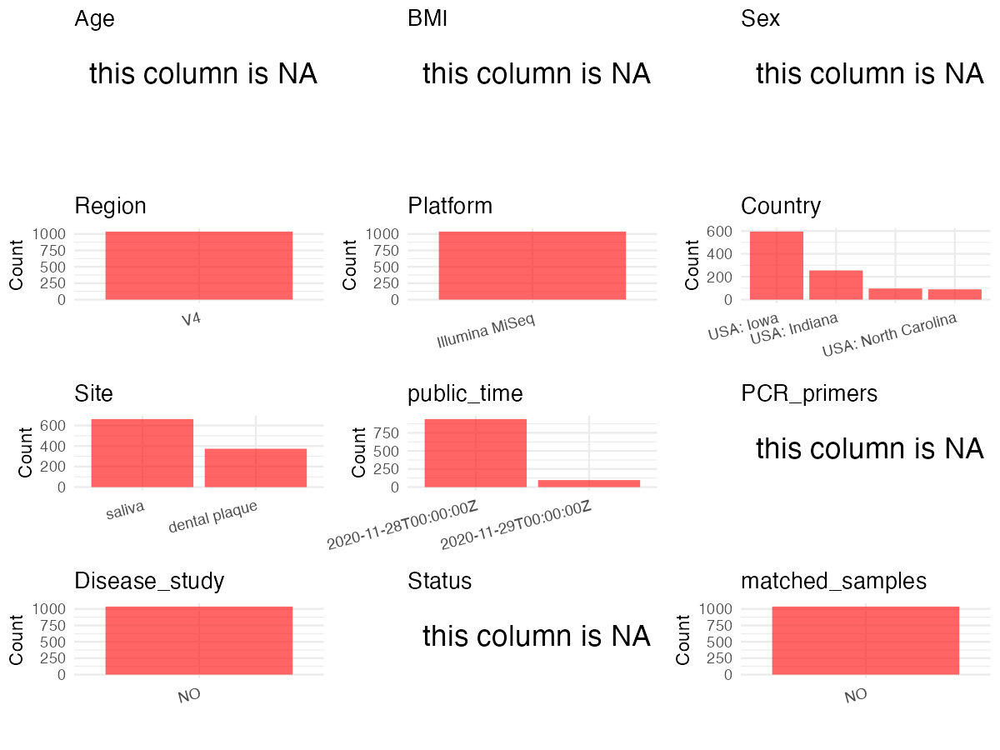

R Notebook: Metadata Processing Workflow
================

# Step 1: Obtain Initial Metadata from Each Project

To obtain the initial metadata: 1. Search for the BioProject ID (e.g.,
“PRJEBXXXX”) on the [NCBI SRA
website](https://www.ncbi.nlm.nih.gov/Traces/study/). 2. In the “Select”
table, click on “Metadata” and download the file. 3. The downloaded file
is typically named “SraRunTable.csv” and contains metadata for the
project.

``` r
# Load necessary libraries
library(dplyr)
library(ggplot2)
library(cowplot)
library(stringr)
# Set working directory (update this path to your local directory)
setwd("/Users/dongbiao/Documents/oral/global-oral-microbiome/data/projects/PRJNA575641/")

# Read the initial metadata files
initial_meta <- read.csv("SraRunTable.csv",header = T) %>% filter(sample_type != "Negative.PCR")

head(initial_meta)
```

    ##           Run Assay.Type AvgSpotLen  Bases  BioProject    BioSample
    ## 1 SRR10364713   AMPLICON        502 106926 PRJNA575641 SAMN13159106
    ## 2 SRR10364714   AMPLICON        502  13554 PRJNA575641 SAMN13159105
    ## 3 SRR10364715   AMPLICON        502  24598 PRJNA575641 SAMN13159104
    ## 4 SRR10364716   AMPLICON        502  19578 PRJNA575641 SAMN13159103
    ## 5 SRR10364717   AMPLICON        502  19076 PRJNA575641 SAMN13159102
    ## 6 SRR10364718   AMPLICON        502  17068 PRJNA575641 SAMN13159101
    ##                         BioSampleModel  Bytes
    ## 1 MIMS.me,MIGS/MIMS/MIMARKS.human-oral 145934
    ## 2 MIMS.me,MIGS/MIMS/MIMARKS.human-oral  89365
    ## 3 MIMS.me,MIGS/MIMS/MIMARKS.human-oral  95767
    ## 4 MIMS.me,MIGS/MIMS/MIMARKS.human-oral  92324
    ## 5 MIMS.me,MIGS/MIMS/MIMARKS.human-oral  92274
    ## 6 MIMS.me,MIGS/MIMS/MIMARKS.human-oral  90668
    ##                               Center.Name Consent DATASTORE.filetype
    ## 1 ACADEMIC CENTRE FOR DENTISTRY AMSTERDAM  public   fastq,run.zq,sra
    ## 2 ACADEMIC CENTRE FOR DENTISTRY AMSTERDAM  public   fastq,run.zq,sra
    ## 3 ACADEMIC CENTRE FOR DENTISTRY AMSTERDAM  public   fastq,run.zq,sra
    ## 4 ACADEMIC CENTRE FOR DENTISTRY AMSTERDAM  public   fastq,run.zq,sra
    ## 5 ACADEMIC CENTRE FOR DENTISTRY AMSTERDAM  public   fastq,run.zq,sra
    ## 6 ACADEMIC CENTRE FOR DENTISTRY AMSTERDAM  public   fastq,run.zq,sra
    ##   DATASTORE.provider                     DATASTORE.region Experiment
    ## 1         gs,ncbi,s3 gs.us-east1,ncbi.public,s3.us-east-1 SRX7072837
    ## 2         gs,ncbi,s3 gs.us-east1,ncbi.public,s3.us-east-1 SRX7072836
    ## 3         gs,ncbi,s3 gs.us-east1,ncbi.public,s3.us-east-1 SRX7072835
    ## 4         gs,ncbi,s3 gs.us-east1,ncbi.public,s3.us-east-1 SRX7072834
    ## 5         gs,ncbi,s3 gs.us-east1,ncbi.public,s3.us-east-1 SRX7072833
    ## 6         gs,ncbi,s3 gs.us-east1,ncbi.public,s3.us-east-1 SRX7072832
    ##   host_subject_id     Instrument  Library.Name LibraryLayout LibrarySelection
    ## 1         Stab.fl Illumina MiSeq stab.fl.AS.15        PAIRED              PCR
    ## 2         Stab.fl Illumina MiSeq  Stab.fl.AS.9        PAIRED              PCR
    ## 3         Stab.fl Illumina MiSeq  Stab.fl.AS.8        PAIRED              PCR
    ## 4         Stab.fl Illumina MiSeq  Stab.fl.AS.7        PAIRED              PCR
    ## 5         Stab.fl Illumina MiSeq  Stab.fl.AS.6        PAIRED              PCR
    ## 6         Stab.fl Illumina MiSeq  Stab.fl.AS.5        PAIRED              PCR
    ##   LibrarySource              Organism Platform          ReleaseDate
    ## 1   METAGENOMIC human oral metagenome ILLUMINA 2020-11-29T00:00:00Z
    ## 2   METAGENOMIC human oral metagenome ILLUMINA 2020-11-29T00:00:00Z
    ## 3   METAGENOMIC human oral metagenome ILLUMINA 2020-11-29T00:00:00Z
    ## 4   METAGENOMIC human oral metagenome ILLUMINA 2020-11-29T00:00:00Z
    ## 5   METAGENOMIC human oral metagenome ILLUMINA 2020-11-29T00:00:00Z
    ## 6   METAGENOMIC human oral metagenome ILLUMINA 2020-11-29T00:00:00Z
    ##            create_date version   Sample.Name          sample_type SRA.Study
    ## 1 2019-10-30T12:12:00Z       1 stab.fl.AS.15 Adult_saliva.control SRP227474
    ## 2 2019-10-30T12:12:00Z       1  Stab.fl.AS.9 Adult_saliva.control SRP227474
    ## 3 2019-10-30T12:12:00Z       1  Stab.fl.AS.8 Adult_saliva.control SRP227474
    ## 4 2019-10-30T12:12:00Z       1  Stab.fl.AS.7 Adult_saliva.control SRP227474
    ## 5 2019-10-30T12:12:00Z       1  Stab.fl.AS.6 Adult_saliva.control SRP227474
    ## 6 2019-10-30T12:12:00Z       1  Stab.fl.AS.5 Adult_saliva.control SRP227474
    ##   env_broad_scale env_local_scale env_medium geo_loc_name_country
    ## 1                                                                
    ## 2                                                                
    ## 3                                                                
    ## 4                                                                
    ## 5                                                                
    ## 6                                                                
    ##   geo_loc_name_country_continent geo_loc_name HOST Time_point
    ## 1                                                            
    ## 2                                                            
    ## 3                                                            
    ## 4                                                            
    ## 5                                                            
    ## 6                                                            
    ##                   SAMPLE
    ## 1 control: stab.fl.AS.15
    ## 2  control: Stab.fl.AS.9
    ## 3  control: Stab.fl.AS.8
    ## 4  control: Stab.fl.AS.7
    ## 5  control: Stab.fl.AS.6
    ## 6  control: Stab.fl.AS.5

# Step 2: Create a Uniform Metadata Template

The uniform metadata should include the following columns:

1.  **BioProject**: Project ID (e.g., “PRJNA339212”)
2.  **Run**: Sample ID (e.g., “ERRXXXXXX” or “SRRXXXXXX”)
3.  **sample_name**: Original sample name submitted by the authors (not
    the database-assigned ID)
4.  **Age**: Age of the subject (if available)
5.  **BMI**: Body Mass Index (if available)
6.  **Sex**: Sex of the subject (“F” or “M”)
7.  **Region**: Targeted 16S rRNA region (e.g., “V3-V4”)
8.  **Platform**: Sequencing platform (e.g., “Illumina MiSeq”)
9.  **Country**: Country of sample origin (e.g., “China”)
10. **Site**: Sample site (e.g., “saliva”, “dental plaque”)
11. **public_time**: Data release date (format: “YYYY-MM-DD”)
12. **PCR_primers**: PCR primers used (e.g., “515F-806R”)
13. **title**: Title of the associated publication
14. **Disease_study**: Whether the study involves a disease (“YES” or
    “NO”)
15. **Status**: Disease status (e.g., “T2DM”, “HC”). Note: If the study
    includes both disease and healthy samples, this must be specified
    per sample.
16. **matched_samples** : matched samples (“YES” or “NO”)

``` r
# Create a uniform metadata dataframe
sites <- str_extract(initial_meta$sample_type, "saliva|Plaque")
sites[sites == "Plaque"] <- "dental plaque"
metadata <- data.frame(
  BioProject = initial_meta$BioProject,
  Run = initial_meta$Run,
  sample_name = initial_meta$`host_subject_id`,
  Age = NA,
  BMI = NA,
  Sex=NA,
  Region = "V4",
  Platform = initial_meta$Instrument,
  Country = initial_meta$geo_loc_name,
  Site = sites,
  public_time = initial_meta$ReleaseDate,
  stringsAsFactors = FALSE
)
```

# Step 3: Manually Add Information from the Publication

Some information (e.g. PCR primers, study title, disease status) must be
manually extracted from the publication and added to the metadata.

``` r
# Add information obtained from the publication
metadata$PCR_primers <- NA
metadata$title <- "Maturation of the Oral Microbiome in Caries-Free Toddlers: A Longitudinal Study"
metadata$Disease_study <- "NO"

# Assign disease status based on sample_name patterns
metadata$Status <- NA

# Create matched_samples column
metadata$matched_samples <- "NO"

# Check initial data distribution
cat("Initial sample distribution:\n")
```

    ## Initial sample distribution:

``` r
table(metadata$sample_name)
```

    ## 
    ##   Brush DU-0285 DU-0298 DU-0331 DU-0353 DU-0354 DU-0355 DU-0363 DU-0368 DU-0375 
    ##      11       7       7       7       7       7       6       7       7       7 
    ## DU-0379 DU-0384 DU-0394 DU-0422 DU-0423 IN-0259 IN-0304 IN-0325 IN-0375 IN-0378 
    ##       7       7       7       1       6       6       7       7       6       7 
    ## IN-0379 IN-0383 IN-0390 IN-0396 IN-0399 IN-0403 IN-0404 IN-0407 IN-0408 IN-0411 
    ##       7       7       7       7       7       7       6       7       5       7 
    ## IN-0413 IN-0418 IN-0419 IN-0431 IN-0434 IN-0437 IN-0438 IN-0445 IN-0447 IN-0461 
    ##       7       7       7       6       6       7       7       7       7       6 
    ## IN-0462 IN-0467 IN-0469 IN-0472 IN-0500 IN-0502 IN-0508 IN-0512 IN-0513 IN-0518 
    ##       6       6       7       6       7       7       6       7       6       6 
    ## IN-0522 IN-0523 IN-0524 IN-0537     LDT    Lysb Stab.fl    Swab UI-0146 UI-0148 
    ##       7       6       5       6      11      40      22      13       9       9 
    ## UI-0153 UI-0165 UI-0166 UI-0169 UI-0171 UI-0172 UI-0178 UI-0184 UI-0189 UI-0190 
    ##       9       9       9       9       9       9       9       9       9       1 
    ## UI-0191 UI-0192 UI-0202 UI-0208 UI-0209 UI-0212 UI-0215 UI-0218 UI-0224 UI-0225 
    ##       7       9       9       9       9       9       9       9       9       9 
    ## UI-0234 UI-0235 UI-0237 UI-0239 UI-0240 UI-0241 UI-0242 UI-0246 UI-0249 UI-0255 
    ##       7       9       8       9       9       9       8       9       9       9 
    ## UI-0257 UI-0258 UI-0259 UI-0261 UI-0263 UI-0267 UI-0270 UI-0274 UI-0275 UI-0280 
    ##       9       9       9       9       9       9       9       9       9       9 
    ## UI-0281 UI-0283 UI-0285 UI-0286 UI-0288 UI-0291 UI-0295 UI-0299 UI-0307 UI-0308 
    ##       9       9       8       9       8       9       9       9       9       9 
    ## UI-0311 UI-0312 UI-0314 UI-0316 UI-0321 UI-0324 UI-0327 UI-0328 UI-0331 UI-0332 
    ##       9       9       9       8       9       9       9       9       9       9 
    ## UI-0335 UI-0338 UI-0341 UI-0342 UI-0347 UI-0348 
    ##       9       9       9       9       9       9

``` r
table(metadata$Site)
```

    ## 
    ## dental plaque        saliva 
    ##           374           663

# Step 4: Summarize and Validate the Metadata

``` r
# Check the number of unique runs and sample names
print(paste("Number of unique runs:", length(unique(metadata$Run))))
```

    ## [1] "Number of unique runs: 1037"

``` r
print(paste("Number of unique sample names:", length(unique(metadata$sample_name))))
```

    ## [1] "Number of unique sample names: 126"

# Step 5: Visualize the Metadata

``` r
# Select columns for visualization
plot_data <- metadata %>%
  select(-BioProject, -Run, -sample_name, -title)

# Function to create simple plots for each column
create_simple_plots <- function(data) {
  plots <- list()
  
  for (col in colnames(data)) {
    # Check if the column is all NA
    if (all(is.na(data[[col]]))) {
      # Create an empty plot with text indicating all NA
      p <- ggplot() +
        annotate("text", x = 0.5, y = 0.5, label = "this column is NA", size = 6) +
        labs(title = col) +
        theme_void()
    } else if (is.numeric(data[[col]])) {
      # Numeric variable: histogram
      p <- ggplot(data, aes(x = .data[[col]])) +
        geom_histogram(fill = "blue", alpha = 0.6, bins = 20, na.rm = TRUE) +
        labs(title = col) +
        theme_minimal()
    } else {
      # Categorical variable: bar plot (remove NA values)
      count_data <- as.data.frame(table(data[[col]], useNA = "ifany"))
      p <- ggplot(count_data, aes(x = reorder(Var1, -Freq), y = Freq)) +
        geom_col(fill = "red", alpha = 0.6) +
        labs(title = col, x = NULL, y = "Count") +
        theme_minimal() +
        theme(axis.text.x = element_text(angle = 15, hjust = 1))
    }
    plots[[col]] <- p
  }
  
  return(plots)
}

# Generate and arrange plots
plots <- create_simple_plots(plot_data)
p<-plot_grid(plots$Age, 
          plots$BMI, 
          plots$Sex, 
          plots$Region, 
          plots$Platform, 
          plots$Country, 
          plots$Site,
          plots$public_time, 
          plots$PCR_primers,
          plots$Disease_study,
          plots$Status,
          plots$matched_samples,# add 
          ncol = 3, align = "hv", axis = "lb")
ggsave("Metadata_Summary.png", plot = p, width = 8, height = 6, dpi = 150)
```

``` r

```


# Step 6: Finalize and Export the Metadata

``` r
# Reorder columns to match the desired format
metadata <- metadata[, c(
  "BioProject", "Run", "sample_name", "Age", "BMI", "Sex", 
  "Region", "Platform", "Country", "Site", "public_time", 
  "PCR_primers", "title", "Disease_study", "Status","matched_samples"
)]

# Export the uniform metadata to a CSV file
write.csv(metadata, file = "metadata.csv", quote = FALSE)
head(metadata)
```

    ##    BioProject         Run sample_name Age BMI Sex Region       Platform Country
    ## 1 PRJNA575641 SRR10364713     Stab.fl  NA  NA  NA     V4 Illumina MiSeq        
    ## 2 PRJNA575641 SRR10364714     Stab.fl  NA  NA  NA     V4 Illumina MiSeq        
    ## 3 PRJNA575641 SRR10364715     Stab.fl  NA  NA  NA     V4 Illumina MiSeq        
    ## 4 PRJNA575641 SRR10364716     Stab.fl  NA  NA  NA     V4 Illumina MiSeq        
    ## 5 PRJNA575641 SRR10364717     Stab.fl  NA  NA  NA     V4 Illumina MiSeq        
    ## 6 PRJNA575641 SRR10364718     Stab.fl  NA  NA  NA     V4 Illumina MiSeq        
    ##     Site          public_time PCR_primers
    ## 1 saliva 2020-11-29T00:00:00Z          NA
    ## 2 saliva 2020-11-29T00:00:00Z          NA
    ## 3 saliva 2020-11-29T00:00:00Z          NA
    ## 4 saliva 2020-11-29T00:00:00Z          NA
    ## 5 saliva 2020-11-29T00:00:00Z          NA
    ## 6 saliva 2020-11-29T00:00:00Z          NA
    ##                                                                             title
    ## 1 Maturation of the Oral Microbiome in Caries-Free Toddlers: A Longitudinal Study
    ## 2 Maturation of the Oral Microbiome in Caries-Free Toddlers: A Longitudinal Study
    ## 3 Maturation of the Oral Microbiome in Caries-Free Toddlers: A Longitudinal Study
    ## 4 Maturation of the Oral Microbiome in Caries-Free Toddlers: A Longitudinal Study
    ## 5 Maturation of the Oral Microbiome in Caries-Free Toddlers: A Longitudinal Study
    ## 6 Maturation of the Oral Microbiome in Caries-Free Toddlers: A Longitudinal Study
    ##   Disease_study Status matched_samples
    ## 1            NO     NA              NO
    ## 2            NO     NA              NO
    ## 3            NO     NA              NO
    ## 4            NO     NA              NO
    ## 5            NO     NA              NO
    ## 6            NO     NA              NO

## Notes for Students:

1.  **Metadata Accuracy**: Always cross-check the metadata with the
    original publication to ensure accuracy.
2.  **Manual Entries**: Columns like `PCR_primers`, and `Status` often
    require manual entry based on the publication.
3.  **Disease Status**: Be careful when assigning `Status`—some studies
    include both disease and healthy samples.
4.  **Visualization**: The plots help quickly identify the distribution
    of values in each column, which is useful for quality control.
5.  **Reproducibility**: Update the working directory and file paths to
    match your local environment.
