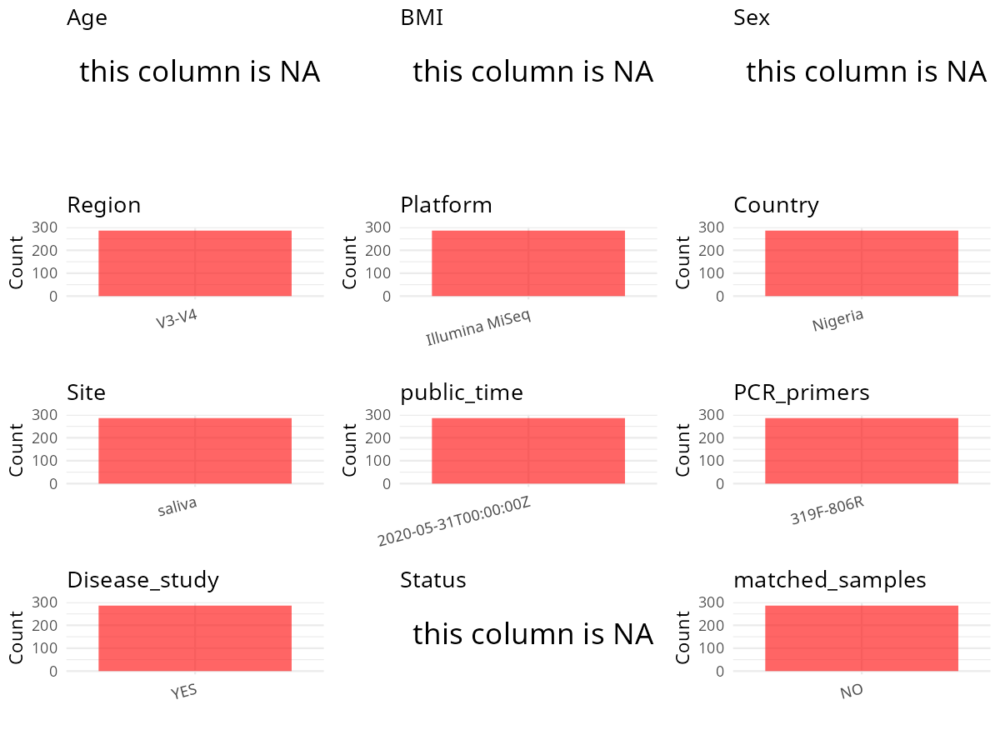

R Notebook: Metadata Processing Workflow
================

# Step 1: Obtain Initial Metadata from Each Project

To obtain the initial metadata: 1. Search for the BioProject ID (e.g.,
“PRJEBXXXX”) on the [NCBI SRA
website](https://www.ncbi.nlm.nih.gov/Traces/study/). 2. In the “Select”
table, click on “Metadata” and download the file. 3. The downloaded file
is typically named “SraRunTable.csv” and contains metadata for the
project.

``` r
# Load necessary libraries
library(dplyr)
library(ggplot2)
library(cowplot)
library(stringr)

# Set working directory (update this path to your local directory)
setwd("/home/hby/oral_project/PRJNA575737")

# Read the initial metadata files
initial_meta <- read.csv("SraRunTable.csv", header = T)

# Combine the two metadata files
# meta <- rbind(initial_meta, initial_meta1)

# Remove entries non-oral samples
# initial_meta <- subset(initial_meta,isolate %in% c("saliva","tongue coat"))

# Check the number of samples containing "HT" in Sample.Name (e.g., healthy controls)
# nrow(subset(meta, grepl("HT", Sample.Name)))

# Display the first few rows of the metadata
head(initial_meta)
```

    ##           Run Assay.Type AvgSpotLen    Bases  BioProject    BioSample              BioSampleModel    Bytes                                                               Center.Name
    ## 1 SRR11886365   AMPLICON        579 29910165 PRJNA575737 SAMN13013551 Metagenome or environmental 15885557 UNIVERSITY OF MARYLAND SCHOOL OF MEDICINE - INSTITUTE FOR GENOME SCIENCES
    ## 2 SRR11886366   AMPLICON        579 24587048 PRJNA575737 SAMN13013728 Metagenome or environmental 13199972 UNIVERSITY OF MARYLAND SCHOOL OF MEDICINE - INSTITUTE FOR GENOME SCIENCES
    ## 3 SRR11886367   AMPLICON        579 22468264 PRJNA575737 SAMN13013727 Metagenome or environmental 12069629 UNIVERSITY OF MARYLAND SCHOOL OF MEDICINE - INSTITUTE FOR GENOME SCIENCES
    ## 4 SRR11886368   AMPLICON        579 27478639 PRJNA575737 SAMN13013726 Metagenome or environmental 14784392 UNIVERSITY OF MARYLAND SCHOOL OF MEDICINE - INSTITUTE FOR GENOME SCIENCES
    ## 5 SRR11886369   AMPLICON        579 17709427 PRJNA575737 SAMN13013725 Metagenome or environmental  9421045 UNIVERSITY OF MARYLAND SCHOOL OF MEDICINE - INSTITUTE FOR GENOME SCIENCES
    ## 6 SRR11886370   AMPLICON        579 14704701 PRJNA575737 SAMN13013724 Metagenome or environmental  7972040 UNIVERSITY OF MARYLAND SCHOOL OF MEDICINE - INSTITUTE FOR GENOME SCIENCES
    ##   Collection_Date Consent DATASTORE.filetype DATASTORE.provider                     DATASTORE.region Experiment geo_loc_name_country geo_loc_name_country_continent
    ## 1        2014/4/8  public   fastq,run.zq,sra         gs,ncbi,s3 gs.us-east1,ncbi.public,s3.us-east-1 SRX8433903              Nigeria                         Africa
    ## 2       2014/9/26  public   fastq,run.zq,sra         gs,ncbi,s3 gs.us-east1,ncbi.public,s3.us-east-1 SRX8434156              Nigeria                         Africa
    ## 3       2014/9/26  public   fastq,run.zq,sra         gs,ncbi,s3 gs.us-east1,ncbi.public,s3.us-east-1 SRX8434155              Nigeria                         Africa
    ## 4       2014/9/25  public   fastq,run.zq,sra         gs,ncbi,s3 gs.us-east1,ncbi.public,s3.us-east-1 SRX8434154              Nigeria                         Africa
    ## 5       2014/9/18  public   fastq,run.zq,sra         gs,ncbi,s3 gs.us-east1,ncbi.public,s3.us-east-1 SRX8434153              Nigeria                         Africa
    ## 6       2014/9/18  public   fastq,run.zq,sra         gs,ncbi,s3 gs.us-east1,ncbi.public,s3.us-east-1 SRX8434152              Nigeria                         Africa
    ##                                                   geo_loc_name         HOST     Instrument isolation_source               lat_lon  Library.Name LibraryLayout LibrarySelection
    ## 1 Nigeria: University of Benin Teaching Hospital\\, Benin city Homo sapiens Illumina MiSeq           saliva 6.334986 N 5.603747 E DUP.H00114CSA        PAIRED              PCR
    ## 2 Nigeria: University of Benin Teaching Hospital\\, Benin city Homo sapiens Illumina MiSeq           saliva 6.334986 N 5.603747 E DUP.H00376CSA        PAIRED              PCR
    ## 3 Nigeria: University of Benin Teaching Hospital\\, Benin city Homo sapiens Illumina MiSeq           saliva 6.334986 N 5.603747 E DUP.H00375CSA        PAIRED              PCR
    ## 4 Nigeria: University of Benin Teaching Hospital\\, Benin city Homo sapiens Illumina MiSeq           saliva 6.334986 N 5.603747 E DUP.H00373CSA        PAIRED              PCR
    ## 5 Nigeria: University of Benin Teaching Hospital\\, Benin city Homo sapiens Illumina MiSeq           saliva 6.334986 N 5.603747 E DUP.H00370CSA        PAIRED              PCR
    ## 6 Nigeria: University of Benin Teaching Hospital\\, Benin city Homo sapiens Illumina MiSeq           saliva 6.334986 N 5.603747 E DUP.H00369CSA        PAIRED              PCR
    ##   LibrarySource         Organism Platform   PTID          ReleaseDate          create_date version   Sample.Name SRA.Study
    ## 1   METAGENOMIC human metagenome ILLUMINA H00114 2020-05-31T00:00:00Z 2020-05-31T22:44:00Z       1 DUP.H00114CSA SRP265420
    ## 2   METAGENOMIC human metagenome ILLUMINA H00376 2020-05-31T00:00:00Z 2020-05-31T22:44:00Z       1 DUP.H00376CSA SRP265420
    ## 3   METAGENOMIC human metagenome ILLUMINA H00375 2020-05-31T00:00:00Z 2020-05-31T22:44:00Z       1 DUP.H00375CSA SRP265420
    ## 4   METAGENOMIC human metagenome ILLUMINA H00373 2020-05-31T00:00:00Z 2020-05-31T22:44:00Z       1 DUP.H00373CSA SRP265420
    ## 5   METAGENOMIC human metagenome ILLUMINA H00370 2020-05-31T00:00:00Z 2020-05-31T22:44:00Z       1 DUP.H00370CSA SRP265420
    ## 6   METAGENOMIC human metagenome ILLUMINA H00369 2020-05-31T00:00:00Z 2020-05-31T22:44:00Z       1 DUP.H00369CSA SRP265420

# Step 2: Create a Uniform Metadata Template

The uniform metadata should include the following columns:

1.  **BioProject**: Project ID (e.g., “PRJNA339212”)
2.  **Run**: Sample ID (e.g., “ERRXXXXXX” or “SRRXXXXXX”)
3.  **sample_name**: Original sample name submitted by the authors (not
    the database-assigned ID)
4.  **Age**: Age of the subject (if available)
5.  **BMI**: Body Mass Index (if available)
6.  **Sex**: Sex of the subject (“F” or “M”)
7.  **Region**: Targeted 16S rRNA region (e.g., “V3-V4”)
8.  **Platform**: Sequencing platform (e.g., “Illumina MiSeq”)
9.  **Country**: Country of sample origin (e.g., “China”)
10. **Site**: Sample site (e.g., “saliva”, “dental plaque”)
11. **public_time**: Data release date (format: “YYYY-MM-DD”)
12. **PCR_primers**: PCR primers used (e.g., “515F-806R”)
13. **title**: Title of the associated publication
14. **Disease_study**: Whether the study involves a disease (“YES” or
    “NO”)
15. **Status**: Disease status (e.g., “T2DM”, “HC”). Note: If the study
    includes both disease and healthy samples, this must be specified
    per sample.
16. **matched_samples**: matched samples (“YES” or “NO”)

``` r
# Create a uniform metadata dataframe
metadata <- data.frame(
  BioProject = initial_meta$BioProject,
  Run = initial_meta$Run,
  sample_name = initial_meta$PTID,
  Platform = initial_meta$Instrument,
  Country = initial_meta$geo_loc_name_country,
  public_time = initial_meta$ReleaseDate,
  Site = initial_meta$isolation_source,
  Sex = NA,
  Age = NA,
  BMI = NA,
  Status = NA
)
```

# Step 3: Manually Add Information from the Publication

Some information (e.g. PCR primers, study title, disease status) must be
manually extracted from the publication and added to the metadata.

``` r
# Add information obtained from the publication
metadata$Region <- "V3-V4"
metadata$PCR_primers <- "319F-806R"
metadata$title <- "Immune status and not HIV infection or exposure、 drives the development of the oral microbiota"
metadata$Disease_study <- "YES"
metadata$matched_samples <- "NO"
```

# Step 4: Summarize and Validate the Metadata

``` r
# Check the number of unique runs and sample names
print(paste("Number of unique runs:", length(unique(metadata$Run))))
```

    ## [1] "Number of unique runs: 286"

``` r
print(paste("Number of unique sample names:", length(unique(metadata$sample_name))))
```

    ## [1] "Number of unique sample names: 286"

# Step 5: Visualize the Metadata

``` r

```


# Step 6: Finalize and Export the Metadata

``` r
# Reorder columns to match the desired format
metadata <- metadata[, c(
  "BioProject", "Run", "sample_name", "Age", "BMI", "Sex",
  "Region", "Platform", "Country", "Site", "public_time",
  "PCR_primers", "title", "Disease_study", "Status", "matched_samples"
)]

# Export the uniform metadata to a CSV file
write.csv(metadata, file = "metadata.csv", quote = FALSE)
head(metadata)
```

    ##    BioProject         Run sample_name Age BMI Sex Region       Platform Country   Site          public_time PCR_primers
    ## 1 PRJNA575737 SRR11886365      H00114  NA  NA  NA  V3-V4 Illumina MiSeq Nigeria saliva 2020-05-31T00:00:00Z   319F-806R
    ## 2 PRJNA575737 SRR11886366      H00376  NA  NA  NA  V3-V4 Illumina MiSeq Nigeria saliva 2020-05-31T00:00:00Z   319F-806R
    ## 3 PRJNA575737 SRR11886367      H00375  NA  NA  NA  V3-V4 Illumina MiSeq Nigeria saliva 2020-05-31T00:00:00Z   319F-806R
    ## 4 PRJNA575737 SRR11886368      H00373  NA  NA  NA  V3-V4 Illumina MiSeq Nigeria saliva 2020-05-31T00:00:00Z   319F-806R
    ## 5 PRJNA575737 SRR11886369      H00370  NA  NA  NA  V3-V4 Illumina MiSeq Nigeria saliva 2020-05-31T00:00:00Z   319F-806R
    ## 6 PRJNA575737 SRR11886370      H00369  NA  NA  NA  V3-V4 Illumina MiSeq Nigeria saliva 2020-05-31T00:00:00Z   319F-806R
    ##                                                                                             title Disease_study Status matched_samples
    ## 1 Immune status and not HIV infection or exposure、 drives the development of the oral microbiota           YES     NA              NO
    ## 2 Immune status and not HIV infection or exposure、 drives the development of the oral microbiota           YES     NA              NO
    ## 3 Immune status and not HIV infection or exposure、 drives the development of the oral microbiota           YES     NA              NO
    ## 4 Immune status and not HIV infection or exposure、 drives the development of the oral microbiota           YES     NA              NO
    ## 5 Immune status and not HIV infection or exposure、 drives the development of the oral microbiota           YES     NA              NO
    ## 6 Immune status and not HIV infection or exposure、 drives the development of the oral microbiota           YES     NA              NO

## Notes for Students:

1.  **Metadata Accuracy**: Always cross-check the metadata with the
    original publication to ensure accuracy.
2.  **Manual Entries**: Columns like `PCR_primers`, and `Status` often
    require manual entry based on the publication.
3.  **Disease Status**: Be careful when assigning `Status`—some studies
    include both disease and healthy samples.
4.  **Visualization**: The plots help quickly identify the distribution
    of values in each column, which is useful for quality control.
5.  **Reproducibility**: Update the working directory and file paths to
    match your local environment.
