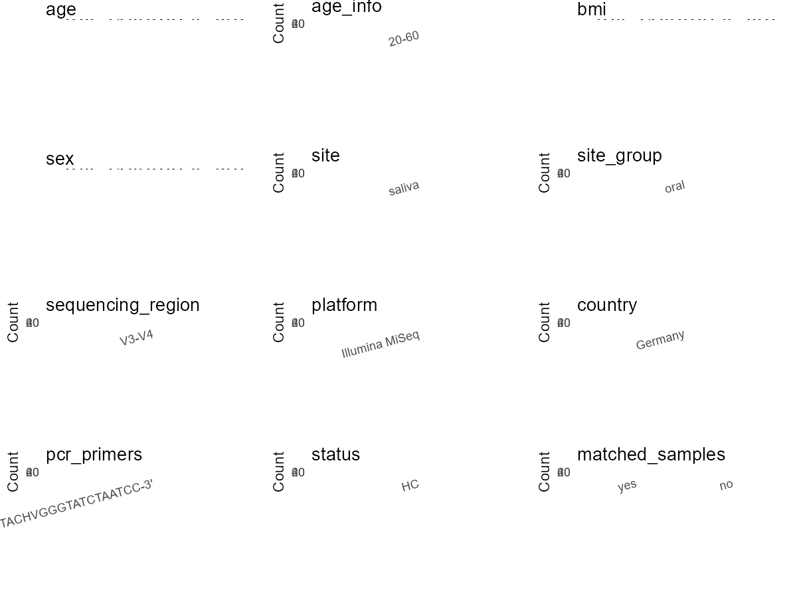

# Step 1: Obtain Initial Metadata from Each Project

This step sets the project directory, loads the raw SRA metadata, and optionally merges supplement tables.

```{r message=FALSE, warning=FALSE}
# =============================================================
# Curation Notes - PRJNA577839
# bioproject   : initial_meta column 'BioProject'
# sample_id    : initial_meta column 'Run' (SRR accession)
# subject_id   : raw_subject_id from initial_meta 'Sample.Name'; extract via regex (10_F_16_TG_Sn_3 -> 16); 38 unique IDs
# age          : NA — no individual age in CSV; paper gives group mean only
# age_info     : "20-60" — paper Results: "range 20-60 years"
# bmi          : NA — no individual BMI; paper Table 1 gives group mean ~23
# sex          : NA — no sex column in SRA metadata
# sequencing_region : "V3-V4" — paper Methods
# platform     : "Illumina MiSeq" — paper Methods
# country      : initial_meta column 'geo_loc_name_country'
# site         : raw_site from initial_meta 'env_medium'; trimws -> "saliva"
# site_group   : "oral" — saliva is oral site
# disease_study: "no" — healthy endurance athletes cohort
# status       : "HC" — paper Methods: "good general health" inclusion criteria
# matched_samples : pending — computed in Step 5 from subject_id frequency
# title        : paper title
# public_time  : initial_meta column 'ReleaseDate'
# pcr_primers  : paper Methods primer sequences (5'-CCTACGGGNGGCWGCAG-3' and 5'-GACTACHVGGGTATCTAATCC-3')
# is_time_series: "no" — two time points (T0/T3) but not longitudinal time series design
# controls     : none in SRA table
# non-human    : none — all "human oral metagenome"
# =============================================================

# Load libraries
library(dplyr)
library(ggplot2)
library(cowplot)

# (1) Setting working directory
# EDIT HERE: change project_id for each study
project_id <- "PRJNA577839"

base_dir <- "D:/metadata_collect/oral_metadata_new/update"
setwd(file.path(base_dir, project_id))

# (2) Loading raw SRA metadata file
sra_file <- "SraRunTable.csv"
initial_meta <- read.csv(sra_file, header = TRUE)

# (3) OPTIONAL: If extra metadata (e.g., Table.x or supplemental materials) are available from the article, you may need to merge the file with initial_meta manually. Below is example code for merging. Depending on the specific case of each study, you can customize the code as needed.
# supp_table <- read.csv("supplemental_table.csv", header = TRUE)
# initial_meta <- left_join(initial_meta, supp_table, by = merge_col_name)
```

# Step 2: Data Overview

First, you need to get an overview of the data, which includes two steps: reading the article and reading the initial metadata. This step is very IMPORTANT!

```{r message=FALSE, warning=FALSE}
# (1) Read the article in the following order: abstract, the beginning of the results section, and the methods. Understand the sample size, experimental design, and disease group overview. Clarify the sampling sites; for oral and gut samples, specify the exact sites like supragingival plaque, tongue, etc.

# Paper: "Influence of the long-term use of oral hygiene products containing stannous ions on the salivary microbiome - a randomized controlled trial"
# - RCT, 54 recruited, 38 remaining (16 TG, 22 CG) after dropout
# - Sampling site: stimulated saliva
# - Platform: Illumina MiSeq, V3-V4 region, primers 5'-CCTACGGGNGGCWGCAG-3' and 5'-GACTACHVGGGTATCTAATCC-3'
# - Two time points: T0 (baseline), T3 (3 years later) - same subjects
# - Healthy endurance athletes, not disease study
# - Age range 20-60 years (group mean ~36-38, no individual ages in paper)
# - Group info encoded in Sample Name column: _TG_ = treatment group, _CG_ = control group

# (2) IMPORTANT: MUST go through each column of initial_meta
# head(initial_meta, 10)

# IMPORTANT: Check the unique values in the column of interest or query column.
# lapply(initial_meta[c('body_habitat', 'body_product', 'body_site')], table)
# table(initial_meta$Organism)  # all "human oral metagenome"
# table(initial_meta$env_medium) # all "saliva"
# table(initial_meta$Host)  # all "Homo sapiens"
# table(initial_meta$platform..exp.)  # all "ILLUMINA"
# table(initial_meta$Collection_Date)  # 2013-10 to 2016-12
# unique(initial_meta$`Sample Name`)  # encodes group (_CG_ / _TG_) and sample number
```

# Step 3: Removing Control and Non-human Samples

First, we need to remove control samples(including both negative controls and positive controls) and non-human samples.

```{r}
# (1) EDIT HERE: Parameter setup
control_column <- ""   # no negative/blank control runs in SRA table; mock community not listed as SRA run
# unique(initial_meta[[control_column]])
control_keywords <- c()     # no control samples to remove

species_column <- "Organism"          # column name in initial_meta
unique(initial_meta[[species_column]])
non_human_keywords <- c()            # all samples are "human oral metagenome", no non-human


# (2) Remove controls and non-human samples. DO NOT need to modify code in this part, just run it.
n_samples <- nrow(initial_meta)
# Control evaluation
if (length(control_keywords) > 0) {
  if (is.null(control_column) || control_column == "") {
    stop("Error: control_keywords provided but control_column is missing.")
  }

  if (!(control_column %in% colnames(initial_meta))) {
    stop(sprintf("Error: Column '%s' not found in initial_meta.", control_column))
  }

  control_pattern <- paste(control_keywords, collapse = "|")
  control_text <- initial_meta[[control_column]]
  is_control <- grepl(control_pattern, control_text)

} else {
  is_control <- rep(FALSE, n_samples)
}

# Non-human evaluation
if (length(non_human_keywords) > 0) {
  if (is.null(species_column) || species_column == "") {
    stop("Error: non_human_keywords provided but species_column is missing.")
  }

  if (!(species_column %in% colnames(initial_meta))) {
    stop(sprintf("Error: Column '%s' not found in initial_meta.", species_column))
  }

  non_human_pattern <- paste(non_human_keywords, collapse = "|")
  species_text <- initial_meta[[species_column]]
  is_non_human <- grepl(non_human_pattern, species_text)
} else {
  is_non_human <- rep(FALSE, n_samples)
}

# Execute removal
samples_to_remove <- is_control | is_non_human
initial_meta <- initial_meta[!samples_to_remove, ]

cat("Initial samples counts:",n_samples,"\n")
cat("Removed control samples:", sum(is_control), "\n")
cat("Removed non-human samples:", sum(is_non_human), "\n")
cat("Total samples removed ", sum(samples_to_remove), "\n")
cat("Remaining samples after Step 2:", nrow(initial_meta), "\n")
```

# Step 4: Creating a Uniform Metadata Template

This step converts the raw SRA table into the standard metadata format used in our meta-analysis.
The uniform metadata should include the following columns:
1. **bioproject**: Project ID from SRA or other database
2. **sample_id**: SRA sample/run ID. Unique id for each sample!
3. **subject_id**: subject id for each person if available.
4. **age**: Age of the subject if available.
5. **age_info**: If the age is not explicitly stated but approximate age range information is available, mark it in this column.
6. **bmi**: Body Mass Index if available.
7. **sex**: Sex of the subject.
8. **sequencing_region**: Targeted 16S rRNA region.
9. **platform**: Sequencing platform.
10. **country**: Country of sample origin.
11. **site**: Sampling site. For oral and gut sites, specify the exact sites as detailed as possible.
12. **site_group**: only accepts one of following three values: 'oral', 'gut', or 'other'.
13. **public_time**: Data release date.
14. **pcr_primers**: PCR primers used.
15. **title**: Title of the associated publication.
16. **disease_study**: Whether the study involves disease samples.
17. **status**: Disease status for each sample if available.
18. **matched_samples**: Whether the subject has matched samples.
19. **is_time_series**: Whether the study is a time series study.

```{r}
# Extract columns from initial_meta as follows: (1) No modification needed -> extract directly. (2) Modification needed -> create a new column with the prefix raw_ and mark the original column as "pending". (3) Need to find or determine based on the article.
metadata <- data.frame(
  # From initial_meta column 'BioProject'
  bioproject = initial_meta$BioProject,
  # From initial_meta column 'Run' (SRR accession)
  sample_id = initial_meta$Run,
  # raw_subject_id from initial_meta 'Sample.Name' (read.csv converts space to dot); subject_id extracted from pattern e.g. 10_F_16_TG_Sn_3 -> 16
  raw_subject_id = initial_meta$Sample.Name,
  subject_id = "pending",
  # No individual age column in CSV; paper gives only group mean
  age = NA,
  # From paper Results: "range 20-60 years"
  age_info = "20-60",
  # No individual BMI in CSV
  bmi = NA,
  sex = NA,
  # From paper Methods: V3-V4 region
  sequencing_region = "V3-V4",
  # From paper Methods: Illumina MiSeq
  platform = "Illumina MiSeq",
  # From initial_meta column 'geo_loc_name_country'
  country = initial_meta$geo_loc_name_country,
  # raw_site from initial_meta 'env_medium'; all values "saliva"
  raw_site = initial_meta$env_medium,
  site = "pending",
  site_group = "pending",
  # From initial_meta column 'ReleaseDate'
  public_time = initial_meta$ReleaseDate,
  # From paper Methods: primer sequences for v3-v4 regions
  pcr_primers = "5'-CCTACGGGNGGCWGCAG-3' and 5'-GACTACHVGGGTATCTAATCC-3'",
  # From paper title
  title = "Influence of the long-term use of oral hygiene products containing stannous ions on the salivary microbiome - a randomized controlled trial",
  # From paper: healthy endurance athletes, inclusion criteria "good general health"
  disease_study = "no",
  status = "HC",
  matched_samples = "pending",
  # Paper: two time points but not treated as time series
  is_time_series = "no",
  stringsAsFactors = FALSE
)
metadata$public_time <- as.Date(metadata$public_time)
```

# Step 5: Manually solving pending issues

This step involves two parts: (1) handle the columns with the `raw_` prefix, and next (2) handle the `site_group` and `matched_samples` columns.

```{r}
# (1) Handle the columns with the `raw_` prefix.
# Extract subject_id from Sample.Name pattern: e.g., 10_F_16_TG_Sn_3 -> 16
# The number between the second underscore group and the group code (CG/TG)
metadata$subject_id <- gsub("^[0-9]+_[A-Z]+_([0-9]+)_.*$", "\\1", metadata$raw_subject_id)
cat("Unique subject IDs:", length(unique(metadata$subject_id)), "\n")

# site from env_medium column — strip whitespace, verify unique values
metadata$site <- trimws(metadata$raw_site)
cat("Unique sites:", paste(unique(metadata$site), collapse = ", "), "\n")
```

```{r}
# (2) Filling the 'site_group' and 'matched_samples' columns
# editing site_group
unique(metadata$site)
# EDIT HERE: add oral sites
Oral_site = c("saliva")
# EDIT HERE: add gut sites
Gut_site = c()
# just run
metadata <- metadata %>%
  mutate(site_group = case_when(
    site %in% Oral_site ~ "oral",
    site %in% Gut_site ~ "gut",
    TRUE ~ "other"
  ))

# editing matched_samples, just run.
metadata$matched_samples <- ifelse(
  ave(metadata$subject_id, metadata$subject_id, FUN = length) > 1,
  "yes",
  "no"
)

# Check: should be exactly 38 unique subjects
cat("Unique subjects:", length(unique(metadata$subject_id)), "\n")
```

```{r}
# (3) check if there is pending value in metadata. If there is pending value, go on modify the metadata.
# Function to check if a column contains "pending"
has_pending <- function(col) {
  if (is.character(col) || is.factor(col)) {
    any(col == "pending", na.rm = TRUE)
  } else {
    FALSE
  }
}

# Check for any pending value
any_pending_value <- any(sapply(metadata, has_pending))

if (!any_pending_value) {
  message("Good! No cell contains the value 'pending'.")
} else {
  pending_cols <- names(metadata)[sapply(metadata, has_pending)]
  message("Columns containing 'pending': ", paste(pending_cols, collapse = ", "))
  message("Please continue to resolve these pending columns!")
}
```

# Step 6: Visualize the Metadata

This step makes a quick set of plots for checking the distribution of key metadata fields.

```{r}
# Select columns for visualization, just run
plot_data <- metadata %>%
  select(-bioproject, -sample_id, -subject_id, -title)

create_simple_plots <- function(data) {
  plots <- list()
  continuous_vars <- c("age", "bmi")

  for (col in colnames(data)) {
    if (all(is.na(data[[col]]))) {
      p <- ggplot() +
        annotate("text", x = 0.5, y = 0.5, label = "this column is NA", size = 6) +
        labs(title = col) +
        theme_void()
    } else if (col %in% continuous_vars && is.numeric(data[[col]])) {
      p <- ggplot(data, aes(x = .data[[col]])) +
        geom_histogram(fill = "blue", alpha = 0.6, bins = 20, na.rm = TRUE) +
        labs(title = col, x = col, y = "Count") +
        theme_minimal()
    } else {
      count_data <- as.data.frame(table(data[[col]], useNA = "ifany"))
      p <- ggplot(count_data, aes(x = reorder(Var1, -Freq), y = Freq)) +
        geom_col(fill = "red", alpha = 0.6) +
        labs(title = col, x = NULL, y = "Count") +
        theme_minimal() +
        theme(axis.text.x = element_text(angle = 15, hjust = 1))
    }
    plots[[col]] <- p
  }

  return(plots)
}

# Generate and arrange plots
plots <- create_simple_plots(plot_data)
p <- plot_grid(plots$age,
               plots$age_info,
               plots$bmi,
               plots$sex,
               plots$site,
               plots$site_group,
               plots$sequencing_region,
               plots$platform,
               plots$country,
               plots$pcr_primers,
               plots$status,
               plots$matched_samples,
               ncol = 3, align = "hv", axis = "lb")
ggsave("Metadata_Summary_v2.png", plot = p, width = 8, height = 6, dpi = 150)
```

```{r}
# Insert Metadata_Summary_v2.png into the current Rmd output

```

# Step 7: Sort and export the metadata

This step saves the cleaned metadata table as the final `metadata.csv` file.

```{r}
# Reorder the data frame
fixed_cols <- c("bioproject", "sample_id", "subject_id", "age", "age_info",
                "bmi", "sex", "platform", "sequencing_region", "pcr_primers", 
                "country", "site", "site_group", "disease_study", "status", 
                "title", "public_time", "matched_samples", "is_time_series")  
metadata <- metadata %>%
  select(all_of(fixed_cols), everything())

# save metadata 
# head(metadata)
write.csv(metadata, file = "metadata_v2.csv", quote = TRUE)
```
