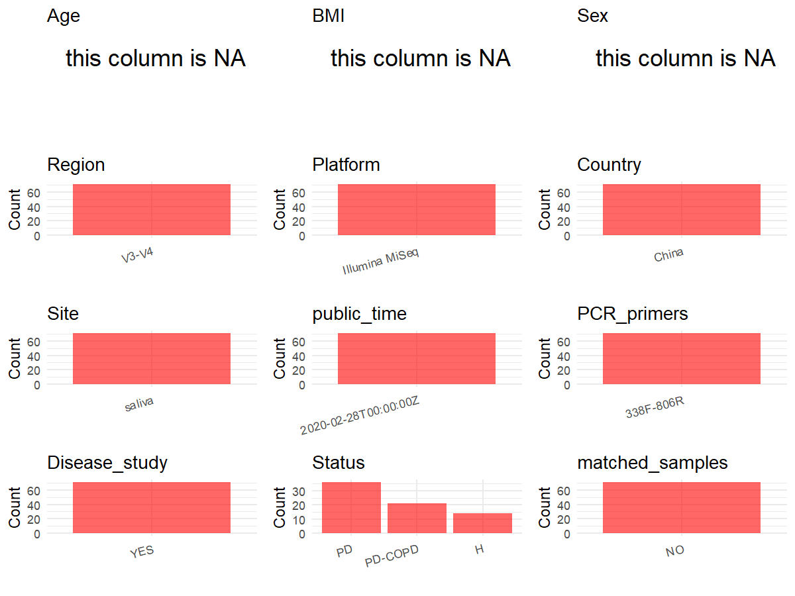

R Notebook: Metadata Processing Workflow
================

# Step 1: Obtain Initial Metadata from Each Project

To obtain the initial metadata: 1. Search for the BioProject ID (e.g.,
“PRJEBXXXX”) on the [NCBI SRA
website](https://www.ncbi.nlm.nih.gov/Traces/study/). 2. In the “Select”
table, click on “Metadata” and download the file. 3. The downloaded file
is typically named “SraRunTable.csv” and contains metadata for the
project.

``` r
# Load necessary libraries
library(dplyr)
library(ggplot2)
library(cowplot)

# Set working directory (update this path to your local directory)
setwd("D:/metadata/3/PRJNA578492")

# Read the initial metadata files
initial_meta<-read.csv("SraRunTable.csv",header = T)

# Combine the two metadata files
#meta <- rbind(initial_meta, initial_meta1)

#Remove entries non-oral samples
#initial_meta <- subset(initial_meta,BioSampleModel != "Metagenome or environmental")

# Check the number of samples containing "HT" in Sample.Name (e.g., healthy controls)
#nrow(subset(meta, grepl("HT", Sample.Name)))

# Display the first few rows of the metadata
head(initial_meta)
```

    ##           Run Assay.Type AvgSpotLen     Bases  BioProject    BioSample
    ## 1 SRR10318288   AMPLICON        501  68211267 PRJNA578492 SAMN13064501
    ## 2 SRR10318289   AMPLICON        501  99911460 PRJNA578492 SAMN13064500
    ## 3 SRR10318290   AMPLICON        501  48093699 PRJNA578492 SAMN13064562
    ## 4 SRR10318291   AMPLICON        501  40628839 PRJNA578492 SAMN13064499
    ## 5 SRR10318292   AMPLICON        501 105318127 PRJNA578492 SAMN13064561
    ## 6 SRR10318293   AMPLICON        501  53039103 PRJNA578492 SAMN13064560
    ##                                  BioSampleModel    Bytes
    ## 1 MIMARKS.specimen,MIGS/MIMS/MIMARKS.human-oral 46741800
    ## 2 MIMARKS.specimen,MIGS/MIMS/MIMARKS.human-oral 66444657
    ## 3 MIMARKS.specimen,MIGS/MIMS/MIMARKS.human-oral 32864131
    ## 4 MIMARKS.specimen,MIGS/MIMS/MIMARKS.human-oral 27863837
    ## 5 MIMARKS.specimen,MIGS/MIMS/MIMARKS.human-oral 72668254
    ## 6 MIMARKS.specimen,MIGS/MIMS/MIMARKS.human-oral 36531135
    ##                                        Center.Name Collection_Date Consent
    ## 1 CAPITAL MEDICAL UNIVERSITY SCHOOL OF STOMATOLOGY         2014-11  public
    ## 2 CAPITAL MEDICAL UNIVERSITY SCHOOL OF STOMATOLOGY         2014-11  public
    ## 3 CAPITAL MEDICAL UNIVERSITY SCHOOL OF STOMATOLOGY         2015-02  public
    ## 4 CAPITAL MEDICAL UNIVERSITY SCHOOL OF STOMATOLOGY         2014-11  public
    ## 5 CAPITAL MEDICAL UNIVERSITY SCHOOL OF STOMATOLOGY         2015-02  public
    ## 6 CAPITAL MEDICAL UNIVERSITY SCHOOL OF STOMATOLOGY         2015-02  public
    ##   DATASTORE.filetype DATASTORE.provider                     DATASTORE.region
    ## 1   fastq,run.zq,sra         gs,ncbi,s3 gs.us-east1,ncbi.public,s3.us-east-1
    ## 2   fastq,run.zq,sra         gs,ncbi,s3 gs.us-east1,ncbi.public,s3.us-east-1
    ## 3   fastq,run.zq,sra         gs,ncbi,s3 gs.us-east1,ncbi.public,s3.us-east-1
    ## 4   fastq,run.zq,sra         gs,ncbi,s3 gs.us-east1,ncbi.public,s3.us-east-1
    ## 5   fastq,run.zq,sra         gs,ncbi,s3 gs.us-east1,ncbi.public,s3.us-east-1
    ## 6   fastq,run.zq,sra         gs,ncbi,s3 gs.us-east1,ncbi.public,s3.us-east-1
    ##   env_broad_scale env_local_scale     env_medium Experiment
    ## 1  not applicable  not applicable not applicable SRX7029275
    ## 2  not applicable  not applicable not applicable SRX7029274
    ## 3  not applicable  not applicable not applicable SRX7029273
    ## 4  not applicable  not applicable not applicable SRX7029272
    ## 5  not applicable  not applicable not applicable SRX7029271
    ## 6  not applicable  not applicable not applicable SRX7029270
    ##   geo_loc_name_country geo_loc_name_country_continent  geo_loc_name
    ## 1                China                           Asia China:beijing
    ## 2                China                           Asia China:beijing
    ## 3                China                           Asia China:beijing
    ## 4                China                           Asia China:beijing
    ## 5                China                           Asia China:beijing
    ## 6                China                           Asia China:beijing
    ##           HOST     Instrument isol_growth_condt isolate        lat_lon
    ## 1 Homo sapiens Illumina MiSeq    not applicable   Humam not applicable
    ## 2 Homo sapiens Illumina MiSeq    not applicable   Humam not applicable
    ## 3 Homo sapiens Illumina MiSeq    not applicable   Humam not applicable
    ## 4 Homo sapiens Illumina MiSeq    not applicable   Humam not applicable
    ## 5 Homo sapiens Illumina MiSeq    not applicable   Humam not applicable
    ## 6 Homo sapiens Illumina MiSeq    not applicable   Humam not applicable
    ##   Library.Name LibraryLayout LibrarySelection LibrarySource         Organism
    ## 1    library10        PAIRED              PCR       GENOMIC human metagenome
    ## 2     library9        PAIRED              PCR       GENOMIC human metagenome
    ## 3    library71        PAIRED              PCR       GENOMIC human metagenome
    ## 4     library8        PAIRED              PCR       GENOMIC human metagenome
    ## 5    library70        PAIRED              PCR       GENOMIC human metagenome
    ## 6    library69        PAIRED              PCR       GENOMIC human metagenome
    ##   Platform          ReleaseDate          create_date version Sample.Name
    ## 1 ILLUMINA 2020-02-28T00:00:00Z 2019-10-23T20:18:00Z       1     HSMHC10
    ## 2 ILLUMINA 2020-02-28T00:00:00Z 2019-10-23T20:18:00Z       1      HSMHC9
    ## 3 ILLUMINA 2020-02-28T00:00:00Z 2019-10-23T20:18:00Z       1     HSMPD36
    ## 4 ILLUMINA 2020-02-28T00:00:00Z 2019-10-23T20:18:00Z       1      HSMHC8
    ## 5 ILLUMINA 2020-02-28T00:00:00Z 2019-10-23T20:18:00Z       1     HSMPD35
    ## 6 ILLUMINA 2020-02-28T00:00:00Z 2019-10-23T20:18:00Z       1     HSMPD34
    ##   SRA.Study        strain
    ## 1 SRP226473 not collected
    ## 2 SRP226473 not collected
    ## 3 SRP226473 not collected
    ## 4 SRP226473 not collected
    ## 5 SRP226473 not collected
    ## 6 SRP226473 not collected

# Step 2: Create a Uniform Metadata Template

The uniform metadata should include the following columns:

1.  **BioProject**: Project ID (e.g., “PRJNA339212”)
2.  **Run**: Sample ID (e.g., “ERRXXXXXX” or “SRRXXXXXX”)
3.  **sample_name**: Original sample name submitted by the authors (not
    the database-assigned ID)
4.  **Age**: Age of the subject (if available)
5.  **BMI**: Body Mass Index (if available)
6.  **Sex**: Sex of the subject (“F” or “M”)
7.  **Region**: Targeted 16S rRNA region (e.g., “V3-V4”)
8.  **Platform**: Sequencing platform (e.g., “Illumina MiSeq”)
9.  **Country**: Country of sample origin (e.g., “China”)
10. **Site**: Sample site (e.g., “saliva”, “dental plaque”)
11. **public_time**: Data release date (format: “YYYY-MM-DD”)
12. **PCR_primers**: PCR primers used (e.g., “515F-806R”)
13. **title**: Title of the associated publication
14. **Disease_study**: Whether the study involves a disease (“YES” or
    “NO”)
15. **Status**: Disease status (e.g., “T2DM”, “HC”). Note: If the study
    includes both disease and healthy samples, this must be specified
    per sample.
16. **matched_samples**: matched samples (“YES” or “NO”)

``` r
# Create a uniform metadata dataframe
metadata <- data.frame(
  BioProject = initial_meta$BioProject,
  Run = initial_meta$Run,
  sample_name = initial_meta$Sample.Name,
  Age = NA,
  BMI = NA,
  Sex=NA,
  Region = "V3-V4",
  Platform = initial_meta$Instrument,
  Country = initial_meta$geo_loc_name_country,
  Site = "saliva",
  public_time = initial_meta$ReleaseDate,
  Status      = ifelse(grepl("^HSMHC",  initial_meta$Sample.Name), "H",
                       ifelse(grepl("^HSMPD",  initial_meta$Sample.Name), "PD",
                              ifelse(grepl("^HSMCOPD", initial_meta$Sample.Name), "PD-COPD",NA))),
  stringsAsFactors = FALSE
)
```

# Step 3: Manually Add Information from the Publication

Some information (e.g. PCR primers, study title, disease status) must be
manually extracted from the publication and added to the metadata.

``` r
# Add information obtained from the publication
metadata$PCR_primers <- "338F-806R"
metadata$title <- "Saliva Microbiome Changes in Patients With Periodontitis With and Without Chronic Obstructive Pulmonary Disease"
metadata$Disease_study <- "YES"
# Assign disease status based on sample_name patterns


metadata$matched_samples <- "NO"
```

# Step 4: Summarize and Validate the Metadata

``` r
# Check the number of unique runs and sample names
print(paste("Number of unique runs:", length(unique(metadata$Run))))
```

    ## [1] "Number of unique runs: 71"

``` r
print(paste("Number of unique sample names:", length(unique(metadata$sample_name))))
```

    ## [1] "Number of unique sample names: 71"

# Step 5: Visualize the Metadata

``` r

```

<!-- -->

# Step 6: Finalize and Export the Metadata

``` r
# Reorder columns to match the desired format
metadata <- metadata[, c(
  "BioProject", "Run", "sample_name", "Age", "BMI", "Sex", 
  "Region", "Platform", "Country", "Site", "public_time", 
  "PCR_primers", "title", "Disease_study", "Status","matched_samples"
)]

# Export the uniform metadata to a CSV file
write.csv(metadata, file = "metadata.csv", quote = TRUE)
head(metadata)
```

    ##    BioProject         Run sample_name Age BMI Sex Region       Platform Country
    ## 1 PRJNA578492 SRR10318288     HSMHC10  NA  NA  NA  V3-V4 Illumina MiSeq   China
    ## 2 PRJNA578492 SRR10318289      HSMHC9  NA  NA  NA  V3-V4 Illumina MiSeq   China
    ## 3 PRJNA578492 SRR10318290     HSMPD36  NA  NA  NA  V3-V4 Illumina MiSeq   China
    ## 4 PRJNA578492 SRR10318291      HSMHC8  NA  NA  NA  V3-V4 Illumina MiSeq   China
    ## 5 PRJNA578492 SRR10318292     HSMPD35  NA  NA  NA  V3-V4 Illumina MiSeq   China
    ## 6 PRJNA578492 SRR10318293     HSMPD34  NA  NA  NA  V3-V4 Illumina MiSeq   China
    ##     Site          public_time PCR_primers
    ## 1 saliva 2020-02-28T00:00:00Z   338F-806R
    ## 2 saliva 2020-02-28T00:00:00Z   338F-806R
    ## 3 saliva 2020-02-28T00:00:00Z   338F-806R
    ## 4 saliva 2020-02-28T00:00:00Z   338F-806R
    ## 5 saliva 2020-02-28T00:00:00Z   338F-806R
    ## 6 saliva 2020-02-28T00:00:00Z   338F-806R
    ##                                                                                                             title
    ## 1 Saliva Microbiome Changes in Patients With Periodontitis With and Without Chronic Obstructive Pulmonary Disease
    ## 2 Saliva Microbiome Changes in Patients With Periodontitis With and Without Chronic Obstructive Pulmonary Disease
    ## 3 Saliva Microbiome Changes in Patients With Periodontitis With and Without Chronic Obstructive Pulmonary Disease
    ## 4 Saliva Microbiome Changes in Patients With Periodontitis With and Without Chronic Obstructive Pulmonary Disease
    ## 5 Saliva Microbiome Changes in Patients With Periodontitis With and Without Chronic Obstructive Pulmonary Disease
    ## 6 Saliva Microbiome Changes in Patients With Periodontitis With and Without Chronic Obstructive Pulmonary Disease
    ##   Disease_study Status matched_samples
    ## 1           YES      H              NO
    ## 2           YES      H              NO
    ## 3           YES     PD              NO
    ## 4           YES      H              NO
    ## 5           YES     PD              NO
    ## 6           YES     PD              NO

## Notes for Students:

1.  **Metadata Accuracy**: Always cross-check the metadata with the
    original publication to ensure accuracy.
2.  **Manual Entries**: Columns like `PCR_primers`, and `Status` often
    require manual entry based on the publication.
3.  **Disease Status**: Be careful when assigning `Status`—some studies
    include both disease and healthy samples.
4.  **Visualization**: The plots help quickly identify the distribution
    of values in each column, which is useful for quality control.
5.  **Reproducibility**: Update the working directory and file paths to
    match your local environment.
