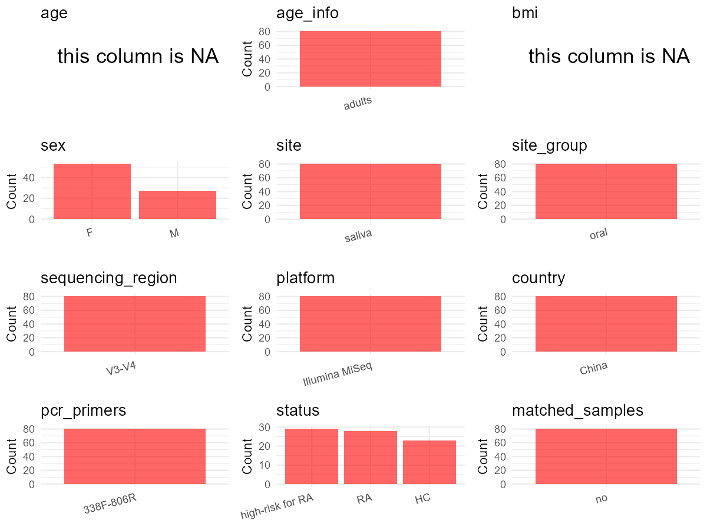

# Step 1: Obtain Initial Metadata from Each Project

This step sets the project directory, loads the raw SRA metadata, and optionally merges supplement tables.

```{r message=FALSE, warning=FALSE}
# =============================================================
# Curation Notes - PRJNA578951
# bioproject    : initial_meta 'BioProject'
# sample_id     : initial_meta 'Run' (SRR IDs)
# subject_id    : initial_meta 'Library Name' (stripped "trim." prefix and ".fq" suffix)
# age           : NA — CSV Host_age is all "50" (placeholder), not true individual ages
# age_info      : Paper Methods — "adults" (subjects >= 18 years old)
# bmi           : NA — not available in metadata or paper per-sample
# sex           : initial_meta 'host_sex'; "male"->"M", "female"->"F"
# sequencing_region : Paper Methods — V3-V4
# platform      : Paper Methods — Illumina MiSeq
# country       : Paper Methods — "China" (recruited from West China Hospital, Sichuan University)
# site          : initial_meta 'isolation_source' (saliva)
# site_group    : "oral" — saliva is oral site
# pcr_primers   : Paper Methods — 338F-806R
# title         : Paper title
# disease_study : "yes" — RA study
# status        : initial_meta 'Library Name'; sH/sHC->HC, spre->high-risk for RA, sR/sRA->RA (HC=23, high-risk for RA=29, RA=28; paper reports 27 RA)
# matched_samples: "pending" — resolved at runtime by subject_id uniqueness
# is_time_series: "no" — cross-sectional design; no repeated sampling of same individual
# controls      : none
# non-human     : Organism column, all Homo sapiens
# =============================================================

# Load libraries
library(dplyr)
library(ggplot2)
library(cowplot)

# (1) Setting working directory
# EDIT HERE: change project_id for each study
project_id <- "PRJNA578951"

base_dir <- "D:/metadata_collect/oral_metadata_new/update"
setwd(file.path(base_dir, project_id))

# (2) Loading raw SRA metadata file
sra_file <- "SraRunTable.csv"
initial_meta <- read.csv(sra_file, header = TRUE)

# (3) OPTIONAL: If extra metadata (e.g., Table.x or supplemental materials) are available from the article, you may need to merge the file with initial_meta manually. Below is example code for merging. Depending on the specific case of each study, you can customize the code as needed.
# supp_table <- read.csv("supplemental_table.csv", header = TRUE)
# initial_meta <- left_join(initial_meta, supp_table, by = merge_col_name)
```

# Step 2: Data Overview

First, you need to get an overview of the data, which includes two steps: reading the article and reading the initial metadata. This step is very IMPORTANT!

```{r message=FALSE, warning=FALSE}
# (1) Read the article: abstract, results opening, methods.
#   - 79 saliva samples: 29 high-risk (ACPA+, no clinical arthritis), 27 RA patients, 23 HCs
#   - Site: saliva; Platform: Illumina MiSeq; Region: V3-V4; Primers: 338F-806R
#   - All subjects >= 18 years; mean age: RA=51.1, high-risk=48.1, HC=49.5
#   - Sex: varies (see Table 1 in paper)
#   - Country: China (West China Hospital, Sichuan University)
#   - Disease study: yes (RA)

# (2) IMPORTANT: MUST go through each column of initial_meta
# Column mapping from SraRunTable.csv:
#   Run = sample ID (SRRxxxxxxx)
#   BioProject = project ID
#   Host_age = age (all listed as 50)
#   host_sex = male/female
#   isolation_source = saliva
#   geo_loc_name_country = China
#   Organism = Homo sapiens
#   Sample Name = human saliva1..80 (subject identifier, not usable as individual ID)
#   Platform = ILLUMINA
#   ReleaseDate = public time
#   Library Name = file names like trim.sH20.fq, trim.spre027.fq (strip trim.s prefix and .fq suffix to get subject hints)

# IMPORTANT: Check the unique values in the column of interest or query column.
# lapply(initial_meta[c('isolation_source', 'geo_loc_name_country')], table)
# table(initial_meta$host_sex)          # male / female
# table(initial_meta$Host_age)           # all 50
# table(initial_meta$Organism)           # Homo sapiens
# table(initial_meta$platform..exp.)     # ILLUMINA
```

# Step 3: Removing Control and Non-human Samples

First, we need to remove control samples(including both negative controls and positive controls) and non-human samples.

```{r}
# (1) EDIT HERE: Parameter setup
control_column <- ""   # No control samples (negative/positive controls) in this study
# unique(initial_meta[[control_column]])
control_keywords <- c()     # No controls

species_column <- "Organism"          # column name in initial_meta
unique(initial_meta[[species_column]])
non_human_keywords <- c("Mus musculus", "Rattus", "dog", "cat", "pig", "cow")  # non-human species


# (2) Remove controls and non-human samples. DO NOT need to modify code in this part, just run it.
n_samples <- nrow(initial_meta)
# Control evaluation
if (length(control_keywords) > 0) {
  if (is.null(control_column) || control_column == "") {
    stop("Error: control_keywords provided but control_column is missing.")
  }
  
  if (!(control_column %in% colnames(initial_meta))) {
    stop(sprintf("Error: Column '%s' not found in initial_meta.", control_column))
  }
  
  control_pattern <- paste(control_keywords, collapse = "|")
  control_text <- initial_meta[[control_column]]
  is_control <- grepl(control_pattern, control_text)
  
} else {
  is_control <- rep(FALSE, n_samples)
}

# Non-human evaluation
if (length(non_human_keywords) > 0) {
  if (is.null(species_column) || species_column == "") {
    stop("Error: non_human_keywords provided but species_column is missing.")
  }
  
  if (!(species_column %in% colnames(initial_meta))) {
    stop(sprintf("Error: Column '%s' not found in initial_meta.", species_column))
  }
  
  non_human_pattern <- paste(non_human_keywords, collapse = "|")
  species_text <- initial_meta[[species_column]]
  is_non_human <- grepl(non_human_pattern, species_text)
} else {
  is_non_human <- rep(FALSE, n_samples)
}

# Execute removal
samples_to_remove <- is_control | is_non_human
initial_meta <- initial_meta[!samples_to_remove, ]

cat("Initial samples counts:",n_samples,"\n")
cat("Removed control samples:", sum(is_control), "\n")
cat("Removed non-human samples:", sum(is_non_human), "\n")
cat("Total samples removed ", sum(samples_to_remove), "\n")
cat("Remaining samples after Step 2:", nrow(initial_meta), "\n")
```

# Step 4: Creating a Uniform Metadata Template

This step converts the raw SRA table into the standard metadata format used in our meta-analysis.
The uniform metadata should include the following columns:
1. **bioproject**: Project ID from SRA or other database
   e.g. `PRJNA1234`, `CNP1234`, 'OEP1234', 'qiita_1234'
2. **sample_id**: SRA sample/run ID. Unique id for each sample!
   e.g. `DRR1234567`, `ERR1234567` and `SRR1234567`. If no such column exists, can use column like sample_name.
3. **subject_id**: subject id for each person if available.
   e.g. `patient_01`, `Host_03_before`, `subject12`
4. **age**: Age of the subject if available.
   e.g. `35`, `42` | not `adult`, `chilren`
5. **age_info**: If the age is not explicitly stated but approximate age range information is available, mark it in this column.
   e.g., `18-55`, `children`, `infant`, `elder`
6. **bmi**: Body Mass Index if available.
   e.g. `22.5`, `18.9` | not `normal`, `overweight`
7. **sex**: Sex of the subject.
   Mandatory to write as M/F | not `female`, `woman`
8. **sequencing_region**: Targeted 16S rRNA region.
   e.g. `V3-V4`, `V4` 
9. **platform**: Sequencing platform.
   e.g. `Illumina MiSeq`, `454 GS FLX Titanium`, `Ion Torrent`
10. **country**: Country of sample origin.
   e.g. `China`, `Japan` | not city name like `Beijing`
11. **site**: Sampling site. For oral and gut sites, specify the exact sites as detailed as possible. For example, if it is known to be supragingival plaque, do not record it as 'dental plaque', unless the original text provides only a vague description. 
    e.g. `saliva`, `tongue coating` | not broad term like `oral`
12. **site_group**: only accepts one of following three values: 'oral', 'gut', or 'other'.
13. **public_time**: Data release date. 
    e.g. `2021-06-22` | not `June 2021`
14. **pcr_primers**: PCR primers used.
    e.g. `515F-806R`, `27F-338R` | not primer sequences
15. **title**: Title of the associated publication.
16. **disease_study**: Whether the study involves disease samples. If it's not clear, can record as NA. Only three values accepted: 'yes', 'no' or NA
17. **status**: Disease status for each sample if available, else record as NA. Only accept following abbreviations, Write full names for all other diseases.
    HC: healthy control
    CD: Crohn's disease
    CRC: colorectal cancer
    COPD: chronic obstructive pulmonary disease
    HIV: human immunodeficiency virus
    ICU: intensive care unit
    OSCC: oral squamous cell carcinoma
    RA: rheumatoid arthritis
    UC: ulcerative colitis
18. **matched_samples**: Whether the subject has matched samples. Only accept 'yes' or 'no'.
19. **is_time_series**: Whether the study is a time series study. Only accept 'yes' or 'no'.

```{r}
# Extract columns from initial_meta as follows: (1) No modification needed → extract directly. (2) Modification needed → create a new column with the prefix raw_ and mark the original column as “pending”. (3) Need to find or determine based on the article.
metadata <- data.frame(
  bioproject = initial_meta$BioProject,
  sample_id = initial_meta$Run,
  subject_id = gsub("\\.fq$", "", gsub("^trim\\.s", "", initial_meta$Library.Name)),  # From initial_meta 'Library Name', stripped "trim.s" prefix and ".fq" suffix
  age = NA,                             # CSV Host_age is all "50" (placeholder), not true individual ages; paper only reports group means
  age_info = "adults",                       # From paper Methods "Subjects from all three study groups were >= 18 years old"
  bmi = NA,
  raw_sex = initial_meta$host_sex,         # From initial_meta 'host_sex': "male"/"female"
  sex = "pending",
  sequencing_region = "V3-V4",             # From paper Methods "V3-V4 hypervariable regions"
  platform = "Illumina MiSeq",             # From paper Methods "Illumina MiSeq platform"
  country = "China",               # From paper Methods "recruited from West China Hospital, Sichuan University, China"
  raw_site = initial_meta$isolation_source,     # From initial_meta 'isolation_source': "saliva"
  site = "pending",
  site_group = "pending",
  public_time = initial_meta$ReleaseDate,
  pcr_primers = "338F-806R",               # From paper Methods: 338F and 806R
  title = "Oral Microbiota Perturbations Are Linked to High Risk for Rheumatoid Arthritis",  # From paper title
  disease_study = "yes",                   # RA study — paper investigates rheumatoid arthritis
  raw_status = initial_meta$Library.Name,  # From initial_meta 'Library Name': sH/sHC=HC, spre=Pre, sR/sRA=RA
  status = "pending",
  matched_samples = "pending",
  is_time_series = "no",                   # Cross-sectional design; no repeated sampling of same individual
  stringsAsFactors = FALSE
)
metadata$public_time <- as.Date(metadata$public_time)
```

# Step 5: Manually solving pending issues

This step involves two parts: (1) handle the columns with the `raw_` prefix, and next (2) handle the `site_group` and `matched_samples` columns.

```{r}
# (1) Handle the columns with the `raw_` prefix.
metadata <- metadata %>%
  mutate(sex = case_when(
    raw_sex == "male" ~ "M",
    raw_sex == "female" ~ "F",
    TRUE ~ NA_character_
  )) # From initial_meta 'host_sex' column: "male" -> "M", "female" -> "F"

# status: derived from 'Library Name' prefix — sH/sHC=HC, spre=high-risk for RA, sR/sRA=RA
# counts: HC=23 (sH=19, sHC=4), high-risk for RA=29 (spre), RA=28 (sR=7, sRA=21); paper reports 27 RA (1 excluded after QC)
metadata <- metadata %>%
  mutate(status = case_when(
    grepl("^trim\\.sH", raw_status) | grepl("^trim\\.sHC", raw_status) ~ "HC",
    grepl("^trim\\.spre", raw_status) ~ "high-risk for RA",
    grepl("^trim\\.sR", raw_status) | grepl("^trim\\.sRA", raw_status) ~ "RA",
    TRUE ~ NA_character_
  )) # From initial_meta 'Library Name': sH/sHC -> HC, spre -> Pre (high-risk), sR/sRA -> RA

metadata$site <- metadata$raw_site  # isolation_source is already "saliva", no transformation needed
```

```{r}
# (2) Filling the 'site_group' and 'matched_samples' columns
# editing site_group
unique(metadata$site)
# EDIT HERE: add oral sites
Oral_site = c("saliva")
# EDIT HERE: add gut sites
Gut_site = c("feces")
# just run
metadata <- metadata %>%
  mutate(site_group = case_when(
    site %in% Oral_site ~ "oral",
    site %in% Gut_site ~ "gut",
    TRUE ~ "other" 
  ))

# editing matched_samples, just run.
metadata$matched_samples <- ifelse(
  ave(metadata$subject_id, metadata$subject_id, FUN = length) > 1,
  "yes",
  "no"
)
```

```{r}
# (3) check if there is pending value in metadata. If there is pending value, go on modify the metadata.
# Function to check if a column contains "pending"
has_pending <- function(col) {
  if (is.character(col) || is.factor(col)) {
    any(col == "pending", na.rm = TRUE)
  } else {
    FALSE
  }
}

# Check for any pending value
any_pending_value <- any(sapply(metadata, has_pending))

if (!any_pending_value) {
  message("Good! No cell contains the value 'pending'.")
} else {
  pending_cols <- names(metadata)[sapply(metadata, has_pending)]
  message("Columns containing 'pending': ", paste(pending_cols, collapse = ", "))
  message("Please continue to resolve these pending columns!")
}
```

# Step 6: Visualize the Metadata

This step makes a quick set of plots for checking the distribution of key metadata fields.

```{r}
# Select columns for visualization, just run
plot_data <- metadata %>%
  select(-bioproject, -sample_id, -subject_id, -title)

create_simple_plots <- function(data) {
  plots <- list()
  continuous_vars <- c("age", "bmi")

  for (col in colnames(data)) {
    if (all(is.na(data[[col]]))) {
      p <- ggplot() +
        annotate("text", x = 0.5, y = 0.5, label = "this column is NA", size = 6) +
        labs(title = col) +
        theme_void()
    } else if (col %in% continuous_vars && is.numeric(data[[col]])) {
      p <- ggplot(data, aes(x = .data[[col]])) +
        geom_histogram(fill = "blue", alpha = 0.6, bins = 20, na.rm = TRUE) +
        labs(title = col, x = col, y = "Count") +
        theme_minimal()
    } else {
      count_data <- as.data.frame(table(data[[col]], useNA = "ifany"))
      p <- ggplot(count_data, aes(x = reorder(Var1, -Freq), y = Freq)) +
        geom_col(fill = "red", alpha = 0.6) +
        labs(title = col, x = NULL, y = "Count") +
        theme_minimal() +
        theme(axis.text.x = element_text(angle = 15, hjust = 1))
    }
    plots[[col]] <- p
  }

  return(plots)
}

# Generate and arrange plots
plots <- create_simple_plots(plot_data)
p <- plot_grid(plots$age,
               plots$age_info,
               plots$bmi,
               plots$sex,
               plots$site,
               plots$site_group,
               plots$sequencing_region,
               plots$platform,
               plots$country,
               plots$pcr_primers,
               plots$status,
               plots$matched_samples,
               ncol = 3, align = "hv", axis = "lb")
ggsave("Metadata_Summary_v2.png", plot = p, width = 8, height = 6, dpi = 150)
```

```{r}
# Insert Metadata_Summary_v2.png into the current Rmd output

```

# Step 7: Sort and export the metadata

This step saves the cleaned metadata table as the final `metadata.csv` file.

```{r}
# Reorder the data frame
fixed_cols <- c("bioproject", "sample_id", "subject_id", "age", "age_info",
                "bmi", "sex", "platform", "sequencing_region", "pcr_primers", 
                "country", "site", "site_group", "disease_study", "status", 
                "title", "public_time", "matched_samples", "is_time_series")  
metadata <- metadata %>%
  select(all_of(fixed_cols), everything())

# save metadata 
# head(metadata)
write.csv(metadata, file = "metadata_v2.csv", quote = TRUE)
```
