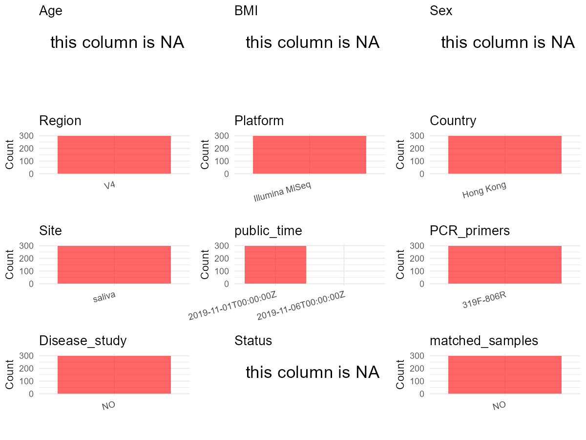

R Notebook: Metadata Processing Workflow
================

# Step 1: Obtain Initial Metadata from Each Project

To obtain the initial metadata: 1. Search for the BioProject ID (e.g.,
“PRJEBXXXX”) on the [NCBI SRA
website](https://www.ncbi.nlm.nih.gov/Traces/study/). 2. In the “Select”
table, click on “Metadata” and download the file. 3. The downloaded file
is typically named “SraRunTable.csv” and contains metadata for the
project.

``` r
# Load necessary libraries
library(dplyr)
library(ggplot2)
library(cowplot)

# Set working directory (update this path to your local directory)
setwd("D:/studylearning/董彪师兄项目/任务4_20251009/PRJNA586897")

# Read the initial metadata files
initial_meta<-read.csv("SraRunTable.csv",header = T)

# Display the first few rows of the metadata
head(initial_meta)
```

    ##           Run Assay.Type AvgSpotLen   Bases  BioProject    BioSample
    ## 1 SRR10381652   AMPLICON        294 8348424 PRJNA586897 SAMN13174208
    ## 2 SRR10381653   AMPLICON        298 6716920 PRJNA586897 SAMN13174207
    ## 3 SRR10381654   AMPLICON        293 6095572 PRJNA586897 SAMN13174206
    ## 4 SRR10381655   AMPLICON        299 4552275 PRJNA586897 SAMN13174205
    ## 5 SRR10381656   AMPLICON        298 5830370 PRJNA586897 SAMN13174204
    ## 6 SRR10381657   AMPLICON        298 7402022 PRJNA586897 SAMN13174203
    ##                                  BioSampleModel   Bytes
    ## 1 MIMARKS.specimen,MIGS/MIMS/MIMARKS.human-oral 4949747
    ## 2 MIMARKS.specimen,MIGS/MIMS/MIMARKS.human-oral 3150670
    ## 3 MIMARKS.specimen,MIGS/MIMS/MIMARKS.human-oral 3642197
    ## 4 MIMARKS.specimen,MIGS/MIMS/MIMARKS.human-oral 2740937
    ## 5 MIMARKS.specimen,MIGS/MIMS/MIMARKS.human-oral 2697143
    ## 6 MIMARKS.specimen,MIGS/MIMS/MIMARKS.human-oral 3415774
    ##                        Center.Name Collection_Date Consent Cultivar
    ## 1 INTERNATIONAL MEDICAL UNIVERSITY            2015  public       NA
    ## 2 INTERNATIONAL MEDICAL UNIVERSITY            2015  public       NA
    ## 3 INTERNATIONAL MEDICAL UNIVERSITY            2015  public       NA
    ## 4 INTERNATIONAL MEDICAL UNIVERSITY            2015  public       NA
    ## 5 INTERNATIONAL MEDICAL UNIVERSITY            2015  public       NA
    ## 6 INTERNATIONAL MEDICAL UNIVERSITY            2015  public       NA
    ##   DATASTORE.filetype DATASTORE.provider                     DATASTORE.region
    ## 1   fastq,run.zq,sra         gs,ncbi,s3 gs.us-east1,ncbi.public,s3.us-east-1
    ## 2   fastq,run.zq,sra         gs,ncbi,s3 gs.us-east1,ncbi.public,s3.us-east-1
    ## 3   fastq,run.zq,sra         gs,ncbi,s3 gs.us-east1,ncbi.public,s3.us-east-1
    ## 4   fastq,run.zq,sra         gs,ncbi,s3 gs.us-east1,ncbi.public,s3.us-east-1
    ## 5   fastq,run.zq,sra         gs,ncbi,s3 gs.us-east1,ncbi.public,s3.us-east-1
    ## 6   fastq,run.zq,sra         gs,ncbi,s3 gs.us-east1,ncbi.public,s3.us-east-1
    ##   Ecotype env_broad_scale env_local_scale env_medium Experiment
    ## 1      NA              NA              NA         NA SRX7082761
    ## 2      NA              NA              NA         NA SRX7082760
    ## 3      NA              NA              NA         NA SRX7082759
    ## 4      NA              NA              NA         NA SRX7082758
    ## 5      NA              NA              NA         NA SRX7082757
    ## 6      NA              NA              NA         NA SRX7082756
    ##   geo_loc_name_country geo_loc_name_country_continent geo_loc_name        HOST
    ## 1            Hong Kong                           Asia    Hong Kong Homosapiens
    ## 2            Hong Kong                           Asia    Hong Kong Homosapiens
    ## 3            Hong Kong                           Asia    Hong Kong Homosapiens
    ## 4            Hong Kong                           Asia    Hong Kong Homosapiens
    ## 5            Hong Kong                           Asia    Hong Kong Homosapiens
    ## 6            Hong Kong                           Asia    Hong Kong Homosapiens
    ##       Instrument isol_growth_condt isolate              lat_lon Library.Name
    ## 1 Illumina MiSeq                NA      NA 22.3193 N 114.1694 E         E082
    ## 2 Illumina MiSeq                NA      NA 22.3193 N 114.1694 E         E081
    ## 3 Illumina MiSeq                NA      NA 22.3193 N 114.1694 E         E080
    ## 4 Illumina MiSeq                NA      NA 22.3193 N 114.1694 E         E056
    ## 5 Illumina MiSeq                NA      NA 22.3193 N 114.1694 E         E055
    ## 6 Illumina MiSeq                NA      NA 22.3193 N 114.1694 E         E054
    ##   LibraryLayout LibrarySelection LibrarySource         Organism Platform
    ## 1        PAIRED              PCR   METAGENOMIC human metagenome ILLUMINA
    ## 2        PAIRED              PCR   METAGENOMIC human metagenome ILLUMINA
    ## 3        PAIRED              PCR   METAGENOMIC human metagenome ILLUMINA
    ## 4        PAIRED              PCR   METAGENOMIC human metagenome ILLUMINA
    ## 5        PAIRED              PCR   METAGENOMIC human metagenome ILLUMINA
    ## 6        PAIRED              PCR   METAGENOMIC human metagenome ILLUMINA
    ##            ReleaseDate          create_date version sample_id Sample.Name
    ## 1 2019-11-01T00:00:00Z 2019-11-01T03:41:00Z       1      E082        E082
    ## 2 2019-11-01T00:00:00Z 2019-11-01T03:41:00Z       1      E081        E081
    ## 3 2019-11-01T00:00:00Z 2019-11-01T03:41:00Z       1      E080        E080
    ## 4 2019-11-01T00:00:00Z 2019-11-01T03:42:00Z       1      E056        E056
    ## 5 2019-11-01T00:00:00Z 2019-11-01T03:42:00Z       1      E055        E055
    ## 6 2019-11-01T00:00:00Z 2019-11-01T03:42:00Z       1      E054        E054
    ##   SRA.Study strain
    ## 1 SRP227886     NA
    ## 2 SRP227886     NA
    ## 3 SRP227886     NA
    ## 4 SRP227886     NA
    ## 5 SRP227886     NA
    ## 6 SRP227886     NA

# Step 2: Create a Uniform Metadata Template

The uniform metadata should include the following columns:

1.  **BioProject**: Project ID (e.g., “PRJNA339212”)
2.  **Run**: Sample ID (e.g., “ERRXXXXXX” or “SRRXXXXXX”)
3.  **sample_name**: Original sample name submitted by the authors (not
    the database-assigned ID)
4.  **Age**: Age of the subject (if available)
5.  **BMI**: Body Mass Index (if available)
6.  **Sex**: Sex of the subject (“F” or “M”)
7.  **Region**: Targeted 16S rRNA region (e.g., “V3-V4”)
8.  **Platform**: Sequencing platform (e.g., “Illumina MiSeq”)
9.  **Country**: Country of sample origin (e.g., “China”)
10. **Site**: Sample site (e.g., “saliva”, “dental plaque”)
11. **public_time**: Data release date (format: “YYYY-MM-DD”)
12. **PCR_primers**: PCR primers used (e.g., “515F-806R”)
13. **title**: Title of the associated publication
14. **Disease_study**: Whether the study involves a disease (“YES” or
    “NO”)
15. **Status**: Disease status (e.g., “T2DM”, “HC”). Note: If the study
    includes both disease and healthy samples, this must be specified
    per sample.

``` r
# Create a uniform metadata dataframe
metadata <- data.frame(
  BioProject = initial_meta$BioProject,
  Run = initial_meta$Run,
  sample_name = initial_meta$Sample.Name,
  Age = NA,
  BMI = NA,
  Sex= NA,
  Region = "V4",
  Platform = initial_meta$Instrument,
  Country = initial_meta$geo_loc_name_country,
  Site = "saliva",
  public_time = initial_meta$ReleaseDate,
  stringsAsFactors = FALSE
)
```

# Step 3: Manually Add Information from the Publication

Some information (e.g. PCR primers, study title, disease status) must be
manually extracted from the publication and added to the metadata.

``` r
# Add information obtained from the publication
metadata$PCR_primers <- "319F-806R"  # Update based on the publication
metadata$title <- "Long-term impact of oral surgery with or without amoxicillin on the oral microbiome-A prospective cohort study"
metadata$Disease_study <- "NO"
metadata$Status <- NA_character_

#extract subject id by remove prefix of sample_name
#metadata$sample_name <- gsub("_st|_sal", "", metadata$sample_name)

# Check initial data distribution
cat("Initial sample distribution:\n")
```

    ## Initial sample distribution:

``` r
table(metadata$sample_name)
```

    ## 
    ##  C030  C031  C032  C033  C034  C035  C040  C041  C042  C044  C045  C050  C051 
    ##     1     1     1     1     1     1     1     1     1     1     1     1     1 
    ##  C052  C053  C054  C055  C070  C071  C072  C073  C074  C075  C100  C101  C102 
    ##     1     1     1     1     1     1     1     1     1     1     1     1     1 
    ##  C103  C104  C105  C110  C111  C112  C113  C114  C115  C130  C131  C132  C133 
    ##     1     1     1     1     1     1     1     1     1     1     1     1     1 
    ##  C134  C135  C140  C141  C142  C143  C144  C145  C150  C151  C152  C153  C154 
    ##     1     1     1     1     1     1     1     1     1     1     1     1     1 
    ##  C155  C160  C161  C162  C163  C164  C165  C170  C171  C172  C173  C174  C175 
    ##     1     1     1     1     1     1     1     1     1     1     1     1     1 
    ##  E020  E021  E022  E023  E024  E025  E026  E030  E031  E032  E033  E034  E035 
    ##     1     1     1     1     1     1     1     1     1     1     1     1     1 
    ##  E036  E050  E051  E052  E053  E054  E055  E056  E080  E081  E082  E083  E084 
    ##     1     1     1     1     1     1     1     1     1     1     1     1     1 
    ##  E085  E086  E090  E091  E092  E093  E094  E095  E096  E110  E111  E112  E113 
    ##     1     1     1     1     1     1     1     1     1     1     1     1     1 
    ##  E114  E115  E116  E120  E121  E122  E123  E124  E125  E126  E130  E131  E132 
    ##     1     1     1     1     1     1     1     1     1     1     1     1     1 
    ##  E133  E134  E135  E136  E140  E141  E142  E143  E144  E145  E146  E210  E211 
    ##     1     1     1     1     1     1     1     1     1     1     1     1     1 
    ##  E212  E213  E214  E215  E216  E240  E241  E242  E243  E244  E245  E246  E280 
    ##     1     1     1     1     1     1     1     1     1     1     1     1     1 
    ##  E281  E282  E283  E284  E285  E286  E290  E291  E292  E293  E294  E295  E296 
    ##     1     1     1     1     1     1     1     1     1     1     1     1     1 
    ##  E330  E331  E332  E333  E334  E335  E336  E350  E351  E352  E353  E354  E355 
    ##     1     1     1     1     1     1     1     1     1     1     1     1     1 
    ##  E356  E401  E402  E403  E404  E405  E406  E410  E411  E412  E413  E414  E415 
    ##     1     1     1     1     1     1     1     1     1     1     1     1     1 
    ##  E416 EA010 EA011 EA012 EA013 EA014 EA015 EA016 EA040 EA041 EA042 EA043 EA045 
    ##     1     1     1     1     1     1     1     1     1     1     1     1     1 
    ## EA046 EA060 EA061 EA062 EA063 EA064 EA065 EA066 EA070 EA071 EA072 EA073 EA074 
    ##     1     1     1     1     1     1     1     1     1     1     1     1     1 
    ## EA075 EA076 EA150 EA151 EA152 EA153 EA154 EA155 EA156 EA160 EA161 EA162 EA163 
    ##     1     1     1     1     1     1     1     1     1     1     1     1     1 
    ## EA164 EA165 EA166 EA170 EA171 EA172 EA173 EA174 EA175 EA176 EA180 EA181 EA182 
    ##     1     1     1     1     1     1     1     1     1     1     1     1     1 
    ## EA183 EA184 EA185 EA186 EA200 EA201 EA202 EA203 EA204 EA205 EA206 EA220 EA221 
    ##     1     1     1     1     1     1     1     1     1     1     1     1     1 
    ## EA222 EA223 EA224 EA225 EA226 EA250 EA251 EA252 EA253 EA254 EA255 EA256 EA260 
    ##     1     1     1     1     1     1     1     1     1     1     1     1     1 
    ## EA261 EA262 EA263 EA264 EA265 EA266 EA270 EA271 EA272 EA273 EA274 EA275 EA276 
    ##     1     1     1     1     1     1     1     1     1     1     1     1     1 
    ## EA300 EA301 EA302 EA303 EA304 EA305 EA306 EA340 EA341 EA342 EA343 EA344 EA345 
    ##     1     1     1     1     1     1     1     1     1     1     1     1     1 
    ## EA346 EA370 EA371 EA372 EA373 EA374 EA375 EA376 EA421 EA422 EA423 EA424 EA425 
    ##     1     1     1     1     1     1     1     1     1     1     1     1     1 
    ## EA426 
    ##     1

``` r
table(metadata$Site)
```

    ## 
    ## saliva 
    ##    300

``` r
# Calculate sampling frequency per subject
sample_counts <- table(metadata$sample_name)
cat("\nNumber of samples per subject:\n")
```

    ## 
    ## Number of samples per subject:

``` r
print(sample_counts)
```

    ## 
    ##  C030  C031  C032  C033  C034  C035  C040  C041  C042  C044  C045  C050  C051 
    ##     1     1     1     1     1     1     1     1     1     1     1     1     1 
    ##  C052  C053  C054  C055  C070  C071  C072  C073  C074  C075  C100  C101  C102 
    ##     1     1     1     1     1     1     1     1     1     1     1     1     1 
    ##  C103  C104  C105  C110  C111  C112  C113  C114  C115  C130  C131  C132  C133 
    ##     1     1     1     1     1     1     1     1     1     1     1     1     1 
    ##  C134  C135  C140  C141  C142  C143  C144  C145  C150  C151  C152  C153  C154 
    ##     1     1     1     1     1     1     1     1     1     1     1     1     1 
    ##  C155  C160  C161  C162  C163  C164  C165  C170  C171  C172  C173  C174  C175 
    ##     1     1     1     1     1     1     1     1     1     1     1     1     1 
    ##  E020  E021  E022  E023  E024  E025  E026  E030  E031  E032  E033  E034  E035 
    ##     1     1     1     1     1     1     1     1     1     1     1     1     1 
    ##  E036  E050  E051  E052  E053  E054  E055  E056  E080  E081  E082  E083  E084 
    ##     1     1     1     1     1     1     1     1     1     1     1     1     1 
    ##  E085  E086  E090  E091  E092  E093  E094  E095  E096  E110  E111  E112  E113 
    ##     1     1     1     1     1     1     1     1     1     1     1     1     1 
    ##  E114  E115  E116  E120  E121  E122  E123  E124  E125  E126  E130  E131  E132 
    ##     1     1     1     1     1     1     1     1     1     1     1     1     1 
    ##  E133  E134  E135  E136  E140  E141  E142  E143  E144  E145  E146  E210  E211 
    ##     1     1     1     1     1     1     1     1     1     1     1     1     1 
    ##  E212  E213  E214  E215  E216  E240  E241  E242  E243  E244  E245  E246  E280 
    ##     1     1     1     1     1     1     1     1     1     1     1     1     1 
    ##  E281  E282  E283  E284  E285  E286  E290  E291  E292  E293  E294  E295  E296 
    ##     1     1     1     1     1     1     1     1     1     1     1     1     1 
    ##  E330  E331  E332  E333  E334  E335  E336  E350  E351  E352  E353  E354  E355 
    ##     1     1     1     1     1     1     1     1     1     1     1     1     1 
    ##  E356  E401  E402  E403  E404  E405  E406  E410  E411  E412  E413  E414  E415 
    ##     1     1     1     1     1     1     1     1     1     1     1     1     1 
    ##  E416 EA010 EA011 EA012 EA013 EA014 EA015 EA016 EA040 EA041 EA042 EA043 EA045 
    ##     1     1     1     1     1     1     1     1     1     1     1     1     1 
    ## EA046 EA060 EA061 EA062 EA063 EA064 EA065 EA066 EA070 EA071 EA072 EA073 EA074 
    ##     1     1     1     1     1     1     1     1     1     1     1     1     1 
    ## EA075 EA076 EA150 EA151 EA152 EA153 EA154 EA155 EA156 EA160 EA161 EA162 EA163 
    ##     1     1     1     1     1     1     1     1     1     1     1     1     1 
    ## EA164 EA165 EA166 EA170 EA171 EA172 EA173 EA174 EA175 EA176 EA180 EA181 EA182 
    ##     1     1     1     1     1     1     1     1     1     1     1     1     1 
    ## EA183 EA184 EA185 EA186 EA200 EA201 EA202 EA203 EA204 EA205 EA206 EA220 EA221 
    ##     1     1     1     1     1     1     1     1     1     1     1     1     1 
    ## EA222 EA223 EA224 EA225 EA226 EA250 EA251 EA252 EA253 EA254 EA255 EA256 EA260 
    ##     1     1     1     1     1     1     1     1     1     1     1     1     1 
    ## EA261 EA262 EA263 EA264 EA265 EA266 EA270 EA271 EA272 EA273 EA274 EA275 EA276 
    ##     1     1     1     1     1     1     1     1     1     1     1     1     1 
    ## EA300 EA301 EA302 EA303 EA304 EA305 EA306 EA340 EA341 EA342 EA343 EA344 EA345 
    ##     1     1     1     1     1     1     1     1     1     1     1     1     1 
    ## EA346 EA370 EA371 EA372 EA373 EA374 EA375 EA376 EA421 EA422 EA423 EA424 EA425 
    ##     1     1     1     1     1     1     1     1     1     1     1     1     1 
    ## EA426 
    ##     1

``` r
# Create matched_samples column
metadata$matched_samples <- ifelse(metadata$sample_name %in% names(sample_counts[sample_counts >= 2]), "YES", "NO")

cat("\nMatched samples distribution:\n")
```

    ## 
    ## Matched samples distribution:

``` r
table(metadata$matched_samples)
```

    ## 
    ##  NO 
    ## 300

``` r
# Identify samples for removal: single samples excluding saliva
single_samples <- names(sample_counts[sample_counts == 1])
samples_to_remove <- metadata$sample_name %in% single_samples & !(metadata$Site %in% c("saliva"))

cat("\nNumber of samples to be removed:", sum(samples_to_remove), "\n")
```

    ## 
    ## Number of samples to be removed: 0

``` r
# Remove identified samples
metadata_clean <- metadata[!samples_to_remove, ]

cat("\nFinal sample distribution after cleaning:\n")
```

    ## 
    ## Final sample distribution after cleaning:

``` r
table(metadata_clean$sample_name)
```

    ## 
    ##  C030  C031  C032  C033  C034  C035  C040  C041  C042  C044  C045  C050  C051 
    ##     1     1     1     1     1     1     1     1     1     1     1     1     1 
    ##  C052  C053  C054  C055  C070  C071  C072  C073  C074  C075  C100  C101  C102 
    ##     1     1     1     1     1     1     1     1     1     1     1     1     1 
    ##  C103  C104  C105  C110  C111  C112  C113  C114  C115  C130  C131  C132  C133 
    ##     1     1     1     1     1     1     1     1     1     1     1     1     1 
    ##  C134  C135  C140  C141  C142  C143  C144  C145  C150  C151  C152  C153  C154 
    ##     1     1     1     1     1     1     1     1     1     1     1     1     1 
    ##  C155  C160  C161  C162  C163  C164  C165  C170  C171  C172  C173  C174  C175 
    ##     1     1     1     1     1     1     1     1     1     1     1     1     1 
    ##  E020  E021  E022  E023  E024  E025  E026  E030  E031  E032  E033  E034  E035 
    ##     1     1     1     1     1     1     1     1     1     1     1     1     1 
    ##  E036  E050  E051  E052  E053  E054  E055  E056  E080  E081  E082  E083  E084 
    ##     1     1     1     1     1     1     1     1     1     1     1     1     1 
    ##  E085  E086  E090  E091  E092  E093  E094  E095  E096  E110  E111  E112  E113 
    ##     1     1     1     1     1     1     1     1     1     1     1     1     1 
    ##  E114  E115  E116  E120  E121  E122  E123  E124  E125  E126  E130  E131  E132 
    ##     1     1     1     1     1     1     1     1     1     1     1     1     1 
    ##  E133  E134  E135  E136  E140  E141  E142  E143  E144  E145  E146  E210  E211 
    ##     1     1     1     1     1     1     1     1     1     1     1     1     1 
    ##  E212  E213  E214  E215  E216  E240  E241  E242  E243  E244  E245  E246  E280 
    ##     1     1     1     1     1     1     1     1     1     1     1     1     1 
    ##  E281  E282  E283  E284  E285  E286  E290  E291  E292  E293  E294  E295  E296 
    ##     1     1     1     1     1     1     1     1     1     1     1     1     1 
    ##  E330  E331  E332  E333  E334  E335  E336  E350  E351  E352  E353  E354  E355 
    ##     1     1     1     1     1     1     1     1     1     1     1     1     1 
    ##  E356  E401  E402  E403  E404  E405  E406  E410  E411  E412  E413  E414  E415 
    ##     1     1     1     1     1     1     1     1     1     1     1     1     1 
    ##  E416 EA010 EA011 EA012 EA013 EA014 EA015 EA016 EA040 EA041 EA042 EA043 EA045 
    ##     1     1     1     1     1     1     1     1     1     1     1     1     1 
    ## EA046 EA060 EA061 EA062 EA063 EA064 EA065 EA066 EA070 EA071 EA072 EA073 EA074 
    ##     1     1     1     1     1     1     1     1     1     1     1     1     1 
    ## EA075 EA076 EA150 EA151 EA152 EA153 EA154 EA155 EA156 EA160 EA161 EA162 EA163 
    ##     1     1     1     1     1     1     1     1     1     1     1     1     1 
    ## EA164 EA165 EA166 EA170 EA171 EA172 EA173 EA174 EA175 EA176 EA180 EA181 EA182 
    ##     1     1     1     1     1     1     1     1     1     1     1     1     1 
    ## EA183 EA184 EA185 EA186 EA200 EA201 EA202 EA203 EA204 EA205 EA206 EA220 EA221 
    ##     1     1     1     1     1     1     1     1     1     1     1     1     1 
    ## EA222 EA223 EA224 EA225 EA226 EA250 EA251 EA252 EA253 EA254 EA255 EA256 EA260 
    ##     1     1     1     1     1     1     1     1     1     1     1     1     1 
    ## EA261 EA262 EA263 EA264 EA265 EA266 EA270 EA271 EA272 EA273 EA274 EA275 EA276 
    ##     1     1     1     1     1     1     1     1     1     1     1     1     1 
    ## EA300 EA301 EA302 EA303 EA304 EA305 EA306 EA340 EA341 EA342 EA343 EA344 EA345 
    ##     1     1     1     1     1     1     1     1     1     1     1     1     1 
    ## EA346 EA370 EA371 EA372 EA373 EA374 EA375 EA376 EA421 EA422 EA423 EA424 EA425 
    ##     1     1     1     1     1     1     1     1     1     1     1     1     1 
    ## EA426 
    ##     1

``` r
table(metadata_clean$Site)
```

    ## 
    ## saliva 
    ##    300

``` r
table(metadata_clean$matched_samples)
```

    ## 
    ##  NO 
    ## 300

``` r
# Use cleaned dataset for subsequent analysis
metadata <- metadata_clean
```

# Step 4: Summarize and Validate the Metadata

``` r
# Check the number of unique runs and sample names
print(paste("Number of unique runs:", length(unique(metadata$Run))))
```

    ## [1] "Number of unique runs: 300"

``` r
print(paste("Number of unique sample names:", length(unique(metadata$sample_name))))
```

    ## [1] "Number of unique sample names: 300"

# Step 5: Visualize the Metadata

``` r

```


# Step 6: Finalize and Export the Metadata

``` r
# Reorder columns to match the desired format
metadata <- metadata[, c(
  "BioProject", "Run", "sample_name", "Age", "BMI", "Sex", 
  "Region", "Platform", "Country", "Site", "public_time", 
  "PCR_primers", "title", "Disease_study", "Status","matched_samples"
)]

# Export the uniform metadata to a CSV file
write.csv(metadata, file = "metadata.csv", quote = FALSE)
head(metadata)
```

    ##    BioProject         Run sample_name Age BMI Sex Region       Platform
    ## 1 PRJNA586897 SRR10381652        E082  NA  NA  NA     V4 Illumina MiSeq
    ## 2 PRJNA586897 SRR10381653        E081  NA  NA  NA     V4 Illumina MiSeq
    ## 3 PRJNA586897 SRR10381654        E080  NA  NA  NA     V4 Illumina MiSeq
    ## 4 PRJNA586897 SRR10381655        E056  NA  NA  NA     V4 Illumina MiSeq
    ## 5 PRJNA586897 SRR10381656        E055  NA  NA  NA     V4 Illumina MiSeq
    ## 6 PRJNA586897 SRR10381657        E054  NA  NA  NA     V4 Illumina MiSeq
    ##     Country   Site          public_time PCR_primers
    ## 1 Hong Kong saliva 2019-11-01T00:00:00Z   319F-806R
    ## 2 Hong Kong saliva 2019-11-01T00:00:00Z   319F-806R
    ## 3 Hong Kong saliva 2019-11-01T00:00:00Z   319F-806R
    ## 4 Hong Kong saliva 2019-11-01T00:00:00Z   319F-806R
    ## 5 Hong Kong saliva 2019-11-01T00:00:00Z   319F-806R
    ## 6 Hong Kong saliva 2019-11-01T00:00:00Z   319F-806R
    ##                                                                                                            title
    ## 1 Long-term impact of oral surgery with or without amoxicillin on the oral microbiome-A prospective cohort study
    ## 2 Long-term impact of oral surgery with or without amoxicillin on the oral microbiome-A prospective cohort study
    ## 3 Long-term impact of oral surgery with or without amoxicillin on the oral microbiome-A prospective cohort study
    ## 4 Long-term impact of oral surgery with or without amoxicillin on the oral microbiome-A prospective cohort study
    ## 5 Long-term impact of oral surgery with or without amoxicillin on the oral microbiome-A prospective cohort study
    ## 6 Long-term impact of oral surgery with or without amoxicillin on the oral microbiome-A prospective cohort study
    ##   Disease_study Status matched_samples
    ## 1            NO   <NA>              NO
    ## 2            NO   <NA>              NO
    ## 3            NO   <NA>              NO
    ## 4            NO   <NA>              NO
    ## 5            NO   <NA>              NO
    ## 6            NO   <NA>              NO

## Notes for Students:

1.  **Metadata Accuracy**: Always cross-check the metadata with the
    original publication to ensure accuracy.
2.  **Manual Entries**: Columns like `PCR_primers`, and `Status` often
    require manual entry based on the publication.
3.  **Disease Status**: Be careful when assigning `Status`—some studies
    include both disease and healthy samples.
4.  **Visualization**: The plots help quickly identify the distribution
    of values in each column, which is useful for quality control.
5.  **Reproducibility**: Update the working directory and file paths to
    match your local environment.
