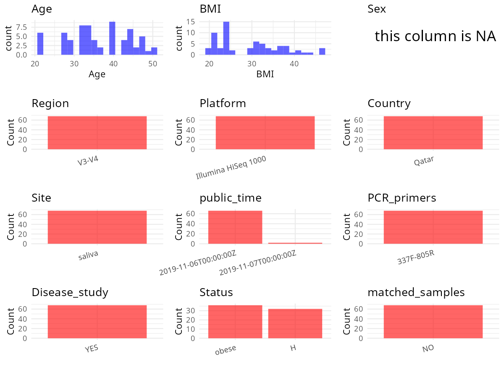

R Notebook: Metadata Processing Workflow
================

# Step 1: Obtain Initial Metadata from Each Project

To obtain the initial metadata: 1. Search for the BioProject ID (e.g.,
“PRJEBXXXX”) on the [NCBI SRA
website](https://www.ncbi.nlm.nih.gov/Traces/study/). 2. In the “Select”
table, click on “Metadata” and download the file. 3. The downloaded file
is typically named “SraRunTable.csv” and contains metadata for the
project.

``` r
# Load necessary libraries
library(dplyr)
library(ggplot2)
library(cowplot)
library(stringr)

# Set working directory (update this path to your local directory)
setwd("/home/hby/oral_project/PRJNA587625")

# Read the initial metadata files
initial_meta <- read.csv("SraRunTable.csv", header = T)

# Combine the two metadata files
# meta <- rbind(initial_meta, initial_meta1)

# Remove entries non-oral samples
# initial_meta <- subset(initial_meta,isolate %in% c("saliva","tongue coat"))

# Check the number of samples containing "HT" in Sample.Name (e.g., healthy controls)
# nrow(subset(meta, grepl("HT", Sample.Name)))

# Display the first few rows of the metadata
head(initial_meta)
```

    ##           Run Assay.Type AvgSpotLen    Bases  BioProject    BioSample              BioSampleModel    Bytes      Center.Name Collection_Date Consent DATASTORE.filetype DATASTORE.provider
    ## 1 SRR10394987   AMPLICON        602 55624198 PRJNA587625 SAMN13196113 Metagenome or environmental 31233979 QATAR UNIVERSITY            2018  public   fastq,run.zq,sra         gs,ncbi,s3
    ## 2 SRR10394988   AMPLICON        602 59538402 PRJNA587625 SAMN13196112 Metagenome or environmental 32683922 QATAR UNIVERSITY            2018  public   fastq,run.zq,sra         gs,ncbi,s3
    ## 3 SRR10394989   AMPLICON        602 35389774 PRJNA587625 SAMN13196111 Metagenome or environmental 21447452 QATAR UNIVERSITY            2018  public   fastq,run.zq,sra         gs,ncbi,s3
    ## 4 SRR10394990   AMPLICON        602 39575480 PRJNA587625 SAMN13196171 Metagenome or environmental 23671280 QATAR UNIVERSITY            2018  public   fastq,run.zq,sra         gs,ncbi,s3
    ## 5 SRR10394991   AMPLICON        602 53753784 PRJNA587625 SAMN13196170 Metagenome or environmental 29494350 QATAR UNIVERSITY            2018  public   fastq,run.zq,sra         gs,ncbi,s3
    ## 6 SRR10394992   AMPLICON        602 50086400 PRJNA587625 SAMN13196169 Metagenome or environmental 27409777 QATAR UNIVERSITY            2018  public   fastq,run.zq,sra         gs,ncbi,s3
    ##                       DATASTORE.region ethnicity Experiment experimental_factor geo_loc_name_country geo_loc_name_country_continent  geo_loc_name Host_Age host_body_mass_index
    ## 1 gs.us-east1,ncbi.public,s3.us-east-1    Qatari SRX7095430             Control         uncalculated                   uncalculated not collected       48                 21.4
    ## 2 gs.us-east1,ncbi.public,s3.us-east-1    Qatari SRX7095429             Control         uncalculated                   uncalculated not collected       46                 24.0
    ## 3 gs.us-east1,ncbi.public,s3.us-east-1    Qatari SRX7095428             Control         uncalculated                   uncalculated not collected       43                 30.2
    ## 4 gs.us-east1,ncbi.public,s3.us-east-1    Qatari SRX7095427                Case         uncalculated                   uncalculated not collected       35                 33.9
    ## 5 gs.us-east1,ncbi.public,s3.us-east-1    Qatari SRX7095426                Case         uncalculated                   uncalculated not collected       44                 23.8
    ## 6 gs.us-east1,ncbi.public,s3.us-east-1    Qatari SRX7095425             Control         uncalculated                   uncalculated not collected       32                 20.8
    ##            Instrument isolation_source        lat_lon Library.Name LibraryLayout LibrarySelection LibrarySource              Organism Platform          ReleaseDate          create_date
    ## 1 Illumina HiSeq 1000           saliva not applicable   FD04252244        PAIRED              PCR   METAGENOMIC human oral metagenome ILLUMINA 2019-11-06T00:00:00Z 2019-11-05T17:14:00Z
    ## 2 Illumina HiSeq 1000           saliva not applicable   FD04252236        PAIRED              PCR   METAGENOMIC human oral metagenome ILLUMINA 2019-11-06T00:00:00Z 2019-11-05T17:14:00Z
    ## 3 Illumina HiSeq 1000           saliva not applicable   FD04252260        PAIRED              PCR   METAGENOMIC human oral metagenome ILLUMINA 2019-11-06T00:00:00Z 2019-11-05T17:14:00Z
    ## 4 Illumina HiSeq 1000           saliva not applicable   FD04252211        PAIRED              PCR   METAGENOMIC human oral metagenome ILLUMINA 2019-11-06T00:00:00Z 2019-11-05T17:14:00Z
    ## 5 Illumina HiSeq 1000           saliva not applicable   FD04252203        PAIRED              PCR   METAGENOMIC human oral metagenome ILLUMINA 2019-11-06T00:00:00Z 2019-11-05T17:14:00Z
    ## 6 Illumina HiSeq 1000           saliva not applicable   FD04252195        PAIRED              PCR   METAGENOMIC human oral metagenome ILLUMINA 2019-11-06T00:00:00Z 2019-11-05T17:14:00Z
    ##   version Sample_Name SRA.Study
    ## 1       1     Diab-19 SRP228455
    ## 2       1     Diab-18 SRP228455
    ## 3       1     Diab-17 SRP228455
    ## 4       1      Diab-9 SRP228455
    ## 5       1      Diab-8 SRP228455
    ## 6       1      Diab-7 SRP228455

# Step 2: Create a Uniform Metadata Template

The uniform metadata should include the following columns:

1.  **BioProject**: Project ID (e.g., “PRJNA339212”)
2.  **Run**: Sample ID (e.g., “ERRXXXXXX” or “SRRXXXXXX”)
3.  **sample_name**: Original sample name submitted by the authors (not
    the database-assigned ID)
4.  **Age**: Age of the subject (if available)
5.  **BMI**: Body Mass Index (if available)
6.  **Sex**: Sex of the subject (“F” or “M”)
7.  **Region**: Targeted 16S rRNA region (e.g., “V3-V4”)
8.  **Platform**: Sequencing platform (e.g., “Illumina MiSeq”)
9.  **Country**: Country of sample origin (e.g., “China”)
10. **Site**: Sample site (e.g., “saliva”, “dental plaque”)
11. **public_time**: Data release date (format: “YYYY-MM-DD”)
12. **PCR_primers**: PCR primers used (e.g., “515F-806R”)
13. **title**: Title of the associated publication
14. **Disease_study**: Whether the study involves a disease (“YES” or
    “NO”)
15. **Status**: Disease status (e.g., “T2DM”, “HC”). Note: If the study
    includes both disease and healthy samples, this must be specified
    per sample.
16. **matched_samples**: matched samples (“YES” or “NO”)

``` r
# Create a uniform metadata dataframe
metadata <- data.frame(
  BioProject = initial_meta$BioProject,
  Run = initial_meta$Run,
  sample_name = initial_meta$Sample_Name,
  Platform = initial_meta$Instrument,
  public_time = initial_meta$ReleaseDate,
  Site = initial_meta$isolation_source,
  Sex = NA,
  Status = initial_meta$experimental_factor,
  Age = initial_meta$Host_Age,
  BMI = initial_meta$host_body_mass_index
) %>%
  mutate(
    Status = case_when(
      Status == "Control" ~ "H",
      Status == "Case" ~ "obese",
    )
  )
```

# Step 3: Manually Add Information from the Publication

Some information (e.g. PCR primers, study title, disease status) must be
manually extracted from the publication and added to the metadata.

``` r
# Add information obtained from the publication
metadata$Country <- "Qatar"
metadata$Region <- "V3-V4"
metadata$PCR_primers <- "337F-805R"
metadata$title <- "Profiling the Oral Microbiome and Plasma Biochemistry of Obese Hyperglycemic Subjects in Qatar"
metadata$Disease_study <- "YES"
metadata$matched_samples <- "NO"
```

# Step 4: Summarize and Validate the Metadata

``` r
# Check the number of unique runs and sample names
print(paste("Number of unique runs:", length(unique(metadata$Run))))
```

    ## [1] "Number of unique runs: 68"

``` r
print(paste("Number of unique sample names:", length(unique(metadata$sample_name))))
```

    ## [1] "Number of unique sample names: 68"

# Step 5: Visualize the Metadata

``` r

```


# Step 6: Finalize and Export the Metadata

``` r
# Reorder columns to match the desired format
metadata <- metadata[, c(
  "BioProject", "Run", "sample_name", "Age", "BMI", "Sex",
  "Region", "Platform", "Country", "Site", "public_time",
  "PCR_primers", "title", "Disease_study", "Status", "matched_samples"
)]

# Export the uniform metadata to a CSV file
write.csv(metadata, file = "metadata.csv", quote = FALSE)
head(metadata)
```

    ##    BioProject         Run sample_name Age  BMI Sex Region            Platform Country   Site          public_time PCR_primers
    ## 1 PRJNA587625 SRR10394987     Diab-19  48 21.4  NA  V3-V4 Illumina HiSeq 1000   Qatar saliva 2019-11-06T00:00:00Z   337F-805R
    ## 2 PRJNA587625 SRR10394988     Diab-18  46 24.0  NA  V3-V4 Illumina HiSeq 1000   Qatar saliva 2019-11-06T00:00:00Z   337F-805R
    ## 3 PRJNA587625 SRR10394989     Diab-17  43 30.2  NA  V3-V4 Illumina HiSeq 1000   Qatar saliva 2019-11-06T00:00:00Z   337F-805R
    ## 4 PRJNA587625 SRR10394990      Diab-9  35 33.9  NA  V3-V4 Illumina HiSeq 1000   Qatar saliva 2019-11-06T00:00:00Z   337F-805R
    ## 5 PRJNA587625 SRR10394991      Diab-8  44 23.8  NA  V3-V4 Illumina HiSeq 1000   Qatar saliva 2019-11-06T00:00:00Z   337F-805R
    ## 6 PRJNA587625 SRR10394992      Diab-7  32 20.8  NA  V3-V4 Illumina HiSeq 1000   Qatar saliva 2019-11-06T00:00:00Z   337F-805R
    ##                                                                                            title Disease_study Status matched_samples
    ## 1 Profiling the Oral Microbiome and Plasma Biochemistry of Obese Hyperglycemic Subjects in Qatar           YES      H              NO
    ## 2 Profiling the Oral Microbiome and Plasma Biochemistry of Obese Hyperglycemic Subjects in Qatar           YES      H              NO
    ## 3 Profiling the Oral Microbiome and Plasma Biochemistry of Obese Hyperglycemic Subjects in Qatar           YES      H              NO
    ## 4 Profiling the Oral Microbiome and Plasma Biochemistry of Obese Hyperglycemic Subjects in Qatar           YES  obese              NO
    ## 5 Profiling the Oral Microbiome and Plasma Biochemistry of Obese Hyperglycemic Subjects in Qatar           YES  obese              NO
    ## 6 Profiling the Oral Microbiome and Plasma Biochemistry of Obese Hyperglycemic Subjects in Qatar           YES      H              NO

## Notes for Students:

1.  **Metadata Accuracy**: Always cross-check the metadata with the
    original publication to ensure accuracy.
2.  **Manual Entries**: Columns like `PCR_primers`, and `Status` often
    require manual entry based on the publication.
3.  **Disease Status**: Be careful when assigning `Status`—some studies
    include both disease and healthy samples.
4.  **Visualization**: The plots help quickly identify the distribution
    of values in each column, which is useful for quality control.
5.  **Reproducibility**: Update the working directory and file paths to
    match your local environment.
