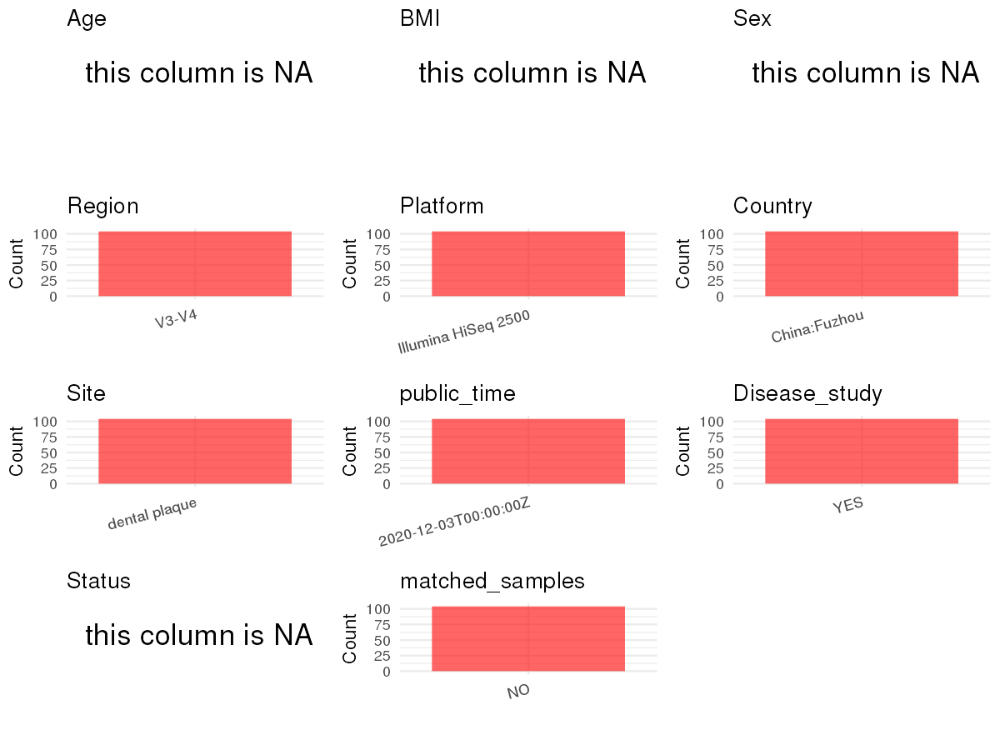

R Notebook: Metadata Processing Workflow
================

# Step 1: Obtain Initial Metadata from Each Project

To obtain the initial metadata: 1. Search for the BioProject ID (e.g.,
“PRJEBXXXX”) on the [NCBI SRA
website](https://www.ncbi.nlm.nih.gov/Traces/study/). 2. In the “Select”
table, click on “Metadata” and download the file. 3. The downloaded file
is typically named “SraRunTable.csv” and contains metadata for the
project.

``` r
# Load necessary libraries
library(dplyr)
library(ggplot2)
library(cowplot)
library(readxl)

# Set working directory (update this path to your local directory)
setwd("/home/dongbiao/word_embedding_microbiome/all_data/oral/global-oral-microbiome/data/projects/PRJNA589106")

# Read the initial metadata files
initial_meta<-read.csv("SraRunTable.csv")

head(initial_meta)
```

    ##           Run Assay.Type AvgSpotLen    Bases  BioProject    BioSample
    ## 1 SRR10436682   AMPLICON        479 24618018 PRJNA589106 SAMN13266873
    ## 2 SRR10436683   AMPLICON        479 14640442 PRJNA589106 SAMN13266872
    ## 3 SRR10436684   AMPLICON        479 13886858 PRJNA589106 SAMN13266871
    ## 4 SRR10436685   AMPLICON        479 26991094 PRJNA589106 SAMN13266870
    ## 5 SRR10436686   AMPLICON        479 16399092 PRJNA589106 SAMN13266869
    ## 6 SRR10436687   AMPLICON        479 26534672 PRJNA589106 SAMN13266868
    ##                BioSampleModel    Bytes       Center.Name Collection_Date
    ## 1 Metagenome or environmental 15482609 FUZHOU UNIVERSITY      2019-03-10
    ## 2 Metagenome or environmental  9172587 FUZHOU UNIVERSITY      2019-03-10
    ## 3 Metagenome or environmental  8745473 FUZHOU UNIVERSITY      2019-03-10
    ## 4 Metagenome or environmental 17056849 FUZHOU UNIVERSITY      2019-03-10
    ## 5 Metagenome or environmental 10362137 FUZHOU UNIVERSITY      2019-03-10
    ## 6 Metagenome or environmental 16859633 FUZHOU UNIVERSITY      2019-03-10
    ##   Consent DATASTORE.filetype DATASTORE.provider
    ## 1  public   fastq,run.zq,sra         gs,ncbi,s3
    ## 2  public   fastq,run.zq,sra         gs,ncbi,s3
    ## 3  public   fastq,run.zq,sra         gs,ncbi,s3
    ## 4  public   fastq,run.zq,sra         gs,ncbi,s3
    ## 5  public   fastq,run.zq,sra         gs,ncbi,s3
    ## 6  public   fastq,run.zq,sra         gs,ncbi,s3
    ##                       DATASTORE.region Experiment geo_loc_name_country
    ## 1 gs.us-east1,ncbi.public,s3.us-east-1 SRX7132552                China
    ## 2 gs.us-east1,ncbi.public,s3.us-east-1 SRX7132551                China
    ## 3 gs.us-east1,ncbi.public,s3.us-east-1 SRX7132550                China
    ## 4 gs.us-east1,ncbi.public,s3.us-east-1 SRX7132549                China
    ## 5 gs.us-east1,ncbi.public,s3.us-east-1 SRX7132548                China
    ## 6 gs.us-east1,ncbi.public,s3.us-east-1 SRX7132547                China
    ##   geo_loc_name_country_continent geo_loc_name         HOST          Instrument
    ## 1                           Asia China:Fuzhou Homo sapiens Illumina HiSeq 2500
    ## 2                           Asia China:Fuzhou Homo sapiens Illumina HiSeq 2500
    ## 3                           Asia China:Fuzhou Homo sapiens Illumina HiSeq 2500
    ## 4                           Asia China:Fuzhou Homo sapiens Illumina HiSeq 2500
    ## 5                           Asia China:Fuzhou Homo sapiens Illumina HiSeq 2500
    ## 6                           Asia China:Fuzhou Homo sapiens Illumina HiSeq 2500
    ##            lat_lon Library.Name LibraryLayout LibrarySelection LibrarySource
    ## 1 26.08 N 119.28 E          8D2        PAIRED              PCR   METAGENOMIC
    ## 2 26.08 N 119.28 E          7D2        PAIRED              PCR   METAGENOMIC
    ## 3 26.08 N 119.28 E          7D1        PAIRED              PCR   METAGENOMIC
    ## 4 26.08 N 119.28 E          6N2        PAIRED              PCR   METAGENOMIC
    ## 5 26.08 N 119.28 E          5D2        PAIRED              PCR   METAGENOMIC
    ## 6 26.08 N 119.28 E          5D1        PAIRED              PCR   METAGENOMIC
    ##           Organism Platform          ReleaseDate          create_date version
    ## 1 human metagenome ILLUMINA 2020-12-03T00:00:00Z 2019-11-13T12:37:00Z       1
    ## 2 human metagenome ILLUMINA 2020-12-03T00:00:00Z 2019-11-13T12:37:00Z       1
    ## 3 human metagenome ILLUMINA 2020-12-03T00:00:00Z 2019-11-13T12:37:00Z       1
    ## 4 human metagenome ILLUMINA 2020-12-03T00:00:00Z 2019-11-13T12:37:00Z       1
    ## 5 human metagenome ILLUMINA 2020-12-03T00:00:00Z 2019-11-13T12:37:00Z       1
    ## 6 human metagenome ILLUMINA 2020-12-03T00:00:00Z 2019-11-13T12:37:00Z       1
    ##   Sample.Name source_material_id SRA.Study
    ## 1         8D2                8D2 SRP229672
    ## 2         7D2                7D2 SRP229672
    ## 3         7D1                7D1 SRP229672
    ## 4         6N2                6N2 SRP229672
    ## 5         5D2                5D2 SRP229672
    ## 6         5D1                5D1 SRP229672

# Step 2: Create a Uniform Metadata Template

The uniform metadata should include the following columns:

1.  **BioProject**: Project ID (e.g., “PRJNA339212”)
2.  **Run**: Sample ID (e.g., “ERRXXXXXX” or “SRRXXXXXX”)
3.  **sample_name**: Original sample name submitted by the authors (not
    the database-assigned ID)
4.  **Age**: Age of the subject (if available)
5.  **BMI**: Body Mass Index (if available)
6.  **Sex**: Sex of the subject (“F” or “M”)
7.  **Region**: Targeted 16S rRNA region (e.g., “V3-V4”)
8.  **Platform**: Sequencing platform (e.g., “Illumina MiSeq”)
9.  **Country**: Country of sample origin (e.g., “China”)
10. **Site**: Sample site (e.g., “saliva”, “dental plaque”)
11. **public_time**: Data release date (format: “YYYY-MM-DD”)
12. **PCR_primers**: PCR primers used (e.g., “515F-806R”)
13. **title**: Title of the associated publication
14. **Disease_study**: Whether the study involves a disease (“YES” or
    “NO”)
15. **Status**: Disease status (e.g., “T2DM”, “HC”). Note: If the study
    includes both disease and healthy samples, this must be specified
    per sample.

``` r
# Create a uniform metadata dataframe
metadata <- data.frame(
  BioProject = initial_meta$BioProject,
  Run = initial_meta$Run,
  sample_name = initial_meta$Sample.Name,
  Age = NA,
  BMI = NA,
  Sex=NA,
  Region = "V3-V4",
  Platform = initial_meta$Instrument,
  Country = initial_meta$geo_loc_name,
  Site = "dental plaque",
  public_time = initial_meta$ReleaseDate,
  stringsAsFactors = FALSE
)
metadata<-unique(metadata)
```

# Step 3: Manually Add Information from the Publication

Some information (e.g. PCR primers, study title, disease status) must be
manually extracted from the publication and added to the metadata.

``` r
# Add information obtained from the publication
metadata$PCR_primers <- "F: 5′ CCTAYGGGRBGCAAG 3′; R: 5′ GGACTACNNGGGTATCTAAT 3′"
metadata$title <- "Study of oral microorganisms contributing to non-carious cervical lesions via bacterial interaction and pH regulation"
metadata$Disease_study <- "YES"

# Assign disease status based on sample_name patterns
metadata$Status <- NA
metadata$matched_samples <- "NO"
```

# Step 4: Summarize and Validate the Metadata

``` r
# Check the number of unique runs and sample names
print(paste("Number of unique runs:", length(unique(metadata$Run))))
```

    ## [1] "Number of unique runs: 104"

``` r
print(paste("Number of unique sample names:", length(unique(metadata$sample_name))))
```

    ## [1] "Number of unique sample names: 104"

# Step 5: Visualize the Metadata

``` r

```


# Step 6: Finalize and Export the Metadata

``` r
# Reorder columns to match the desired format
metadata <- metadata[, c(
  "BioProject", "Run", "sample_name", "Age", "BMI", "Sex", 
  "Region", "Platform", "Country", "Site", "public_time", 
  "PCR_primers", "title", "Disease_study", "Status","matched_samples"
)]

# Export the uniform metadata to a CSV file
metadata<-unique(metadata)
write.csv(metadata, file = "metadata.csv", quote = FALSE)
head(metadata)
```

    ##    BioProject         Run sample_name Age BMI Sex Region            Platform
    ## 1 PRJNA589106 SRR10436682         8D2  NA  NA  NA  V3-V4 Illumina HiSeq 2500
    ## 2 PRJNA589106 SRR10436683         7D2  NA  NA  NA  V3-V4 Illumina HiSeq 2500
    ## 3 PRJNA589106 SRR10436684         7D1  NA  NA  NA  V3-V4 Illumina HiSeq 2500
    ## 4 PRJNA589106 SRR10436685         6N2  NA  NA  NA  V3-V4 Illumina HiSeq 2500
    ## 5 PRJNA589106 SRR10436686         5D2  NA  NA  NA  V3-V4 Illumina HiSeq 2500
    ## 6 PRJNA589106 SRR10436687         5D1  NA  NA  NA  V3-V4 Illumina HiSeq 2500
    ##        Country          Site          public_time
    ## 1 China:Fuzhou dental plaque 2020-12-03T00:00:00Z
    ## 2 China:Fuzhou dental plaque 2020-12-03T00:00:00Z
    ## 3 China:Fuzhou dental plaque 2020-12-03T00:00:00Z
    ## 4 China:Fuzhou dental plaque 2020-12-03T00:00:00Z
    ## 5 China:Fuzhou dental plaque 2020-12-03T00:00:00Z
    ## 6 China:Fuzhou dental plaque 2020-12-03T00:00:00Z
    ##                                               PCR_primers
    ## 1 F: 5′ CCTAYGGGRBGCAAG 3′; R: 5′ GGACTACNNGGGTATCTAAT 3′
    ## 2 F: 5′ CCTAYGGGRBGCAAG 3′; R: 5′ GGACTACNNGGGTATCTAAT 3′
    ## 3 F: 5′ CCTAYGGGRBGCAAG 3′; R: 5′ GGACTACNNGGGTATCTAAT 3′
    ## 4 F: 5′ CCTAYGGGRBGCAAG 3′; R: 5′ GGACTACNNGGGTATCTAAT 3′
    ## 5 F: 5′ CCTAYGGGRBGCAAG 3′; R: 5′ GGACTACNNGGGTATCTAAT 3′
    ## 6 F: 5′ CCTAYGGGRBGCAAG 3′; R: 5′ GGACTACNNGGGTATCTAAT 3′
    ##                                                                                                                   title
    ## 1 Study of oral microorganisms contributing to non-carious cervical lesions via bacterial interaction and pH regulation
    ## 2 Study of oral microorganisms contributing to non-carious cervical lesions via bacterial interaction and pH regulation
    ## 3 Study of oral microorganisms contributing to non-carious cervical lesions via bacterial interaction and pH regulation
    ## 4 Study of oral microorganisms contributing to non-carious cervical lesions via bacterial interaction and pH regulation
    ## 5 Study of oral microorganisms contributing to non-carious cervical lesions via bacterial interaction and pH regulation
    ## 6 Study of oral microorganisms contributing to non-carious cervical lesions via bacterial interaction and pH regulation
    ##   Disease_study Status matched_samples
    ## 1           YES     NA              NO
    ## 2           YES     NA              NO
    ## 3           YES     NA              NO
    ## 4           YES     NA              NO
    ## 5           YES     NA              NO
    ## 6           YES     NA              NO

## Notes for Students:

1.  **Metadata Accuracy**: Always cross-check the metadata with the
    original publication to ensure accuracy.
2.  **Manual Entries**: Columns like `PCR_primers`, and `Status` often
    require manual entry based on the publication.
3.  **Disease Status**: Be careful when assigning `Status`—some studies
    include both disease and healthy samples.
4.  **Visualization**: The plots help quickly identify the distribution
    of values in each column, which is useful for quality control.
5.  **Reproducibility**: Update the working directory and file paths to
    match your local environment.
