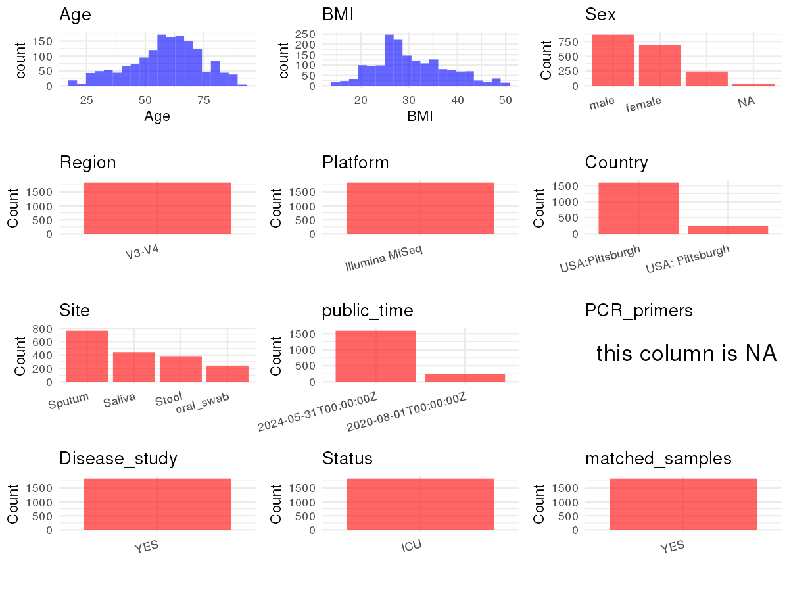

R Notebook: Metadata Processing Workflow
================

# Step 1: Obtain Initial Metadata from Each Project

To obtain the initial metadata: 1. Search for the BioProject ID (e.g.,
“PRJEBXXXX”) on the [NCBI SRA
website](https://www.ncbi.nlm.nih.gov/Traces/study/). 2. In the “Select”
table, click on “Metadata” and download the file. 3. The downloaded file
is typically named “SraRunTable.csv” and contains metadata for the
project.

``` r
# Load necessary libraries
library(dplyr)
library(stringr)
library(ggplot2)
library(cowplot)

# Set working directory (update this path to your local directory)
setwd("/home/dongbiao/word_embedding_microbiome/all_data/oral/global-oral-microbiome/data/projects/PRJNA595346")

# Read the initial metadata files
initial_meta <- read.csv("SraRunTable.csv", header = T)

# Display the first few rows of the metadata
head(initial_meta)
```

    ##           Run Assay.Type AvgSpotLen    Bases  BioProject    BioSample
    ## 1 SRR24619887   AMPLICON        501  4903470 PRJNA595346 SAMN35132673
    ## 2 SRR24619890   AMPLICON        499  1368538 PRJNA595346 SAMN35132672
    ## 3 SRR24619892   AMPLICON        500   339411 PRJNA595346 SAMN35132670
    ## 4 SRR24619894   AMPLICON        502 34903558 PRJNA595346 SAMN35132668
    ## 5 SRR24619896   AMPLICON        500   538519 PRJNA595346 SAMN35132666
    ## 6 SRR24619899   AMPLICON        502 35304656 PRJNA595346 SAMN35132664
    ##                                      BioSampleModel      bmi    Bytes
    ## 1 MIMARKS.survey,MIGS/MIMS/MIMARKS.human-associated 31.31429  2994612
    ## 2 MIMARKS.survey,MIGS/MIMS/MIMARKS.human-associated       NA   848982
    ## 3 MIMARKS.survey,MIGS/MIMS/MIMARKS.human-associated 34.08661   256036
    ## 4 MIMARKS.survey,MIGS/MIMS/MIMARKS.human-associated 38.15697 12909737
    ## 5 MIMARKS.survey,MIGS/MIMS/MIMARKS.human-associated 38.15697   375042
    ## 6 MIMARKS.survey,MIGS/MIMS/MIMARKS.human-associated 30.09944 13455502
    ##           Center.Name Collection_Date Consent DATASTORE.filetype
    ## 1 PITT-MICROBIOME-ALI      2020-02-11  public   fastq,run.zq,sra
    ## 2 PITT-MICROBIOME-ALI      2020-02-06  public   fastq,run.zq,sra
    ## 3 PITT-MICROBIOME-ALI      2020-02-05  public   fastq,run.zq,sra
    ## 4 PITT-MICROBIOME-ALI      2020-02-03  public   fastq,run.zq,sra
    ## 5 PITT-MICROBIOME-ALI      2020-02-03  public   fastq,run.zq,sra
    ## 6 PITT-MICROBIOME-ALI      2020-01-30  public   fastq,run.zq,sra
    ##   DATASTORE.provider                     DATASTORE.region
    ## 1         gs,ncbi,s3 gs.us-east1,ncbi.public,s3.us-east-1
    ## 2         gs,ncbi,s3 gs.us-east1,ncbi.public,s3.us-east-1
    ## 3         gs,ncbi,s3 gs.us-east1,ncbi.public,s3.us-east-1
    ## 4         gs,ncbi,s3 gs.us-east1,ncbi.public,s3.us-east-1
    ## 5         gs,ncbi,s3 gs.us-east1,ncbi.public,s3.us-east-1
    ## 6         gs,ncbi,s3 gs.us-east1,ncbi.public,s3.us-east-1
    ##                           env_broad_scale env_local_scale env_medium
    ## 1 multicellular organism [UBERON:0000468]          Throat     Sputum
    ## 2 multicellular organism [UBERON:0000468]          Throat     Sputum
    ## 3 multicellular organism [UBERON:0000468]          Throat     Sputum
    ## 4 multicellular organism [UBERON:0000468]          Throat     Sputum
    ## 5 multicellular organism [UBERON:0000468]          Throat     Sputum
    ## 6 multicellular organism [UBERON:0000468]          Throat     Sputum
    ##    Experiment geo_loc_name_country geo_loc_name_country_continent
    ## 1 SRX20400920                  USA                  North America
    ## 2 SRX20400918                  USA                  North America
    ## 3 SRX20400916                  USA                  North America
    ## 4 SRX20400914                  USA                  North America
    ## 5 SRX20400912                  USA                  North America
    ## 6 SRX20400909                  USA                  North America
    ##     geo_loc_name         Host     Instrument             lat_lon
    ## 1 USA:Pittsburgh Homo sapiens Illumina MiSeq 40.4406 N 79.9959 W
    ## 2 USA:Pittsburgh Homo sapiens Illumina MiSeq 40.4406 N 79.9959 W
    ## 3 USA:Pittsburgh Homo sapiens Illumina MiSeq 40.4406 N 79.9959 W
    ## 4 USA:Pittsburgh Homo sapiens Illumina MiSeq 40.4406 N 79.9959 W
    ## 5 USA:Pittsburgh Homo sapiens Illumina MiSeq 40.4406 N 79.9959 W
    ## 6 USA:Pittsburgh Homo sapiens Illumina MiSeq 40.4406 N 79.9959 W
    ##                                          Library.Name LibraryLayout
    ## 1 FASTQ_Generation_2020-06-07_09_23_23Z-261084824_S54        PAIRED
    ## 2 FASTQ_Generation_2020-06-07_09_23_23Z-261084824_S53        PAIRED
    ## 3 FASTQ_Generation_2020-06-07_09_23_23Z-261084824_S51        PAIRED
    ## 4            20221026_A_0102_Plates_A_B__RN_0176_S164        PAIRED
    ## 5 FASTQ_Generation_2020-06-07_09_23_23Z-261084824_S50        PAIRED
    ## 6            20221026_A_0102_Plates_A_B__RN_0176_S163        PAIRED
    ##   LibrarySelection LibrarySource                  Organism Platform
    ## 1              PCR   METAGENOMIC human tracheal metagenome ILLUMINA
    ## 2              PCR   METAGENOMIC human tracheal metagenome ILLUMINA
    ## 3              PCR   METAGENOMIC human tracheal metagenome ILLUMINA
    ## 4              PCR   METAGENOMIC human tracheal metagenome ILLUMINA
    ## 5              PCR   METAGENOMIC human tracheal metagenome ILLUMINA
    ## 6              PCR   METAGENOMIC human tracheal metagenome ILLUMINA
    ##            ReleaseDate          create_date version              Sample.Name
    ## 1 2024-05-31T00:00:00Z 2023-05-17T14:23:00Z       1 0102.4872.1.20200211.ETA
    ## 2 2024-05-31T00:00:00Z 2023-05-17T14:23:00Z       1       0102.4871.1.M9.ETA
    ## 3 2024-05-31T00:00:00Z 2023-05-17T14:23:00Z       1 0102.4870.1.20200205.ETA
    ## 4 2024-05-31T00:00:00Z 2023-05-17T14:23:00Z       1    0102.4868.D01.ETA.Dep
    ## 5 2024-05-31T00:00:00Z 2023-05-17T14:23:00Z       1 0102.4868.1.20200203.ETA
    ## 6 2024-05-31T00:00:00Z 2023-05-17T14:23:00Z       1    0102.4866.D01.ETA.Dep
    ##   SRA.Study   AGE BUN Creatinine day gender  hgb  hr    IL6 platelets     rage
    ## 1 SRP237307 56.96  81        2.1   1   male   NA  77 193.23        NA 15705.80
    ## 2 SRP237307    NA  NA         NA   1   <NA>   NA  NA     NA        NA       NA
    ## 3 SRP237307 67.60  82       10.5   1   male 10.5 128 107.60       210 25065.88
    ## 4 SRP237307 79.06  18        1.1   1   male  9.0 104 192.29       317  8323.14
    ## 5 SRP237307 79.06  18        1.1   1   male  9.0 104 192.29       317  8323.14
    ## 6 SRP237307 82.66  74        3.7   1   male  8.8 104  19.06        96  5540.49
    ##   RespSample_Depletion rr   SampleID_Merge sampletype sbp            StudyDate
    ## 1                Undep 26 4872_1_ETA_Undep        ETA  NA 2020-02-11T00:00:00Z
    ## 2                Undep NA 4871_1_ETA_Undep        ETA  NA 2020-02-06T00:00:00Z
    ## 3                Undep 26 4870_1_ETA_Undep        ETA  NA 2020-02-05T00:00:00Z
    ## 4                  Dep 18   4868_1_ETA_Dep        ETA 111 2020-02-03T00:00:00Z
    ## 5                Undep 18 4868_1_ETA_Undep        ETA 111 2020-02-03T00:00:00Z
    ## 6                  Dep 16   4866_1_ETA_Dep        ETA 127 2020-01-30T00:00:00Z
    ##   subjectid  wbc log_IL.6_level log_st2_level
    ## 1      4872   NA             NA            NA
    ## 2      4871   NA             NA            NA
    ## 3      4870 29.7             NA            NA
    ## 4      4868 16.4             NA            NA
    ## 5      4868 16.4             NA            NA
    ## 6      4866  5.0             NA            NA

# Step 2: Create a Uniform Metadata Template

The uniform metadata should include the following columns:

1.  **BioProject**: Project ID (e.g., “PRJNA339212”)
2.  **Run**: Sample ID (e.g., “ERRXXXXXX” or “SRRXXXXXX”)
3.  **sample_name**: Original sample name submitted by the authors (not
    the database-assigned ID)
4.  **Age**: Age of the subject (if available)
5.  **BMI**: Body Mass Index (if available)
6.  **Sex**: Sex of the subject (“F” or “M”)
7.  **Region**: Targeted 16S rRNA region (e.g., “V3-V4”)
8.  **Platform**: Sequencing platform (e.g., “Illumina MiSeq”)
9.  **Country**: Country of sample origin (e.g., “China”)
10. **Site**: Sample site (e.g., “saliva”, “dental plaque”)
11. **public_time**: Data release date (format: “YYYY-MM-DD”)
12. **PCR_primers**: PCR primers used (e.g., “515F-806R”)
13. **title**: Title of the associated publication
14. **Disease_study**: Whether the study involves a disease (“YES” or
    “NO”)
15. **Status**: Disease status (e.g., “T2DM”, “HC”). Note: If the study
    includes both disease and healthy samples, this must be specified
    per sample.
16. **matched_samples**: matched samples (“YES” or “NO”)

``` r
# Create a uniform metadata dataframe
metadata <- data.frame(
  BioProject = initial_meta$BioProject,
  Run = initial_meta$Run,
  sample_name = initial_meta$subjectid,
  Age = initial_meta$AGE,
  Sex = initial_meta$gender,
  BMI = initial_meta$bmi,  
  Region = "V3-V4",
  Platform = initial_meta$Instrument,
  Country = initial_meta$geo_loc_name,
  Site = initial_meta$env_medium,
  public_time = initial_meta$ReleaseDate,
  stringsAsFactors = FALSE
)

metadata$Age[metadata$Age > 110] <- NA
metadata$BMI[metadata$BMI > 50] <- NA
```

# Step 3: Manually Add Information from the Publication

Some information (e.g. PCR primers, study title, disease status) must be
manually extracted from the publication and added to the metadata.

``` r
# Add information obtained from the publication
metadata$PCR_primers <- NA
metadata$title <- "The upper and lower respiratory tract microbiome in severe aspiration pneumonia"
metadata$Disease_study <- "YES"

metadata$Status <- "ICU"

# Check initial data distribution
cat("Initial sample distribution:\n")
```

    ## Initial sample distribution:

``` r
table(metadata$sample_name)
```

    ## 
    ##   98  403 1031 1357 1686 1767 1819 1970 1971 2434 2554 3189 3195 3497 3516 3538 
    ##    3    2    5    3    3    4    4    4    3    1    1    3    3    2    2    1 
    ## 3641 3644 3646 3669 3671 3672 3673 3699 3731 3732 3733 3734 3747 3768 3769 3770 
    ##    2    1    2    2    2    2    4    6    1    2    1    3    5    2    3    3 
    ## 3771 3772 3773 3774 3775 3776 3801 3816 3840 3847 3861 3862 3863 3876 3878 3879 
    ##    3    4    2    3    2    2    3    1    2    3    2    5    3    2   11    1 
    ## 3880 3881 3901 3902 3904 3905 3924 3925 3927 3928 3930 3931 3932 3933 3934 3935 
    ##    1    2    4    2    2    1    1    3   10    4    1    6    5    2    4    2 
    ## 3964 3966 3986 3992 3994 3996 4055 4067 4094 4105 4124 4140 4156 4159 4167 4176 
    ##    3    5    7    1    2    1    3    2    4    4    4    4   10    4    4    4 
    ## 4179 4183 4185 4196 4197 4200 4204 4206 4219 4220 4224 4230 4233 4237 4238 4265 
    ##    2    4    4    2    4    7    8    4    2    4    4    4    4    2    2    1 
    ## 4267 4270 4272 4273 4280 4285 4286 4288 4298 4301 4310 4315 4316 4317 4321 4322 
    ##    2    1    1    1    4    2    2    1    4    1    1    4    1    1    3    3 
    ## 4327 4333 4335 4336 4337 4345 4346 4347 4363 4365 4368 4369 4372 4373 4377 4378 
    ##    4    5    3    1    1    3    3    1    4    6    4    4    1    7    3    1 
    ## 4381 4383 4384 4388 4389 4391 4396 4397 4398 4401 4402 4405 4406 4409 4411 4415 
    ##    8    5    4    3    4    1    1    1    1    1    9    5    4    8    1    7 
    ## 4420 4421 4424 4428 4431 4432 4433 4434 4436 4437 4438 4446 4449 4453 4457 4458 
    ##    1    9    1    3    1    9    4    1    4    4    1    8    1    4    1    1 
    ## 4459 4460 4464 4466 4467 4469 4470 4472 4473 4474 4475 4476 4479 4484 4486 4487 
    ##    1    4    1    5    4    1    1    2    1    1    2    1    1    7    6    1 
    ## 4488 4489 4490 4493 4494 4498 4502 4503 4504 4506 4507 4508 4509 4510 4514 4515 
    ##    5    1    1    5    1    4    1    5    1    1    1    7    1    4    1    3 
    ## 4516 4522 4523 4525 4528 4530 4531 4533 4535 4536 4537 4539 4540 4541 4542 4544 
    ##    1    1    1    3    2    1    1   10    3    4    3    3    3    3    7    7 
    ## 4545 4547 4550 4551 4552 4553 4554 4555 4556 4557 4562 4563 4565 4566 4567 4570 
    ##    3    3    5    3    6    9    2   10    3    3   10    4    2   10    3    3 
    ## 4576 4577 4580 4587 4588 4589 4593 4594 4595 4596 4599 4600 4602 4604 4605 4607 
    ##    6    6    5    4    6    4    9    4    3    4   15    8    8    8    5    3 
    ## 4615 4616 4618 4619 4621 4623 4629 4630 4636 4639 4643 4645 4649 4650 4651 4652 
    ##    3    3    7    3    3    6    6    1    6    3    3    5    3    3    3    3 
    ## 4658 4661 4662 4663 4668 4669 4670 4671 4672 4678 4680 4687 4688 4693 4694 4697 
    ##    6    4    9    2    4    3    6    4   10    5    5    2    4    4    4    6 
    ## 4698 4700 4701 4703 4704 4707 4708 4709 4710 4711 4717 4718 4721 4726 4727 4728 
    ##    4    4    8    7    3    3    4    4    6    6    3    4    8    6    2    3 
    ## 4729 4734 4735 4736 4738 4741 4742 4743 4744 4745 4746 4748 4751 4752 4753 4754 
    ##    4    3    3    5    4    8   14    6    5    3    5    4    3    3    4    5 
    ## 4755 4757 4759 4760 4761 4762 4763 4770 4771 4773 4780 4781 4792 4793 4794 4798 
    ##    5    4    6    3    4    4    5   10    7    4    3    5    4    8    3    4 
    ## 4803 4804 4805 4807 4808 4809 4810 4814 4819 4828 4830 4831 4835 4836 4839 4842 
    ##    4    2    4    6    3    4    3    3    4    4   11    4    4    2    3    1 
    ## 4844 4845 4847 4848 4849 4850 4854 4856 4858 4860 4861 4862 4863 4864 4866 4867 
    ##    5    1    4    4    2    4    2    2    5    4    5    4    2    1    4    4 
    ## 4868 4869 4870 4871 4872 4873 4901 4902 4929 4930 4931 4938 4939 4940 4941 4942 
    ##    4    4    2    1    8    3    2    2    2    2    6    3    2    4    8    3 
    ## 5091 5092 5093 5094 5095 5096 5097 5098 5099 5100 5102 5105 5107 5108 5109 5111 
    ##    2    2    1    3    2    1    3    1    1    2    2    2    1    1    2    1 
    ## 5113 5116 5118 5119 5120 5121 5124 5125 5126 5266 5306 5307 5308 5310 5311 5312 
    ##    2    2    4    1    2    1    1    3    3    3    1    3    3    1    1    2 
    ## 5314 5315 5316 5318 5320 5321 5324 5325 5326 5329 5332 5335 5336 5337 5340 5341 
    ##    1    2    1    1    3    2    2    2    2    1    2    1    2    2    1    1 
    ## 5342 5348 5350 5351 5352 5353 5359 5366 5370 5371 5372 5381 5382 5383 5387 5391 
    ##    1    1    1    1    1    1    1    1    4    1    2    5    1    1    2    2 
    ## 5394 5395 5397 5398 5399 5400 5401 5402 5408 5411 5412 5413 5414 5415 5418 5421 
    ##    2    1    6    3    1    1    1    1    5    3    2    6    2    3    5    5 
    ## 5422 5424 5425 5426 5427 5428 5431 5436 5437 5462 5463 5464 5484 5485 5495 5496 
    ##    3    3    6    3    4    3    2    3    1    1    1    1    3    1    3    3 
    ## 5498 5504 5505 5506 5509 5515 5516 5523 5524 5525 5526 5527 5528 5529 5532 5533 
    ##    2    1    2    4    3    1    3    1    2    3    1    4    1    1    1    1 
    ## 5534 5535 5536 
    ##    1    2    2

``` r
table(metadata$Site)
```

    ## 
    ## oral_swab    Saliva    Sputum     Stool 
    ##       241       444       765       384

``` r
# Calculate sampling frequency per subject
sample_counts <- table(metadata$sample_name)
cat("\nNumber of samples per subject:\n")
```

    ## 
    ## Number of samples per subject:

``` r
print(sample_counts)
```

    ## 
    ##   98  403 1031 1357 1686 1767 1819 1970 1971 2434 2554 3189 3195 3497 3516 3538 
    ##    3    2    5    3    3    4    4    4    3    1    1    3    3    2    2    1 
    ## 3641 3644 3646 3669 3671 3672 3673 3699 3731 3732 3733 3734 3747 3768 3769 3770 
    ##    2    1    2    2    2    2    4    6    1    2    1    3    5    2    3    3 
    ## 3771 3772 3773 3774 3775 3776 3801 3816 3840 3847 3861 3862 3863 3876 3878 3879 
    ##    3    4    2    3    2    2    3    1    2    3    2    5    3    2   11    1 
    ## 3880 3881 3901 3902 3904 3905 3924 3925 3927 3928 3930 3931 3932 3933 3934 3935 
    ##    1    2    4    2    2    1    1    3   10    4    1    6    5    2    4    2 
    ## 3964 3966 3986 3992 3994 3996 4055 4067 4094 4105 4124 4140 4156 4159 4167 4176 
    ##    3    5    7    1    2    1    3    2    4    4    4    4   10    4    4    4 
    ## 4179 4183 4185 4196 4197 4200 4204 4206 4219 4220 4224 4230 4233 4237 4238 4265 
    ##    2    4    4    2    4    7    8    4    2    4    4    4    4    2    2    1 
    ## 4267 4270 4272 4273 4280 4285 4286 4288 4298 4301 4310 4315 4316 4317 4321 4322 
    ##    2    1    1    1    4    2    2    1    4    1    1    4    1    1    3    3 
    ## 4327 4333 4335 4336 4337 4345 4346 4347 4363 4365 4368 4369 4372 4373 4377 4378 
    ##    4    5    3    1    1    3    3    1    4    6    4    4    1    7    3    1 
    ## 4381 4383 4384 4388 4389 4391 4396 4397 4398 4401 4402 4405 4406 4409 4411 4415 
    ##    8    5    4    3    4    1    1    1    1    1    9    5    4    8    1    7 
    ## 4420 4421 4424 4428 4431 4432 4433 4434 4436 4437 4438 4446 4449 4453 4457 4458 
    ##    1    9    1    3    1    9    4    1    4    4    1    8    1    4    1    1 
    ## 4459 4460 4464 4466 4467 4469 4470 4472 4473 4474 4475 4476 4479 4484 4486 4487 
    ##    1    4    1    5    4    1    1    2    1    1    2    1    1    7    6    1 
    ## 4488 4489 4490 4493 4494 4498 4502 4503 4504 4506 4507 4508 4509 4510 4514 4515 
    ##    5    1    1    5    1    4    1    5    1    1    1    7    1    4    1    3 
    ## 4516 4522 4523 4525 4528 4530 4531 4533 4535 4536 4537 4539 4540 4541 4542 4544 
    ##    1    1    1    3    2    1    1   10    3    4    3    3    3    3    7    7 
    ## 4545 4547 4550 4551 4552 4553 4554 4555 4556 4557 4562 4563 4565 4566 4567 4570 
    ##    3    3    5    3    6    9    2   10    3    3   10    4    2   10    3    3 
    ## 4576 4577 4580 4587 4588 4589 4593 4594 4595 4596 4599 4600 4602 4604 4605 4607 
    ##    6    6    5    4    6    4    9    4    3    4   15    8    8    8    5    3 
    ## 4615 4616 4618 4619 4621 4623 4629 4630 4636 4639 4643 4645 4649 4650 4651 4652 
    ##    3    3    7    3    3    6    6    1    6    3    3    5    3    3    3    3 
    ## 4658 4661 4662 4663 4668 4669 4670 4671 4672 4678 4680 4687 4688 4693 4694 4697 
    ##    6    4    9    2    4    3    6    4   10    5    5    2    4    4    4    6 
    ## 4698 4700 4701 4703 4704 4707 4708 4709 4710 4711 4717 4718 4721 4726 4727 4728 
    ##    4    4    8    7    3    3    4    4    6    6    3    4    8    6    2    3 
    ## 4729 4734 4735 4736 4738 4741 4742 4743 4744 4745 4746 4748 4751 4752 4753 4754 
    ##    4    3    3    5    4    8   14    6    5    3    5    4    3    3    4    5 
    ## 4755 4757 4759 4760 4761 4762 4763 4770 4771 4773 4780 4781 4792 4793 4794 4798 
    ##    5    4    6    3    4    4    5   10    7    4    3    5    4    8    3    4 
    ## 4803 4804 4805 4807 4808 4809 4810 4814 4819 4828 4830 4831 4835 4836 4839 4842 
    ##    4    2    4    6    3    4    3    3    4    4   11    4    4    2    3    1 
    ## 4844 4845 4847 4848 4849 4850 4854 4856 4858 4860 4861 4862 4863 4864 4866 4867 
    ##    5    1    4    4    2    4    2    2    5    4    5    4    2    1    4    4 
    ## 4868 4869 4870 4871 4872 4873 4901 4902 4929 4930 4931 4938 4939 4940 4941 4942 
    ##    4    4    2    1    8    3    2    2    2    2    6    3    2    4    8    3 
    ## 5091 5092 5093 5094 5095 5096 5097 5098 5099 5100 5102 5105 5107 5108 5109 5111 
    ##    2    2    1    3    2    1    3    1    1    2    2    2    1    1    2    1 
    ## 5113 5116 5118 5119 5120 5121 5124 5125 5126 5266 5306 5307 5308 5310 5311 5312 
    ##    2    2    4    1    2    1    1    3    3    3    1    3    3    1    1    2 
    ## 5314 5315 5316 5318 5320 5321 5324 5325 5326 5329 5332 5335 5336 5337 5340 5341 
    ##    1    2    1    1    3    2    2    2    2    1    2    1    2    2    1    1 
    ## 5342 5348 5350 5351 5352 5353 5359 5366 5370 5371 5372 5381 5382 5383 5387 5391 
    ##    1    1    1    1    1    1    1    1    4    1    2    5    1    1    2    2 
    ## 5394 5395 5397 5398 5399 5400 5401 5402 5408 5411 5412 5413 5414 5415 5418 5421 
    ##    2    1    6    3    1    1    1    1    5    3    2    6    2    3    5    5 
    ## 5422 5424 5425 5426 5427 5428 5431 5436 5437 5462 5463 5464 5484 5485 5495 5496 
    ##    3    3    6    3    4    3    2    3    1    1    1    1    3    1    3    3 
    ## 5498 5504 5505 5506 5509 5515 5516 5523 5524 5525 5526 5527 5528 5529 5532 5533 
    ##    2    1    2    4    3    1    3    1    2    3    1    4    1    1    1    1 
    ## 5534 5535 5536 
    ##    1    2    2

``` r
# Create matched_samples column
metadata$matched_samples <- "YES"
```

# Step 4: Summarize and Validate the Metadata

``` r
# Check the number of unique runs and sample names
print(paste("Number of unique runs:", length(unique(metadata$Run))))
```

    ## [1] "Number of unique runs: 1834"

``` r
print(paste("Number of unique sample names:", length(unique(metadata$sample_name))))
```

    ## [1] "Number of unique sample names: 484"

# Step 5: Visualize the Metadata

``` r

```


# Step 6: Finalize and Export the Metadata

``` r
# Reorder columns to match the desired format
metadata <- metadata[, c(
  "BioProject", "Run", "sample_name", "Age", "BMI", "Sex", 
  "Region", "Platform", "Country", "Site", "public_time", 
  "PCR_primers", "title", "Disease_study", "Status", "matched_samples"
)]

# Export the uniform metadata to a CSV file
write.csv(metadata, file = "metadata.csv", quote = TRUE)
head(metadata)
```

    ##    BioProject         Run sample_name   Age      BMI  Sex Region       Platform
    ## 1 PRJNA595346 SRR24619887        4872 56.96 31.31429 male  V3-V4 Illumina MiSeq
    ## 2 PRJNA595346 SRR24619890        4871    NA       NA <NA>  V3-V4 Illumina MiSeq
    ## 3 PRJNA595346 SRR24619892        4870 67.60 34.08661 male  V3-V4 Illumina MiSeq
    ## 4 PRJNA595346 SRR24619894        4868 79.06 38.15697 male  V3-V4 Illumina MiSeq
    ## 5 PRJNA595346 SRR24619896        4868 79.06 38.15697 male  V3-V4 Illumina MiSeq
    ## 6 PRJNA595346 SRR24619899        4866 82.66 30.09944 male  V3-V4 Illumina MiSeq
    ##          Country   Site          public_time PCR_primers
    ## 1 USA:Pittsburgh Sputum 2024-05-31T00:00:00Z          NA
    ## 2 USA:Pittsburgh Sputum 2024-05-31T00:00:00Z          NA
    ## 3 USA:Pittsburgh Sputum 2024-05-31T00:00:00Z          NA
    ## 4 USA:Pittsburgh Sputum 2024-05-31T00:00:00Z          NA
    ## 5 USA:Pittsburgh Sputum 2024-05-31T00:00:00Z          NA
    ## 6 USA:Pittsburgh Sputum 2024-05-31T00:00:00Z          NA
    ##                                                                             title
    ## 1 The upper and lower respiratory tract microbiome in severe aspiration pneumonia
    ## 2 The upper and lower respiratory tract microbiome in severe aspiration pneumonia
    ## 3 The upper and lower respiratory tract microbiome in severe aspiration pneumonia
    ## 4 The upper and lower respiratory tract microbiome in severe aspiration pneumonia
    ## 5 The upper and lower respiratory tract microbiome in severe aspiration pneumonia
    ## 6 The upper and lower respiratory tract microbiome in severe aspiration pneumonia
    ##   Disease_study Status matched_samples
    ## 1           YES    ICU             YES
    ## 2           YES    ICU             YES
    ## 3           YES    ICU             YES
    ## 4           YES    ICU             YES
    ## 5           YES    ICU             YES
    ## 6           YES    ICU             YES

## Notes for Students:

1.  **Metadata Accuracy**: Always cross-check the metadata with the
    original publication to ensure accuracy.
2.  **Manual Entries**: Columns like `PCR_primers`, and `Status` often
    require manual entry based on the publication.
3.  **Disease Status**: Be careful when assigning `Status`—some studies
    include both disease and healthy samples.
4.  **Visualization**: The plots help quickly identify the distribution
    of values in each column, which is useful for quality control.
5.  **Reproducibility**: Update the working directory and file paths to
    match your local environment.
