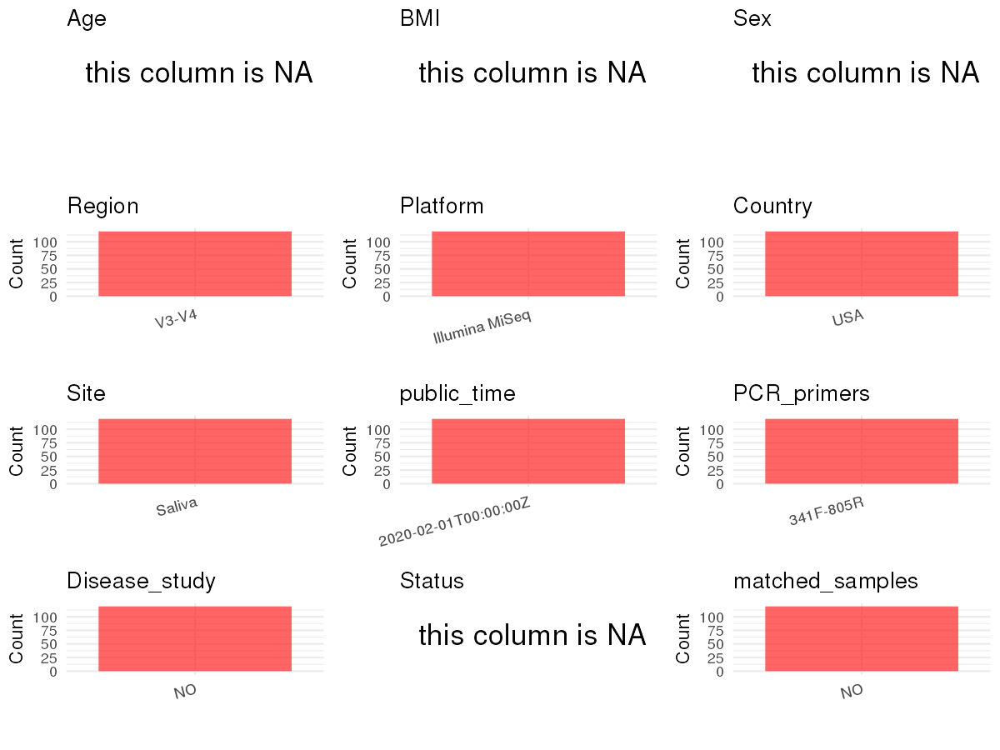

R Notebook: Metadata Processing Workflow
================

# Step 1: Obtain Initial Metadata from Each Project

To obtain the initial metadata: 1. Search for the BioProject ID (e.g.,
“PRJEBXXXX”) on the [NCBI SRA
website](https://www.ncbi.nlm.nih.gov/Traces/study/). 2. In the “Select”
table, click on “Metadata” and download the file. 3. The downloaded file
is typically named “SraRunTable.csv” and contains metadata for the
project.

``` r
# Load necessary libraries
library(dplyr)
library(ggplot2)
library(cowplot)
library(readxl)

# Set working directory (update this path to your local directory)
setwd("/home/dongbiao/word_embedding_microbiome/all_data/oral/global-oral-microbiome/data/projects/PRJNA602902")

# Read the initial metadata files
initial_meta<-read.csv("SraRunTable.csv")

head(initial_meta)
```

    ##           Run Assay.Type AvgSpotLen    Bases  BioProject    BioSample
    ## 1 SRR10958508      OTHER        300 40357879 PRJNA602902 SAMN13910363
    ## 2 SRR10958509      OTHER        300 52306338 PRJNA602902 SAMN13910362
    ## 3 SRR10958510      OTHER        300 43295847 PRJNA602902 SAMN13910361
    ## 4 SRR10958511      OTHER        300 44993273 PRJNA602902 SAMN13910360
    ## 5 SRR10958512      OTHER        300 55187205 PRJNA602902 SAMN13910359
    ## 6 SRR10958513      OTHER        300 36954376 PRJNA602902 SAMN13910358
    ##                BioSampleModel    Bytes
    ## 1 Metagenome or environmental 26491510
    ## 2 Metagenome or environmental 34316920
    ## 3 Metagenome or environmental 28244847
    ## 4 Metagenome or environmental 29080857
    ## 5 Metagenome or environmental 36289702
    ## 6 Metagenome or environmental 24173878
    ##                                                    Center.Name Collection_Date
    ## 1 NEW YORK UNIVERSITY COLLEGE OF DENTISTRY, SCHOOL OF MEDICINE      2018-10-03
    ## 2 NEW YORK UNIVERSITY COLLEGE OF DENTISTRY, SCHOOL OF MEDICINE      2018-10-03
    ## 3 NEW YORK UNIVERSITY COLLEGE OF DENTISTRY, SCHOOL OF MEDICINE      2018-10-03
    ## 4 NEW YORK UNIVERSITY COLLEGE OF DENTISTRY, SCHOOL OF MEDICINE      2018-10-03
    ## 5 NEW YORK UNIVERSITY COLLEGE OF DENTISTRY, SCHOOL OF MEDICINE      2018-10-03
    ## 6 NEW YORK UNIVERSITY COLLEGE OF DENTISTRY, SCHOOL OF MEDICINE      2018-10-03
    ##   Consent DATASTORE.filetype DATASTORE.provider
    ## 1  public   fastq,run.zq,sra         gs,ncbi,s3
    ## 2  public   fastq,run.zq,sra         gs,ncbi,s3
    ## 3  public   fastq,run.zq,sra         gs,ncbi,s3
    ## 4  public   fastq,run.zq,sra         gs,ncbi,s3
    ## 5  public   fastq,run.zq,sra         gs,ncbi,s3
    ## 6  public   fastq,run.zq,sra         gs,ncbi,s3
    ##                       DATASTORE.region Experiment geo_loc_name_country
    ## 1 gs.us-east1,ncbi.public,s3.us-east-1 SRX7624744                  USA
    ## 2 gs.us-east1,ncbi.public,s3.us-east-1 SRX7624743                  USA
    ## 3 gs.us-east1,ncbi.public,s3.us-east-1 SRX7624742                  USA
    ## 4 gs.us-east1,ncbi.public,s3.us-east-1 SRX7624741                  USA
    ## 5 gs.us-east1,ncbi.public,s3.us-east-1 SRX7624740                  USA
    ## 6 gs.us-east1,ncbi.public,s3.us-east-1 SRX7624739                  USA
    ##   geo_loc_name_country_continent geo_loc_name Group..run.         HOST
    ## 1                  North America          USA          NS Homo sapiens
    ## 2                  North America          USA          NS Homo sapiens
    ## 3                  North America          USA          NS Homo sapiens
    ## 4                  North America          USA          CS Homo sapiens
    ## 5                  North America          USA          NS Homo sapiens
    ## 6                  North America          USA          CS Homo sapiens
    ##       Instrument             lat_lon Library.Name LibraryLayout
    ## 1 Illumina MiSeq 40.7128 N 74.0060 W       SAL101        PAIRED
    ## 2 Illumina MiSeq 40.7128 N 74.0060 W       SAL100        PAIRED
    ## 3 Illumina MiSeq 40.7128 N 74.0060 W       SAL099        PAIRED
    ## 4 Illumina MiSeq 40.7128 N 74.0060 W       SAL098        PAIRED
    ## 5 Illumina MiSeq 40.7128 N 74.0060 W       SAL097        PAIRED
    ## 6 Illumina MiSeq 40.7128 N 74.0060 W       SAL096        PAIRED
    ##   LibrarySelection LibrarySource         Organism Platform raw_seq_num..run.
    ## 1              PCR   METAGENOMIC human metagenome ILLUMINA             77379
    ## 2              PCR   METAGENOMIC human metagenome ILLUMINA            101770
    ## 3              PCR   METAGENOMIC human metagenome ILLUMINA             83027
    ## 4              PCR   METAGENOMIC human metagenome ILLUMINA             86981
    ## 5              PCR   METAGENOMIC human metagenome ILLUMINA            106902
    ## 6              PCR   METAGENOMIC human metagenome ILLUMINA             70905
    ##            ReleaseDate          create_date version samp_mat_process samp_size
    ## 1 2020-02-01T00:00:00Z 2020-01-23T19:35:00Z       1   16S sequencing     77379
    ## 2 2020-02-01T00:00:00Z 2020-01-23T19:36:00Z       1   16S sequencing    101770
    ## 3 2020-02-01T00:00:00Z 2020-01-23T19:36:00Z       1   16S sequencing     83027
    ## 4 2020-02-01T00:00:00Z 2020-01-23T19:36:00Z       1   16S sequencing     86981
    ## 5 2020-02-01T00:00:00Z 2020-01-23T19:36:00Z       1   16S sequencing    106902
    ## 6 2020-02-01T00:00:00Z 2020-01-23T19:36:00Z       1   16S sequencing     70905
    ##   Sample.Name sample_type..run. SRA.Study
    ## 1      SAL101            saliva SRP244387
    ## 2      SAL100            saliva SRP244387
    ## 3      SAL099            saliva SRP244387
    ## 4      SAL098            saliva SRP244387
    ## 5      SAL097            saliva SRP244387
    ## 6      SAL096            saliva SRP244387

# Step 2: Create a Uniform Metadata Template

The uniform metadata should include the following columns:

1.  **BioProject**: Project ID (e.g., “PRJNA339212”)
2.  **Run**: Sample ID (e.g., “ERRXXXXXX” or “SRRXXXXXX”)
3.  **sample_name**: Original sample name submitted by the authors (not
    the database-assigned ID)
4.  **Age**: Age of the subject (if available)
5.  **BMI**: Body Mass Index (if available)
6.  **Sex**: Sex of the subject (“F” or “M”)
7.  **Region**: Targeted 16S rRNA region (e.g., “V3-V4”)
8.  **Platform**: Sequencing platform (e.g., “Illumina MiSeq”)
9.  **Country**: Country of sample origin (e.g., “China”)
10. **Site**: Sample site (e.g., “saliva”, “dental plaque”)
11. **public_time**: Data release date (format: “YYYY-MM-DD”)
12. **PCR_primers**: PCR primers used (e.g., “515F-806R”)
13. **title**: Title of the associated publication
14. **Disease_study**: Whether the study involves a disease (“YES” or
    “NO”)
15. **Status**: Disease status (e.g., “T2DM”, “HC”). Note: If the study
    includes both disease and healthy samples, this must be specified
    per sample.

``` r
# Create a uniform metadata dataframe
metadata <- data.frame(
  BioProject = initial_meta$BioProject,
  Run = initial_meta$Run,
  sample_name = initial_meta$Sample.Name,
  Age = NA,
  BMI = NA,
  Sex=NA,
  Region = "V3-V4",
  Platform = initial_meta$Instrument,
  Country = initial_meta$geo_loc_name,
  Site = "Saliva",
  public_time = initial_meta$ReleaseDate,
  stringsAsFactors = FALSE
)
metadata<-unique(metadata)
```

# Step 3: Manually Add Information from the Publication

Some information (e.g. PCR primers, study title, disease status) must be
manually extracted from the publication and added to the metadata.

``` r
# Add information obtained from the publication
metadata$PCR_primers <- "341F-805R"
metadata$title <- "The Influences of Bioinformatics Tools and Reference Databases in Analyzing the Human Oral Microbial Community"
metadata$Disease_study <- "NO"

# Assign disease status based on sample_name patterns
metadata$Status <- NA
metadata$matched_samples <- "NO"
```

# Step 4: Summarize and Validate the Metadata

``` r
# Check the number of unique runs and sample names
print(paste("Number of unique runs:", length(unique(metadata$Run))))
```

    ## [1] "Number of unique runs: 119"

``` r
print(paste("Number of unique sample names:", length(unique(metadata$sample_name))))
```

    ## [1] "Number of unique sample names: 119"

# Step 5: Visualize the Metadata

``` r

```


# Step 6: Finalize and Export the Metadata

``` r
# Reorder columns to match the desired format
metadata <- metadata[, c(
  "BioProject", "Run", "sample_name", "Age", "BMI", "Sex", 
  "Region", "Platform", "Country", "Site", "public_time", 
  "PCR_primers", "title", "Disease_study", "Status","matched_samples"
)]

# Export the uniform metadata to a CSV file
metadata<-unique(metadata)
write.csv(metadata, file = "metadata.csv", quote = FALSE)
head(metadata)
```

    ##    BioProject         Run sample_name Age BMI Sex Region       Platform Country
    ## 1 PRJNA602902 SRR10958508      SAL101  NA  NA  NA  V3-V4 Illumina MiSeq     USA
    ## 2 PRJNA602902 SRR10958509      SAL100  NA  NA  NA  V3-V4 Illumina MiSeq     USA
    ## 3 PRJNA602902 SRR10958510      SAL099  NA  NA  NA  V3-V4 Illumina MiSeq     USA
    ## 4 PRJNA602902 SRR10958511      SAL098  NA  NA  NA  V3-V4 Illumina MiSeq     USA
    ## 5 PRJNA602902 SRR10958512      SAL097  NA  NA  NA  V3-V4 Illumina MiSeq     USA
    ## 6 PRJNA602902 SRR10958513      SAL096  NA  NA  NA  V3-V4 Illumina MiSeq     USA
    ##     Site          public_time PCR_primers
    ## 1 Saliva 2020-02-01T00:00:00Z   341F-805R
    ## 2 Saliva 2020-02-01T00:00:00Z   341F-805R
    ## 3 Saliva 2020-02-01T00:00:00Z   341F-805R
    ## 4 Saliva 2020-02-01T00:00:00Z   341F-805R
    ## 5 Saliva 2020-02-01T00:00:00Z   341F-805R
    ## 6 Saliva 2020-02-01T00:00:00Z   341F-805R
    ##                                                                                                            title
    ## 1 The Influences of Bioinformatics Tools and Reference Databases in Analyzing the Human Oral Microbial Community
    ## 2 The Influences of Bioinformatics Tools and Reference Databases in Analyzing the Human Oral Microbial Community
    ## 3 The Influences of Bioinformatics Tools and Reference Databases in Analyzing the Human Oral Microbial Community
    ## 4 The Influences of Bioinformatics Tools and Reference Databases in Analyzing the Human Oral Microbial Community
    ## 5 The Influences of Bioinformatics Tools and Reference Databases in Analyzing the Human Oral Microbial Community
    ## 6 The Influences of Bioinformatics Tools and Reference Databases in Analyzing the Human Oral Microbial Community
    ##   Disease_study Status matched_samples
    ## 1            NO     NA              NO
    ## 2            NO     NA              NO
    ## 3            NO     NA              NO
    ## 4            NO     NA              NO
    ## 5            NO     NA              NO
    ## 6            NO     NA              NO

## Notes for Students:

1.  **Metadata Accuracy**: Always cross-check the metadata with the
    original publication to ensure accuracy.
2.  **Manual Entries**: Columns like `PCR_primers`, and `Status` often
    require manual entry based on the publication.
3.  **Disease Status**: Be careful when assigning `Status`—some studies
    include both disease and healthy samples.
4.  **Visualization**: The plots help quickly identify the distribution
    of values in each column, which is useful for quality control.
5.  **Reproducibility**: Update the working directory and file paths to
    match your local environment.
