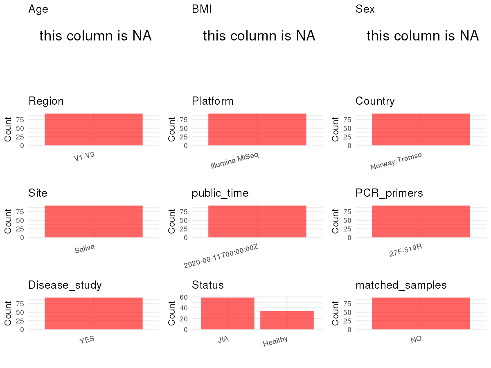

R Notebook: Metadata Processing Workflow
================

# Step 1: Obtain Initial Metadata from Each Project

To obtain the initial metadata: 1. Search for the BioProject ID (e.g.,
“PRJEBXXXX”) on the [NCBI SRA
website](https://www.ncbi.nlm.nih.gov/Traces/study/). 2. In the “Select”
table, click on “Metadata” and download the file. 3. The downloaded file
is typically named “SraRunTable.csv” and contains metadata for the
project.

``` r
# Load necessary libraries
library(dplyr)
library(ggplot2)
library(cowplot)
library(readxl)

# Set working directory (update this path to your local directory)
setwd("/home/dongbiao/word_embedding_microbiome/all_data/oral/global-oral-microbiome/data/projects/PRJNA605805")

# Read the initial metadata files
initial_meta<-read.csv("SraRunTable.csv")

head(initial_meta)
```

    ##           Run Assay.Type AvgSpotLen    Bases  BioProject    BioSample
    ## 1 SRR12429848   AMPLICON        597 22027617 PRJNA605805 SAMN14079783
    ## 2 SRR12429849   AMPLICON        595 21814230 PRJNA605805 SAMN14079782
    ## 3 SRR12429850   AMPLICON        586 40680080 PRJNA605805 SAMN14079781
    ## 4 SRR12429851   AMPLICON        590 38512301 PRJNA605805 SAMN14079700
    ## 5 SRR12429852   AMPLICON        564 50180051 PRJNA605805 SAMN14079780
    ## 6 SRR12429853   AMPLICON        590 48291867 PRJNA605805 SAMN14079779
    ##                BioSampleModel    Bytes       Center.Name Collection_Date
    ## 1 Metagenome or environmental 12278539 TEMPLE UNIVERSITY      2016-06-30
    ## 2 Metagenome or environmental 12268868 TEMPLE UNIVERSITY      2016-06-30
    ## 3 Metagenome or environmental 25517739 TEMPLE UNIVERSITY      2016-06-30
    ## 4 Metagenome or environmental 24183481 TEMPLE UNIVERSITY      2016-06-30
    ## 5 Metagenome or environmental 31056425 TEMPLE UNIVERSITY      2016-06-30
    ## 6 Metagenome or environmental 29879347 TEMPLE UNIVERSITY      2016-06-30
    ##   Consent DATASTORE.filetype DATASTORE.provider
    ## 1  public   fastq,run.zq,sra         gs,ncbi,s3
    ## 2  public   fastq,run.zq,sra         gs,ncbi,s3
    ## 3  public   fastq,run.zq,sra         gs,ncbi,s3
    ## 4  public   fastq,run.zq,sra         gs,ncbi,s3
    ## 5  public   fastq,run.zq,sra         gs,ncbi,s3
    ## 6  public   fastq,run.zq,sra         gs,ncbi,s3
    ##                       DATASTORE.region Experiment geo_loc_name_country
    ## 1 gs.us-east1,ncbi.public,s3.us-east-1 SRX8925762               Norway
    ## 2 gs.us-east1,ncbi.public,s3.us-east-1 SRX8925761               Norway
    ## 3 gs.us-east1,ncbi.public,s3.us-east-1 SRX8925760               Norway
    ## 4 gs.us-east1,ncbi.public,s3.us-east-1 SRX8925759               Norway
    ## 5 gs.us-east1,ncbi.public,s3.us-east-1 SRX8925758               Norway
    ## 6 gs.us-east1,ncbi.public,s3.us-east-1 SRX8925757               Norway
    ##   geo_loc_name_country_continent  geo_loc_name         HOST     Instrument
    ## 1                         Europe Norway:Tromso Homo sapiens Illumina MiSeq
    ## 2                         Europe Norway:Tromso Homo sapiens Illumina MiSeq
    ## 3                         Europe Norway:Tromso Homo sapiens Illumina MiSeq
    ## 4                         Europe Norway:Tromso Homo sapiens Illumina MiSeq
    ## 5                         Europe Norway:Tromso Homo sapiens Illumina MiSeq
    ## 6                         Europe Norway:Tromso Homo sapiens Illumina MiSeq
    ##           lat_lon               Library.Name LibraryLayout LibrarySelection
    ## 1 69.65 N 18.96 E     16S-seq Saliva- JIA 59        PAIRED              PCR
    ## 2 69.65 N 18.96 E     16S-seq Saliva- JIA 58        PAIRED              PCR
    ## 3 69.65 N 18.96 E     16S-seq Saliva- JIA 57        PAIRED              PCR
    ## 4 69.65 N 18.96 E 16S-seq Saliva- Healthy 10        PAIRED              PCR
    ## 5 69.65 N 18.96 E     16S-seq Saliva- JIA 56        PAIRED              PCR
    ## 6 69.65 N 18.96 E     16S-seq Saliva- JIA 55        PAIRED              PCR
    ##   LibrarySource   Organism Platform          ReleaseDate          create_date
    ## 1   METAGENOMIC metagenome ILLUMINA 2020-08-11T00:00:00Z 2020-08-11T12:08:00Z
    ## 2   METAGENOMIC metagenome ILLUMINA 2020-08-11T00:00:00Z 2020-08-11T12:08:00Z
    ## 3   METAGENOMIC metagenome ILLUMINA 2020-08-11T00:00:00Z 2020-08-11T12:08:00Z
    ## 4   METAGENOMIC metagenome ILLUMINA 2020-08-11T00:00:00Z 2020-08-11T12:08:00Z
    ## 5   METAGENOMIC metagenome ILLUMINA 2020-08-11T00:00:00Z 2020-08-11T12:08:00Z
    ## 6   METAGENOMIC metagenome ILLUMINA 2020-08-11T00:00:00Z 2020-08-11T12:08:00Z
    ##   version                  sample_id Sample.Name SRA.Study
    ## 1       1     16S-seq Saliva- JIA 59         N57 SRP277051
    ## 2       1     16S-seq Saliva- JIA 58         N56 SRP277051
    ## 3       1     16S-seq Saliva- JIA 57         N55 SRP277051
    ## 4       1 16S-seq Saliva- Healthy 10         H10 SRP277051
    ## 5       1     16S-seq Saliva- JIA 56         N53 SRP277051
    ## 6       1     16S-seq Saliva- JIA 55         N52 SRP277051

# Step 2: Create a Uniform Metadata Template

The uniform metadata should include the following columns:

1.  **BioProject**: Project ID (e.g., “PRJNA339212”)
2.  **Run**: Sample ID (e.g., “ERRXXXXXX” or “SRRXXXXXX”)
3.  **sample_name**: Original sample name submitted by the authors (not
    the database-assigned ID)
4.  **Age**: Age of the subject (if available)
5.  **BMI**: Body Mass Index (if available)
6.  **Sex**: Sex of the subject (“F” or “M”)
7.  **Region**: Targeted 16S rRNA region (e.g., “V3-V4”)
8.  **Platform**: Sequencing platform (e.g., “Illumina MiSeq”)
9.  **Country**: Country of sample origin (e.g., “China”)
10. **Site**: Sample site (e.g., “saliva”, “dental plaque”)
11. **public_time**: Data release date (format: “YYYY-MM-DD”)
12. **PCR_primers**: PCR primers used (e.g., “515F-806R”)
13. **title**: Title of the associated publication
14. **Disease_study**: Whether the study involves a disease (“YES” or
    “NO”)
15. **Status**: Disease status (e.g., “T2DM”, “HC”). Note: If the study
    includes both disease and healthy samples, this must be specified
    per sample.

``` r
# Create a uniform metadata dataframe
metadata <- data.frame(
  BioProject = initial_meta$BioProject,
  Run = initial_meta$Run,
  sample_name = initial_meta$Sample.Name,
  Age = NA,
  BMI = NA,
  Sex=NA,
  Region = "V1-V3",
  Platform = initial_meta$Instrument,
  Country = initial_meta$geo_loc_name,
  Site = "Saliva",
  public_time = initial_meta$ReleaseDate,
  stringsAsFactors = FALSE
)
metadata<-unique(metadata)
```

# Step 3: Manually Add Information from the Publication

Some information (e.g. PCR primers, study title, disease status) must be
manually extracted from the publication and added to the metadata.

``` r
# Add information obtained from the publication
metadata$PCR_primers <- "27F-519R"
metadata$title <- "Salivary Oral Microbiome of Children With Juvenile Idiopathic Arthritis: A Norwegian Cross-Sectional Study"
metadata$Disease_study <- "YES"

# Assign disease status based on sample_name patterns
metadata$Status <- sapply(strsplit(initial_meta$sample_id, " "), function(x) x[3])
metadata$matched_samples <- "NO"
```

# Step 4: Summarize and Validate the Metadata

``` r
# Check the number of unique runs and sample names
print(paste("Number of unique runs:", length(unique(metadata$Run))))
```

    ## [1] "Number of unique runs: 93"

``` r
print(paste("Number of unique sample names:", length(unique(metadata$sample_name))))
```

    ## [1] "Number of unique sample names: 93"

# Step 5: Visualize the Metadata

``` r

```


# Step 6: Finalize and Export the Metadata

``` r
# Reorder columns to match the desired format
metadata <- metadata[, c(
  "BioProject", "Run", "sample_name", "Age", "BMI", "Sex", 
  "Region", "Platform", "Country", "Site", "public_time", 
  "PCR_primers", "title", "Disease_study", "Status","matched_samples"
)]

# Export the uniform metadata to a CSV file
metadata<-unique(metadata)
write.csv(metadata, file = "metadata.csv", quote = FALSE)
head(metadata)
```

    ##    BioProject         Run sample_name Age BMI Sex Region       Platform
    ## 1 PRJNA605805 SRR12429848         N57  NA  NA  NA  V1-V3 Illumina MiSeq
    ## 2 PRJNA605805 SRR12429849         N56  NA  NA  NA  V1-V3 Illumina MiSeq
    ## 3 PRJNA605805 SRR12429850         N55  NA  NA  NA  V1-V3 Illumina MiSeq
    ## 4 PRJNA605805 SRR12429851         H10  NA  NA  NA  V1-V3 Illumina MiSeq
    ## 5 PRJNA605805 SRR12429852         N53  NA  NA  NA  V1-V3 Illumina MiSeq
    ## 6 PRJNA605805 SRR12429853         N52  NA  NA  NA  V1-V3 Illumina MiSeq
    ##         Country   Site          public_time PCR_primers
    ## 1 Norway:Tromso Saliva 2020-08-11T00:00:00Z    27F-519R
    ## 2 Norway:Tromso Saliva 2020-08-11T00:00:00Z    27F-519R
    ## 3 Norway:Tromso Saliva 2020-08-11T00:00:00Z    27F-519R
    ## 4 Norway:Tromso Saliva 2020-08-11T00:00:00Z    27F-519R
    ## 5 Norway:Tromso Saliva 2020-08-11T00:00:00Z    27F-519R
    ## 6 Norway:Tromso Saliva 2020-08-11T00:00:00Z    27F-519R
    ##                                                                                                        title
    ## 1 Salivary Oral Microbiome of Children With Juvenile Idiopathic Arthritis: A Norwegian Cross-Sectional Study
    ## 2 Salivary Oral Microbiome of Children With Juvenile Idiopathic Arthritis: A Norwegian Cross-Sectional Study
    ## 3 Salivary Oral Microbiome of Children With Juvenile Idiopathic Arthritis: A Norwegian Cross-Sectional Study
    ## 4 Salivary Oral Microbiome of Children With Juvenile Idiopathic Arthritis: A Norwegian Cross-Sectional Study
    ## 5 Salivary Oral Microbiome of Children With Juvenile Idiopathic Arthritis: A Norwegian Cross-Sectional Study
    ## 6 Salivary Oral Microbiome of Children With Juvenile Idiopathic Arthritis: A Norwegian Cross-Sectional Study
    ##   Disease_study  Status matched_samples
    ## 1           YES     JIA              NO
    ## 2           YES     JIA              NO
    ## 3           YES     JIA              NO
    ## 4           YES Healthy              NO
    ## 5           YES     JIA              NO
    ## 6           YES     JIA              NO

## Notes for Students:

1.  **Metadata Accuracy**: Always cross-check the metadata with the
    original publication to ensure accuracy.
2.  **Manual Entries**: Columns like `PCR_primers`, and `Status` often
    require manual entry based on the publication.
3.  **Disease Status**: Be careful when assigning `Status`—some studies
    include both disease and healthy samples.
4.  **Visualization**: The plots help quickly identify the distribution
    of values in each column, which is useful for quality control.
5.  **Reproducibility**: Update the working directory and file paths to
    match your local environment.
