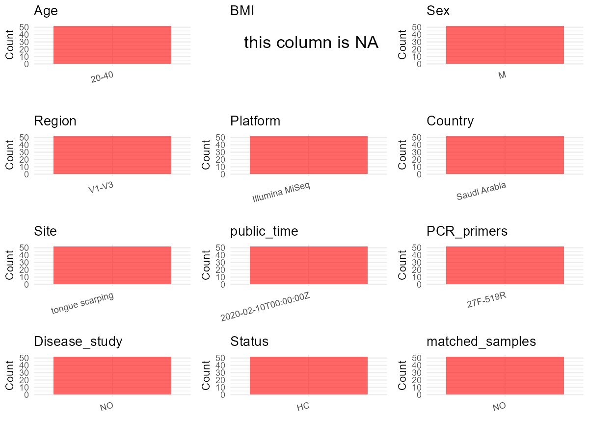

R Notebook: Metadata Processing Workflow
================

# Step 1: Obtain Initial Metadata from Each Project

To obtain the initial metadata: 1. Search for the BioProject ID (e.g.,
“PRJEBXXXX”) on the [NCBI SRA
website](https://www.ncbi.nlm.nih.gov/Traces/study/). 2. In the “Select”
table, click on “Metadata” and download the file. 3. The downloaded file
is typically named “SraRunTable.csv” and contains metadata for the
project.

``` r
# Load necessary libraries
library(dplyr)
library(ggplot2)
library(cowplot)

# Set working directory (update this path to your local directory)
setwd("E:/bioproject_YSD/PRJNA605810")

# Read the initial metadata files
initial_meta <- read.csv("SraRunTable.csv", header = T)

# Display the first few rows of the metadata
head(initial_meta)
```

    ##           Run Assay.Type AvgSpotLen    Bases  BioProject    BioSample
    ## 1 SRR11058093   AMPLICON        592 20932272 PRJNA605810 SAMN14079837
    ## 2 SRR11058094   AMPLICON        585 19979888 PRJNA605810 SAMN14079836
    ## 3 SRR11058095   AMPLICON        581 40351852 PRJNA605810 SAMN14079835
    ## 4 SRR11058096   AMPLICON        588 35975485 PRJNA605810 SAMN14079834
    ## 5 SRR11058097   AMPLICON        583 28394242 PRJNA605810 SAMN14079879
    ## 6 SRR11058098   AMPLICON        590 19190383 PRJNA605810 SAMN14079878
    ##                BioSampleModel    Bytes       Center.Name Collection_Date
    ## 1 Metagenome or environmental 11752833 TEMPLE UNIVERSITY      2019-06-30
    ## 2 Metagenome or environmental 11405869 TEMPLE UNIVERSITY      2019-06-30
    ## 3 Metagenome or environmental 22726382 TEMPLE UNIVERSITY      2019-06-30
    ## 4 Metagenome or environmental 20747005 TEMPLE UNIVERSITY      2019-06-30
    ## 5 Metagenome or environmental 15713149 TEMPLE UNIVERSITY      2019-06-30
    ## 6 Metagenome or environmental 10629594 TEMPLE UNIVERSITY      2019-06-30
    ##   Consent DATASTORE.filetype DATASTORE.provider
    ## 1  public   fastq,run.zq,sra         gs,ncbi,s3
    ## 2  public   fastq,run.zq,sra         gs,ncbi,s3
    ## 3  public   fastq,run.zq,sra         gs,ncbi,s3
    ## 4  public   fastq,run.zq,sra         gs,ncbi,s3
    ## 5  public   fastq,run.zq,sra         gs,ncbi,s3
    ## 6  public   fastq,run.zq,sra         gs,ncbi,s3
    ##                       DATASTORE.region Experiment geo_loc_name_country
    ## 1 gs.us-east1,ncbi.public,s3.us-east-1 SRX7704125         Saudi Arabia
    ## 2 gs.us-east1,ncbi.public,s3.us-east-1 SRX7704124         Saudi Arabia
    ## 3 gs.us-east1,ncbi.public,s3.us-east-1 SRX7704123         Saudi Arabia
    ## 4 gs.us-east1,ncbi.public,s3.us-east-1 SRX7704122         Saudi Arabia
    ## 5 gs.us-east1,ncbi.public,s3.us-east-1 SRX7704121         Saudi Arabia
    ## 6 gs.us-east1,ncbi.public,s3.us-east-1 SRX7704120         Saudi Arabia
    ##   geo_loc_name_country_continent        geo_loc_name         HOST
    ## 1                           Asia Saudi Arabia: Jizan Homo sapiens
    ## 2                           Asia Saudi Arabia: Jizan Homo sapiens
    ## 3                           Asia Saudi Arabia: Jizan Homo sapiens
    ## 4                           Asia Saudi Arabia: Jizan Homo sapiens
    ## 5                           Asia Saudi Arabia: Jizan Homo sapiens
    ## 6                           Asia Saudi Arabia: Jizan Homo sapiens
    ##       Instrument         lat_lon               Library.Name LibraryLayout
    ## 1 Illumina MiSeq 16.89 N 42.57 E 16S-seq shammah non-user10        PAIRED
    ## 2 Illumina MiSeq 16.89 N 42.57 E  16S-seq shammah non-user9        PAIRED
    ## 3 Illumina MiSeq 16.89 N 42.57 E  16S-seq shammah non-user8        PAIRED
    ## 4 Illumina MiSeq 16.89 N 42.57 E  16S-seq shammah non-user7        PAIRED
    ## 5 Illumina MiSeq 16.89 N 42.57 E     16S-seq shammah user29        PAIRED
    ## 6 Illumina MiSeq 16.89 N 42.57 E     16S-seq shammah user28        PAIRED
    ##   LibrarySelection LibrarySource   Organism Platform          ReleaseDate
    ## 1              PCR   METAGENOMIC metagenome ILLUMINA 2020-02-10T00:00:00Z
    ## 2              PCR   METAGENOMIC metagenome ILLUMINA 2020-02-10T00:00:00Z
    ## 3              PCR   METAGENOMIC metagenome ILLUMINA 2020-02-10T00:00:00Z
    ## 4              PCR   METAGENOMIC metagenome ILLUMINA 2020-02-10T00:00:00Z
    ## 5              PCR   METAGENOMIC metagenome ILLUMINA 2020-02-10T00:00:00Z
    ## 6              PCR   METAGENOMIC metagenome ILLUMINA 2020-02-10T00:00:00Z
    ##            create_date version                  sample_id Sample.Name SRA.Study
    ## 1 2020-02-10T14:52:00Z       1 16S-seq shammah non-user10         E10 SRP247998
    ## 2 2020-02-10T14:52:00Z       1  16S-seq shammah non-user9          E9 SRP247998
    ## 3 2020-02-10T14:52:00Z       1  16S-seq shammah non-user8          E8 SRP247998
    ## 4 2020-02-10T14:52:00Z       1  16S-seq shammah non-user7          E7 SRP247998
    ## 5 2020-02-10T14:52:00Z       1     16S-seq shammah user29         E53 SRP247998
    ## 6 2020-02-10T14:52:00Z       1     16S-seq shammah user28         E50 SRP247998

# Step 2: Create a Uniform Metadata Template

The uniform metadata should include the following columns:

1.  **BioProject**: Project ID (e.g., “PRJNA339212”)
2.  **Run**: Sample ID (e.g., “ERRXXXXXX” or “SRRXXXXXX”)
3.  **sample_name**: Original sample name submitted by the authors (not
    the database-assigned ID)
4.  **Age**: Age of the subject (if available)
5.  **BMI**: Body Mass Index (if available)
6.  **Sex**: Sex of the subject (“F” or “M”)
7.  **Region**: Targeted 16S rRNA region (e.g., “V3-V4”)
8.  **Platform**: Sequencing platform (e.g., “Illumina MiSeq”)
9.  **Country**: Country of sample origin (e.g., “China”)
10. **Site**: Sample site (e.g., “saliva”, “dental plaque”)
11. **public_time**: Data release date (format: “YYYY-MM-DD”)
12. **PCR_primers**: PCR primers used (e.g., “515F-806R”)
13. **title**: Title of the associated publication
14. **Disease_study**: Whether the study involves a disease (“YES” or
    “NO”)
15. **Status**: Disease status (e.g., “T2DM”, “HC”). Note: If the study
    includes both disease and healthy samples, this must be specified
    per sample.
16. **matched_samples**: matched samples (“YES” or “NO”)

``` r
# Create a uniform metadata dataframe
metadata <- data.frame(
  BioProject = initial_meta$BioProject,
  Run = initial_meta$Run,
  sample_name = initial_meta$Sample.Name,
  Age = "20-40",
  BMI = NA,  
  Sex = "M",
  Region = "V1-V3",
  Platform = initial_meta$Instrument,
  Country = initial_meta$geo_loc_name_country,
  Site = "tongue scarping",
  public_time = initial_meta$ReleaseDate,
  stringsAsFactors = FALSE
)
```

# Step 3: Manually Add Information from the Publication

Some information (e.g. PCR primers, study title, disease status) must be
manually extracted from the publication and added to the metadata.

``` r
# Add information obtained from the publication
metadata$PCR_primers <- "27F-519R"
metadata$title <- "Tongue microbiome of smokeless tobacco users"
metadata$Disease_study <- "NO"
# Assign disease status based on sample_name patterns
metadata$Status <- "HC"

# Check initial data distribution
cat("Initial sample distribution:\n")
```

    ## Initial sample distribution:

``` r
table(metadata$sample_name)
```

    ## 
    ##  E1 E10 E11 E12 E13 E14 E15 E16 E17 E18 E19  E2 E20 E21 E22 E23 E24 E25 E26 E27 
    ##   1   1   1   1   1   1   1   1   1   1   1   1   1   1   1   1   1   1   1   1 
    ## E28 E29  E3 E30 E31 E32 E33 E34 E36 E37 E38 E39  E4 E40 E41 E42 E43 E44 E45 E46 
    ##   1   1   1   1   1   1   1   1   1   1   1   1   1   1   1   1   1   1   1   1 
    ## E47 E48 E49  E5 E50 E51 E53 E54  E6  E7  E8  E9 
    ##   1   1   1   1   1   1   1   1   1   1   1   1

``` r
table(metadata$Site)
```

    ## 
    ## tongue scarping 
    ##              52

``` r
# Calculate sampling frequency per subject
sample_counts <- table(metadata$sample_name)
cat("\nNumber of samples per subject:\n")
```

    ## 
    ## Number of samples per subject:

``` r
print(sample_counts)
```

    ## 
    ##  E1 E10 E11 E12 E13 E14 E15 E16 E17 E18 E19  E2 E20 E21 E22 E23 E24 E25 E26 E27 
    ##   1   1   1   1   1   1   1   1   1   1   1   1   1   1   1   1   1   1   1   1 
    ## E28 E29  E3 E30 E31 E32 E33 E34 E36 E37 E38 E39  E4 E40 E41 E42 E43 E44 E45 E46 
    ##   1   1   1   1   1   1   1   1   1   1   1   1   1   1   1   1   1   1   1   1 
    ## E47 E48 E49  E5 E50 E51 E53 E54  E6  E7  E8  E9 
    ##   1   1   1   1   1   1   1   1   1   1   1   1

``` r
# Create matched_samples column
metadata$matched_samples <- ifelse(metadata$sample_name %in% names(sample_counts[sample_counts >= 2]), "YES", "NO")

cat("\nMatched samples distribution:\n")
```

    ## 
    ## Matched samples distribution:

``` r
table(metadata$matched_samples)
```

    ## 
    ## NO 
    ## 52

``` r
# Identify samples for removal: single samples excluding tongue scarping
single_samples <- names(sample_counts[sample_counts == 1])
samples_to_remove <- metadata$sample_name %in% single_samples & 
                     !(metadata$Site %in% c("tongue scarping"))

cat("\nNumber of samples to be removed:", sum(samples_to_remove), "\n")
```

    ## 
    ## Number of samples to be removed: 0

``` r
# Remove identified samples
metadata_clean <- metadata[!samples_to_remove, ]

cat("\nFinal sample distribution after cleaning:\n")
```

    ## 
    ## Final sample distribution after cleaning:

``` r
table(metadata_clean$sample_name)
```

    ## 
    ##  E1 E10 E11 E12 E13 E14 E15 E16 E17 E18 E19  E2 E20 E21 E22 E23 E24 E25 E26 E27 
    ##   1   1   1   1   1   1   1   1   1   1   1   1   1   1   1   1   1   1   1   1 
    ## E28 E29  E3 E30 E31 E32 E33 E34 E36 E37 E38 E39  E4 E40 E41 E42 E43 E44 E45 E46 
    ##   1   1   1   1   1   1   1   1   1   1   1   1   1   1   1   1   1   1   1   1 
    ## E47 E48 E49  E5 E50 E51 E53 E54  E6  E7  E8  E9 
    ##   1   1   1   1   1   1   1   1   1   1   1   1

``` r
table(metadata_clean$Site)
```

    ## 
    ## tongue scarping 
    ##              52

``` r
table(metadata_clean$matched_samples)
```

    ## 
    ## NO 
    ## 52

``` r
# Use cleaned dataset for subsequent analysis
metadata <- metadata_clean
```

# Step 4: Summarize and Validate the Metadata

``` r
# Check the number of unique runs and sample names
print(paste("Number of unique runs:", length(unique(metadata$Run))))
```

    ## [1] "Number of unique runs: 52"

``` r
print(paste("Number of unique sample names:", length(unique(metadata$sample_name))))
```

    ## [1] "Number of unique sample names: 52"

# Step 5: Visualize the Metadata

``` r

```


# Step 6: Finalize and Export the Metadata

``` r
# Reorder columns to match the desired format
metadata <- metadata[, c(
  "BioProject", "Run", "sample_name", "Age", "BMI", "Sex", 
  "Region", "Platform", "Country", "Site", "public_time", 
  "PCR_primers", "title", "Disease_study", "Status", "matched_samples"
)]

# Export the uniform metadata to a CSV file
write.csv(metadata, file = "metadata.csv", quote = FALSE)
head(metadata)
```

    ##    BioProject         Run sample_name   Age BMI Sex Region       Platform
    ## 1 PRJNA605810 SRR11058093         E10 20-40  NA   M  V1-V3 Illumina MiSeq
    ## 2 PRJNA605810 SRR11058094          E9 20-40  NA   M  V1-V3 Illumina MiSeq
    ## 3 PRJNA605810 SRR11058095          E8 20-40  NA   M  V1-V3 Illumina MiSeq
    ## 4 PRJNA605810 SRR11058096          E7 20-40  NA   M  V1-V3 Illumina MiSeq
    ## 5 PRJNA605810 SRR11058097         E53 20-40  NA   M  V1-V3 Illumina MiSeq
    ## 6 PRJNA605810 SRR11058098         E50 20-40  NA   M  V1-V3 Illumina MiSeq
    ##        Country            Site          public_time PCR_primers
    ## 1 Saudi Arabia tongue scarping 2020-02-10T00:00:00Z    27F-519R
    ## 2 Saudi Arabia tongue scarping 2020-02-10T00:00:00Z    27F-519R
    ## 3 Saudi Arabia tongue scarping 2020-02-10T00:00:00Z    27F-519R
    ## 4 Saudi Arabia tongue scarping 2020-02-10T00:00:00Z    27F-519R
    ## 5 Saudi Arabia tongue scarping 2020-02-10T00:00:00Z    27F-519R
    ## 6 Saudi Arabia tongue scarping 2020-02-10T00:00:00Z    27F-519R
    ##                                          title Disease_study Status
    ## 1 Tongue microbiome of smokeless tobacco users            NO     HC
    ## 2 Tongue microbiome of smokeless tobacco users            NO     HC
    ## 3 Tongue microbiome of smokeless tobacco users            NO     HC
    ## 4 Tongue microbiome of smokeless tobacco users            NO     HC
    ## 5 Tongue microbiome of smokeless tobacco users            NO     HC
    ## 6 Tongue microbiome of smokeless tobacco users            NO     HC
    ##   matched_samples
    ## 1              NO
    ## 2              NO
    ## 3              NO
    ## 4              NO
    ## 5              NO
    ## 6              NO

## Notes for Students:

1.  **Metadata Accuracy**: Always cross-check the metadata with the
    original publication to ensure accuracy.
2.  **Manual Entries**: Columns like `PCR_primers`, and `Status` often
    require manual entry based on the publication.
3.  **Disease Status**: Be careful when assigning `Status`—some studies
    include both disease and healthy samples.
4.  **Visualization**: The plots help quickly identify the distribution
    of values in each column, which is useful for quality control.
5.  **Reproducibility**: Update the working directory and file paths to
    match your local environment.
