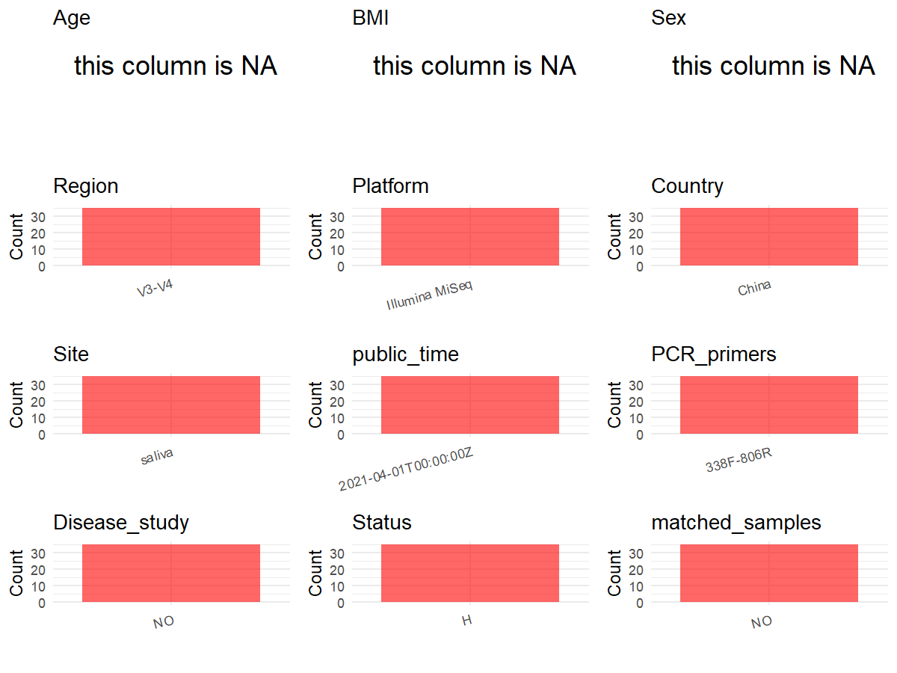

R Notebook: Metadata Processing Workflow
================

# Step 1: Obtain Initial Metadata from Each Project

To obtain the initial metadata: 1. Search for the BioProject ID (e.g.,
“PRJEBXXXX”) on the [NCBI SRA
website](https://www.ncbi.nlm.nih.gov/Traces/study/). 2. In the “Select”
table, click on “Metadata” and download the file. 3. The downloaded file
is typically named “SraRunTable.csv” and contains metadata for the
project.

``` r
# Load necessary libraries
library(dplyr)
library(ggplot2)
library(cowplot)

# Set working directory (update this path to your local directory)
setwd("D:/metadata/3/PRJNA610499")

# Read the initial metadata files
initial_meta<-read.csv("SraRunTable.csv",header = T)

# Combine the two metadata files
#meta <- rbind(initial_meta, initial_meta1)

#Remove entries non-oral samples
#initial_meta <- subset(initial_meta,BioSampleModel != "Metagenome or environmental")

# Check the number of samples containing "HT" in Sample.Name (e.g., healthy controls)
#nrow(subset(meta, grepl("HT", Sample.Name)))

# Display the first few rows of the metadata
head(initial_meta)
```

    ##           Run Assay.Type AvgSpotLen    Bases  BioProject    BioSample
    ## 1 SRR11285121   AMPLICON        602 38921106 PRJNA610499 SAMN14308540
    ## 2 SRR11285122   AMPLICON        602 43729280 PRJNA610499 SAMN14308539
    ## 3 SRR11285124   AMPLICON        602 37385404 PRJNA610499 SAMN14308537
    ## 4 SRR11285125   AMPLICON        602 39853002 PRJNA610499 SAMN14308536
    ## 5 SRR11285126   AMPLICON        602 42435582 PRJNA610499 SAMN14308535
    ## 6 SRR11285127   AMPLICON        602 40544098 PRJNA610499 SAMN14308565
    ##                BioSampleModel    Bytes
    ## 1 Metagenome or environmental 18333085
    ## 2 Metagenome or environmental 20476995
    ## 3 Metagenome or environmental 17848254
    ## 4 Metagenome or environmental 18979097
    ## 5 Metagenome or environmental 19998661
    ## 6 Metagenome or environmental 19427938
    ##                                                                   Center.Name
    ## 1 AFFILIATED HOSPITAL OF STOMATOLOGY,COLLEGE OF MEDICINE, ZHEJIANG UNIVERSITY
    ## 2 AFFILIATED HOSPITAL OF STOMATOLOGY,COLLEGE OF MEDICINE, ZHEJIANG UNIVERSITY
    ## 3 AFFILIATED HOSPITAL OF STOMATOLOGY,COLLEGE OF MEDICINE, ZHEJIANG UNIVERSITY
    ## 4 AFFILIATED HOSPITAL OF STOMATOLOGY,COLLEGE OF MEDICINE, ZHEJIANG UNIVERSITY
    ## 5 AFFILIATED HOSPITAL OF STOMATOLOGY,COLLEGE OF MEDICINE, ZHEJIANG UNIVERSITY
    ## 6 AFFILIATED HOSPITAL OF STOMATOLOGY,COLLEGE OF MEDICINE, ZHEJIANG UNIVERSITY
    ##   Collection_Date Consent DATASTORE.filetype DATASTORE.provider
    ## 1      2015-04-12  public   fastq,run.zq,sra         gs,ncbi,s3
    ## 2      2015-04-12  public   fastq,run.zq,sra         gs,ncbi,s3
    ## 3      2015-04-12  public   fastq,run.zq,sra         gs,ncbi,s3
    ## 4      2015-04-12  public   fastq,run.zq,sra         gs,ncbi,s3
    ## 5      2015-04-12  public   fastq,run.zq,sra         gs,ncbi,s3
    ## 6      2015-04-18  public   fastq,run.zq,sra         gs,ncbi,s3
    ##                       DATASTORE.region Experiment geo_loc_name_country
    ## 1 gs.us-east1,ncbi.public,s3.us-east-1 SRX7890864                China
    ## 2 gs.us-east1,ncbi.public,s3.us-east-1 SRX7890863                China
    ## 3 gs.us-east1,ncbi.public,s3.us-east-1 SRX7890861                China
    ## 4 gs.us-east1,ncbi.public,s3.us-east-1 SRX7890860                China
    ## 5 gs.us-east1,ncbi.public,s3.us-east-1 SRX7890859                China
    ## 6 gs.us-east1,ncbi.public,s3.us-east-1 SRX7890858                China
    ##   geo_loc_name_country_continent   geo_loc_name         HOST     Instrument
    ## 1                           Asia China:Zhejiang Homo sapiens Illumina MiSeq
    ## 2                           Asia China:Zhejiang Homo sapiens Illumina MiSeq
    ## 3                           Asia China:Zhejiang Homo sapiens Illumina MiSeq
    ## 4                           Asia China:Zhejiang Homo sapiens Illumina MiSeq
    ## 5                           Asia China:Zhejiang Homo sapiens Illumina MiSeq
    ## 6                           Asia China:Zhejiang Homo sapiens Illumina MiSeq
    ##   isolation_source           lat_lon Library.Name LibraryLayout
    ## 1    saliva sample  30.23 N 119.81 E         AF15        PAIRED
    ## 2    saliva sample  30.23 N 119.80 E         AF11        PAIRED
    ## 3    saliva sample  30.23 N 119.78 E         AF09        PAIRED
    ## 4    saliva sample  30.23 N 119.77 E         AF08        PAIRED
    ## 5    saliva sample  30.23 N 119.76 E         AF07        PAIRED
    ## 6    saliva sample 30.23 N 119.106 E         ak38        PAIRED
    ##   LibrarySelection LibrarySource              Organism Platform
    ## 1              PCR       GENOMIC human oral metagenome ILLUMINA
    ## 2              PCR       GENOMIC human oral metagenome ILLUMINA
    ## 3              PCR       GENOMIC human oral metagenome ILLUMINA
    ## 4              PCR       GENOMIC human oral metagenome ILLUMINA
    ## 5              PCR       GENOMIC human oral metagenome ILLUMINA
    ## 6              PCR       GENOMIC human oral metagenome ILLUMINA
    ##            ReleaseDate          create_date version Sample.Name SRA.Study
    ## 1 2021-04-01T00:00:00Z 2020-03-10T20:58:00Z       1        af15 SRP252283
    ## 2 2021-04-01T00:00:00Z 2020-03-10T20:58:00Z       1        af11 SRP252283
    ## 3 2021-04-01T00:00:00Z 2020-03-10T20:58:00Z       1        af09 SRP252283
    ## 4 2021-04-01T00:00:00Z 2020-03-10T20:58:00Z       1        af08 SRP252283
    ## 5 2021-04-01T00:00:00Z 2020-03-10T20:58:00Z       1        af07 SRP252283
    ## 6 2021-04-01T00:00:00Z 2020-03-10T20:58:00Z       1        ak38 SRP252283

# Step 2: Create a Uniform Metadata Template

The uniform metadata should include the following columns:

1.  **BioProject**: Project ID (e.g., “PRJNA339212”)
2.  **Run**: Sample ID (e.g., “ERRXXXXXX” or “SRRXXXXXX”)
3.  **sample_name**: Original sample name submitted by the authors (not
    the database-assigned ID)
4.  **Age**: Age of the subject (if available)
5.  **BMI**: Body Mass Index (if available)
6.  **Sex**: Sex of the subject (“F” or “M”)
7.  **Region**: Targeted 16S rRNA region (e.g., “V3-V4”)
8.  **Platform**: Sequencing platform (e.g., “Illumina MiSeq”)
9.  **Country**: Country of sample origin (e.g., “China”)
10. **Site**: Sample site (e.g., “saliva”, “dental plaque”)
11. **public_time**: Data release date (format: “YYYY-MM-DD”)
12. **PCR_primers**: PCR primers used (e.g., “515F-806R”)
13. **title**: Title of the associated publication
14. **Disease_study**: Whether the study involves a disease (“YES” or
    “NO”)
15. **Status**: Disease status (e.g., “T2DM”, “HC”). Note: If the study
    includes both disease and healthy samples, this must be specified
    per sample.
16. **matched_samples**: matched samples (“YES” or “NO”)

``` r
# Create a uniform metadata dataframe
metadata <- data.frame(
  BioProject = initial_meta$BioProject,
  Run = initial_meta$Run,
  sample_name = initial_meta$Sample.Name,
  Age = NA,
  BMI = NA,
  Sex=NA,
  Region = "V3-V4",
  Platform = initial_meta$Instrument,
  Country = initial_meta$geo_loc_name_country,
  Site = "saliva",
  public_time = initial_meta$ReleaseDate,
  Status      = "H",
  stringsAsFactors = FALSE
)
```

# Step 3: Manually Add Information from the Publication

Some information (e.g. PCR primers, study title, disease status) must be
manually extracted from the publication and added to the metadata.

``` r
# Add information obtained from the publication
metadata$PCR_primers <- "338F-806R"
metadata$title <- "High-throughput sequencing identifies salivary microbiota in Chinese caries-free preschool children with primary dentition"
metadata$Disease_study <- "NO"
# Assign disease status based on sample_name patterns


metadata$matched_samples <- "NO"
```

# Step 4: Summarize and Validate the Metadata

``` r
# Check the number of unique runs and sample names
print(paste("Number of unique runs:", length(unique(metadata$Run))))
```

    ## [1] "Number of unique runs: 35"

``` r
print(paste("Number of unique sample names:", length(unique(metadata$sample_name))))
```

    ## [1] "Number of unique sample names: 35"

# Step 5: Visualize the Metadata

``` r

```

<!-- -->

# Step 6: Finalize and Export the Metadata

``` r
# Reorder columns to match the desired format
metadata <- metadata[, c(
  "BioProject", "Run", "sample_name", "Age", "BMI", "Sex", 
  "Region", "Platform", "Country", "Site", "public_time", 
  "PCR_primers", "title", "Disease_study", "Status","matched_samples"
)]

# Export the uniform metadata to a CSV file
write.csv(metadata, file = "metadata.csv", quote = TRUE)
head(metadata)
```

    ##    BioProject         Run sample_name Age BMI Sex Region       Platform Country
    ## 1 PRJNA610499 SRR11285121        af15  NA  NA  NA  V3-V4 Illumina MiSeq   China
    ## 2 PRJNA610499 SRR11285122        af11  NA  NA  NA  V3-V4 Illumina MiSeq   China
    ## 3 PRJNA610499 SRR11285124        af09  NA  NA  NA  V3-V4 Illumina MiSeq   China
    ## 4 PRJNA610499 SRR11285125        af08  NA  NA  NA  V3-V4 Illumina MiSeq   China
    ## 5 PRJNA610499 SRR11285126        af07  NA  NA  NA  V3-V4 Illumina MiSeq   China
    ## 6 PRJNA610499 SRR11285127        ak38  NA  NA  NA  V3-V4 Illumina MiSeq   China
    ##     Site          public_time PCR_primers
    ## 1 saliva 2021-04-01T00:00:00Z   338F-806R
    ## 2 saliva 2021-04-01T00:00:00Z   338F-806R
    ## 3 saliva 2021-04-01T00:00:00Z   338F-806R
    ## 4 saliva 2021-04-01T00:00:00Z   338F-806R
    ## 5 saliva 2021-04-01T00:00:00Z   338F-806R
    ## 6 saliva 2021-04-01T00:00:00Z   338F-806R
    ##                                                                                                                        title
    ## 1 High-throughput sequencing identifies salivary microbiota in Chinese caries-free preschool children with primary dentition
    ## 2 High-throughput sequencing identifies salivary microbiota in Chinese caries-free preschool children with primary dentition
    ## 3 High-throughput sequencing identifies salivary microbiota in Chinese caries-free preschool children with primary dentition
    ## 4 High-throughput sequencing identifies salivary microbiota in Chinese caries-free preschool children with primary dentition
    ## 5 High-throughput sequencing identifies salivary microbiota in Chinese caries-free preschool children with primary dentition
    ## 6 High-throughput sequencing identifies salivary microbiota in Chinese caries-free preschool children with primary dentition
    ##   Disease_study Status matched_samples
    ## 1            NO      H              NO
    ## 2            NO      H              NO
    ## 3            NO      H              NO
    ## 4            NO      H              NO
    ## 5            NO      H              NO
    ## 6            NO      H              NO

## Notes for Students:

1.  **Metadata Accuracy**: Always cross-check the metadata with the
    original publication to ensure accuracy.
2.  **Manual Entries**: Columns like `PCR_primers`, and `Status` often
    require manual entry based on the publication.
3.  **Disease Status**: Be careful when assigning `Status`—some studies
    include both disease and healthy samples.
4.  **Visualization**: The plots help quickly identify the distribution
    of values in each column, which is useful for quality control.
5.  **Reproducibility**: Update the working directory and file paths to
    match your local environment.
