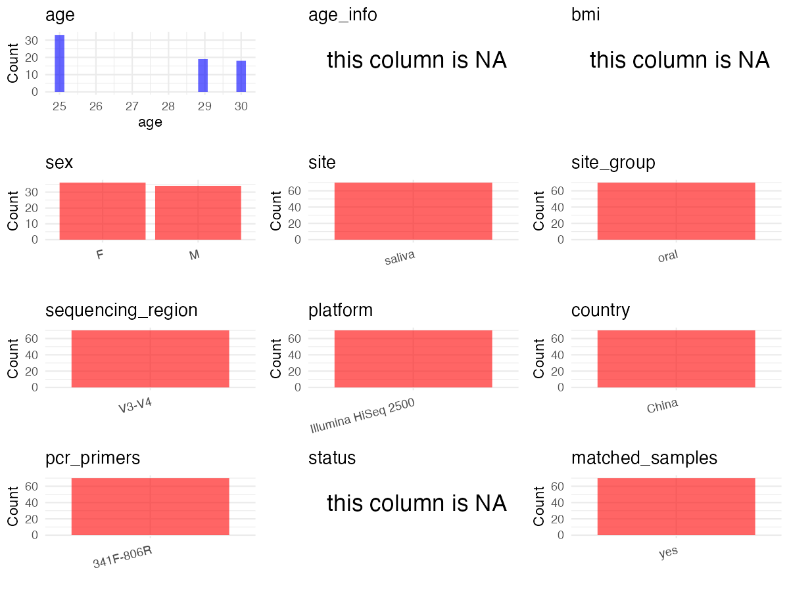

R Notebook: Metadata Processing Workflow
================

# Step 1: Obtain Initial Metadata from Each Project

This step sets the project directory, loads the raw SRA metadata, and
optionally merges supplement tables.

``` r
# =============================================================
# Curation Notes - PRJNA611700
# subject_id      : substr(Sample.Name, 1, 2) — SA/SB/SC/SD prefix identifies each subject
# age             : AGE column all "missing" in metadata; from paper Methods: A=25, B=30, C=25, D=29
# sex             : metadata sex column is all "intersex" (incorrect); from paper Materials and
#                   Methods: subjects A and B are male, C and D are female; derived via subject_id
# sequencing_region: Paper Methods — V3-V4 region of 16S rRNA gene
# platform        : Paper Methods — Illumina HiSeq 2500 (2x250 paired ends); confirmed by Instrument col
# country         : Paper — China (Beihang University, Beijing, China)
# site            : isolate column — all "saliva"
# pcr_primers     : Paper Methods — 341F (5'-CCTAYGGGRBGCASCAG-3') and 806R (5'-GGACTACNNGGGTATCTAAT-3')
# disease_study   : "no" — healthy crewmembers, no disease history (paper Materials and Methods)
# is_time_series  : "yes" — same 4 crewmembers repeatedly sampled at 19+ chronologically ordered
#                   timepoints to track temporal dynamics of salivary microbiota
# status          : NA — all healthy subjects
# controls        : none found in metadata or paper
# non-human       : none — all Homo sapiens
# =============================================================

# Load libraries
library(dplyr)
library(ggplot2)
library(cowplot)

# (1) Setting working directory
# EDIT HERE: change project_id for each study
project_id <- "PRJNA611700"

base_dir <- "/Users/dongbiao/Documents/软件开发/oral/metadata_collect"
setwd(file.path(base_dir, project_id))

# (2) Loading raw SRA metadata file
sra_file <- "SraRunTable.csv"
initial_meta <- read.csv(sra_file, header = TRUE)

# (3) No supplemental tables needed for this study
```

# Step 2: Data Overview

First, you need to get an overview of the data, which includes two
steps: reading the article and reading the initial metadata. This step
is very IMPORTANT!

``` r
# (1) Read the article in the following order: abstract, the beginning of the results section, and the methods. Understand the sample size, experimental design, and disease group overview. Clarify the sampling sites; for oral and gut samples, specify the exact sites like supragingival plaque, tongue, etc.

# (2) IMPORTANT: MUST go through each column of initial_meta
# head(initial_meta, 10)

# IMPORTANT: Check the unique values in the column of interest or query column.
# lapply(initial_meta[c('isolate', 'tissue')], table)        # site: isolate = "saliva" for all
# table(initial_meta$Organism)                               # organism: all "Homo sapiens"
# table(initial_meta$sex)                                    # sex: all "intersex" (incorrect per paper)
# table(initial_meta$Sample.Name)                            # subject id: SA01-19, SB01-19, SC01-19, SD01-19
# table(initial_meta$Instrument)                             # Illumina HiSeq 2500 — matches paper Methods
# table(initial_meta$AGE)                                    # all "missing"
```

# Step 3: Removing Control and Non-human Samples

First, we need to remove control samples(including both negative
controls and positive controls) and non-human samples.

``` r
# (1) EDIT HERE: Parameter setup
control_column <- ""   # column name in initial_meta; no controls present in this study
# unique(initial_meta[[control_column]])
control_keywords <- c()     # no control samples

species_column <- "Organism"          # column name in initial_meta
unique(initial_meta[[species_column]])
```

    ## [1] "Homo sapiens"

``` r
non_human_keywords <- c()            # all samples are Homo sapiens; no non-human filtering needed


# (2) Remove controls and non-human samples. DO NOT need to modify code in this part, just run it.
n_samples <- nrow(initial_meta)
# Control evaluation
if (length(control_keywords) > 0) {
  if (is.null(control_column) || control_column == "") {
    stop("Error: control_keywords provided but control_column is missing.")
  }

  if (!(control_column %in% colnames(initial_meta))) {
    stop(sprintf("Error: Column '%s' not found in initial_meta.", control_column))
  }

  control_pattern <- paste(control_keywords, collapse = "|")
  control_text <- initial_meta[[control_column]]
  is_control <- grepl(control_pattern, control_text)

} else {
  is_control <- rep(FALSE, n_samples)
}

# Non-human evaluation
if (length(non_human_keywords) > 0) {
  if (is.null(species_column) || species_column == "") {
    stop("Error: non_human_keywords provided but species_column is missing.")
  }

  if (!(species_column %in% colnames(initial_meta))) {
    stop(sprintf("Error: Column '%s' not found in initial_meta.", species_column))
  }

  non_human_pattern <- paste(non_human_keywords, collapse = "|")
  species_text <- initial_meta[[species_column]]
  is_non_human <- grepl(non_human_pattern, species_text)
} else {
  is_non_human <- rep(FALSE, n_samples)
}

# Execute removal
samples_to_remove <- is_control | is_non_human
initial_meta <- initial_meta[!samples_to_remove, ]

cat("Initial samples counts:",n_samples,"\n")
```

    ## Initial samples counts: 70

``` r
cat("Removed control samples:", sum(is_control), "\n")
```

    ## Removed control samples: 0

``` r
cat("Removed non-human samples:", sum(is_non_human), "\n")
```

    ## Removed non-human samples: 0

``` r
cat("Total samples removed ", sum(samples_to_remove), "\n")
```

    ## Total samples removed  0

``` r
cat("Remaining samples after Step 2:", nrow(initial_meta), "\n")
```

    ## Remaining samples after Step 2: 70

# Step 4: Creating a Uniform Metadata Template

This step converts the raw SRA table into the standard metadata format
used in our meta-analysis. The uniform metadata should include the
following columns: 1. **bioproject**: Project ID from SRA or other
database e.g. `PRJNA1234`, `CNP1234`, ‘OEP1234’, ‘qiita_1234’ 2.
**sample_id**: SRA sample/run ID. Unique id for each sample!
e.g. `DRR1234567`, `ERR1234567` and `SRR1234567`. If no such column
exists, can use column like sample_name. 3. **subject_id**: subject id
for each person if available. e.g. `patient_01`, `Host_03_before`,
`subject12` 4. **age**: Age of the subject if available. e.g. `35`, `42`
\| not `adult`, `chilren` 5. **age_info**: If the age is not explicitly
stated but approximate age range information is available, mark it in
this column. e.g., `18-55`, `children`, `infant`, `elder` 6. **bmi**:
Body Mass Index if available. e.g. `22.5`, `18.9` \| not `normal`,
`overweight` 7. **sex**: Sex of the subject. Mandatory to write as M/F
\| not `female`, `woman` 8. **sequencing_region**: Targeted 16S rRNA
region. e.g. `V3-V4`, `V4` 9. **platform**: Sequencing platform.
e.g. `Illumina MiSeq`, `454 GS FLX Titanium`, `Ion Torrent` 10.
**country**: Country of sample origin. e.g. `China`, `Japan` \| not city
name like `Beijing` 11. **site**: Sampling site. For oral and gut sites,
specify the exact sites as detailed as possible. For example, if it is
known to be supragingival plaque, do not record it as ‘dental plaque’,
unless the original text provides only a vague description.
e.g. `saliva`, `tongue coating` \| not broad term like `oral` 12.
**site_group**: only accepts one of following three values: ‘oral’,
‘gut’, or ‘other’. 13. **public_time**: Data release date.
e.g. `2021-06-22` \| not `June 2021` 14. **pcr_primers**: PCR primers
used. e.g. `515F-806R`, `27F-338R` \| not primer sequences 15.
**title**: Title of the associated publication. 16. **disease_study**:
Whether the study involves disease samples. If it’s not clear, can
record as NA. Only three values accepted: ‘yes’, ‘no’ or NA 17.
**status**: Disease status for each sample if available, else record as
NA. Only accept following abbreviations, Write full names for all other
diseases. HC: healthy control CD: Crohn’s disease CRC: colorectal cancer
COPD: chronic obstructive pulmonary disease HIV: human immunodeficiency
virus ICU: intensive care unit OSCC: oral squamous cell carcinoma RA:
rheumatoid arthritis UC: ulcerative colitis 18. **matched_samples**:
Whether the subject has matched samples. Only accept ‘yes’ or ‘no’. 19.
**is_time_series**: Whether the study is a time series study. Only
accept ‘yes’ or ‘no’.

``` r
# Extract columns from initial_meta as follows: (1) No modification needed -> extract directly. (2) Modification needed -> create a new column with the prefix raw_ and mark the original column as "pending". (3) Need to find or determine based on the article.
metadata <- data.frame(
  bioproject = initial_meta$BioProject,
  sample_id = initial_meta$Run,
  # SA/SB/SC/SD prefix from Sample.Name identifies each crewmember (Subject A-D)
  subject_id = substr(initial_meta$Sample.Name, 1, 2),
  age = NA,  # AGE column is all "missing" in metadata; filled from paper in Step 5
  age_info = NA,
  bmi = NA,
  sex = "pending",  # metadata sex column is all "intersex" (incorrect); derived from subject_id in Step 5
  sequencing_region = "V3-V4",  # From paper Methods: "V3 to V4 region of the bacterial 16S rRNA gene"
  platform = "Illumina HiSeq 2500",  # From paper Methods: "Illumina HiSeq 2500 platform (2x250 paired ends)"
  country = "China",  # From paper: Beihang University, Beijing, China
  site = initial_meta$isolate,  # isolate column = "saliva" for all samples
  site_group = "pending",
  public_time = initial_meta$ReleaseDate,
  pcr_primers = "341F-806R",  # From paper Methods: 341F (5'-CCTAYGGGRBGCASCAG-3') and 806R (5'-GGACTACNNGGGTATCTAAT-3')
  title = "Effects of Long-Term Enclosed Environment on Human Health Based on the Analysis of Salivary Microbiota and Cytokines",  # From paper
  disease_study = "no",  # Healthy crewmembers with no disease history (paper Materials and Methods)
  status = NA,
  matched_samples = "pending",
  is_time_series = "yes",  # Same 4 crewmembers sampled at 19+ chronologically ordered timepoints to track temporal dynamics (paper Results and Fig. 6c)
  stringsAsFactors = FALSE
)
metadata$public_time <- as.Date(metadata$public_time)
```

# Step 5: Manually solving pending issues

This step involves two parts: (1) handle the columns with the `raw_`
prefix, and next (2) handle the `site_group` and `matched_samples`
columns.

``` r
# (1) Handle sex and age derived from subject_id.
# Sex: metadata sex column is all "intersex" which is incorrect.
# Per paper Materials and Methods: subjects A and B are male (SA/SB), C and D are female (SC/SD).
# Age: AGE column is all "missing". Per paper Materials and Methods:
# Subject A = 25 years old, Subject B = 30 years old, Subject C = 25 years old, Subject D = 29 years old.
metadata <- metadata %>%
  mutate(
    sex = case_when(
      subject_id %in% c("SA", "SB") ~ "M",  # Subject A (25M) and Subject B (30M) per paper
      subject_id %in% c("SC", "SD") ~ "F",  # Subject C (25F) and Subject D (29F) per paper
      TRUE ~ NA_character_
    ),
    age = case_when(
      subject_id == "SA" ~ 25,  # Subject A, 25 years old per paper Materials and Methods
      subject_id == "SB" ~ 30,  # Subject B, 30 years old per paper Materials and Methods
      subject_id == "SC" ~ 25,  # Subject C, 25 years old per paper Materials and Methods
      subject_id == "SD" ~ 29,  # Subject D, 29 years old per paper Materials and Methods
      TRUE ~ NA_real_
    )
  )
```

``` r
# (2) Filling the 'site_group' and 'matched_samples' columns
# editing site_group
unique(metadata$site)
```

    ## [1] "saliva"

``` r
# EDIT HERE: add oral sites
Oral_site = c("saliva")
# EDIT HERE: add gut sites
Gut_site = c()
# just run
metadata <- metadata %>%
  mutate(site_group = case_when(
    site %in% Oral_site ~ "oral",
    site %in% Gut_site ~ "gut",
    TRUE ~ "other"
  ))

# editing matched_samples, just run.
metadata$matched_samples <- ifelse(
  ave(metadata$subject_id, metadata$subject_id, FUN = length) > 1,
  "yes",
  "no"
)
```

``` r
# (3) check if there is pending value in metadata. If there is pending value, go on modify the metadata.
# Function to check if a column contains "pending"
has_pending <- function(col) {
  if (is.character(col) || is.factor(col)) {
    any(col == "pending", na.rm = TRUE)
  } else {
    FALSE
  }
}

# Check for any pending value
any_pending_value <- any(sapply(metadata, has_pending))

if (!any_pending_value) {
  message("Good! No cell contains the value 'pending'.")
} else {
  pending_cols <- names(metadata)[sapply(metadata, has_pending)]
  message("Columns containing 'pending': ", paste(pending_cols, collapse = ", "))
  message("Please continue to resolve these pending columns!")
}
```

    ## Good! No cell contains the value 'pending'.

# Step 6: Visualize the Metadata

This step makes a quick set of plots for checking the distribution of
key metadata fields.

``` r
# Select columns for visualization, just run
plot_data <- metadata %>%
  select(-bioproject, -sample_id, -subject_id, -title)

create_simple_plots <- function(data) {
  plots <- list()
  continuous_vars <- c("age", "bmi")

  for (col in colnames(data)) {
    if (all(is.na(data[[col]]))) {
      p <- ggplot() +
        annotate("text", x = 0.5, y = 0.5, label = "this column is NA", size = 6) +
        labs(title = col) +
        theme_void()
    } else if (col %in% continuous_vars && is.numeric(data[[col]])) {
      p <- ggplot(data, aes(x = .data[[col]])) +
        geom_histogram(fill = "blue", alpha = 0.6, bins = 20, na.rm = TRUE) +
        labs(title = col, x = col, y = "Count") +
        theme_minimal()
    } else {
      count_data <- as.data.frame(table(data[[col]], useNA = "ifany"))
      p <- ggplot(count_data, aes(x = reorder(Var1, -Freq), y = Freq)) +
        geom_col(fill = "red", alpha = 0.6) +
        labs(title = col, x = NULL, y = "Count") +
        theme_minimal() +
        theme(axis.text.x = element_text(angle = 15, hjust = 1))
    }
    plots[[col]] <- p
  }

  return(plots)
}

# Generate and arrange plots
plots <- create_simple_plots(plot_data)
p <- plot_grid(plots$age,
               plots$age_info,
               plots$bmi,
               plots$sex,
               plots$site,
               plots$site_group,
               plots$sequencing_region,
               plots$platform,
               plots$country,
               plots$pcr_primers,
               plots$status,
               plots$matched_samples,
               ncol = 3, align = "hv", axis = "lb")
ggsave("Metadata_Summary.png", plot = p, width = 8, height = 6, dpi = 150)
```

``` r
# Insert Metadata_Summary.png into the current Rmd output

```


# Step 7: Sort and export the metadata

This step saves the cleaned metadata table as the final `metadata.csv`
file.

``` r
# Reorder the data frame
fixed_cols <- c("bioproject", "sample_id", "subject_id", "age", "age_info",
                "bmi", "sex", "platform", "sequencing_region", "pcr_primers",
                "country", "site", "site_group", "disease_study", "status",
                "title", "public_time", "matched_samples", "is_time_series")
metadata <- metadata %>%
  select(all_of(fixed_cols), everything())

# save metadata
# head(metadata)
write.csv(metadata, file = "metadata_v2.csv", quote = TRUE)
```
