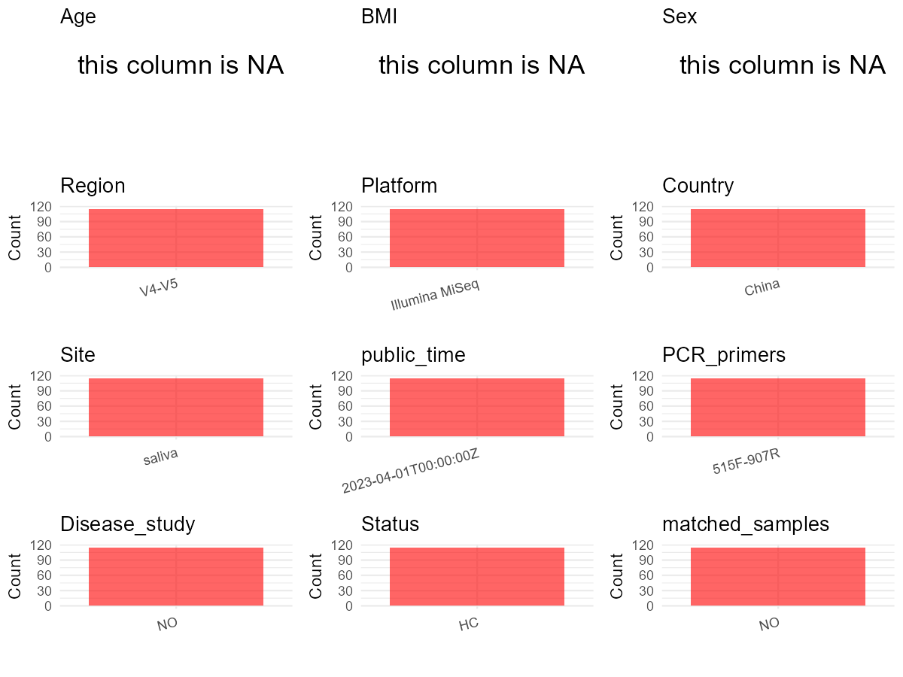

# Step 1: Obtain Initial Metadata from Each Project

To obtain the initial metadata: 1. Search for the BioProject ID (e.g.,
“PRJEBXXXX”) on the [NCBI SRA
website](https://www.ncbi.nlm.nih.gov/Traces/study/). 2. In the “Select”
table, click on “Metadata” and download the file. 3. The downloaded file
is typically named “SraRunTable.csv” and contains metadata for the
project.

    library(tidyverse)
    library(ggplot2)
    library(cowplot)

    setwd("C:/Users/zyc/Desktop/oral_project/PRJNA613363")
    initial_meta <- read.csv("SraRunTable.csv", header = TRUE) 
    head(initial_meta)

    ##           Run Assay.Type AvgSpotLen    Bases  BioProject    BioSample              BioSampleModel    Bytes
    ## 1 SRR11348548   AMPLICON        602 31756102 PRJNA613363 SAMN14402255 Metagenome or environmental 18392910
    ## 2 SRR11348549   AMPLICON        602 43746738 PRJNA613363 SAMN14402258 Metagenome or environmental 25075665
    ## 3 SRR11348550   AMPLICON        602 32004126 PRJNA613363 SAMN14402205 Metagenome or environmental 16825762
    ## 4 SRR11348551   AMPLICON        602 32707864 PRJNA613363 SAMN14402257 Metagenome or environmental 19049986
    ## 5 SRR11348552   AMPLICON        602 30655044 PRJNA613363 SAMN14402204 Metagenome or environmental 16355855
    ## 6 SRR11348553   AMPLICON        602 29573852 PRJNA613363 SAMN14402177 Metagenome or environmental 15753848
    ##                                              Center.Name Collection_Date Consent DATASTORE.filetype
    ## 1 WEST CHINA HOSPITAL OF STOMATOLOGY, SICHUAN UNIVERSITY      2019-05-10  public   fastq,run.zq,sra
    ## 2 WEST CHINA HOSPITAL OF STOMATOLOGY, SICHUAN UNIVERSITY      2019-05-10  public   fastq,run.zq,sra
    ## 3 WEST CHINA HOSPITAL OF STOMATOLOGY, SICHUAN UNIVERSITY      2019-05-10  public   fastq,run.zq,sra
    ## 4 WEST CHINA HOSPITAL OF STOMATOLOGY, SICHUAN UNIVERSITY      2019-05-10  public   fastq,run.zq,sra
    ## 5 WEST CHINA HOSPITAL OF STOMATOLOGY, SICHUAN UNIVERSITY      2019-05-10  public   fastq,run.zq,sra
    ## 6 WEST CHINA HOSPITAL OF STOMATOLOGY, SICHUAN UNIVERSITY      2019-05-10  public   fastq,run.zq,sra
    ##   DATASTORE.provider                     DATASTORE.region Experiment geo_loc_name_country
    ## 1         gs,ncbi,s3 gs.us-east1,ncbi.public,s3.us-east-1 SRX7950576         uncalculated
    ## 2         gs,ncbi,s3 gs.us-east1,ncbi.public,s3.us-east-1 SRX7950575         uncalculated
    ## 3         gs,ncbi,s3 gs.us-east1,ncbi.public,s3.us-east-1 SRX7950574         uncalculated
    ## 4         gs,ncbi,s3 gs.us-east1,ncbi.public,s3.us-east-1 SRX7950533         uncalculated
    ## 5         gs,ncbi,s3 gs.us-east1,ncbi.public,s3.us-east-1 SRX7950573         uncalculated
    ## 6         gs,ncbi,s3 gs.us-east1,ncbi.public,s3.us-east-1 SRX7950572         uncalculated
    ##   geo_loc_name_country_continent geo_loc_name         host     Instrument isolation_source lat_lon Library.Name
    ## 1                   uncalculated      missing Homo sapiens Illumina MiSeq           saliva missing         TH25
    ## 2                   uncalculated      missing Homo sapiens Illumina MiSeq           saliva missing         TH28
    ## 3                   uncalculated      missing Homo sapiens Illumina MiSeq           saliva missing         CT02
    ## 4                   uncalculated      missing Homo sapiens Illumina MiSeq           saliva missing         TH27
    ## 5                   uncalculated      missing Homo sapiens Illumina MiSeq           saliva missing         CT01
    ## 6                   uncalculated      missing Homo sapiens Illumina MiSeq           saliva missing         CH04
    ##   LibraryLayout LibrarySelection LibrarySource              Organism Platform          ReleaseDate
    ## 1        PAIRED              PCR         OTHER human oral metagenome ILLUMINA 2023-04-01T00:00:00Z
    ## 2        PAIRED              PCR         OTHER human oral metagenome ILLUMINA 2023-04-01T00:00:00Z
    ## 3        PAIRED              PCR         OTHER human oral metagenome ILLUMINA 2023-04-01T00:00:00Z
    ## 4        PAIRED              PCR         OTHER human oral metagenome ILLUMINA 2023-04-01T00:00:00Z
    ## 5        PAIRED              PCR         OTHER human oral metagenome ILLUMINA 2023-04-01T00:00:00Z
    ## 6        PAIRED              PCR         OTHER human oral metagenome ILLUMINA 2023-04-01T00:00:00Z
    ##            create_date version Sample.Name SRA.Study tmp
    ## 1 2020-03-19T02:58:00Z       1        TH25 SRP253289  82
    ## 2 2020-03-19T02:57:00Z       1        TH28 SRP253289  85
    ## 3 2020-03-19T02:57:00Z       1        CT02 SRP253289  32
    ## 4 2020-03-19T02:57:00Z       1        TH27 SRP253289  84
    ## 5 2020-03-19T02:57:00Z       1        CT01 SRP253289  31
    ## 6 2020-03-19T02:57:00Z       1        CH04 SRP253289   4

# Step 2: Create a Uniform Metadata Template

The uniform metadata should include the following columns:

1.  **BioProject**: Project ID (e.g., “PRJNA339212”)
2.  **Run**: Sample ID (e.g., “ERRXXXXXX” or “SRRXXXXXX”)
3.  **sample\_name**: Original sample name submitted by the authors (not
    the database-assigned ID)
4.  **Age**: Age of the subject (if available)
5.  **BMI**: Body Mass Index (if available)
6.  **Sex**: Sex of the subject (“F” or “M”)
7.  **Region**: Targeted 16S rRNA region (e.g., “V3-V4”)
8.  **Platform**: Sequencing platform (e.g., “Illumina MiSeq”)
9.  **Country**: Country of sample origin (e.g., “China”)
10. **Site**: Sample site (e.g., “saliva”, “dental plaque”)
11. **public\_time**: Data release date (format: “YYYY-MM-DD”)
12. **PCR\_primers**: PCR primers used (e.g., “515F-806R”)
13. **title**: Title of the associated publication
14. **Disease\_study**: Whether the study involves a disease (“YES” or
    “NO”)
15. **Status**: Disease status (e.g., “T2DM”, “HC”). Note: If the study
    includes both disease and healthy samples, this must be specified
    per sample.
16. **matched\_samples**: matched samples (“YES” or “NO”)

<!-- -->

    metadata <- data.frame(
      BioProject = initial_meta$BioProject,
      Run = initial_meta$Run,
      sample_name = initial_meta$Sample.Name,
      Age = NA, 
      BMI = NA,  
      Sex = NA,
      Platform = initial_meta$Instrument,
      # Country = initial_meta$geo_loc_name_country,
      # Status = initial_meta$Host_disease,
      Site = initial_meta$isolation_source,
      public_time = initial_meta$ReleaseDate,
      stringsAsFactors = FALSE
    )

# Step 3: Manually Add Information from the Publication

Some information (e.g. PCR primers, study title, disease status) must be
manually extracted from the publication and added to the metadata.

     # metadata <- metadata %>%
     #  mutate(Sex = recode(Sex, "female" = "F", "male" = "M"))
     # metadata <- metadata %>%mutate(Age = Age/12)

    metadata$Country = "China"
    metadata$Status = "HC"
    metadata$matched_samples = "NO"
    metadata$Region = "V4-V5"
    metadata$title <- "Comparative analysis of oral microbiome from Zang and Han populations living at different altitudes"
    metadata$Disease_study <- "NO"
    metadata$PCR_primers <- "515F-907R"
    head(metadata)

    ##    BioProject         Run sample_name Age BMI Sex       Platform   Site          public_time Country Status
    ## 1 PRJNA613363 SRR11348548        TH25  NA  NA  NA Illumina MiSeq saliva 2023-04-01T00:00:00Z   China     HC
    ## 2 PRJNA613363 SRR11348549        TH28  NA  NA  NA Illumina MiSeq saliva 2023-04-01T00:00:00Z   China     HC
    ## 3 PRJNA613363 SRR11348550        CT02  NA  NA  NA Illumina MiSeq saliva 2023-04-01T00:00:00Z   China     HC
    ## 4 PRJNA613363 SRR11348551        TH27  NA  NA  NA Illumina MiSeq saliva 2023-04-01T00:00:00Z   China     HC
    ## 5 PRJNA613363 SRR11348552        CT01  NA  NA  NA Illumina MiSeq saliva 2023-04-01T00:00:00Z   China     HC
    ## 6 PRJNA613363 SRR11348553        CH04  NA  NA  NA Illumina MiSeq saliva 2023-04-01T00:00:00Z   China     HC
    ##   matched_samples Region
    ## 1              NO  V4-V5
    ## 2              NO  V4-V5
    ## 3              NO  V4-V5
    ## 4              NO  V4-V5
    ## 5              NO  V4-V5
    ## 6              NO  V4-V5
    ##                                                                                                 title Disease_study
    ## 1 Comparative analysis of oral microbiome from Zang and Han populations living at different altitudes            NO
    ## 2 Comparative analysis of oral microbiome from Zang and Han populations living at different altitudes            NO
    ## 3 Comparative analysis of oral microbiome from Zang and Han populations living at different altitudes            NO
    ## 4 Comparative analysis of oral microbiome from Zang and Han populations living at different altitudes            NO
    ## 5 Comparative analysis of oral microbiome from Zang and Han populations living at different altitudes            NO
    ## 6 Comparative analysis of oral microbiome from Zang and Han populations living at different altitudes            NO
    ##   PCR_primers
    ## 1   515F-907R
    ## 2   515F-907R
    ## 3   515F-907R
    ## 4   515F-907R
    ## 5   515F-907R
    ## 6   515F-907R

# Step 4: Summarize and Validate the Metadata

    print(paste("Number of unique runs:", length(unique(metadata$Run))))

    ## [1] "Number of unique runs: 115"

    print(paste("Number of unique sample names:", length(unique(metadata$sample_name))))

    ## [1] "Number of unique sample names: 115"

# Step 5: Visualize the Metadata

    plot_data <- metadata %>%
      select(-BioProject, -Run, -sample_name, -title)

    # Function to create simple plots for each column
    create_simple_plots <- function(data) {
      plots <- list()
      
      for (col in colnames(data)) {
        # Check if the column is all NA
        if (all(is.na(data[[col]]))) {
          # Create an empty plot with text indicating all NA
          p <- ggplot() +
            annotate("text", x = 0.5, y = 0.5, label = "this column is NA", size = 6) +
            labs(title = col) +
            theme_void()
        } else if (is.numeric(data[[col]])) {
          # Numeric variable: histogram
          p <- ggplot(data, aes(x = .data[[col]])) +
            geom_histogram(fill = "blue", alpha = 0.6, bins = 20, na.rm = T) +
            labs(title = col) +
            theme_minimal()
        } else {
          # Categorical variable: bar plot (remove NA values)
          count_data <- as.data.frame(table(data[[col]], useNA = "ifany"))
          p <- ggplot(count_data, aes(x = reorder(Var1, -Freq), y = Freq)) +
            geom_col(fill = "red", alpha = 0.6) +
            labs(title = col, x = NULL, y = "Count") +
            theme_minimal() +
            theme(axis.text.x = element_text(angle = 15, hjust = 1))
        }
        plots[[col]] <- p
      }
      
      return(plots)
    }

    plots <- create_simple_plots(plot_data)
    p<-plot_grid(plots$Age, 
              plots$BMI, 
              plots$Sex, 
              plots$Region, 
              plots$Platform, 
              plots$Country, 
              plots$Site,
              plots$public_time, 
              plots$PCR_primers,
              plots$Disease_study,
              plots$Status,
              plots$matched_samples,# add 
              ncol = 3, align = "hv", axis = "lb")
    ggsave("Metadata_Summary.png", plot = p, width = 8, height = 6, dpi = 150)

    

 \# Step 6: Finalize and Export the Metadata

    metadata <- metadata[, c(
      "BioProject", "Run", "sample_name", "Age", "BMI", "Sex", 
      "Region", "Platform", "Country", "Site", "public_time", 
      "PCR_primers", "title", "Disease_study", "Status","matched_samples"
    )]

    write.csv(metadata, file = "metadata.csv", quote = FALSE)
